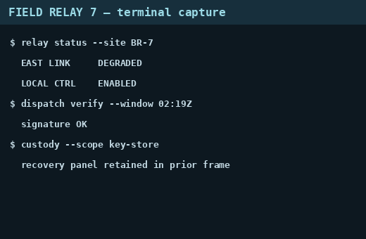

[🇬🇧 English](README.md) · 🇫🇷 Français

# Afterimage

| Catégorie | Points | Résolutions | Résolu | First blood | Résolu par | Auteur du challenge |
|---|---|---|---|---|---|---|
| forensics | 345 | 105 | ✅ | — | 0xAr3s-root | Chronos Security |

## Énoncé

> A duty operator screenshotted their terminal, cropped the bottom off to remove something sensitive, and posted the result to a shared channel. The picture looks fine. The file is the problem.
>
> The crop changed what you see, not what the file still carries. Recover what was cropped away and read the station recovery key.
>
> Flag format: `CSCTF{message}`

**Fichiers fournis :** `files/relay-capture.png` (non commité ; l'image rognée est aussi dans [`img/cropped.png`](img/cropped.png)).

## En bref

Le PNG rogné a été écrit par-dessus l'original plus long sans troncature : 11 911 octets de l'ancien flux IDAT restent après `IEND` (un « aCropalypse ») ; reconstruire ce flux, trouver une frontière de bloc deflate par force brute et amorcer la fenêtre avec l'image visible redonne les 200 dernières lignes, qui montrent la clé de récupération.

## Démarche

**1. Reconnaissance — un PNG 520×340 avec des données après IEND**

`file` annonce un PNG RGB 520×340 de 26 174 octets — gros pour une capture de terminal plate. En parcourant les chunks à la main : 14 chunks `IDAT` (1 024 octets chacun sauf le dernier, 738), `IEND` à l'offset 14 251, puis **11 911 octets en trop**. L'image visible est une capture de terminal (« FIELD RELAY 7 — terminal capture ») qui finit par `custody --scope key-store` / `recovery panel retained in prior frame` : ce qui a été rogné, c'est le panneau de récupération.



Les données en trop contiennent des en-têtes de chunk `IDAT` tous les 1 036 octets (1 024 + 12 d'encadrement) et un second `IEND` à la toute fin : c'est la fin du PNG original, dont les 14 263 premiers octets ont été écrasés par le nouveau fichier, plus court. Les premiers octets en trop sont la fin d'un ancien chunk IDAT coupé au milieu (270 octets de données, puis son CRC).

**2. Hypothèse — l'ancien flux zlib se décode depuis une frontière de bloc ultérieure**

L'ancien flux deflate est coupé : son début (et les tables de Huffman du bloc à cheval sur le point d'écrasement) a disparu, on ne peut donc pas l'inflater depuis le début. Mais les blocs deflate sont indépendants hormis la fenêtre de références arrière de 32 Kio, donc :

- reconstruire le flux de fin = données restantes du chunk coupé + données de chaque chunk `IDAT` complet (en retirant les 12 octets d'encadrement de chacun) ;
- essayer chaque position de départ, à chaque décalage de bit 0–7, comme bloc deflate brut (`zlib.decompressobj(-15)`), la plupart échouent aussitôt ;
- amorcer la fenêtre (`zdict`) avec les 32 derniers Kio des scanlines décompressées de l'image *visible* : l'ancienne image est la même capture avec des lignes en plus en bas, donc les références arrière qui pointent vers les lignes visibles se résolvent correctement.

**3. Exploitation — un seul départ décode jusqu'à une fin de flux propre**

Exactement un départ (octet 3 123 du flux reconstruit, sans décalage de bit) décode jusqu'à un bloc final (`eof`) et donne **312 200 octets = 200 × 1 561** (1 octet de filtre + 520 × 3 pixels par scanline) : exactement 200 scanlines, une forte confirmation. Ce sont les 200 dernières lignes de l'image originale ; la première ligne peut être imparfaite car sa ligne précédente est inconnue, et les filtres sont défaits avec une ligne nulle au-dessus. Les afficher montre un panneau « RELAY RECOVERY KEY — ROTATE AFTER USE » contenant le flag (agrandi pour le lire caractère par caractère).

```bash
pip install pillow
python3 -I solve/solve.py files/relay-capture.png recovered.png
```

Script de résolution : [`solve/solve.py`](solve/solve.py)

## Flag

`CSCTF{...}` (masqué)

## Réflexions

- Rogner sans tronquer le fichier laisse les anciens octets derrière : une taille de fichier grande pour son contenu est le premier indice (même bug que l'« aCropalypse » de 2023 sur les éditeurs Pixel/Windows).
- Les blocs deflate peuvent être resynchronisés : forcer le départ de bloc (octet × décalage de bit) et valider avec `eof` plus un nombre entier de scanlines est peu coûteux et sans ambiguïté.
- Utiliser l'image visible comme dictionnaire compte : cela permet au bloc récupéré de référencer des lignes qui n'ont pas été perdues.
- La clé a été lue à l'œil sur un rendu agrandi ; les 24 chiffres hexa se confondent facilement (`1`/`l`, `0`/`o`), donc revérifier si la plateforme la refuse.

## Outils & références

- Python 3 (`struct`, `zlib`), Pillow
- Structure des chunks et filtres PNG, structure des blocs zlib/deflate, aCropalypse (CVE-2023-21036)

---
[⬅ Retour à l'événement](../../README.fr.md)
