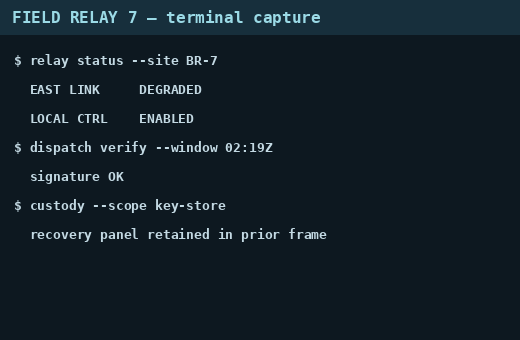

🇬🇧 English · [🇫🇷 Français](README.fr.md)

# Afterimage

| Category | Points | Solves | Solved | First blood | Solved by | Challenge author |
|---|---|---|---|---|---|---|
| forensics | 345 | 105 | ✅ | — | 0xAr3s-root | Chronos Security |

## Challenge description

> A duty operator screenshotted their terminal, cropped the bottom off to remove something sensitive, and posted the result to a shared channel. The picture looks fine. The file is the problem.
>
> The crop changed what you see, not what the file still carries. Recover what was cropped away and read the station recovery key.
>
> Flag format: `CSCTF{message}`

**Artifact files:** `files/relay-capture.png` (not committed; the cropped image is also in [`img/cropped.png`](img/cropped.png)).

## TL;DR

The cropped PNG was written over the longer original without truncating: 11,911 bytes of the old IDAT stream remain after `IEND` (an "aCropalypse"); rebuilding that stream, finding a deflate block boundary by brute force and seeding the window with the visible image gives back the last 200 rows, which show the recovery key.

## Approach

**1. Recon — a 520×340 PNG with data after IEND**

`file` says a 520×340 RGB PNG, 26,174 bytes — large for a flat terminal capture. Walking the chunks by hand: 14 `IDAT` chunks (1,024 bytes each except the last, 738), `IEND` at offset 14,251, then **11,911 trailing bytes**. The visible image is a terminal capture ("FIELD RELAY 7 — terminal capture") that ends with `custody --scope key-store` / `recovery panel retained in prior frame`: what was cropped is the recovery panel.



The trailing data contains `IDAT` chunk headers every 1,036 bytes (1,024 + 12 of framing) and a second `IEND` at the very end: it is the tail of the original PNG, whose first 14,263 bytes were overwritten by the new, shorter file. The first trailing bytes are the end of an old IDAT chunk cut in the middle (270 bytes of data, then its CRC).

**2. Hypothesis — the old zlib stream can be decoded from a later block boundary**

The old deflate stream is cut: its start (and the Huffman tables of the block that straddles the overwrite point) is gone, so it cannot be inflated from the beginning. But deflate blocks are independent apart from the 32 KiB back-reference window, so:

- rebuild the tail stream = leftover data of the cut chunk + the data of every complete trailing `IDAT` chunk (dropping the 12 bytes of chunk framing each);
- try every starting position, at every bit shift 0–7, as a raw deflate block (`zlib.decompressobj(-15)`), most fail immediately;
- seed the window (`zdict`) with the last 32 KiB of the *visible* image's decompressed scanlines: the old image is the same screenshot plus extra rows at the bottom, so back-references that reach into the visible rows resolve correctly.

**3. Exploitation — one start decodes to a clean end of stream**

Exactly one start (byte 3,123 of the rebuilt stream, no bit shift) decodes to a final block (`eof`), and yields **312,200 bytes = 200 × 1,561** (1 filter byte + 520 × 3 pixels per scanline): exactly 200 scanlines, a strong confirmation. These are the last 200 rows of the original image; the first row may be imperfect since its previous row is unknown, and filters are undone with an all-zero row above it. Rendering them shows a "RELAY RECOVERY KEY — ROTATE AFTER USE" panel containing the flag (zoomed in to read it character by character).

```bash
pip install pillow
python3 -I solve/solve.py files/relay-capture.png recovered.png
```

Solve script: [`solve/solve.py`](solve/solve.py)

## Flag

`CSCTF{...}` (redacted)

## Reflections

- Cropping without truncating the file leaves the old bytes behind: a file size that is large for its content is the first clue (the same bug as the 2023 "aCropalypse" on Pixel/Windows editors).
- Deflate blocks can be resynchronised: brute-forcing the block start (byte × bit shift) and validating with `eof` plus a whole number of scanlines is cheap and unambiguous.
- Using the visible image as the dictionary matters: it lets the recovered block reference rows that were not lost.
- The key was read by eye from an enlarged render; the 24 hex digits are easy to confuse (`1`/`l`, `0`/`o`), so re-check if the platform rejects it.

## Tools & references

- Python 3 (`struct`, `zlib`), Pillow
- PNG chunk structure and filters, zlib/deflate block structure, aCropalypse (CVE-2023-21036)

---
[⬅ Back to event](../../README.md)
