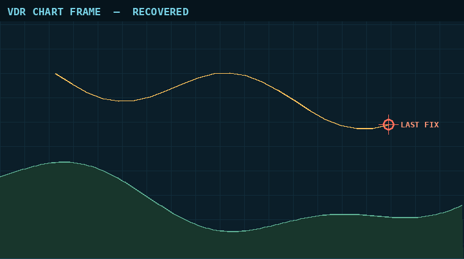

[🇬🇧 English](README.md) · 🇫🇷 Français

# Flotsam

| Catégorie | Points | Résolutions | Résolu | First blood | Résolu par | Auteur du challenge |
|---|---|---|---|---|---|---|
| forensics | 120 | 100 | ✅ | — | 0xAr3s-root | Chronos Security |

## Énoncé

> The voyage data recorder from MV Ortelia was lifted from the wreck site. The capsule survived, the controller didn't, so the flash was read chip-off: a raw byte-level dump with no filesystem metadata. With the allocation tables gone, files have to be carved out by hand.
>
> The bridge wrote a chart frame showing the vessel's last fix, a PNG sitting somewhere in that dump. Recover it and read the recovery key printed on it. A file that opens is not the same as a file that is whole.
>
> Flag format: `CSCTF{message}`

**Fichiers fournis :** `files/recorder-sectors.img` (35 840 octets, non commité).

## En bref

Le PNG est fragmenté : sa première partie se décode en une carte qui « s'ouvre » mais dont le bas (où est imprimée la clé) manque ; les secteurs IDAT restants sont avant lui dans le dump, et les remettre dans l'ordre des adresses fait correspondre le CRC de l'IDAT et révèle la clé → flag.

## Démarche

**1. Reconnaissance — 70 secteurs, un JPEG, un PNG et du texte NMEA**

L'image fait 35 840 octets = 70 secteurs de 512 o. `binwalk` signale un JPEG en 0x2C00 et un PNG (760×520) en 0x6800, sans `IEND` après. En cherchant les marqueurs à la main, `IEND` est à l'offset 24215, *avant* l'en-tête PNG : la fin du PNG est dans des données antérieures, donc le fichier est fragmenté. J'ai fait une carte par secteur (premiers octets + nombre d'octets nuls) :

- secteurs 0–2 et 48–51 : texte ASCII NMEA (`$GPRMC,…`), journal sans rapport ;
- secteurs 3–20 : données à forte entropie, puis secteur 21 entièrement nul ;
- secteurs 22–33 : le JPEG (`FFD8` … `FFD9` à 17110), complet, puis des zéros ;
- secteurs 35–41, 44–47 : encore des données à forte entropie, finissant par le chunk `IEND` dans le secteur 47, séparées par des secteurs nuls ;
- secteur 52 : `\x89PNG`, IHDR 760×520, un seul chunk `IDAT` de 22 630 octets — mais seuls 9 175 octets (secteurs 52–67) sont contigus avant les secteurs nuls 68–69.

**2. Hypothèse — l'IDAT continue dans les secteurs orphelins, dans l'ordre des adresses**

Les chiffres collent exactement : l'IDAT demande 22 630 − 8 151 (la partie des secteurs 52–67) = 14 479 octets = 28 secteurs pleins + 143 octets. Les secteurs orphelins non nuls (3–20, 35–41, 44–46 = 28 secteurs) plus 143 octets au début du secteur 47, suivis du CRC de 4 octets et du chunk `IEND` de 12 octets, ferment le fichier exactement à l'offset 159 du secteur 47. Le JPEG et les secteurs NMEA sont des leurres.

Décompresser seulement le premier fragment avec `zlib` donne une image qui s'ouvre et semble correcte : la carte avec le marqueur « LAST FIX », mais la bande du bas est noire. C'est l'avertissement « s'ouvre ≠ entier » de l'énoncé : le flux deflate est coupé et le visualiseur affiche ce qu'il a.



(L'image ci-dessus est le haut de la trame reconstruite ; la ligne de la clé en dessous est volontairement rognée.)

**3. Exploitation — réassembler dans l'ordre et valider avec le CRC**

J'ai d'abord tenté une recherche gloutonne (ajouter les secteurs qui gardent le flux deflate valide et les octets de filtre PNG entre 0 et 4), mais trop de mauvais secteurs s'inflatent aussi « validement » : impasse. Plus simple et exact : concaténer le premier fragment, les secteurs orphelins dans l'ordre des adresses, puis le début du secteur `IEND`, et vérifier le CRC32 de l'IDAT — il correspond du premier coup, et `zlib` finit proprement avec exactement 520 × 2281 octets.

```bash
python3 -I solve/solve.py files/recorder-sectors.img recovered.png
```

Ouvrir `recovered.png` montre la carte complète avec une ligne **RECOVERY KEY (transcribe exactly)** en bas : c'est le flag.

Script de résolution : [`solve/solve.py`](solve/solve.py)

## Flag

`CSCTF{...}` (masqué)

## Réflexions

- Un PNG qui s'affiche n'est pas un PNG entier : vérifier les CRC des chunks et que le flux deflate se termine (`eof`) avec exactement `hauteur × (1 + largeur × 3)` octets.
- Compter les octets vaut mieux que deviner : la longueur de l'IDAT dans l'en-tête disait exactement combien de secteurs manquaient et où le fichier finissait.
- L'ordre des fragments n'est pas toujours séquentiel en général, mais ici l'ordre des adresses convenait ; le CRC est l'oracle qui valide n'importe quel ordre.
- J'ai lu la clé sur l'image à l'œil : revérifier les caractères comme `0/O` et `1/l` si une soumission est refusée.

## Outils & références

- `binwalk`, `file`, Python 3 (`zlib`, `struct`), Pillow pour rendre la sortie partielle
- Structure des chunks PNG (IHDR/IDAT/IEND, CRC32), file carving de fichiers fragmentés

---
[⬅ Retour à l'événement](../../README.fr.md)
