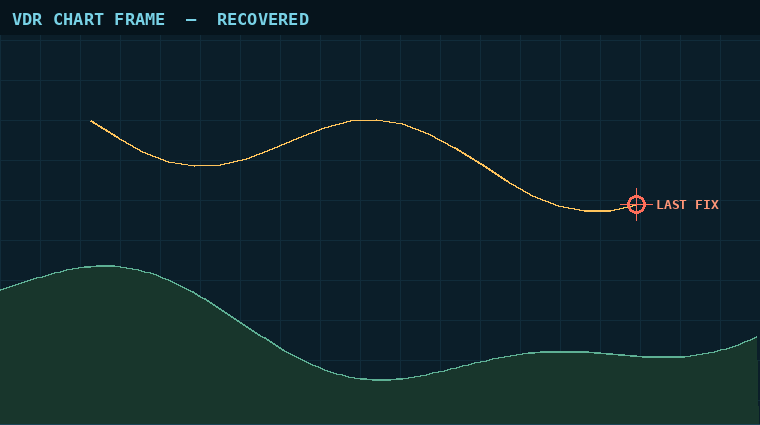

🇬🇧 English · [🇫🇷 Français](README.fr.md)

# Flotsam

| Category | Solves | Solved | First blood | Hint used | Solved by | Challenge author |
|---|---|---|---|---|---|---|
| forensics | 100 | ✅ | — | no | 0xAr3s-root | Chronos Security |

## Challenge description

> The voyage data recorder from MV Ortelia was lifted from the wreck site. The capsule survived, the controller didn't, so the flash was read chip-off: a raw byte-level dump with no filesystem metadata. With the allocation tables gone, files have to be carved out by hand.
>
> The bridge wrote a chart frame showing the vessel's last fix, a PNG sitting somewhere in that dump. Recover it and read the recovery key printed on it. A file that opens is not the same as a file that is whole.
>
> Flag format: `CSCTF{message}`

**Artifact files:** `files/recorder-sectors.img` (35,840 bytes, not committed).

## TL;DR

The PNG is fragmented: its first part decodes to a chart that "opens" but the bottom (where the key is printed) is missing; the remaining IDAT sectors lie before it in the dump, and putting them back in address order makes the IDAT CRC match and reveals the key → flag.

## Approach

**1. Recon — 70 sectors, a JPEG, a PNG and NMEA text**

The image is 35,840 bytes = 70 sectors of 512 B. `binwalk` reports a JPEG at 0x2C00 and a PNG (760×520) at 0x6800, with no `IEND` after it. Searching the markers by hand shows `IEND` at offset 24215, *before* the PNG header: the PNG's end is in earlier data, so the file is fragmented. I dumped a per-sector map (first bytes + number of zero bytes):

- sectors 0–2 and 48–51: ASCII NMEA (`$GPRMC,…`), unrelated log records;
- sectors 3–20: high-entropy data, then an all-zero sector 21;
- sectors 22–33: the JPEG (`FFD8` … `FFD9` at 17110), complete, then zeros;
- sectors 35–41, 44–47: more high-entropy data, ending with the `IEND` chunk in sector 47, separated by all-zero sectors;
- sector 52: `\x89PNG`, IHDR 760×520, one `IDAT` chunk of 22,630 bytes — but only 9,175 bytes (sectors 52–67) are contiguous before zero sectors 68–69.

**2. Hypothesis — the IDAT continues in the orphan sectors, in address order**

The numbers fit exactly: the IDAT needs 22,630 − 8,151 (the part in sectors 52–67) = 14,479 bytes = 28 full sectors + 143 bytes. The orphan non-zero sectors (3–20, 35–41, 44–46 = 28 sectors) plus 143 bytes at the start of sector 47, followed by the 4-byte CRC and the 12-byte `IEND` chunk, close the file exactly at offset 159 of sector 47. The JPEG and NMEA sectors are decoys.

Decompressing only the first fragment with `zlib` gives a picture that opens and looks fine: the chart with the "LAST FIX" marker, but the strip at the bottom is black (see below). That is the "opens ≠ whole" warning of the statement: the deflate stream is cut and the viewer renders what it has.



(The image above is the top of the reconstructed frame; the key line below it is cropped out on purpose.)

**3. Exploitation — reassemble in order and validate with the CRC**

I first tried a greedy search (appending sectors that keep the deflate stream valid and the PNG filter bytes in 0–4), but too many wrong sectors also inflate "validly", so it was a dead end. Simpler and exact: concatenate the first fragment, the orphan sectors in address order, then the start of the `IEND` sector, and check the IDAT CRC32 — it matches on the first try, and `zlib` ends cleanly with exactly 520 × 2281 bytes.

```bash
python3 -I solve/solve.py files/recorder-sectors.img recovered.png
```

Opening `recovered.png` shows the full chart with a **RECOVERY KEY (transcribe exactly)** line at the bottom: that is the flag.

Solve script: [`solve/solve.py`](solve/solve.py)

## Flag

`CSCTF{...}` (redacted)

## Reflections

- A PNG that renders is not a PNG that is whole: check chunk CRCs and that the deflate stream ends (`eof`) with exactly `height × (1 + width × 3)` bytes.
- Counting bytes beats guessing: the IDAT length in the header told exactly how many sectors were missing and where the file ended.
- Fragment order is not always sequential in general, but here address order matched; the CRC is the oracle that validates any ordering.
- I only read the key off the image by eye (OCR-by-eye): re-check characters like `0/O` and `1/l` if a submission is rejected.

## Tools & references

- `binwalk`, `file`, Python 3 (`zlib`, `struct`), Pillow to render partial output
- PNG chunk structure (IHDR/IDAT/IEND, CRC32), file carving of fragmented files

---
[⬅ Back to event](../../README.md)
